# SPDX-FileCopyrightText: 2026 hardenedlinux Linux Team and Contributors
#
# SPDX-License-Identifier: LGPL-2.1-or-later AND Apache-2.0

#+TITLE: Weaver
#+SUBTITLE: A Policy-Governed AI Agent Gateway
#+LANGUAGE: en
#+OPTIONS: toc:2

Weaver connects agents, tools and LLM providers through a shared governance and
execution boundary. Cedar Policy constrains routing, dispatch and stream release;
original task claims, shared budgets and history remain bound across retries,
revocation and recovery.

* Architecture

#+CAPTION: Weaver connects governed configuration and cloud-native routing to Rust-owned final execution.

| Component | Responsibility |
|-----------+----------------|
| Scheme | Reuse upstream Governor for eligible steps and Governance for Profile assessment; compose typed modules and project policies/source-assets into Cedar |
| Go | Accept JSON/YAML data or a Rust-compiled Scheme artifact, coordinate authenticated authority publication, and provide routing and protocol integration |
| Rust | Own atomic MRR Data/Turso state, evaluate current Cedar Policy, reserve budgets, consume execution authority, and control final provider dispatch and stream release |
| Telemetry | Collect fixed local counters in both services; expose authenticated operational snapshots without execution or settlement authority |

Go and Rust communicate through mutually authenticated gRPC. Protobuf is the
default stream encoding; Arrow IPC is optional. Rust hosts the approved Gerbil
runtime; typed Scheme objects cross the Gambit C ABI through =gerbil-scheme-rust=.
Go neither evaluates Scheme nor owns VM objects. Configuration validation does
not grant execution rights.

Local telemetry is enabled with the service owners. =InspectTelemetry= reads
process-local counters through existing authenticated gRPC; Rust additionally
requires the current source role. It records no prompts, response text,
credentials or identity labels. Counter reset on restart cannot reset claims or
unknown budget. Autonomous external export and OTLP are not enabled. See the
[[file:docs/50-59-research-program/59-provider-rpc/59.24-telemetry-service.org][telemetry service contract]] for the implemented boundary and export requirements.

** Zero Trust security architecture

Weaver imports =CedarPooSpec.Gateway.ZeroTrust= from =cedar-poo-spec=.
The upstream framework defines the security contract; Weaver connects it to
authenticated source publication, durable consumption and final Rust mediation.
The checked composition retains explicit host obligations for authentication,
currentness, atomic storage and actual transport. See the
[[file:docs/50-59-research-program/59-provider-rpc/59.86-release-zero-trust-integration.org][implementation and validation boundary]].
Zero Trust grants no implicit authority from network location,
service ownership or an authenticated connection. Each concrete effect needs
current, explicitly bound authorization. See [[https://csrc.nist.gov/pubs/sp/800/207/final][NIST SP 800-207]].

The SPEC distinguishes a pure =Proposal= from =FinalUse=. A publication-indexed
receipt binds the original profile, actual effect, state, context, schema and
Cedar decision. =consumeAdmission= computes updated operation and authority
ledgers; computing that result performs no external send. At first use,
=FinalUse= additionally requires the same complete deciding view, authenticated
identity, current facts, authoritative original/selected profile publication,
committed consumption, retained unknown exposure, no revocation and complete
mediation of the effect. Weaver must enforce these premises at actual use.

#+CAPTION: Runtime responsibilities realize the imported SPEC contract: original scope, actual admission, durable consumption, final-use enforcement and continuing use.

| Runtime boundary | Required interpretation of the imported contract |
|------------------+--------------------------------------------------|
| Scheme Governance and Go publication | Propose source-bound profiles and Policy; Rust validates authoritative publication and retains original and independently required parent constraints |
| Rust Cedar admission | Validate the actual request and entities against the schema, current source/Policy and accepted profile checks; require an error-free Allow |
| Rust authority ledger | Atomically install both returned ledgers with the original reservation; retain original operation identity across renewed grants |
| Rust final broker | Enforce =FinalUse= against the actual deciding view and serialize the final effect with current authority/fencing |
| Rust ongoing execution and recovery | Use =continuing= with current assessment and a =CommittedPrefix= witness; preserve original consumption instead of consuming the root again |

For streaming, =continuing= intentionally does not require the old admission
pre-state to remain equal forever. It retains the original scope, authoritative
profile and installed consumption prefix while reassessing the actual effect
against current facts. A new grant cannot repeat an already consumed operation.
Recovery does not authorize a new effect. =UsageControl.step= additionally
requires phase-specific authorization, conditions, witnessed obligations and
state mutation; closure requires both terminal and accounted state.

A late confirmation, equal-looking restored snapshot or copied receipt cannot
supply currentness or durability. Uncertain writes retain their original hold;
settlement needs attributable evidence. Revocation blocks new governed
admissions at its ordering point, while already admitted bytes may still drain.
These are Host obligations: the pure SPEC does not implement storage, identity,
shared-budget arithmetic or transport fencing, and a Lean proof is not a send
handle. The [[file:docs/50-59-research-program/59-provider-rpc/59.51-zero-trust-architecture.org][security design]] records the concrete realization and its limits.

For provider response streams, Rust closes affected execution lanes before
authority changes and retains unresolved OAuth witness outcomes. Queued frames
are inert. The final gRPC receiver joins an acknowledged range commit with the
current owner and authority cut, then advances the original stream cursor once.
Exact range bookkeeping preserves prior permission; Policy and domain changes
still invalidate it. Revocation blocks an old queued frame; restart cannot turn
an unknown send into
another invocation or a refund. See the
[[file:docs/10-19-llm-gateway/10-routing-and-inference/10.08-send-window-promotion.org][writer mediation and final delivery design]].

** Gateway request and routine architecture

A routine defines the work: typed steps, tools, artifacts and original
obligations. Routing selects a concrete model, provider, tool or delegated agent
that can satisfy a step. The Gateway keeps both under the same Policy and
execution boundary, rather than treating inference as an unconstrained proxy.

#+CAPTION: Protocol ingress, semantic routines, cloud-native routing, Rust execution and stream receipts form the Gateway request path.

| Component | Design responsibility |
|-----------+-----------------------|
| Protocol ingress | Normalize LLM APIs, MCP, A2A and Client ACP into canonical work without resetting identity or accounting |
| Routine and semantic program | Reuse Agentic AI Lab modules; compose typed behavior in Scheme and expose JSON/YAML data through the same owned contracts |
| Model catalog and virtual models | Resolve public aliases to admitted deployments and codecs; retain capability, region, quota and health provenance |
| Go routing and cloud integration | Integrate discovery, model capabilities and operational constraints; propose eligible bindings and bounded retry/fallback choices |
| Rust governed execution | Reconstruct current Cedar authority, bind the original claim/reservation, consume once and control final credentials and bytes |
| Provider and tool adapters | Bind the exact destination, model and codec; forbid hidden SDK retries, redirects and lossy scope substitution |
| Stream and routine lifecycle | Recheck message/range release, bound queues and cancellation, and use attributable receipts to advance the original routine |

Internal Go/Rust streams use mutually authenticated gRPC, with Protobuf by
default and optional Arrow IPC for suitable data workloads. Scheme runs inside
the Rust-owned Gerbil boundary through the typed C ABI. Responses and tool
calls are observations or proposals; they cannot directly grant a subsequent
operation. Telemetry is a default operational service with governed export,
not an authority to change Policy or release budget.

These are the intended component and protocol boundaries. Complete MCP/A2A/ACP
adapters and Kubernetes reconciliation remain delivery work; existing
configuration, routing, gRPC and provider execution coverage is recorded in the
[[file:docs/50-59-research-program/59-provider-rpc/59.00-index.org][implementation guide]]. The
[[file:docs/40-49-admission-coordination/49-routine-routing-config/49.01-routine-routing-config.org][routine/routing design]] explains how configurable semantic programs specialize
provider choices without replacing the original task contract.

Persistence uses the MRR Data Backend public Turso driver. Claims, budgets,
Policy/fence and consumption share one deciding transaction; tests use the same
engine. See the [[file:docs/50-59-research-program/59-provider-rpc/59.77-mrr-turso-storage.org][storage and recovery contract]].

* Workspace

[[file:Project.sysml][Project.sysml]] defines repository ownership and dependency boundaries,
checked through the in-process OpenSysML SDK.

| Path | Contents |
|------+----------|
| =crates/= | Rust workspace libraries, server and per-crate benchmarks |
| =go/= | Go control plane, gRPC clients and development tooling |
| =proto/= | Shared versioned Protobuf service definitions |
| =scheme/= | Governance, Policy and Gateway modules |
| =t/= | Scheme-owned tests and fixtures |
| =prod/= | Production Policy schemas and assets |
| =dev/= | SysML models, Quint models, Lean proofs and development specifications |
| =docs/= | English Org documentation and D2 diagrams |

The root =Cargo.toml= manages Rust crates; =go/go.mod= owns the single Go module.
=gerbil.pkg=, =build.ss= and =init.ss= define the Scheme package.

* Development

Use the toolchains and prerequisites described in the
[[file:docs/50-59-research-program/59-provider-rpc/59.22-parallel-ci.org][verification guide]]. The Go development entrypoint runs the same suites locally
and in CI:

#+begin_src text
go -C go run ./cmd/weaver-dev bootstrap
go -C go run ./cmd/weaver-dev check
go -C go run ./cmd/weaver-dev bench
#+end_src

Individual suites are =check-rust=, =check-go=, =check-policy=,
=check-architecture=, =check-storage= and =check-scheme=. Scheme qualification requires an explicit
Gerbil compiler and a prepared =GERBIL_PATH= package environment. Install the
single root dependency explicitly with =gerbil deps --install= when needed;
verification never installs, updates or deletes that environment. See the
[[file:docs/50-59-research-program/59-provider-rpc/59.19-governance-control.org][Scheme integration guide]]. Builds use the machine's available CPU capacity.
Generated output stays in ignored caches or temporary directories.

SysML checks ownership and requirement traceability. Quint explores concurrent
and failure schedules. Lean proves the declared semantic and transition
properties, reusing cedar-poo-spec. Rust, Go and Scheme tests validate their
implementation boundaries, including real multi-process gRPC and HTTPS streams.

* Documentation

- [[file:docs/50-59-research-program/59-provider-rpc/59.00-index.org][Implementation guide and current scope]]
- [[file:docs/50-59-research-program/59-provider-rpc/59.23-governance-policy-projection.org][Governance Policy projection and authoritative publication]]
- [[file:docs/50-59-research-program/59-provider-rpc/59.20-project-structure.org][Project structure and module ownership]]
- [[file:docs/50-59-research-program/59-provider-rpc/59.21-verification-ownership.org][Verification responsibilities]]
- [[file:docs/architecture/00-system-design.org][Architecture and design rationale]]
- [[file:dev/specs/README.org][Formal specification guide]]

Weaver is under active development. The implementation guide distinguishes
implemented behavior from design requirements and remaining qualification work.

* License

Weaver is available under =LGPL-2.1-or-later AND Apache-2.0=, at your option.
See [[file:LICENSE][the license notice]], [[file:LICENSING.org][licensing scope]] and
[[file:REUSE.toml][SPDX metadata]]. Third-party material retains its own terms.
