#+title: Weaver Documentation Map
#+language: en
#+options: toc:2

* Johnny Decimal organization

Use an area directory, a category directory and a numbered artifact:
=docs/AA-BB-area/CC-category/CC.DD-subject.org=. D2 source and its SVG preview
share one artifact ID. Keep formal source under =dev/proofs/lean/= and
=dev/proofs/quint/=; the latter is the requested directory name and contains Quint
=.qnt= models. Check receipts are English Org documents; raw logs belong under
=dev/proofs/evidence/=. Tool versions and acceptance details belong in receipts,
not core diagrams.

| Area | Category | Artifacts |
|------+----------+-----------|
| 00-09 Navigation | 00 Index | This map |
| 30-39 Assurance | 31 Protected signer | [[file:../../30-39-assurance/31-protected-signer/31.01-durable-commit-release-recovery.org][31.01 Design]], [[file:../../30-39-assurance/31-protected-signer/31.02-protected-signer.d2][31.02 D2]], , [[file:../../30-39-assurance/31-protected-signer/31.03-validation-evidence.org][31.03 Evidence]] |

* Formal verification entry points

[[file:../../../dev/proofs/lean/ProtectedSignerRelease.lean][The Lean composition]] separates durable commit, observation, signing-boundary
release and late delivery over the initialized earlier execution product.
[[file:../../../dev/proofs/quint/ProtectedSignerRelease.qnt][The Quint model]] checks concurrency, lost responses, service recovery and
excluded raw-key/checkpoint failures. Run the reproducible checking entry point:

#+begin_src sh :eval never
python3 dev/proofs/check_protected_signer.py
#+end_src

* Source and evidence lineage

[[file:../../architecture/00-system-design.org][The foundational architecture]], [[file:../../architecture/01-reference-comparison.org][pinned source register]] and
[[file:../../architecture/28-quorum-durable-promises-prefix-recovery.org][preceding quorum-promise review]] remain at their recorded paths. Historical
byte manifests and links retain those identities. This map introduces the
numbered navigation for the new work; it does not claim that the historical
archive has already been migrated or its old evidence rewritten.
