# SPDX-FileCopyrightText: 2026 hardenedlinux Linux Team and Contributors
#
# SPDX-License-Identifier: LGPL-2.1-or-later AND Apache-2.0

#+title: Weaver LLM Gateway Core Index
#+language: en
#+options: toc:2

[[file:../../00-09-navigation/00-index/00.02-current-design.org][Current design navigation]]

#+begin_quote
Historical Python verification entrypoints are retired. Commands and receipts
referenced below describe earlier experiments. Current native verification uses
the Go-owned plan; see [[file:../../50-59-research-program/59-provider-rpc/59.21-verification-ownership.org][verification ownership and coverage]].
#+end_quote

* Product architecture first

Weaver is an AI Agent Gateway whose primary data path is LLM inference. Catalog,
model routing, provider translation, streaming, usage and reliability are core
capabilities. Governance constrains and composes this path; it does not replace it.
This category corrects the prior architecture's disproportionate focus on fault
and authorization mechanisms without a complete inference product design.

Area =10-19 LLM Gateway=; category =10 Routing and inference=.

| ID | Artifact |
|----+----------|
| 10.00 | This product-core index |
| 10.01 | [[file:10.01-llm-gateway-and-routing.org][Inference pipeline, catalog, routing and ownership]] |
| 10.02 | [[file:10.02-llm-routing.d2][Core D2]] /  |
| 10.03 | [[file:10.03-differentiation-and-delivery.org][Differentiation, reference comparison and delivery/measurement plan]] |
| 10.04 | [[file:10.04-validation-evidence.org][Formal evidence and remaining qualification]] |

[[file:../../../dev/proofs/lean/LlmRouting.lean][Lean]] and [[file:../../../dev/proofs/quint/LlmRouting.qnt][Quint]] model candidate eligibility, selection, current route
binding and the initial single-provider-admission profile. Detailed downstream
contracts remain in [[file:../../30-39-assurance/36-gateway-head-cas/36.00-index.org][36 Head CAS]], [[file:../../30-39-assurance/37-broker-consumption-queue/37.00-index.org][37 Broker queue]] and [[file:../../30-39-assurance/38-logical-range-recovery/38.00-index.org][38 Logical range recovery]].
They support the inference path; they are not substitutes for an LLM router.
Earlier sealed documents remain historical receipts. The product design delta,
its source comparison and four-artifact mapping are maintained in this category.

#+begin_src sh :eval never
python3 dev/proofs/check_llm_routing.py
python3 dev/proofs/evidence/llm-routing/check-four-artifacts.py
python3 dev/proofs/evidence/llm-routing/check-counterexample-observations.py
#+end_src

No Gateway runtime or dependency pin is changed.

* Embedded architecture views

** 10.02-llm-routing.svg

