# SPDX-FileCopyrightText: 2026 hardenedlinux Linux Team and Contributors
#
# SPDX-License-Identifier: LGPL-2.1-or-later AND Apache-2.0

#+title: Weaver LLM Gateway and Model Routing
#+language: en
#+options: toc:3
#+property: STATUS product-core-design-runtime-not-implemented

* What the Gateway does

[[file:10.00-index.org][Index]], [[file:10.02-llm-routing.d2][core D2]] / [[file:10.02-llm-routing.svg][SVG]], [[file:10.03-differentiation-and-delivery.org][product differentiation and delivery]],
[[file:10.04-validation-evidence.org][validation evidence]].

An agent submits an inference intent, such as a model alias or a POO Flow task.
Weaver resolves it to an eligible model deployment, optimizes the configured
objective, binds and sends the actual provider request, translates its stream,
and attributes usage and outcomes to the original task and shared budget.
The first-class path is:

=Agent request -> inference IR -> virtual model -> eligible candidates ->
route selection -> provider encoding -> final admission -> model inference ->
normalized stream -> governed client release -> usage and task outcome=.

The Gateway also supports embedding/reranking as typed inference operations.
A model/tool response is data. A tool call emitted by a model is a proposal for
a separate governed effect, not permission to execute that tool.

The design preserves one canonical operation identity through virtual aliases,
provider-specific encodings, queueing and recovery. Its intended differentiation
is task-aware model selection and coherent policy/accounting across the whole
agent workflow. It must also deliver ordinary Gateway functions well: usable
model APIs, fast routing, provider adapters, streaming and operational visibility.

* Client interface and canonical inference IR

The initial interface targets HTTP chat/completion, response and message-style
APIs with explicit support profiles. Wire compatibility is a qualification target,
not assumed semantic equivalence between providers. A POO Flow task interface
uses the same canonical inference contract. Model discovery is permission-filtered;
internal deployment names need not be directly requestable.

| Inference field | Contract |
|-----------------+----------|
| Operation identity | Tenant, principal, agent, workflow/task, conversation and original logical request key |
| Requested model | User-facing alias or concrete permitted binding; retained separately from resolved model |
| Task requirements | Chat/reasoning/embedding/rerank, modalities, tool calling, structured output, context and output bounds |
| Content and tools | Canonical input/messages, content labels, tool schemas, response schema, transformation provenance and payload identity |
| Constraints | Data boundary/region, allowed provider/model classes, original budget/history domains, deadline and priority |
| Generation controls | Temperature, output/reasoning bounds and supported provider parameters; unknown or lossy fields require an explicit profile |
| Streaming contract | Client event format, response source, disclosure checks, cancellation and terminal/usage semantics |

A client header claiming a trusted task type or data class is not authoritative.
Scheme/POO Flow derives trusted context from the admitted task and source lineage.
Optional learned classification is advisory; its own prompt disclosure and cost
are explicit effects. A classifier cannot grant permission to use another model.

Normalization precedes selection. Provider encoding follows selection because
model names, paths, tool schemas, reasoning controls and stream formats differ.
The final wire manifest binds actual target, method, path, credentials scope and
encoded bytes. A canonical payload digest alone does not prove that encoding.
Unsupported semantic conversion is rejected instead of silently dropping features.

* Model catalog and virtual models

A catalog entry represents a concrete model deployment, not just a display name.
It binds provider/model revision, endpoint generation, account/credential scope,
region and protocol adapter. Capability and pricing observations carry provenance
and freshness; a missing hard capability is not inferred from a similar name.

| Catalog dimension | Required information |
|-------------------+----------------------|
| Capability | Input/output modalities; tools; response schema support; streaming; reasoning controls; embeddings dimensions when applicable |
| Capacity | Context/input/output limits, tokenizer/estimator contract, concurrency/rate quotas and deployment capacity |
| Billing | Metering units, currency/account domain, input/output/cached/reasoning/media rate coverage, service tier and conservative cost-bound method |
| Trust and data | Region/data boundary, approved retention/training profile, endpoint and credential scope |
| Operations | Availability, queue depth, latency/TTFT observations, errors, circuit status and endpoint lifecycle |
| Publication | Catalog/schema/adapter/policy identities and authenticated deployment generation |

Virtual models name a stable intent, such as =support.reply=, =code.review= or
=document.extract=. They resolve to an admitted bounded set of concrete bindings.
Aliases do not create new operation identities or new budget domains. Alias
expansion is a bounded acyclic graph; cycles, unresolved targets and unsupported
projection features fail configuration admission.

Model listing may expose only permitted public aliases. Internal targets can be
selected by a virtual model without becoming ambient client-accessible routes.
A catalog overlay must preserve unknown-field/error admission rules; public
catalog metadata alone cannot establish compliance or a billing upper bound.

* Routing algorithm: eligibility before optimization

** Hard eligibility

Build the candidate set from the authenticated current catalog and virtual-model
closure. Intersect all required constraints:

1. Target exists in the admitted closure and the actual provider adapter supports
   the requested operation and all required capabilities.
2. Input plus bounded output/reasoning/tool overhead fits the deployment's actual
   context and token-estimation contract.
3. Tenant, agent/task, model/provider, data region and current history permit the
   selected effect under all required Cedar layers, without evaluation errors.
4. A conservative maximum charge fits the original reserved allowance, and the
   shared account/tenant quota and deadline/concurrency contracts can admit it.
5. The selected endpoint and credential publication are current and usable.

The result may be empty. Return an attributable =no_eligible_route= result with
protected reason categories, rather than choosing an unauthorized cheap model.
Distinguish unsupported capabilities, policy/history, budget, deadline and
unavailable deployments in operator evidence without leaking hidden catalog data.

** Select within the eligible set

| Strategy | Intended use | Constraint |
|----------+--------------+------------|
| Explicit/pinned model | Reproducible task and required specialist | Still requires current eligibility |
| Ordered conditional routing | Task class, modalities, context size or trusted workflow labels | Conditions choose among eligible targets; classifier text is not authority |
| Priority tiers | Preferred deployment with a warm eligible backup tier | Degraded/unavailable targets change selection, not policy meaning |
| Weighted selection | Controlled rollout, capacity distribution or experiments | Sample only eligible targets; record configuration/seed or decision evidence |
| Cost/quality/latency objective | Economical tasks, quality floors, TTFT-sensitive interactive use | Quality and latency are estimates; price estimates are not final charges |
| Advisory router/callout | Optional specialized or learned selection | Returned model and transformed fields re-enter eligibility and wire binding |

The deterministic reference strategy minimizes a configured scalar/lexicographic
score over eligible candidates, with a stable tie-break. The score may combine
priority, quality penalty, conservative cost, latency and load. Weights and units
are policy-owned configuration, not an implicit promise that one model is best.
Weighted/advisory alternatives share the same hard admission guard; statistical
fairness and ranking quality need separate tests and experiments.

Soft telemetry updates do not invalidate authorization on every metric sample.
The route plan records the ranking observation for explanation, while final
admission rechecks the hard catalog/policy/history/endpoint view. A newly unusable
endpoint may still block an old selection. Exact health scores cannot widen the
eligible set or clear an original budget hold. This distinction prevents route
churn from turning a cloud telemetry feed into a permanent fencing storm.

** Commit the selected route

A =RoutePlan= binds original root and payload, requested alias, concrete target,
provider/model/endpoint/credential scope, hard publication view, ranking mode and
observation, maximum charge, transformation and wire manifest identities. Planning
is not an execution right. Rust performs final policy/eligibility, source claim,
reservation and exact encoding checks before the selected provider admission.

Catalog, policy/history or endpoint replacement invalidates an old hard view.
Re-plan before admission. A metrics-only update may keep the existing plan usable;
a ranking freshness bound, if required, is a separate scheduling constraint.

* Tenant-scoped model selection and token economics

A model module publishes candidate descriptors under stable identities. Each
descriptor binds the provider, concrete model, model revision, endpoint,
supported capabilities, context and output limits, locality, and procurement
rate schedule. Tenant configuration selects the modules and the candidates
eligible for each virtual model. A request may name a virtual model or an
allowed concrete model. Neither identifier grants a provider credential,
creates a new task identity, or chooses a different accounting scope.

The authenticated API key resolves to a stable user within a tenant. A single
original reservation joins the applicable key quota, user budget and tenant
budget. Rotating a key preserves the user and tenant accounting identities.
All amounts are denominated in explicit units. The provider procurement
schedule estimates the operator's marginal cost by token category. The
tenant's versioned formula prices normalized token counts in user credits.
These inputs can differ. A model label or an internal provider rate never
silently changes the tenant formula. The reservation pins the applicable
formula and the estimate's source schedule.

Go selects among candidates in this order:

1. Resolve the original task, semantic profile and tenant-visible catalogue.
   Filter by capabilities, region, input and output bounds, required response
   mode, current Policy and history. Tool-capable, large-context and structured
   output tasks each carry their own minimum requirements.
2. Compute conservative token bounds for each remaining candidate. Evaluate
   the user formula and the provider procurement schedule in their respective
   units. Drop candidates whose upper bound exceeds an applicable quota,
   budget, procurement cap or deadline. An unknown hard bound makes a
   candidate ineligible under a hard-cap route.
3. Rank eligible candidates by the tenant's declared strategy. A cost-first
   strategy chooses the lowest estimated procurement cost among candidates
   meeting the minimum quality and latency contract. A quality-first strategy
   may choose a higher-cost candidate within the same limits. Use a stable
   tie-break and record the catalogue, strategy and estimate identities.

Rust rechecks the exact selected model, translated request, profile, current
Policy and original accounting scopes before effect. Joint quota and budget
reservation is one deciding operation. The same original settlement fans out
to all applicable accounting dimensions. These projections represent one
charge. Before consumption, a changed candidate requires fresh evaluation and
an atomic amendment of the existing reservation, including any increased
ceiling. After consumption or uncertain send, the same logical message cannot
automatically escalate to another model. A later explicit attempt needs the
original lineage, separate attempt authority and remaining shared exposure.

** Implemented source activation and quota profile

A JSON/YAML source bundle can declare a bounded =routing= candidate set for
each open node. Each candidate supplies an already translated concrete plan,
capability labels, latency and conservative token estimates. The tenant-owned
module allowlist and required capabilities filter the set. Go computes the
user-credit estimate and the procurement estimate with separate rates and
selects the lowest eligible procurement cost with deterministic tie-breaking.
Activation seals the selected body and stream contract before authority
registration. A new request cannot substitute a different module, body,
model or target set. Actual Cedar authorization still occurs in Rust.

The optional =WEAVER_METERING.quotas= deployment extension binds original
families to stable key IDs, key IDs to canonical principals, and principals
to tenant scopes. The Rust store applies the original ceiling to three
counters in the provider admission transaction. Each counter CAS joins its
retained reservation projection. Known signed settlement releases only the
unused remainder from the same three scopes; unknown execution retains the
original amount. Model substitution or a new key cannot reopen the original
plan. Different original families with the same user or tenant still compete
for the same counters.

This first profile uses deployment-bound key IDs under the existing
authenticated control ingress. Public tenant API-key authentication, live
catalogue recomputation, route amendment and cross-model retries remain
separate delivery gates. The candidate's pricing bounds and labels are source
inputs. The exact settlement formula is pinned independently by Rust's
metering deployment. A source estimate does not grant a larger ceiling or
establish actual provider usage. Existing immutable deployments require an
explicit configuration migration before enabling the new quota scopes.

Go property tests check cost ordering, capability and latency exclusion and
a single sealed concrete plan. Real TLS integration checks two keys sharing
one user's quota, concurrent admission, model substitution, an unknown stream
and restart. The Lean and Quint controls state the shared-capacity property
under the authentic scope and deciding-transaction premises.

* Inference execution, streams and response ownership

Rust owns the default inference data plane: request normalization, routing tables,
provider codecs, bounded streaming, final broker integration and usage extraction.
It can learn from agentgateway's Rust LLM conversion modules and runtime patterns.
This is a default placement decision based on actual work and library fit, not
an assertion that Rust intrinsically makes a faster proxy.

Provider adapters translate supported request semantics and normalize response
text, structured deltas, tool-call proposals, finish reasons, errors and usage.
Response transformations retain provider-specific state when required. An adapter
must not rewrite away required fields, switch the actual target after admission,
or silently install a retrying transport. If a Go SDK is necessary, its complete
transport hooks must preserve the same Rust broker boundary.

The response source is committed once for a logical client stream. After any
client-visible prefix, generic failover cannot splice a different model's output
into that stream. A partial failure returns an attributable partial outcome or
uses a separately qualified provider-native resume protocol. Agent-requested
regeneration is an explicit new workflow operation that retains original lineage
and unresolved prior charges; a reconnect does not impersonate a new root.

Cancellation propagates to the provider and queue with best-effort operational
semantics. It does not prove that generation or billing stopped. Slow clients
apply bounded backpressure; buffering and response-release rules must not exhaust
shared memory or disclose blocked content before a streaming guard decides.

Token estimates support routing and reservation. Actual usage is attributed to
provider model revision, original task/root, account, attempt and terminal result.
Cached-token conventions and reasoning/media units are adapter-specific. Missing
terminal usage retains an unknown charge; a socket close is not a zero-cost event.
The existing range/receipt/settlement contracts remain responsible for safe
completion and account application.

* Reliability: three different operations

| Operation | Initial design behavior | Existing proof boundary |
|-----------+-------------------------+-------------------------|
| Selection failover before provider admission | Recompute an eligible target after health/capacity/endpoint failure; keep original root and reservation | Covered by routing guards and unchanged downstream admission contract |
| Resume a definitely uninvoked interval | Fence old permit; prove authoritative original slot is zero; continue the same immutable target/range | Category 38 conditional same-range recovery |
| Additional provider attempt after admission | Requires an explicit child-attempt ledger and policy/budget extension; disabled in the initial single-admission profile | Not proved by one-root/one-offer or same-range continuation proofs |

A provider 429/5xx or connection failure is not automatically proof of no execution
or no billing. An attributable provider rejection may support a future no-execution
transition only with a qualified provider contract. Generic provider-client retries, hedges,
mirrors and post-admission failover are not silently enabled.

A future child attempt must have an owner-allocated ordinal under the same
original root, its own bound target/grant and separately reserved maximum cost.
The original claim, account and history remain shared. An unknown earlier attempt
keeps its hold. Explicit duplicate-generation profiles may permit another charged
attempt for suitable non-tool inference, with one response-winner CAS and no
remote exactly-once claim. This is an extension, not a new nonce bypass or a
claimed reuse of the current =sends <= 1= proof for multiple provider calls.

This product requirement reveals a real boundary in the existing models: logical
request admission, provider attempt admission and streaming range invocation must
have distinct identities. Existing proofs support the first admitted attempt;
new multi-attempt semantics require new proofs and provider qualification.

* Language and ecosystem boundaries

| Owner | Product responsibility | Execution boundary |
|-------+------------------------+--------------------|
| Scheme / POO Flow | Task intent and composition; source/history labels; capability/response contracts; route strategy and budget ownership; compile one admitted route/Policy closure | No arbitrary Scheme RPC per token; no parallel provider-specific permission semantics |
| Go | Kubernetes controllers, model/deployment discovery, catalog and quota observations, workload identity/credential lifecycle, distribution/status and selected integrations | Cloud reconciliation publishes facts; it does not select unchecked targets or run a second retrying egress plane |
| Rust | Inference IR, eligible-set filtering, selection, provider encoding, connection pools, final admission, streams, backpressure and usage attribution | Actual provider/credential/manifest must match the authorized plan; every application call crosses the broker |
| Cedar / cedar-poo-spec | Permission meaning for actual model/provider/data/response effects and semantic projections | Allow is neither route optimization nor transport execution |
| Quint / Lean | Model current route selection, alias/target binding, retry/stream faults and conditional preservation | Proof checking stays out of per-token forwarding; native behavior remains to be qualified |

The proposed LLM-facing Cedar action/entity schema extends existing POO contracts;
it is not asserted to exist in current cedar-poo-spec. It must cover model
discovery, inference invocation, response disclosure and delegated tool effects,
with exact actual-state projection. Route preference and authorization remain
separate: a ranking program may select only a target that the final policy allows.

* Formal baseline and four-artifact correspondence

[[file:../../../dev/proofs/lean/LlmRouting.lean][Lean]] models arbitrary finite catalog candidates and required capabilities.
The deterministic proposal proves an eligible minimum of the configured score;
an advisory proposal permits another eligible candidate without granting it
extra authority. Dispatch rechecks the hard view, eligibility, original identity,
wire validity and final Policy. A plan can be stored yet no longer executable.
[[file:../../../dev/proofs/quint/LlmRouting.qnt][Quint]] checks a seven-target fixture with tools, context, residency, policy,
cost and primary/backup choices. It also checks that local stream source selection
cannot fabricate an unadmitted provider result.

The proof's =AdmissionBridge= requires an actual initialized downstream admission,
same original root/payload/escrow and exact selected target. It reuses claim and
shared-capacity preservation conditionally. It does not establish the runtime
encoder, token bound, catalog authenticity or the bridge's native realization.
The routing fixture is independent of the downstream fault fixtures; it does not
pretend to execute a real provider adapter or an integrated billing service.

| Contract | Org rule | Quint declarations | Lean declarations | D2 node |
|----------+----------+--------------------+-------------------+---------|
| LM1 | Task requirements precede price | capabilityAndPolicyBeforePriceTest; cheapUnsupportedModelRejectedTest; insufficientContextRejectedTest | every_new_proposal_is_eligible; ranked_proposal_has_eligible_minimum | router.choose |
| LM2 | Region and current Policy constrain choices | wrongResidencyModelRejectedTest; lowScoreDeniedModelRejectedTest; modelCalloutIsOnlyAdviceTest | actual_dispatch_rechecks_target; history_denial_cannot_be_undone | scheme.policy |
| LM3 | Target maximum cost fits original escrow | originalEscrowCannotBeExceededTest; advisedRouteCannotExceedEscrowTest; quotaBypassRouteCounterexampleTest | selected_cost_within_original_escrow; selected_route_fits_source_reservation; original_account_capacity_survives | scheme.policy |
| LM4 | Hard publication changes reject stale plans | catalogChangeInvalidatesPlanTest; policyChangeInvalidatesPlanTest; historyRestrictionInvalidatesPlanTest; endpointChangeInvalidatesPlanTest; stalePolicyRouteCounterexampleTest | actual_dispatch_rechecks_target; stale_catalog_plan_counterexample | router.plan |
| LM5 | Soft ranking data is not permission | softMetricUpdateDoesNotInvalidateAuthorityTest; newSelectionUsesNewMetricsTest; authorizedAdviceCanChooseEligibleAlternativeTest | soft_metrics_do_not_change_authority; every_new_proposal_is_eligible | scheme.catalog |
| LM6 | Selection failover retains original identity | preAdmissionFailoverKeepsOriginalRootTest; newAliasRootRouteCounterexampleTest | original_claim_is_not_recreated; initialized_audit | router.choose |
| LM7 | Final encoding and Policy bind actual send | wrongWireManifestRejectedTest; forgedFinalPolicyRejectedTest; foreignWireRouteCounterexampleTest | actual_dispatch_rechecks_target; initialized_audit | broker.send |
| LM8 | Unknown does not authorize another attempt | unknownCannotAutomaticallyFailoverTest; sdkRetryCannotReadmitRootTest; unknownRetryRouteCounterexampleTest | one_provider_admission_per_root; dispatch_record_never_disappears; duplicate_root_dispatch_counterexample | broker.send |
| LM9 | One admitted source owns a client stream | responseRequiresActualProviderAdmissionTest; responseDisclosureRequiresPolicyTest; duplicateStreamWinnerRejectedTest; mixedStreamRouteCounterexampleTest | one_response_source_per_root; initialized_audit | broker.stream |
| LM10 | Partial outcomes retain original provenance | lateTimeoutDoesNotEraseOriginalDispatchTest; rankedPrimaryDispatchTest | dispatch_record_never_disappears; original_claim_is_not_recreated | providers.hosted |

* Embedded architecture views

** 10.02-llm-routing.svg

[[file:10.02-llm-routing.svg]]

** 10.05-route-execution.svg

The selection view shows the sources of an eligible proposal. The execution
view starts with that same routing component and follows the reviewed Policy,
final execution guard, provider request and bound response stream.

* First-request model selection and rate authority

The optional =select_on_request= source profile accepts a single original
task and operation. Go activates the reviewed Policy before admitting
requests. The caller supplies the operation key. Go derives the concrete
model and provider body from the privately owned source candidates and
registers the selected original through the source authority. Registration
and execution are separate transactions. Losing the registration response
allows exact registration replay. A competing concrete selection for the
same original fails the immutable task comparison.

A deployment may enable =provider_quotes= together with the three quota
scopes. Its immutable metering configuration indexes each quote by concrete
plan digest and binds the tenant, procurement rates, billing formula digest,
token bounds and version. Registration requires an eligible tenant quote.
Turso checks the authoritative billing bound and records the quote digest in
the same transaction as the original reservation and its three quota
projections. Final consumption checks the retained rate binding alongside
current Policy, the original claim and the quota projections.

Go ranks candidate estimates from trusted source configuration. The Rust
quote is the authority for billing admission. Comparing every candidate
against a live authority catalog would require a separate catalog read
contract. The current profile uses predeclared tasks and candidate bodies.
It does not accept caller-authored capability claims or arbitrary new task
registration. Once the original is bound, the selected model is immutable.
Unknown execution retains the original reservation.

* Runtime model catalog and rate publication

The authenticated source publishes a bounded catalog snapshot by supplying its
exact parent digest. Turso appends the snapshot in the same deciding owner
domain used for provider admission. A competing parent fails, and repeating a
committed proposal returns its historical digest without restoring it as head.
An empty snapshot withdraws all new admissions while retaining history.

Go reads the live catalog over the source gRPC channel. It joins deployment
candidate bodies by concrete plan digest and takes model capabilities, latency,
procurement rates and token bounds from the catalog. Source requirements and
tenant module policy still constrain candidate selection. The selected plan
and the observed catalog digest travel together to Rust. In the deciding
reservation transaction Rust compares the digest to the current head, checks
tenant, billing bound and current Policy, then retains the historical
catalog reference and three quota projections. A catalog change before this
commit can reject admission even if immutable task registration succeeded.

An existing reservation retains its concrete plan, catalog reference,
billing formula and ceiling. Catalog withdrawal affects new reservations.
Cedar publication and fencing still decide whether an existing queued
reservation can dispatch. Unknown execution preserves its hold across restart
and cannot reopen the original logical operation.

The source publishes provider procurement rates and customer Token rates
as separate fields in the same catalog snapshot. Procurement rates rank
candidates. Customer rates determine the metering formula digest and the
reservation affordability check. All entries for a tenant in one snapshot
must agree on customer rates. The meter issuer, public key, audience and
quota scopes remain deployment-bound. Concrete request bodies and original
tasks remain source owned.

Settlement reads the historical catalog reference retained by the original
reservation. It verifies the signed formula digest and charges with that
formula after joining terminal execution, tenant, original task and target.
A new catalog may change either rate independently. Exact application replay
returns the same charge and release, and a competing application ID cannot
settle the same reservation. A reservation with unknown execution releases
nothing. Reservations created before catalog publication still use their
deployment formula.

* Terminal usage and independent signing

The Chat Completions SSE adapter accepts a complete prompt and completion
breakdown with a consistent total. Cached prompt tokens are inclusive and
are subtracted once. The resulting vector is uncached input, cache read,
cache write and output. This profile records zero cache writes. A
total-only observation can still be displayed and supplies no billable
breakdown. Invalid category arithmetic fails the stream.

Rust persists the normalized vector with the completed execution transition.
Both a terminal SSE marker and a successfully completed guarded response
release are required. The source RPC joins the observation to the original
family, node, origin, plan, actual target, catalog and historical formula.
The observation digest also serves as the deterministic application ID.
An observation before completion gives the issuer no signable record.

The independent =weaver-meter FAMILY NODE= job reads the unsigned record
over source mTLS, checks its configured audience, tenant and issuer, then
signs it with its own Ed25519 seed. The seed is supplied through
=WEAVER_METER_SIGNING_SEED= as a file containing hexadecimal seed bytes.
The job uses =WEAVER_METER_SOURCE_ADDR=, =WEAVER_METER_TOKEN=,
=WEAVER_METER_TLS_CERT=, =WEAVER_METER_TLS_KEY=, =WEAVER_METER_TLS_CA=,
=WEAVER_METER_TLS_SERVER_NAME=, =WEAVER_METER_AUDIENCE=,
=WEAVER_METER_TENANT= and =WEAVER_METER_ISSUER=. It can be restarted with
the same operation and key after a lost response. The meter uses its own mTLS certificate and bearer on the source listener.
Only terminal evidence inspection and signed settlement recognize that role.
The source authority enrolls or rotates the tenant's meter with
=RotateMeterCredential=, starting with expected epoch zero. Turso compares
the live credential and configured issuer in the same scope as evidence
read or application. Historical rotation replay returns its original epoch.
The current epoch remains authoritative after restart. Transport rotation
does not change the issuer signing key or the reservation's formula.
Existing external-evidence tenants without a meter enrollment retain
their legacy source transport. Strict terminal-evidence deployments require
independent enrollment.

When =require_terminal_usage= is enabled in the metering deployment,
settlement requires exact normalized counts, observation digest and
application identity from the deciding store. The receipt must also
verify under the independent issuer key and original formula. Deployments
without the setting can still accept signed external terminal evidence
when the provider supplied no breakdown. When a stored breakdown exists,
settlement always requires its exact binding. Missing terminal execution
never releases a reservation. The gateway authenticates provider transport
and validates the usage shape. The provider's usage report is the source
of the measured token counts.

* Direct provider adapters

Weaver owns provider adaptation. The Rust =llm-provider=
Cargo feature enables the direct provider subsystem and is on by default.
A server built without the feature rejects execution before admission.
OpenAI-compatible Chat Completions and Anthropic Messages have distinct
text streaming profiles under the same broker boundary. Go selects a concrete provider and model
from the authorized catalog using task capabilities, tenant policy, cost
and latency. Rust adapters translate and validate requests, decode streams
and normalize usage. The Rust broker owns provider credentials, the final
Cedar check and the transport send. Turso retains the original claim,
reservation and formula.

Extend the existing OpenAI Chat Completions SSE profile through its
OpenAI-compatible endpoint contract. Add provider-specific codecs where
request, authentication or usage semantics differ. A codec supplies data
to the broker. It has no execution authority. Qualification observes the
actual upstream call, confirms that a broken stream cannot start another
call, and checks that only terminal, bound usage can reach settlement.

Agentgateway provides a reference for direct provider adapters and model
routing. Its LiteLLM importer translates configuration into agentgateway's
own model and routing definitions. Weaver treats LiteLLM as an
interoperability reference outside the deciding runtime path.

See [[https://agentgateway.dev/docs/standalone/latest/documentation/llm/about/][Agentgateway provider support]]
and [[https://docs.litellm.ai/docs/proxy/architecture][LiteLLM request architecture]].

** Import external provider configuration

Run =weaver-import-provider json|yaml LITELLM_FILE REVIEW_JSON= to emit
the existing catalog proposal record on stdout. The review manifest is
JSON with a =parent= digest and =bindings= keyed by the external model
alias. Each binding has a concrete Weaver =plan=, an inert
=credential_reference= and an existing catalog =entry=. The import
accepts the explicit OpenAI-compatible LiteLLM subset with one endpoint
per plan and a matching =os.environ/NAME= reference. User tariffs and
procurement estimates come from the review manifest. Unsupported or
unmatched input stops the import with a diagnostic. Publish the resulting
record with the existing =PublishProviderCatalog= source RPC.

Import is an offline transformation. It performs no network discovery,
environment expansion, secret resolution or plugin loading. Imported retry,
fallback, proxy and arbitrary header settings cannot become execution
instructions. A credential reference is resolved only after an authorized
operator binds it to a deployment-owned secret and target.

The proposal enters the existing catalog validation and source publication
flow. Import cannot grant a tenant access, publish a catalog, create a
reservation or dispatch a request. Go selects an eligible model only from the
published catalog. Rust validates the translated request and actual target,
then the broker checks current Cedar Policy and consumes the original
authorization before writing. Turso retains the original quota reservation
and historical billing formula. Terminal usage still requires independent
metering evidence.

Verify import with bounded parsing, deterministic conversion and negative
cases for secret expansion, hidden retries, unsupported targets and model
rewrites. Qualify each provider adapter independently with real upstream
call counts, partial-write and disconnect injection, and historical-formula
settlement. A successful import supplies no provider qualification evidence.

** Authorize provider effects with Cedar

The existing provider schema defines =admitProvider=, =invokeProvider= and
=emitProvider=. The principal comes from the original task and the resource
identifies the concrete target. Rust supplies the validated endpoint, model,
protocol, profile and plan commitments, request bounds, Policy revision,
fence and current domain facts. Go route selection and imported configuration
supply proposals to this boundary.

Admission authorizes reservation. Invocation checks the consumed route
again under current Policy at the broker's write boundary. Emission checks
authorize response ranges before release. A policy change between
reservation and dispatch can therefore prevent the outbound call. Once
transport activity is uncertain, the original consumption and hold remain
in force.

A new provider codec must expose the effective target, model and request
semantics before admission. Commit those facts and the translated request
to the plan before Cedar evaluation. Any provider feature whose final
effect cannot be expressed and checked at this boundary requires a reviewed
schema extension before activation. Keep the authorization context
independent of caller assertions and response telemetry.

** Anthropic Messages text streaming

The =anthropic.messages-text-sse.v1= profile binds the exact model,
request bytes and HTTPS =/v1/messages= target. It accepts text user and
assistant messages, optional system text, streaming and a bounded
=max_tokens=. The broker attaches its target-owned API key and the
adapter's fixed Anthropic version header. Go validates the same source
profile before proposing the plan. The Rust ledger derives the adapter
from the retained profile and checks current Cedar Policy before sending.

The decoder reuses bounded line and event buffers. It rejects foreign
models, non-text blocks and invalid transitions. Usage fields represent
uncached input, cache read, cache creation and output directly. The latest
monotonic cumulative values replace earlier values. Only a valid
=message_stop= qualifies terminal usage. The final usage write shares the
original completion transaction, and the meter settles under the retained
catalog formula. A stream interruption retains the original hold.

The adapter uses the same guarded HTTPS writer and response queue as
OpenAI-compatible execution. It performs one protocol selection per
consumed dispatch, keeps a compact stream state and does no per-event
network, policy publication or catalog fetch. Existing batch release
still checks current Cedar authority. The Criterion benchmark
=broker/anthropic_sse_64_deltas= isolates framing, decoding and
normalization from TLS, Cedar and Turso. The TLS integration covers
settlement and recovery. Tool, thinking, multimodal and beta fallback
events are outside this profile.

See [[https://platform.claude.com/docs/en/build-with-claude/streaming][Anthropic streaming event semantics]].

*** Provider workload identity

The Rust =weaver-broker= package owns the guarded writer and private
transport. Its =llm-provider= feature enables protocol adapters and
their deployment-owned authentication. Set =WEAVER_ANTHROPIC_WIF= to
a JSON map keyed by target. Each value provides =assertion_file=,
=federation_rule_id=, =organization_id=, =service_account_id= and
=workspace_id=. A target uses one credential mode. WIF requires the
concrete Anthropic Messages endpoint and the exact inference scope.
The exchange uses the official Anthropic token endpoint over verified
TLS with redirects, proxies and transport retries disabled.

The broker reads the projected assertion file on each refresh. A bounded
per-target cache coalesces refresh and shares the current token. Exchange
happens after original consumption and before the deciding send scope.
No OAuth network wait runs under the send lock. Expiration is checked
before connection and again immediately before submitting the HTTP
request. Exchange failure, expiration or HTTP 401 keeps the original
reservation. A future token cannot reopen a consumed original. The
=broker/wif_cached_token= benchmark isolates cache lookup and credential
sharing. Inbound caller OAuth remains a separate identity boundary.

See [[https://platform.claude.com/docs/en/manage-claude/workload-identity-federation][Anthropic Workload Identity Federation]].

*** Isolated production qualification

Use a dedicated Anthropic test workspace and a federation rule whose only
granted scope is =workspace:inference=. Provision a projected assertion file
from its authorized workload identity. Record the allowed model and a fixed
request and Token budget before any live call. Use a fresh Weaver ledger,
synthetic prompts and a release image identified by its digest. Keep secret
values and token-bearing headers out of all receipts.

- Establish a cold exchange and one completed Messages request through the
  normal Go and Rust entry points. Record exchange and dispatch counts
  separately, and reconcile terminal usage against the original reservation.
- Exercise distinct operations on a shared target during a refresh window.
  Require one successful exchange for concurrent callers sharing the same
  process-owned target cache and one upstream dispatch per admitted original.
  Rotate the projected assertion and verify its use on the next refresh.
  Credential rotation cannot reopen a consumed original.
- Expire a credential before write and verify zero Messages requests for
  that original. If the provider returns HTTP 401 on an authorized test cut,
  record the exact status and require a single attempt, including after
  restart. A provider status other than 401 supplies evidence for its own
  branch. Use the loopback fault control to exercise a deterministic 401.
  An exchange rejection, an expired credential and an ambiguous Messages
  outcome must be accounted for separately. None supplies settlement evidence.
- Run interleaved warm-token and refresh-path measurements on the same
  release image, with matched model, request, concurrency and output bounds.
  Use distinct original operation keys. Report exchange time, time to first
  response event, terminal latency and committed provider call counts. Keep
  interrupted samples in the receipt and report their outcomes separately.

Production qualification requires receipts from the official service and
the deciding ledger.

*** Snake Oil integration and timing

The Go integration test drives the Rust gateway over mTLS gRPC. The broker
uses the canonical Anthropic authority, SNI and paths. The Rust test
executable maps both HTTPS connections to one loopback socket under a
temporary test CA. That mapping is unavailable to the production server's
environment loader. The synthetic peer requires the registered workspace,
account and rule, grants only =workspace:inference=, and accepts Messages
only with a current bearer issued by its exchange endpoint.

After the first token expires, the test replaces the assertion atomically
and runs four distinct originals against the same target cache. It observes
the four durable holds while the exchange is paused, then requires one
refresh and one Messages request per original. An inference 401 and a
near-expiry exchange are exercised separately. Restart leaves the 401 at
one request and the near-expiry original at zero. Both holds remain
unknown, including after a fresh credential successfully serves a new
operation. Lean and Quint keep credential generation and cache state
outside the identity of a consumed original.

=BenchmarkAnthropicWifSnakeOilPair= reuses one digest-identified optimized
test image across fresh stores and rotates the order of the three arms.
Each arm primes one operation before measuring the same four concurrent
originals. The cold arm restarts the process with the same ledger and an
empty cache. The refresh arm starts inside the refresh window with a
rotated assertion, and the warm arm has a reusable credential. Each
sample checks exchange and Messages counts and reports both per-stream
and wave latency. Measurements start at
Go invocation and include gRPC, broker, loopback TLS and the Turso receipt.
They exclude process startup, task registration and cache priming.

*** Sender-bound OAuth on operation ingress

Deployments can require delegated OAuth authority in addition to the
existing operation bearer and authenticated gRPC client certificate. The
operation request supplies the separate opaque token through
=weaver-provider-oauth=. The gateway derives the token digest and
certificate fingerprint from the actual request.

The independent issuer signs the token digest, certificate fingerprint,
issuer, subject, client, audience, scopes and validity interval. The
deployment pins the issuer key and expected resource identity. Only the
current source authority can install verified evidence or revoke a digest.
Revocation is absorbing, including when publication arrives late. The
source RPC never receives the opaque token.

Turso verifies the current grant when reserving and consuming the original
operation. Final dispatch and response release recheck the grant in the
same deciding scope as Cedar and the original claim. A committed
revocation blocks subsequent effects. The broker retains the original
reservation after an uncertain send, and a fresh grant cannot reopen the
consumed operation. The Anthropic WIF cache supplies the separate
provider-facing credential.

Set =WEAVER_PROVIDER_OAUTH= on the Rust server with =issuer=, =subject=,
=client=, =audience= and =public_key=. The subject must match the operation
principal. The public key is a lowercase hex Ed25519 key and is independent
of the review and metering keys. Once installed, the deciding store
requires the same deployment binding at startup.

The issuer signs the raw SHA-256 digest of the compact UTF-8 JSON array
whose elements, in order, are =weaver.provider-oauth.grant.v1=, issuer,
subject, client, audience, sorted scopes, token hash, certificate SHA-256,
not-before and expiry. The last two elements are Unix seconds. The source
owner accepts the resulting signed record through =ChangeProviderOAuth=.
The same RPC accepts a token hash to revoke. A revoked hash cannot be
published again.

A direct Go operation client uses =WithProviderOAuth= with its existing
mTLS connection. =provider:execute= covers the provider request and
its response stream. =provider:inspect= covers the separate receipt read.
The OAuth sender is the certificate authenticated by Rust. A delegated
token bound to a different connection cannot be used through this path.

*** OAuth over two authenticated hops

Set =WEAVER_CONTROL_PROVIDER_OAUTH_RELAY=1= on the Go control server and
configure =relay_certificate_sha256= on the Rust OAuth deployment. Use
distinct Go ingress and Rust operation client certificates. Go rejects
caller-supplied ingress evidence and derives the first-hop fingerprint
from the verified TLS peer. Rust accepts that projection only from the
designated relay certificate.

The issuer publishes a root grant bound to the original ingress
certificate and a child bound to the Go client certificate seen by Rust.
The child carries the signed =parent_token_hash=. The parent stays
single-level and retains the issuer, subject, client and audience. The
child can only narrow scopes and validity. The control client supplies
the child bearer on the Go ingress. The Rust deciding scope checks both
the root and child revocation records together with Cedar, consumption
and the existing effect fences.

For an epoch-zero child, use =weaver.provider-oauth.delegated-grant.v1=
as the signing domain and append the parent digest to the existing grant
array. For a grant after signing-key rotation, use
=weaver.provider-oauth.epoch-grant.v1= and append the parent digest or JSON
null, then the signing epoch.

*** OAuth authority recovery and measurement

Provision an empty regular =witness_file= at an absolute path outside the
Turso database backup and restore domain before enabling relay mode. One
deciding database owns that file. Protect its directory from replacement
and preserve the deployment configuration and the witness across restore.
The witness uses a bound genesis and an append-only prefix. Source changes
append and sync the decision before acknowledging the Turso transaction.
Startup verifies the retained prefix and replays any suffix. The effect
guard requires the projected length to match the independently retained
journal under the deciding scope. A malformed or incomplete record
keeps the resource closed. The current journal has a fixed capacity and
requires operator-managed lifecycle at exhaustion.

The current issuer signs the digest of a compact JSON array containing
=weaver.provider-oauth.rotate-issuer.v1=, issuer, current key, expected
epoch and next public key. The source owner publishes the rotation through
=ChangeProviderOAuth=. An exact retry returns the recorded decision.
New publications require the current epoch, while previously admitted
grant records retain their original expiry and revocation constraints.
A root tombstone blocks existing descendants and late child publications.
The witness protects OAuth authority under database-only rollback.
Its trust premise is retention independent of that rollback, along with
the existing trusted server clock and deciding-owner assumptions.

The Rust session prepares an immutable candidate before enqueue and before
consumption. Preparation decodes the exact deployment, leaf and root records
and checks the cedar-poo-spec resource-use contract with the observed sender.
The consumed operation retains its candidate for its own writer and response
scopes. Receipt inspection prepares its own scope-specific candidate.

Each deciding scope reads the exact records and both tombstones by primary
key and reads the current witness projection. The connection may reuse SQL
programs. Each execution observes the current transaction. The scope verifies
the witness
file length and current clock interval under the lock. A changed record,
revocation, unreconciled journal or expired candidate denies the effect.
Cedar, claim, budget and fencing checks continue in the deciding scope.
=prepared_use_refines_current= in Lean composes the record match with the
live premises. The Quint cases cover changed records, late revocation,
commit uncertainty and elapsed time. The native fault test retains a
candidate across the pre-commit and post-commit cuts.

The ABBA benchmark runs both arms on the same optimized Rust image with
the same Go control binary and the deployment MVCC entrypoint. It excludes
startup and credential publication. It reports first event, terminal receipt,
grant preparation, locked grant checks, domain hold and wait, transaction
begin and hold, commit, provider write and response queue. These intervals
overlap. In particular, the difference in domain hold includes work beyond
the OAuth check, and the paired control is necessary on each image.

The queue encodes the immutable plan before locking and observes the existing
receipt once in the deciding transaction. Consumption verifies the profile
registry and derives the semantic index key. Later effects reuse those static
facts, match the registry identity, digest and exact record, and recheck the
live task floor. The registry match does not replace the floor, the domain
stamp or the current policy decision. Lean composes these premises in
=retained_profile_refines_current=. Quint checks a stale registry, a changed
floor and a stale live guard.

=BenchmarkProviderOAuthDomainContention= starts two original operations
together through identical Go relay processes and one optimized Rust MVCC
image. Each image supplies four paired arms with OAuth off and on for
shared and independent roots. Both arms have distinct origins. The shared
arm joins the budget and history roots before timing. Boot, publication,
migration and credential setup are outside the timed wave. Throughput
counts terminal receipts per wave wall time, including the inspection RPC.
The benchmark reports completions and provider calls per attempt alongside
the overlapping per-attempt intervals. Currentness covers guarded domain
and original-exposure reads and publication, authority and profile reads.
Cedar reports actual evaluation separately. An MVCC conflict counts as a
failed attempt and does not grant an automatic resend.

The locked read counters separate domain views, publication and review,
profile, and original claims. The claim interval includes original-task
identity, retained budget, and history reconciliation. A member shared by
the budget and history roots is validated once in the same deciding
transaction. The history check reuses its verified original members
and compares both the count and the full set of live history rows.
Consumption and final use reuse the domain view they just read in that
transaction. The dispatch permit retains only the stamp for future scopes.

The diagnostic arm uses Turso's per-connection program cache for fixed
currentness queries. The production guard uses ordinary Turso queries.
Both bind inputs and execute against the current transaction. Policy
publication and review, profile floors, budget conservation and history
coverage still read live state. =currentness_reuse_preserves_decision=
states the same-image premise in Lean. Quint rejects reuse across a
changed image and rejects missing claim or history evidence.

=BenchmarkProviderCurrentnessPlans= pairs fresh and cached SQL programs
in the same optimized image, with OAuth enabled and the same two
originals in each topology. =ProviderCurrentnessBudget= in SysML allocates
a proposed 20 ms per completed stream to the four locked read categories
in this fixture. This allocation is a design target. Host samples are
diagnostic. The shared lock still serializes a common budget or history
root. A future bounded projection needs an atomic update and recovery
proof for the exact original claims and all affected roots.
*** Prepared publication evidence

Before admission and consumption, the session reads the reviewed head
using the full reviewed-publication predicate and validates the original
task's committed birth receipt. The provider permit retains the consumed
candidate. The original reviewed authority predicate also serves as the
locked reference in the test image.

Each effect rereads the pending barrier and matches the exact reviewed
association, publication request and result, review and delta records,
review deployment and newest key, schema, current Policy, revision and
fence. It matches the task birth link and receipt bytes independently.
Legacy mode requires a live absence of review state. A mismatch denies
use and does not change the original claim or release unknown exposure.
Cedar still evaluates the matched live authority, and the independent
OAuth, domain, fencing and budget guards remain active.

=prepared_review_refines_live= in Lean composes the exact-image premise
with the live gates. Quint exercises same-fence replacement, pending
publication, issuer rotation and revocation. Native fault tests change
individual durable projections after preflight.

=BenchmarkProviderPublicationReviewPair= compares locked qualification and
prepared matching on one optimized MVCC image, with OAuth enabled in both
same-root and independent-root waves. It reports locked pending, review,
and birth intervals, preflight outside the lock, the four currentness
categories, and terminal throughput. The proposed 20 ms currentness
allocation remains a design target for this workload.

The server keeps one MVCC database owner across requests. Each blocking
provider operation opens a verified Turso session with its own affine
dispatch identity. The provider prepares the requested family's bounded
task record and original domain binding before acquiring domain locks.
Prepared checks are reusable only after matching the exact original row.
The domain lookup reads current membership, capacity, held amount, epochs
and history count. Every claim reconciliation matches the original
task row and rechecks the live publication link. On mismatch it validates
the live row. All other families, reservation manifests, and historical
events are reconciled from the deciding transaction. The live original row,
publication link, and task-held balance are read together. Manifest checks
use those balances and the original task's validated budget.

Admission uses one checked domain view for reconciliation, charge and
history append. The write predicates enforce capacity and active roots.
The owner gate serializes migration and publication with this transaction.
Every later effect opens a fresh deciding scope and joins current authority
and the retained dispatch stamp. The owner gate is held while the scope
selects stripes from the consumed stamp and rechecks the live one.
Mismatch aborts before any write or callback. This removes a second
domain lookup from later scope entry. An uncertain send keeps its hold.

A successful new stream needs five fixed scopes for admission, consume,
dispatch burn, request write and terminal commit, plus two per response
range for durable preparation and final queue release. The five-range
benchmark therefore exercises 15 deciding scopes per successful stream.

=BenchmarkProviderOriginalEvidencePair= contrasts locked qualification
and rediscovered lock keys with prepared matching and preselected keys
on one MVCC image.
Both arms reuse the view within admission. The benchmark reports session
open, lock discovery, lock wait, transaction begin and commit, and splits
the claim interval into original task, reservation manifest and history.
Child intervals are already included in claim time. Session open and
prequalification are outside the domain lock. Currentness cost per
completed stream includes work on unsuccessful attempts in the same wave.

=prepared_original_refines_live= requires exact row equality and a live
guard. =retained_domain_identity_preserves_mutation_target= requires a
stable origin and roots within the admitting scope.
=retained_stamp_selects_live_keys= relates the consumed stamp to the
current lock keys. Quint exercises changed commitments and stale stamps
after migration, reply loss and restart. The Turso fault test changes the
original task commitment after consume and checks that final use refuses
the callback while the original hold and history remain.

The five-range same-image MVCC experiment paired two original requests
with shared roots and with independent roots. Each arm completed both
originals and made one upstream call per original. Timings are means
from the native scopes in the paired waves.

| Metric | Shared discovery | Shared stamp | Independent discovery | Independent stamp |
|-
| Locked currentness per completed stream (ms) | 22.81 | 16.66 | 17.90 | 15.38 |
| Lock-key discovery per attempt (ms) | 7.51 | 0.58 | 6.28 | 0.77 |
| Domain-lock wait per attempt (ms) | 24.99 | 18.15 | 0.006 | 0.004 |
| Terminal streams per second | 23.60 | 32.78 | 38.85 | 50.15 |

In the prepared arm, original-task, reservation-manifest and history
reconciliation cost 2.68, 2.72 and 0.60 ms within the 7.50 ms shared
claim interval. Independent roots cost 1.57, 1.95 and 0.71 ms within
the 5.71 ms claim interval. Session open cost 0.31 and 0.25 ms
respectively. The total currentness mean meets the 20 ms fixture budget.
Domain-view reads still exceed their 2 ms suballocation, and the
numbers apply to local fixture means. Tail latency and external provider
latency need separate measurements.

** Provider domain query program

The domain query joins the original registration, origin membership,
budget and history roots, and both original domain bindings. Its SQL
program is invariant across provider scopes. The provider asks Turso to
prepare that single program before the deciding lock. Turso checks
compatibility when borrowing the program from the connection cache.
Each decision binds the current family and opens a cursor on the active
write transaction. The cursor is discarded within the scope. Cedar gets
the current epochs, capacity, held balance and history count. A consumed
stamp still fences migrated roots. Pending publication, OAuth and original
exposure reconciliation remain independent live guards.

=prepared_domain_program_preserves_live_decision= in Lean states the
refinement under the engine premise that both programs evaluate the same
family and current image. The Quint exposure schedule changes shared
held balance and history without replacing the permit. The Go/TLS fault
test warms one provider session, adds a second reservation on the same
roots while its response is paused, and checks that Cedar denies the
first stream's next range while both original reservations remain held.

=BenchmarkProviderDomainProgram= pairs a freshly compiled domain query
and the compatible cached program on one optimized Rust image. Each
topology runs 128 originals per arm for 5 and 13 ranges and 1 and 4
concurrent streams. The same-domain and independent-domain arms each
use new authoritative roots per wave. The model counts 15 and 31
scopes per completed stream. Per-stream P95 and P99 use nearest-rank
elapsed time through authenticated gRPC stream EOF. Durable receipt and
hold checks run serially after timing because Inspect uses a separate
two-slot observation lane. The benchmark checks every retained receipt
and requires one upstream call per original.

Results are paired means and empirical percentiles from the local MVCC
fixture. Each cell shows fresh compilation followed by program reuse.

| Ranges | Concurrency | Roots | Domain read mean (ms) | Streams/s | Stream P95 (ms) | Stream P99 (ms) |
|-
| 5 | 1 | Independent | 4.42 to 0.81 | 43.96 to 50.21 | 34.50 to 32.11 | 41.35 to 40.71 |
| 5 | 1 | Shared | 4.23 to 0.77 | 45.19 to 51.67 | 31.57 to 29.87 | 38.00 to 33.05 |
| 5 | 4 | Independent | 5.26 to 1.00 | 100.40 to 121.70 | 54.74 to 43.47 | 70.15 to 48.04 |
| 5 | 4 | Shared | 4.31 to 0.78 | 40.23 to 47.84 | 142.40 to 103.90 | 173.00 to 144.30 |
| 13 | 1 | Independent | 8.53 to 1.34 | 26.08 to 32.26 | 62.99 to 56.27 | 104.90 to 85.23 |
| 13 | 1 | Shared | 8.68 to 1.29 | 26.17 to 32.79 | 66.58 to 42.58 | 92.25 to 83.18 |
| 13 | 4 | Independent | 10.21 to 1.50 | 61.62 to 73.02 | 122.70 to 89.31 | 159.80 to 95.95 |
| 13 | 4 | Shared | 10.08 to 1.75 | 18.31 to 20.82 | 339.00 to 312.90 | 428.20 to 345.40 |

All eight cached mean domain read results are below 2 ms. Preparation
moves 0.44 to 0.63 ms per stream outside the deciding scope. At four
concurrent streams, the shared-root 13-range case retains a 345.4 ms
stream P99 and a 5.53 ms domain-read P99. These are separate from the
mean allocation. Shared-root wait costs remain visible in the benchmark.
The fixture measures local gRPC and TLS streaming with a synthetic
provider. The single-stream topology arms control for root layout with
no contention. Independent roots can share a lock stripe.

The same-image repeat used the finalized Go benchmark timer. Other
compilation jobs were active during this run. One host load observation
was 33.55 on 12 logical CPUs. The paired cases retained 128 completions
per arm. These wall-clock values include scheduler and storage effects.

| Ranges | Concurrency | Roots | Domain read mean (ms) | Streams/s | Stream P95 (ms) | Stream P99 (ms) |
|-
| 5 | 1 | Independent | 5.52 to 0.99 | 20.98 to 27.04 | 107.30 to 89.43 | 158.80 to 110.40 |
| 5 | 1 | Shared | 8.20 to 1.54 | 16.68 to 23.76 | 141.60 to 83.87 | 297.70 to 109.60 |
| 5 | 4 | Independent | 9.57 to 2.35 | 40.64 to 46.28 | 172.40 to 191.30 | 228.10 to 247.10 |
| 5 | 4 | Shared | 11.14 to 3.56 | 14.38 to 14.15 | 461.20 to 527.60 | 812.60 to 683.80 |
| 13 | 1 | Independent | 18.74 to 3.58 | 8.87 to 11.48 | 267.80 to 193.30 | 373.50 to 345.00 |
| 13 | 1 | Shared | 22.52 to 5.41 | 6.86 to 8.74 | 376.40 to 260.30 | 509.30 to 357.60 |
| 13 | 4 | Independent | 40.17 to 6.01 | 10.81 to 16.01 | 855.00 to 874.10 | 1863.00 to 1069.00 |
| 13 | 4 | Shared | 40.54 to 8.32 | 4.65 to 5.91 | 1395.00 to 1080.00 | 1901.00 to 1621.00 |

The repeat confirms lower mean domain-read time from program reuse
under the observed load. Some cells exceed the 2 ms mean allocation,
and some stream percentiles regress. Both runs measure the same Rust
binary with the same fixture controls. Report the 2 ms result together
with the run conditions and keep the tail data for shared roots.

#+begin_src sh
go -C go test -mod=readonly -tags integration ./dev -run '^$' -bench '^BenchmarkProviderDomainProgram$' -benchtime=1x -count=1
#+end_src

** Shared-domain long-stream tail

Range preparation and terminal completion read dispatch state, the next
sequence and the pending-release predicate through one SQL projection
on the deciding Turso transaction. The domain lock and live Cedar,
OAuth, publication and fencing checks still govern each operation.
The range reservation and final queue release keep separate commits.
A failed or unknown send retains the original reservation.

=joined_release_progress_preserves_gate= states that a projection of the
same deciding image preserves the authorization conjunction. The Quint
cases reject a pending range, revocation, an unstarted dispatch and an
invalid cursor. Native fault tests exercise revocation and crash
boundaries around the existing release protocol.

=BenchmarkProviderSharedLongTail= holds the workload at four original
streams on shared budget and history roots, 13 Protobuf ranges and
31 deciding scopes per successful stream. It interleaves blocks with
no injected load and controlled CPU pressure. Both algorithms run on
the same Rust image in alternating order and distinct MVCC files.
Pressure is generated by a separate Go process with one saturated
worker for every two logical CPUs. Its measured process CPU time divided
by elapsed time gives realized CPU equivalents.

For each stream, the driver joins its gRPC EOF latency with the Rust
worker queue delay, worker elapsed time, domain lock wait and hold,
native commit, and domain read times by original family. The selected
stream at the empirical P99 has its own phase values. Commit and domain
reads are contained in lock hold. Their independent percentiles and
host timer overshoot have separate meanings. The timer probe records
scheduler wake-up lateness in the Go driver. Native wall intervals can
also contain scheduling pauses or storage waits. No injected load is
the control condition, and ambient host work can remain present. The
benchmark uses mutual TLS and the operation bearer. The separate fault
suite exercises OAuth.

Two paired repetitions completed 128 streams per arm. The one-minute
ambient load rose from 16.85 before the command to 24.62 at completion
on a 12-logical-CPU host. Other local work was active. The no-injection
arms control the synthetic pressure source.

| Repeat | CPU injection | Progress | Streams/s | Stream P95 ms | Stream P99 ms | Domain mean ms | Wait at P99 ms | Hold at P99 ms | Commit at P99 ms | Worker queue at P99 ms |
|-
| 1 | None | Separate | 12.65 | 543.20 | 589.90 | 3.16 | 460.20 | 113.80 | 6.60 | 0.26 |
| 1 | None | Joined | 14.22 | 411.80 | 490.10 | 2.48 | 353.40 | 100.10 | 4.60 | 0.87 |
| 1 | Six workers | Separate | 13.42 | 465.80 | 529.70 | 2.94 | 290.30 | 196.50 | 5.20 | 18.31 |
| 1 | Six workers | Joined | 14.10 | 412.30 | 546.20 | 2.70 | 386.30 | 136.80 | 5.52 | 1.23 |
| 2 | None | Separate | 16.92 | 419.70 | 545.80 | 2.32 | 430.50 | 85.24 | 3.28 | 0.14 |
| 2 | None | Joined | 15.48 | 445.60 | 488.50 | 2.47 | 351.00 | 120.70 | 4.25 | 3.15 |
| 2 | Six workers | Separate | 11.93 | 452.00 | 543.80 | 3.18 | 387.00 | 140.30 | 7.40 | 1.72 |
| 2 | Six workers | Joined | 12.95 | 464.00 | 493.00 | 3.31 | 324.90 | 134.70 | 4.88 | 1.46 |

Pressure realized 2.86 and 3.13 CPU equivalents. Host timer P99 was
5.20 to 5.20 ms in the first pair and 5.91 to 6.31 ms in the second pair
when pressure was added. At the loaded joined stream P99, the stripe
wait accounts for about 71 percent and 66 percent of elapsed time.
Native commit accounts for about 5 ms within the measured lock hold
in each selected stream. Other time remains outside these measured
stages. The loaded joined mean domain read is above 2 ms in both
repeats. Loaded throughput improves in both paired comparisons, and
the stream P99 changes direction across repeats.

#+begin_src sh
go -C go test -mod=readonly -tags integration ./dev -run '^$' -bench '^BenchmarkProviderSharedLongTail$' -benchtime=1x -count=2
#+end_src

** Range queue ownership, scheduling and transport

Go's control service authenticates ingress, bounds
concurrent calls, projects routing inputs and propagates cancellation.
It relays Rust response frames without decoding them. Rust owns the
durable admission, provider worker and transaction lifetime. It
registers a single ticket for the exact origin, shared budget and
shared history roots. Each root uses its own namespace. Rust grants
custody only when no active scope and no older queued ticket shares
a root. A disjoint ticket can proceed even when string labels happen
to match in different namespaces. Publication and migration take a
global ticket, so later arrivals cannot postpone that barrier. A
waiting ticket opens no deciding transaction, owns no partial set of
roots and carries no execution authority.

Root lookup before admission is advisory. For unconsumed operations,
a completed global ticket changes the scheduler generation and forces
an exact root rejoin before opening the transaction. For a consumed
provider operation, the retained stamp selects the mask and the
deciding transaction checks that exact stamp before any effect.
Cedar still evaluates the live policy and fence inside the deciding
scope. Client cancellation or owner shutdown can abandon a pending
range ticket. A granted scope completes or rolls back normally.
Restart discards the process-local queue. It preserves durable
consumption and unknown holds and cannot restore an old release.

Range preparation commits an unknown release before any queue
insertion. The final scope rejoins live authority and checks the
exact pending row and digest. Queue acceptance follows the
transport-time guard. The release-marker write and native commit
follow the queue callback. Private queue capacity and frame encoding
stay outside this scope. Rollback preserves the pending range and
reservation, and the affine continuation prevents replay.

The same-image early-marker candidate conditionally updated the
pending row before calling the queue. Under the two pressure
repetitions, terminal P99 changed from 451.70 to 524.70 ms and from
409.80 to 358.10 ms. In the no-injection arms, it changed from
337.30 to 503.70 ms and from 273.50 to 297.60 ms. The exact-match and
rollback properties of this candidate remain in the Lean and Quint
evidence.

The prewarmed-program candidate keeps the queue-then-mark order.
=cached_release_programs_preserve_ordered_effect= states its
refinement given compatible SQL programs and fresh parameters on the
same deciding image. Under pressure, both repeats show lower
throughput with prewarming, and terminal P99 changes in opposite
directions. Production keeps the original order and fresh release
programs. The compatible prewarm remains a test-only comparison.

The historical stripe-lock experiment recorded a process-local ordinal before the
first sorted stripe acquisition and after the last. It counts a later
arrival from another family that receives the full set before an
earlier waiter in the same shared-root wave. This measures observed
overtaking across scheduler and stripe acquisition. It reports
per-stage wait and hold, the P95 within-wave spread of accumulated
range waits, and the exact stage values of the terminal P99 sample.
The trace is bounded and emitted after the deciding scopes.

Go-to-Rust uses authenticated gRPC. A request carries a Protobuf plan.
Its response carries a Protobuf event or a bounded Arrow IPC payload
inside each gRPC frame. Rust parses SSE on the separate provider HTTPS
hop. The Go SDK decodes Arrow when consuming an Arrow response. For
thirteen events, one-row Protobuf gives thirteen ranges and thirty-one
deciding scopes. With four-row Arrow batches, the same event stream
gives four ranges and thirteen deciding scopes. Cedar still checks
each row. This is a modeled batching example. Warm transport, codec
cost, batching amortization and governed execution have separate
performance budgets. The range-scope benchmark is a direct Go driver
to Rust with a synthetic TLS provider. The Go control relay is outside
this measurement.

Agentgateway gives a useful comparison. Its Go Kubernetes controller
translates resource changes into typed configuration and sends them
over gRPC delta xDS. The Rust proxy subscribes and handles request
traffic directly. The controller coalesces pending configuration pushes
per connection and bounds push concurrency. Typed resources preserve
useful update granularity. Weaver separates policy publication from the
request and response paths and keeps durable execution authority in
Rust. Configuration push acknowledgments and queue scheduling carry
distinct meanings from durable policy publication and final release.
[[https://github.com/agentgateway/agentgateway/blob/main/architecture/configuration.md][Agentgateway configuration design]]
[[https://github.com/agentgateway/agentgateway/blob/main/controller/pkg/syncer/krtxds/pushqueue.go][Agentgateway configuration push queue]]
[[https://github.com/agentgateway/agentgateway/blob/main/crates/xds/src/client.rs][Agentgateway Rust xDS client]]

Two same-image repetitions retain 128 successful streams per arm. The
pressure process realized 4.20 and 3.65 CPU equivalents. The one-minute
host load samples ranged from 13.85 to 23.16 on 12 logical CPUs.
The no-injection controls share the host's background activity. The
strict low-background start gate was one-minute load at or below the
logical CPU count. The host missed that gate. These results qualify
the injected pressure comparison on the measured host.

| Repeat | Pressure | Release programs | Streams/s | Stream P95 ms | Stream P99 ms | Domain mean ms |
|-
| 1 | None injected | fresh-programs | 19.35 | 343.90 | 552.10 | 1.99 |
| 1 | None injected | cached-programs | 19.83 | 341.00 | 392.50 | 2.02 |
| 1 | Six workers | fresh-programs | 15.52 | 366.80 | 453.60 | 2.38 |
| 1 | Six workers | cached-programs | 14.51 | 384.50 | 408.90 | 3.04 |
| 2 | None injected | fresh-programs | 19.62 | 328.80 | 365.30 | 2.02 |
| 2 | None injected | cached-programs | 23.01 | 264.90 | 410.70 | 1.64 |
| 2 | Six workers | fresh-programs | 14.13 | 402.20 | 450.30 | 2.88 |
| 2 | Six workers | cached-programs | 11.58 | 512.60 | 587.20 | 3.43 |

| Repeat | Pressure | Release programs | Prepare wait / hold P99 ms | Queue wait / hold P99 ms | Prepare / queue overtaken % | Flow wait spread P95 ms |
|-
| 1 | None injected | fresh-programs | 57.64 / 5.51 | 21.79 / 5.20 | 53.37 / 25.00 | 134.30 |
| 1 | None injected | cached-programs | 50.82 / 5.02 | 22.09 / 4.38 | 56.43 / 25.96 | 116.60 |
| 1 | Six workers | fresh-programs | 69.90 / 6.07 | 23.52 / 6.81 | 41.17 / 7.63 | 151.20 |
| 1 | Six workers | cached-programs | 86.27 / 7.75 | 27.07 / 8.12 | 39.30 / 10.82 | 179.50 |
| 2 | None injected | fresh-programs | 54.20 / 6.71 | 28.78 / 6.51 | 60.52 / 24.70 | 121.10 |
| 2 | None injected | cached-programs | 31.03 / 3.93 | 20.33 / 3.78 | 61.54 / 25.06 | 80.87 |
| 2 | Six workers | fresh-programs | 95.79 / 11.95 | 40.57 / 10.67 | 44.29 / 7.33 | 204.50 |
| 2 | Six workers | cached-programs | 103.20 / 14.21 | 61.55 / 12.08 | 36.96 / 11.66 | 262.20 |

| Repeat | Pressure | Release programs | Prepare wait / hold at stream P99 ms | Queue wait / hold at stream P99 ms |
|-
| 1 | None injected | fresh-programs | 111.90 / 79.10 | 56.88 / 51.99 |
| 1 | None injected | cached-programs | 196.00 / 32.33 | 58.18 / 31.04 |
| 1 | Six workers | fresh-programs | 149.00 / 28.47 | 56.97 / 54.62 |
| 1 | Six workers | cached-programs | 207.20 / 31.64 | 63.47 / 44.26 |
| 2 | None injected | fresh-programs | 73.01 / 23.66 | 14.29 / 21.02 |
| 2 | None injected | cached-programs | 215.30 / 38.64 | 40.23 / 33.39 |
| 2 | Six workers | fresh-programs | 106.90 / 25.09 | 58.39 / 35.96 |
| 2 | Six workers | cached-programs | 242.40 / 46.96 | 106.80 / 66.42 |

Wait and hold percentiles in the second table describe individual
range scopes. The third table joins accumulated phase values to the
same stream as the terminal P99. The largest observed overtake count
for a single range waiter was 75. Those historical counts reflect
stripe acquisition and scheduler timing together. The current trace
assigns arrival and grant ordinals under the scheduler mutex, so
overtaking now measures actual registered ticket order.

The separate warm mutual-TLS Inspect reference averaged 1.863 ms
per call over 1,000 calls. It includes Rust authentication and a ledger
read. It observes a different boundary from codec-only and stream-tail
measurements.

#+begin_src sh
go -C go test -mod=readonly -tags integration ./dev -run '^$' -bench '^BenchmarkProviderSharedRangeScopes$' -benchtime=1x -count=2
#+end_src

** Scheduled MVCC transport comparison

The experiment reuses one optimized Rust image with real mutual TLS,
a loopback TLS provider and separate MVCC files per arm. A wave starts
four streams, each with thirteen identical provider events. Every
arm verifies original receipts, usage of the expected target,
held capacity and history. A full same-root wave rejects a single
registered-ticket inversion. The bounded Rust test trace joins each
frame's queue handoff to the Go SDK receive timestamp on the same
host. The interval includes queue drain, gRPC envelope processing,
HTTP/2 and TLS, and receiving goroutine scheduling. Network transit
alone cannot be inferred from it. Payload codec timings are separate
and the reported Protobuf message size excludes HTTP/2 and TLS
framing. Full stream latency includes provider and storage work.

Protobuf remains the single-event default. A four-row Arrow batch
uses thirteen deciding scopes per thirteen events, compared with
thirty-one for either one-row arm. That changes the frequency of
durable transitions. It still checks every row, retains the current
guard at queue time and holds unknown budget on interruption.

Each row covers 128 completed streams. The injected workers realized
3.52 and 2.75 CPU equivalents in the shared and independent
cohorts. None injected describes the driver setup. The host still ran
other workloads. No same-root wave recorded a registered-ticket
inversion in range preparation or final queue insertion.

| Roots | Pressure | Encoding | Stream P95 ms | Stream P99 ms | Streams/s | Domain read mean ms | Ticket wait P99 ms/scope | Commit P99 ms/stream |
|-
| Shared | None injected | protobuf-1 | 699.900 | 792.100 | 13.240 | 2.833 | 33.170 | 109.000 |
| Shared | None injected | arrow-1 | 757.100 | 767.900 | 13.380 | 2.559 | 26.430 | 103.000 |
| Shared | None injected | arrow-4 | 319.400 | 330.400 | 28.150 | 1.253 | 29.610 | 41.810 |
| Shared | Six workers | protobuf-1 | 425.700 | 661.700 | 12.220 | 3.325 | 26.350 | 17.010 |
| Shared | Six workers | arrow-1 | 580.900 | 621.000 | 11.340 | 3.339 | 31.590 | 41.710 |
| Shared | Six workers | arrow-4 | 237.200 | 247.100 | 26.090 | 1.546 | 25.620 | 15.460 |
| Independent | None injected | protobuf-1 | 80.390 | 111.000 | 68.830 | 2.386 | 0.002 | 22.390 |
| Independent | None injected | arrow-1 | 82.370 | 87.050 | 68.920 | 2.522 | 0.002 | 20.060 |
| Independent | None injected | arrow-4 | 57.520 | 82.010 | 109.300 | 1.598 | 0.002 | 19.020 |
| Independent | Six workers | protobuf-1 | 91.890 | 108.000 | 56.360 | 2.475 | 0.002 | 14.000 |
| Independent | Six workers | arrow-1 | 137.600 | 420.100 | 44.080 | 2.777 | 0.002 | 34.360 |
| Independent | Six workers | arrow-4 | 45.270 | 51.850 | 102.800 | 1.154 | 0.002 | 8.600 |

| Roots | Pressure | Encoding | Queue to Go P99 ms/frame | Rust encode P99 ms/stream | Go decode P99 ms/stream | Recv wait P99 ms/stream | Message bytes/stream |
|-
| Shared | None injected | protobuf-1 | 2.864 | 0.248 | 0.023 | 792.000 | 447.000 |
| Shared | None injected | arrow-1 | 2.785 | 3.550 | 0.795 | 767.300 | 16914.000 |
| Shared | None injected | arrow-4 | 2.114 | 0.540 | 0.486 | 330.200 | 5198.000 |
| Shared | Six workers | protobuf-1 | 5.690 | 0.011 | 0.013 | 661.700 | 447.000 |
| Shared | Six workers | arrow-1 | 6.048 | 4.593 | 1.570 | 620.500 | 16914.000 |
| Shared | Six workers | arrow-4 | 3.251 | 0.524 | 1.512 | 246.900 | 5198.000 |
| Independent | None injected | protobuf-1 | 1.837 | 0.009 | 0.012 | 111.000 | 447.000 |
| Independent | None injected | arrow-1 | 2.652 | 3.956 | 1.041 | 86.580 | 16914.000 |
| Independent | None injected | arrow-4 | 2.562 | 0.582 | 0.486 | 81.790 | 5198.000 |
| Independent | Six workers | protobuf-1 | 2.105 | 0.009 | 0.024 | 108.000 | 447.000 |
| Independent | Six workers | arrow-1 | 3.430 | 1.262 | 0.758 | 419.400 | 16914.000 |
| Independent | Six workers | arrow-4 | 2.409 | 0.484 | 0.244 | 51.680 | 5198.000 |

Fixed-width stripes were tested first. In that comparison, different
root tuples collided in ten of thirty-two independent waves. The
shipped scheduler compares exact typed roots. These two executions
used different Rust images, so cross-image tail differences do not
establish a paired speedup. Compare encodings within each cohort of
the final matrix. Arrow single-row controls for codec choice at the
same durable cadence. A follow-up comparison should hold batch size
and transaction cadence fixed when comparing batched encodings.

Exact independent-root ticket admission stayed between 1.7 and
2.5 microseconds at P99 per scope. Shared-root admission still
spent 25.6 to 33.2 ms at P99 per scope. Four-row Arrow met the
2 ms mean locked-domain-read allocation in all four cohorts.
Both one-row arms exceeded it. The frame handoff stayed between
1.84 and 6.05 ms at P99, above the sub-millisecond target in all
cohorts. Full-stream P99 ranged from 51.85 to 792.10 ms. The
baseline host load average exceeded its twelve logical CPUs.
Absolute P99 differs even across injected and uninjected
cohorts, so the matrix supports same-cohort comparisons.

The sub-millisecond target is tracked separately for local scheduling
and for the Rust-to-Go handoff. The 2 ms locked-domain-read budget
remains a distinct stream allocation. End-to-end stream P99 and
completed streams per second expose contention and durable work
outside either local budget. The following paired study holds framing fixed and varies preparation.

#+begin_src sh
go -C go test -mod=readonly -tags integration ./dev -run '^$' -bench '^BenchmarkProviderScheduledEncoding$' -benchtime=1x -count=1 -v
#+end_src

** Atomic range preparation

The Rust worker groups up to four complete ranges from the decoder's
existing buffer, with at most thirty-two rows per preparation ticket.
It never polls the network to fill a preparation group.
It reserves one output slot before preparation. Subsequent slot waits
and encoding run outside the domain grant and transaction. Under
paced input, complete ranges can progress individually.

One deciding transaction rejoins the original claim and current
authority, evaluates Cedar for each sequence, stages each exact
pending row using one reusable SQL program and advances the cursor
once. It constructs affine, session-bound range capabilities after
acknowledgment and outside the deciding scope. The final transaction for each range rechecks live
Cedar, OAuth, the fence and original claim, then matches its exact
pending row. Later group members also require the immediately
preceding range to be durably marked released.

A definitive Cedar denial before preparation can be evaluated again
one range at a time to preserve the authorized prefix. A failed native
commit, lost acknowledgment or restart cannot reconstruct a capability
or reopen the consumed request. The durable prepared cursor records
possible exposure. It does not prove frame delivery or justify a
refund. The Rust property test forces a native second-insert failure
and checks the rollback and retained claim. The Go suite kills the
actual owner around Turso commit, discards a real acknowledgment and
advances the fence before a late worker can enqueue.

The comparison fixes Protobuf at one event per gRPC frame, thirteen
events per stream and four concurrent streams sharing both budget and
history. A buffered burst lowers the deciding scope count from
thirty-one to twenty-two while keeping all thirteen final queue
checks. The paced arm preserves the same event and frame counts.
Timings separate preparation ticket wait, all ticket wait, native
commit and Rust-to-Go handoff. Handoff includes gRPC/TLS and client
scheduling. The sub-millisecond target is assessed per deciding
ticket and per delivered frame.

#+begin_src sh
go -C go test -mod=readonly -tags integration ./dev -run '^$' -bench '^BenchmarkProviderRangePreparationGroup$' -benchtime=1x -count=2 -v
#+end_src

Each arm completed 128 streams per repeat. The two loaded cohorts
realized 3.68 and 4.59 additional CPU equivalents. The machine also
carried background load in the uninjected arms.

| Repeat | Input | Preparation | Prepare commits/stream | Prep wait P99 ms | Ticket wait P99 ms | Commit P99 ms/stream | Handoff P99 ms/frame | Domain mean ms/stream | Stream P99 ms | Streams/s |
|-
| 1 | burst | single | 13.000 | 22.580 | 18.370 | 10.190 | 3.661 | 1.997 | 404.300 | 20.200 |
| 1 | burst | group | 4.000 | 21.040 | 20.960 | 16.410 | 3.022 | 1.393 | 314.600 | 25.990 |
| 2 | burst | single | 13.000 | 15.600 | 15.880 | 11.890 | 2.537 | 1.836 | 365.200 | 20.250 |
| 2 | burst | group | 4.000 | 24.850 | 24.610 | 10.340 | 5.057 | 1.477 | 307.500 | 25.840 |
| 1 | paced | single | 13.000 | 18.920 | 20.520 | 97.820 | 3.214 | 1.806 | 686.000 | 19.110 |
| 1 | paced | group | 12.000 | 22.080 | 21.840 | 18.760 | 4.406 | 1.828 | 545.100 | 19.320 |
| 2 | paced | single | 13.000 | 23.730 | 23.400 | 61.770 | 3.786 | 2.285 | 612.200 | 15.830 |
| 2 | paced | group | 12.000 | 17.390 | 18.640 | 22.440 | 3.449 | 1.944 | 626.400 | 19.280 |
| 1 | burst-loaded | single | 13.000 | 28.710 | 33.660 | 27.170 | 5.040 | 2.833 | 464.200 | 12.950 |
| 1 | burst-loaded | group | 4.000 | 30.170 | 31.990 | 16.950 | 5.470 | 2.144 | 386.600 | 16.260 |
| 2 | burst-loaded | single | 13.000 | 37.400 | 38.080 | 73.120 | 8.338 | 2.673 | 740.900 | 11.610 |
| 2 | burst-loaded | group | 4.000 | 37.550 | 25.840 | 8.928 | 7.014 | 1.847 | 395.800 | 18.840 |

Under injected load, all-ticket P99 fell from 33.66 to 31.99 ms
and from 38.08 to 25.84 ms. Preparation ticket P99 did not improve
in either loaded repeat. Native commit time per stream and terminal
P99 improved in both. Frame handoff P99 changed in opposite
directions. The grouped burst needed four preparation commits
instead of thirteen. The paced input averaged twelve.
The grouped path met the 2 ms mean locked domain-read allocation
in five of six cohorts. Neither same-domain ticket wait nor
frame handoff met the 1 ms target. Fewer preparation transactions
reduce work per stream. Each final range still contends for
the shared domain until its guarded queue and commit complete.

** Independent OAuth witness activation

An existing direct deployment can enable its independent witness once
while preserving the same issuer key, subject, client and audience.
Activation seeds previously committed revocations before confirmation.
Subsequent startup requires the installed witness and relay binding.
