# SPDX-FileCopyrightText: 2026 hardenedlinux Linux Team and Contributors
#
# SPDX-License-Identifier: LGPL-2.1-or-later AND Apache-2.0

#+title: Weaver LLM Gateway and Model Routing
#+language: en
#+options: toc:3
#+property: STATUS product-core-design-runtime-not-implemented

* What the Gateway does

[[file:10.00-index.org][Index]], [[file:10.02-llm-routing.d2][core D2]] / , [[file:10.03-differentiation-and-delivery.org][product differentiation and delivery]],
[[file:10.04-validation-evidence.org][validation evidence]].

An agent submits an inference intent, such as a model alias or a POO Flow task.
Weaver resolves it to an eligible model deployment, optimizes the configured
objective, binds and sends the actual provider request, translates its stream,
and attributes usage and outcomes to the original task and shared budget.
The first-class path is:

=Agent request -> inference IR -> virtual model -> eligible candidates ->
route selection -> provider encoding -> final admission -> model inference ->
normalized stream -> governed client release -> usage and task outcome=.

The Gateway also supports embedding/reranking as typed inference operations.
A model/tool response is data. A tool call emitted by a model is a proposal for
a separate governed effect, not permission to execute that tool.

The design preserves one canonical operation identity through virtual aliases,
provider-specific encodings, queueing and recovery. Its intended differentiation
is task-aware model selection and coherent policy/accounting across the whole
agent workflow. It must also deliver ordinary Gateway functions well: usable
model APIs, fast routing, provider adapters, streaming and operational visibility.

* Client interface and canonical inference IR

The initial interface targets HTTP chat/completion, response and message-style
APIs with explicit support profiles. Wire compatibility is a qualification target,
not assumed semantic equivalence between providers. A POO Flow task interface
uses the same canonical inference contract. Model discovery is permission-filtered;
internal deployment names need not be directly requestable.

| Inference field | Contract |
|-----------------+----------|
| Operation identity | Tenant, principal, agent, workflow/task, conversation and original logical request key |
| Requested model | User-facing alias or concrete permitted binding; retained separately from resolved model |
| Task requirements | Chat/reasoning/embedding/rerank, modalities, tool calling, structured output, context and output bounds |
| Content and tools | Canonical input/messages, content labels, tool schemas, response schema, transformation provenance and payload identity |
| Constraints | Data boundary/region, allowed provider/model classes, original budget/history domains, deadline and priority |
| Generation controls | Temperature, output/reasoning bounds and supported provider parameters; unknown or lossy fields require an explicit profile |
| Streaming contract | Client event format, response source, disclosure checks, cancellation and terminal/usage semantics |

A client header claiming a trusted task type or data class is not authoritative.
Scheme/POO Flow derives trusted context from the admitted task and source lineage.
Optional learned classification is advisory; its own prompt disclosure and cost
are explicit effects. A classifier cannot grant permission to use another model.

Normalization precedes selection. Provider encoding follows selection because
model names, paths, tool schemas, reasoning controls and stream formats differ.
The final wire manifest binds actual target, method, path, credentials scope and
encoded bytes. A canonical payload digest alone does not prove that encoding.
Unsupported semantic conversion is rejected instead of silently dropping features.

* Model catalog and virtual models

A catalog entry represents a concrete model deployment, not just a display name.
It binds provider/model revision, endpoint generation, account/credential scope,
region and protocol adapter. Capability and pricing observations carry provenance
and freshness; a missing hard capability is not inferred from a similar name.

| Catalog dimension | Required information |
|-------------------+----------------------|
| Capability | Input/output modalities; tools; response schema support; streaming; reasoning controls; embeddings dimensions when applicable |
| Capacity | Context/input/output limits, tokenizer/estimator contract, concurrency/rate quotas and deployment capacity |
| Billing | Metering units, currency/account domain, input/output/cached/reasoning/media rate coverage, service tier and conservative cost-bound method |
| Trust and data | Region/data boundary, approved retention/training profile, endpoint and credential scope |
| Operations | Availability, queue depth, latency/TTFT observations, errors, circuit status and endpoint lifecycle |
| Publication | Catalog/schema/adapter/policy identities and authenticated deployment generation |

Virtual models name a stable intent, such as =support.reply=, =code.review= or
=document.extract=. They resolve to an admitted bounded set of concrete bindings.
Aliases do not create new operation identities or new budget domains. Alias
expansion is a bounded acyclic graph; cycles, unresolved targets and unsupported
projection features fail configuration admission.

Model listing may expose only permitted public aliases. Internal targets can be
selected by a virtual model without becoming ambient client-accessible routes.
A catalog overlay must preserve unknown-field/error admission rules; public
catalog metadata alone cannot establish compliance or a billing upper bound.

* Routing algorithm: eligibility before optimization

** Hard eligibility

Build the candidate set from the authenticated current catalog and virtual-model
closure. Intersect all required constraints:

1. Target exists in the admitted closure and the actual provider adapter supports
   the requested operation and all required capabilities.
2. Input plus bounded output/reasoning/tool overhead fits the deployment's actual
   context and token-estimation contract.
3. Tenant, agent/task, model/provider, data region and current history permit the
   selected effect under all required Cedar layers, without evaluation errors.
4. A conservative maximum charge fits the original reserved allowance, and the
   shared account/tenant quota and deadline/concurrency contracts can admit it.
5. The selected endpoint and credential publication are current and usable.

The result may be empty. Return an attributable =no_eligible_route= result with
protected reason categories, rather than choosing an unauthorized cheap model.
Distinguish unsupported capabilities, policy/history, budget, deadline and
unavailable deployments in operator evidence without leaking hidden catalog data.

** Select within the eligible set

| Strategy | Intended use | Constraint |
|----------+--------------+------------|
| Explicit/pinned model | Reproducible task and required specialist | Still requires current eligibility |
| Ordered conditional routing | Task class, modalities, context size or trusted workflow labels | Conditions choose among eligible targets; classifier text is not authority |
| Priority tiers | Preferred deployment with a warm eligible backup tier | Degraded/unavailable targets change selection, not policy meaning |
| Weighted selection | Controlled rollout, capacity distribution or experiments | Sample only eligible targets; record configuration/seed or decision evidence |
| Cost/quality/latency objective | Economical tasks, quality floors, TTFT-sensitive interactive use | Quality and latency are estimates; price estimates are not final charges |
| Advisory router/callout | Optional specialized or learned selection | Returned model and transformed fields re-enter eligibility and wire binding |

The deterministic reference strategy minimizes a configured scalar/lexicographic
score over eligible candidates, with a stable tie-break. The score may combine
priority, quality penalty, conservative cost, latency and load. Weights and units
are policy-owned configuration, not an implicit promise that one model is best.
Weighted/advisory alternatives share the same hard admission guard; statistical
fairness and ranking quality need separate tests and experiments.

Soft telemetry updates do not invalidate authorization on every metric sample.
The route plan records the ranking observation for explanation, while final
admission rechecks the hard catalog/policy/history/endpoint view. A newly unusable
endpoint may still block an old selection. Exact health scores cannot widen the
eligible set or clear an original budget hold. This distinction prevents route
churn from turning a cloud telemetry feed into a permanent fencing storm.

** Commit the selected route

A =RoutePlan= binds original root and payload, requested alias, concrete target,
provider/model/endpoint/credential scope, hard publication view, ranking mode and
observation, maximum charge, transformation and wire manifest identities. Planning
is not an execution right. Rust performs final policy/eligibility, source claim,
reservation and exact encoding checks before the selected provider admission.

Catalog, policy/history or endpoint replacement invalidates an old hard view.
Re-plan before admission. A metrics-only update may keep the existing plan usable;
a ranking freshness bound, if required, is a separate scheduling constraint.

* Inference execution, streams and response ownership

Rust owns the default inference data plane: request normalization, routing tables,
provider codecs, bounded streaming, final broker integration and usage extraction.
It can learn from agentgateway's Rust LLM conversion modules and runtime patterns.
This is a default placement decision based on actual work and library fit, not
an assertion that Rust intrinsically makes a faster proxy.

Provider adapters translate supported request semantics and normalize response
text, structured deltas, tool-call proposals, finish reasons, errors and usage.
Response transformations retain provider-specific state when required. An adapter
must not rewrite away required fields, switch the actual target after admission,
or silently install a retrying transport. If a Go SDK is necessary, its complete
transport hooks must preserve the same Rust broker boundary.

The response source is committed once for a logical client stream. After any
client-visible prefix, generic failover cannot splice a different model's output
into that stream. A partial failure returns an attributable partial outcome or
uses a separately qualified provider-native resume protocol. Agent-requested
regeneration is an explicit new workflow operation that retains original lineage
and unresolved prior charges; a reconnect does not impersonate a new root.

Cancellation propagates to the provider and queue with best-effort operational
semantics. It does not prove that generation or billing stopped. Slow clients
apply bounded backpressure; buffering and response-release rules must not exhaust
shared memory or disclose blocked content before a streaming guard decides.

Token estimates support routing and reservation. Actual usage is attributed to
provider model revision, original task/root, account, attempt and terminal result.
Cached-token conventions and reasoning/media units are adapter-specific. Missing
terminal usage retains an unknown charge; a socket close is not a zero-cost event.
The existing range/receipt/settlement contracts remain responsible for safe
completion and account application.

* Reliability: three different operations

| Operation | Initial design behavior | Existing proof boundary |
|-----------+-------------------------+-------------------------|
| Selection failover before provider admission | Recompute an eligible target after health/capacity/endpoint failure; keep original root and reservation | Covered by routing guards and unchanged downstream admission contract |
| Resume a definitely uninvoked interval | Fence old permit; prove authoritative original slot is zero; continue the same immutable target/range | Category 38 conditional same-range recovery |
| Additional provider attempt after admission | Requires an explicit child-attempt ledger and policy/budget extension; disabled in the initial single-admission profile | Not proved by one-root/one-offer or same-range continuation proofs |

A provider 429/5xx or connection failure is not automatically proof of no execution
or no billing. An attributable provider rejection may support a future no-execution
transition only with a qualified provider contract. Generic provider-client retries, hedges,
mirrors and post-admission failover are not silently enabled.

A future child attempt must have an owner-allocated ordinal under the same
original root, its own bound target/grant and separately reserved maximum cost.
The original claim, account and history remain shared. An unknown earlier attempt
keeps its hold. Explicit duplicate-generation profiles may permit another charged
attempt for suitable non-tool inference, with one response-winner CAS and no
remote exactly-once claim. This is an extension, not a new nonce bypass or a
claimed reuse of the current =sends <= 1= proof for multiple provider calls.

This product requirement reveals a real boundary in the existing models: logical
request admission, provider attempt admission and streaming range invocation must
have distinct identities. Existing proofs support the first admitted attempt;
new multi-attempt semantics require new proofs and provider qualification.

* Language and ecosystem boundaries

| Owner | Product responsibility | Execution boundary |
|-------+------------------------+--------------------|
| Scheme / POO Flow | Task intent and composition; source/history labels; capability/response contracts; route strategy and budget ownership; compile one admitted route/Policy closure | No arbitrary Scheme RPC per token; no parallel provider-specific permission semantics |
| Go | Kubernetes controllers, model/deployment discovery, catalog and quota observations, workload identity/credential lifecycle, distribution/status and selected integrations | Cloud reconciliation publishes facts; it does not select unchecked targets or run a second retrying egress plane |
| Rust | Inference IR, eligible-set filtering, selection, provider encoding, connection pools, final admission, streams, backpressure and usage attribution | Actual provider/credential/manifest must match the authorized plan; every application call crosses the broker |
| Cedar / cedar-poo-spec | Permission meaning for actual model/provider/data/response effects and semantic projections | Allow is neither route optimization nor transport execution |
| Quint / Lean | Model current route selection, alias/target binding, retry/stream faults and conditional preservation | Proof checking stays out of per-token forwarding; native behavior remains to be qualified |

The proposed LLM-facing Cedar action/entity schema extends existing POO contracts;
it is not asserted to exist in current cedar-poo-spec. It must cover model
discovery, inference invocation, response disclosure and delegated tool effects,
with exact actual-state projection. Route preference and authorization remain
separate: a ranking program may select only a target that the final policy allows.

* Formal baseline and four-artifact correspondence

[[file:../../../dev/proofs/lean/LlmRouting.lean][Lean]] models arbitrary finite catalog candidates and required capabilities.
The deterministic proposal proves an eligible minimum of the configured score;
an advisory proposal permits another eligible candidate without granting it
extra authority. Dispatch rechecks the hard view, eligibility, original identity,
wire validity and final Policy. A plan can be stored yet no longer executable.
[[file:../../../dev/proofs/quint/LlmRouting.qnt][Quint]] checks a seven-target fixture with tools, context, residency, policy,
cost and primary/backup choices. It also checks that local stream source selection
cannot fabricate an unadmitted provider result.

The proof's =AdmissionBridge= requires an actual initialized downstream admission,
same original root/payload/escrow and exact selected target. It reuses claim and
shared-capacity preservation conditionally. It does not establish the runtime
encoder, token bound, catalog authenticity or the bridge's native realization.
The routing fixture is independent of the downstream fault fixtures; it does not
pretend to execute a real provider adapter or an integrated billing service.

| Contract | Org rule | Quint declarations | Lean declarations | D2 node |
|----------+----------+--------------------+-------------------+---------|
| LM1 | Task requirements precede price | capabilityAndPolicyBeforePriceTest; cheapUnsupportedModelRejectedTest; insufficientContextRejectedTest | every_new_proposal_is_eligible; ranked_proposal_has_eligible_minimum | router.choose |
| LM2 | Region and current Policy constrain choices | wrongResidencyModelRejectedTest; lowScoreDeniedModelRejectedTest; modelCalloutIsOnlyAdviceTest | actual_dispatch_rechecks_target; history_denial_cannot_be_undone | scheme.policy |
| LM3 | Target maximum cost fits original escrow | originalEscrowCannotBeExceededTest; advisedRouteCannotExceedEscrowTest; quotaBypassRouteCounterexampleTest | selected_cost_within_original_escrow; selected_route_fits_source_reservation; original_account_capacity_survives | scheme.policy |
| LM4 | Hard publication changes reject stale plans | catalogChangeInvalidatesPlanTest; policyChangeInvalidatesPlanTest; historyRestrictionInvalidatesPlanTest; endpointChangeInvalidatesPlanTest; stalePolicyRouteCounterexampleTest | actual_dispatch_rechecks_target; stale_catalog_plan_counterexample | router.plan |
| LM5 | Soft ranking data is not permission | softMetricUpdateDoesNotInvalidateAuthorityTest; newSelectionUsesNewMetricsTest; authorizedAdviceCanChooseEligibleAlternativeTest | soft_metrics_do_not_change_authority; every_new_proposal_is_eligible | scheme.catalog |
| LM6 | Selection failover retains original identity | preAdmissionFailoverKeepsOriginalRootTest; newAliasRootRouteCounterexampleTest | original_claim_is_not_recreated; initialized_audit | router.choose |
| LM7 | Final encoding and Policy bind actual send | wrongWireManifestRejectedTest; forgedFinalPolicyRejectedTest; foreignWireRouteCounterexampleTest | actual_dispatch_rechecks_target; initialized_audit | broker.send |
| LM8 | Unknown does not authorize another attempt | unknownCannotAutomaticallyFailoverTest; sdkRetryCannotReadmitRootTest; unknownRetryRouteCounterexampleTest | one_provider_admission_per_root; dispatch_record_never_disappears; duplicate_root_dispatch_counterexample | broker.send |
| LM9 | One admitted source owns a client stream | responseRequiresActualProviderAdmissionTest; responseDisclosureRequiresPolicyTest; duplicateStreamWinnerRejectedTest; mixedStreamRouteCounterexampleTest | one_response_source_per_root; initialized_audit | broker.stream |
| LM10 | Partial outcomes retain original provenance | lateTimeoutDoesNotEraseOriginalDispatchTest; rankedPrimaryDispatchTest | dispatch_record_never_disappears; original_claim_is_not_recreated | providers.hosted |

* Embedded architecture views

** 10.02-llm-routing.svg

