#+title: Turn Weaver's Foundations Into LLM Gateway Advantages
#+language: en
#+options: toc:3
#+property: STATUS product-hypotheses-and-delivery-contract

* Positioning and the missing center

[[file:10.00-index.org][Product-core index]], [[file:10.01-llm-gateway-and-routing.org][routing architecture]], .

An LLM Gateway needs model discovery, routing, provider adaptation, streaming,
reliability and usage visibility before governance can distinguish it. Earlier
Weaver documents overdeveloped the enforcement/recovery mechanisms while leaving
this center implicit. The new architecture makes inference the primary path and
uses those mechanisms to strengthen useful product behavior.

Weaver's intended advantage is not the presence of Scheme, Go, Rust, Cedar,
Quint or Lean. It is the ability to route an agent's actual task to an appropriate
permitted model, preserve that task's constraints through execution and fallback,
and account for the complete workflow. These are product hypotheses that need
runtime delivery and matched evaluation, not claims of current superiority.

* Product value from each existing foundation

| Existing foundation | User-visible capability | Concrete example | Evidence needed |
|---------------------+-------------------------+------------------+-----------------|
| POO Flow task/composition semantics | Route by capability and task intent instead of provider-specific names | A tool-using review task selects a tool/structured-output capable deployment with sufficient context | Correct eligible set and task contract across provider encodings |
| Governed source/history | Data-aware routing that follows context acquired during the workflow | After private retrieval, the same agent's next inference stays within permitted private/region deployments | History update invalidates an old public-model plan |
| Shared budget and claim ownership | Predictable team/agent spending across a workflow | Several agents reserve against one account; uncertain cancelled generation does not reopen spending capacity | Concurrent reservation/usage traces and complete task cost |
| Scheme-owned extensible contracts | Add an owned routing strategy without cloning rules across controllers and adapters | A domain team adds an extraction route with a quality floor and strict schema requirements | Admitted projections and no competing Go/Rust permission logic |
| Cedar / cedar-poo-spec | One permission meaning at discovery, chosen target and actual effect | A virtual alias cannot hide an unauthorized concrete provider or response disclosure | Error-free required layers on authenticated actual operation/state |
| Rust inference broker | Efficient codecs, streams, pools and one final application-call owner | SSE responses remain bounded under slow clients; SDK retries cannot change the admitted route | Wire golden tests, bounded memory and instrumented actual calls |
| Go cloud-native integration | Operational model pools and portable deployment lifecycle | Kubernetes endpoint/identity changes publish current model bindings and useful status | Reconciliation and stale endpoint/credential cutover tests |
| Quint and Lean | Find routing/recovery design errors before shipping them | Cheap denied target wins a naive ranker; stale plan survives a policy update; retry resets an original root | Executable counterexamples plus actual source/runtime refinement |

One policy/flow change should propagate to routing eligibility, actual provider
admission and usage provenance without three independently maintained versions
of its meaning. This can reduce integration and policy drift only when the
projections and adapters are complete and qualified.

* Representative end-to-end tasks

| Public intent | Required routing behavior | Operational value |
|---------------+---------------------------+-------------------|
| support.reply | Prefer an economical eligible chat deployment; use private candidates when governed context requires it | Spend less on routine tasks without routing private context to an unauthorized cheap model |
| code.review | Require adequate context, tools and structured findings; optimize an explicit quality/latency objective | Preserve task semantics when switching permitted model deployments |
| document.extract | Require the actual input modality and strict output contract; reject unsupported lossy translation | Avoid silently selecting a cheap model that cannot complete the task |
| research.plan | Coordinate classifier/retrieval/inference/tool effects under one workflow budget and lineage | Attribute the whole agent task rather than only the last model request |
| embed.index | Pin compatible embedding dimensions/model revision; batch only compatible authorized inputs | Keep downstream vector compatibility and account usage consistent |

These are illustrative intent names, not implemented APIs or selected commercial
models. The route plan must explain why a candidate met the constraints and why
its configured preference beat alternatives. Such explanations expose inputs and
rules; they do not assert that a score proves answer quality.

* What to learn from agentgateway

The [[file:../../../dev/proofs/evidence/llm-routing/agentgateway-source-review.json][pinned local source review]] covers concrete LLM mechanisms, beyond the earlier
network/runtime comparison. No claim is made that agentgateway lacks governance
or that Weaver already matches its product surface.

| Inspected source | Observed reference mechanism | Weaver application |
|------------------+------------------------------+--------------------|
| controller AgentgatewayModel types | Concrete/public/internal models; weighted, priority failover, ordered conditions and HTTP callout strategies | Adopt a complete model/virtual-model product concept; compile owned POO route contracts into bounded runtime resources |
| Rust llm/model_router | Endpoint classification, requested versus resolved model, virtual/concrete selection, discovery authorization and model rewriting | Preserve requested intent and actual target separately; final chosen target re-enters actual policy/manifest binding |
| Rust catalog/model | Capability/context/pricing metadata, overlays and strict unknown-field handling | Publish a versioned catalog with provenance; do not treat public metadata as a compliance or billing guarantee |
| Rust llm/mod and conversion modules | Provider request/response/stream translation and provider-specific state; explicit unsupported cases | Place a real inference codec/stream layer in the default Rust data plane; qualify lossless support per feature |
| Rust router_callout | External model advice, transformations, failure behavior and response caching | Treat selection as advice; govern the callout's own disclosure/cost, revalidate fields and scope every cache |
| Rust loadbalancer and outlier detection | Health/capacity/latency-oriented endpoint mechanisms and affinity | Keep soft operating signals useful without making them authorization inputs that expand permission |
| Go model translator and catalog tooling | Kubernetes translation and catalog acquisition/publication mechanisms | Use Go for cloud-native lifecycle, model inventory and distribution rather than moving every inference operation across languages |
| LLM golden tests and retry module | Separate wire conversion and retry/body-replay machinery | Reuse testing patterns; do not enable generic retry semantics without a qualified original-operation/attempt contract |

Reference priority failover is inspected as a target-selection mechanism. It must
not be conflated with a guarantee that an arbitrary failed provider call was
never executed. Likewise, cached callout responses need revalidation against
current tenant/task/history/capability constraints before use in Weaver.

Reuse protocol/catalog/controller mechanisms where their APIs fit. Keep a single
owned semantic contract for the differences. No upstream fork, runtime library
embedding or provider dependency is selected merely by this architecture study.

* Delivery sequence with a useful vertical slice

** First slice: a usable inference gateway

Deliver one original root, model catalog and public aliases, explicit model
selection, deterministic conditional/priority routes and guarded weighted choices,
a small qualified provider/operation matrix, bounded streams and usage attribution.
At least one hosted and one private deployment profile exercise actual data
boundary and cloud lifecycle behavior. This is a test topology, not a mandated
vendor purchase or deployment choice.

The UI/API must show requested alias, selected provider/model, eligibility reason,
reservation and observed usage without leaking protected payloads. Operators need
clear status for invalid catalog/adapter/policy publications and absent eligible
routes. Basic discovery, task routing and SSE/error behavior are acceptance gates.

The first formal baseline permits one provider admission per original request.
Pre-admission selection failover is supported. Weighted/advisory selection shares
the eligibility guard; quantitative distribution and quality require independent
validation. Post-admission automatic retry/failover is disabled in this profile.
The design is proposed; none of this slice is reported as implemented.

** Second slice: qualified child attempts and workflow accounting

Add explicit child-attempt identities, independently reserved attempt costs,
provider-specific no-execution/usage receipts and one client response-winner CAS.
Preserve original root, claim, history and budget across every attempt. Extend
Quint/Lean before claiming the existing one-offer proofs cover multiple provider
calls. Qualify SDK retry, redirect, cancel and queue behavior at real call sites.

Add paid classifier/routing callouts, private cache partitions and workflow-level
usage only with their own disclosure and budget contracts. Embedding/rerank
batching must preserve dimensions, model revision, authorization and per-item
accounting.

** Third slice: adaptive optimization supported by evidence

Use measured task outcomes, price/latency observations and controlled experiments
to improve preferences within the eligible set. Add hedging, speculative work or
provider-native resume only for explicit profiles with bounded duplicated cost
and qualified response selection. A learned router never becomes an authority
source or a way around a denied target.

* Measurement and acceptance

| Dimension | Measure | Required control |
|-----------+---------+------------------|
| Task quality | Accepted task completion, structured-output/tool correctness, evaluation score and failure reasons | Same task corpus, input/history, output limits and declared quality floor |
| Complete cost | Actual/unknown charges for all provider attempts, classifiers, retrieval and cancelled/losing work | Same billing units and source identity; report reservation separately from final usage |
| Latency | Routing time, added Gateway TTFT, provider TTFT, inter-token delay and full task latency | Separate Gateway overhead from model/network variance; no synthetic provider timing as production evidence |
| Capacity | Concurrency, queue delay, tokens/sec, memory under slow clients and cancellation | Matched payloads/stream lengths; bounded queues and retained unknown holds |
| Correctness | Wrong capability/region/tenant routes, stale target sends, response splicing and budget escape | Every injected negative case fails closed; guard errors are not routing fallback |
| Operability | Endpoint/catalog update lag, invalid publication status, recovery and quota visibility | Exercise live Kubernetes/credential changes and separate soft metrics from hard changes |

Evaluate bounded catalogs of different sizes, such as 16/128/1024 bindings,
and controlled soft-metric update rates. Include no-eligible-route workloads,
long-context/tool/vision incompatibilities, missing usage, provider errors,
slow consumers and changed histories. These are proposed experiment inputs,
not measured throughput claims.

Compare with the inspected reference on ordinary Gateway functions using the same
supported surface and workload, then measure the incremental task/Policy/budget
features separately. Report unsupported features, warm/cold paths, native source
identities and uncertainty. Formal safety, bounded simulation, protocol tests and
end-to-end performance are distinct evidence.

* Unresolved decisions

Concrete provider reuse libraries, supported API/feature matrices, tokenizer and
price-bound suppliers, public LLM Cedar entities/actions, child-attempt accounting
and deployment egress enforcement still require implementation qualification.
The architecture establishes where these decisions belong and how they affect
routing. It does not settle them by choosing Rust/Go or displaying proof tools.
