# SPDX-FileCopyrightText: 2026 hardenedlinux Linux Team and Contributors
#
# SPDX-License-Identifier: LGPL-2.1-or-later OR Apache-2.0

#+title: LLM Routing Design and Validation Evidence
#+language: en
#+date: 2026-10-19
#+property: STATUS product-core-design-conditional-formal-baseline
#+options: toc:2

#+begin_quote
Historical Python verification entrypoints are retired. Commands and receipts
referenced below describe earlier experiments. Current native verification uses
the Go-owned plan; see [[file:../../50-59-research-program/59-provider-rpc/59.21-verification-ownership.org][verification ownership and coverage]].
#+end_quote

* Product and implementation boundary

[[file:10.00-index.org][Index]], [[file:10.01-llm-gateway-and-routing.org][core architecture]], [[file:10.03-differentiation-and-delivery.org][differentiation/delivery]], [[file:10.02-llm-routing.d2][D2]] / ,
[[file:../../../dev/proofs/lean/LlmRouting.lean][Lean]], [[file:../../../dev/proofs/quint/LlmRouting.qnt][Quint]] and [[file:../../00-09-navigation/00-index/00.02-current-design.org][current navigation]] restore LLM inference to the center of
the Gateway design. Catalog, model routing, provider adaptation, streaming,
usage and reliability are product capabilities to implement. Governance and
proofs constrain them; proof checking is not the inference product itself.

Workspace: /Users/guangtao/ghq/github.com/tao3k/weaver; branch =main=;
tracked HEAD =4df1f0233f9a78e5a3ea8a1a0d8aaca983698b8d=. Architecture and
formal artifacts remain untracked. No Gateway implementation, upstream code,
dependency pin, deployment, commit or push was changed.

* Fresh source comparison

[[file:../../../dev/proofs/evidence/llm-routing/agentgateway-source-review.json][Ten agentgateway LLM source blobs]] were read and SHA256 checked at
=955d56fae09b45f3cb8e85e797dbb1eb06134f77=. [[file:../../../dev/proofs/evidence/llm-routing/agentgateway-source-boundaries.log][Numbered excerpts]] cover model
CRDs and routing strategies, virtual/concrete resolution and authorization,
catalog features/pricing, provider streams, callouts, load balancing, Go model
translation, retry machinery and golden tests. This is a pinned source study,
not a claim of latest-release product parity or a selected runtime dependency.

[[file:../../../dev/proofs/evidence/llm-routing/source-review.json][Eighteen POO Flow/cedar-poo-spec source blobs]] were freshly read and hashed at
=a74fc2fd63437252175b5a67649ee54b886d3bf4= and
=c8d1a0641120cf65e299e8a98f9fe7666ca96ab5=. The existing strict mediation,
source-bound recovery, budget/history, typed authorization and error-free compound
layer contracts remain reusable foundations. The proposed LLM catalog/actions,
router projections, provider encoders and child-attempt ledger are extensions,
not asserted existing APIs. [[file:../../../dev/proofs/evidence/llm-routing/dependency-identity.log][Dependency identities]] match the preceding sealed
receipt; research sources and tool versions do not change dependency pins.

* Reproduction and final formal checks

#+begin_src sh :eval never
python3 dev/proofs/check_llm_routing.py
python3 dev/proofs/evidence/llm-routing/check-counterexample-observations.py
python3 dev/proofs/evidence/llm-routing/check-four-artifacts.py
#+end_src

[[file:../../../dev/proofs/evidence/llm-routing/commands.json][Fifteen final command routes]] retain exact arguments, timings, watchdogs,
exit codes and raw logs. Seven Lean modules build in a fresh isolated directory:
LogicalMessageAuthority, SharedMessageBudget, FiniteDomainMigration,
GatewayHeadCAS, BrokerConsumptionQueue, LogicalRangeRecovery and LlmRouting.
Lean uses the installed 4.34.1 toolchain and Std; Quint uses 0.33.0 with the
TypeScript backend. The [[file:../../../dev/proofs/evidence/llm-routing/dependency-graph.json][proof import graph]] contains software semantics only.

The new Lean log prints 15 declarations without =sorryAx= or errors. Standard
propext, Quot.sound and inherited Classical.choice are recorded. The routing
proof handles arbitrary finite catalog candidates and required capabilities,
with a conditional actual-admission bridge. It proves target cost fits the
original source reservation and retains source claim/capacity invariants when
that bridge is supplied. It does not prove a tokenizer, price supplier, provider
codec or native bridge implementation.

The final Quint =Test$= route passes 32 new routing controls, including six
intentional unsafe counterexamples. This model is independent of the downstream
fault fixtures. The separate range-recovery regression passes 66 controls;
those checks are not counted as new routing coverage.

Four initializers (=init=, =planned=, =dispatched=, =responded=) each run ten
samples of at most 30 post-initializer steps, seed 149: 40 bounded samples without
invariant violations. The fixture has seven concrete targets: a capable primary,
a cheap unsupported model, a denied low-score model, a wrong-region model, an
insufficient-context model, an over-escrow model and an eligible backup.

These checks establish a constrained baseline: eligible-set filtering, deterministic
minimum-score proposals or eligible advisory alternatives, current hard-view and
wire/Policy recheck, one provider admission and one response source per root.
They do not prove weighted statistical fairness, actual answer quality, adaptive
latency improvements or a multi-attempt provider failover service.

Soft metric publication intentionally does not change the hard authorization view.
Tests show a previously selected eligible plan may still dispatch after a metrics
update, while a new selection uses the new ranking. Catalog, policy/history and
endpoint changes invalidate the hard view. This prevents routing telemetry from
becoming an implicit authority source or forcing a new fence on every sample.

* Counterexamples and explicit assumptions

Six final [[file:../../../dev/proofs/evidence/llm-routing/itf][ITF traces]] are independently decoded by the stored Python checker.
[[file:../../../dev/proofs/evidence/llm-routing/counterexample-observations.json][Decoded observations]] check actual final fields:

| Unsafe schedule | Observed failure |
|-----------------+------------------|
| Stale policy route | Plan publication view differs from the dispatch snapshot |
| Quota bypass | Selected target's bound cost exceeds the original allowance |
| Foreign wire | Provider manifest identity differs from the selected target binding |
| Unknown retry | Two provider admissions exist while the original outcome is unknown |
| Mixed stream | A response source has no matching admitted provider request |
| New alias/root | Dispatch rewrites the original logical root |

Initial Lean elaboration diagnostics and pre-composition output are retained as
preliminary logs. Final counts apply only to final source identities and command
routes. Safe selection rejects missing capabilities, data-region mismatch and
invalid advice before optimization can grant any effect.

Catalog publication, task/source labels, capability/token/cost bounds and actual
wire encoding require authenticated runtime inputs. Lean =Owner.wireValid=,
=finalPolicyValid= and =responseValid= are explicit predicates. The fixture's wire
identity and score are symbolic abstractions, not provider calls. An eligible
minimum proves only the configured score comparison, not real-world task quality.

The inherited one-offer proof cannot be relabeled as proof of multiple provider
attempts. The design separates pre-admission selection failover from post-admission
retry/hedging. A future child-attempt model needs original-root sponsorship,
independent attempt reservation, retained unknown holds and a response-winner
contract. Generic provider errors are not assumed to prove zero execution/cost.

* Documentation, diagram and integrity evidence

[[file:../../../dev/proofs/evidence/llm-routing/four-artifact-check.json][Ten mapping rows]] resolve real Org contracts, Quint tests, Lean declarations
and D2 nodes. This is named-reference consistency, not native code generation or
complete cross-language refinement.

[[file:../../../dev/proofs/evidence/llm-routing/document-check.log][Document inventory]] checks English ASCII Org, balanced blocks, local links,
existing pinned reference targets and acceptance registers. [[file:../../../dev/proofs/evidence/llm-routing/org-export.log][Org export]] disables
Babel execution and retains optional missing-htmlize diagnostics. [[file:../../../dev/proofs/evidence/llm-routing/diagram-validation.json][D2 validation]]
covers every core source. The new LLM product diagram was rendered and visually
inspected, with the existing Go/Kubernetes/Rust assets and no software/check
versions or hardware chain in its labels.

[[file:../../../dev/proofs/evidence/llm-routing/historical-manifests.log][Fifteen historical manifests]] remain byte-identical. The new
[[file:../../../dev/proofs/evidence/llm-routing/SHA256SUMS][manifest]] seals the current product documents/navigation, formal sources,
checkers, shared assets and evidence.

* Remaining product acceptance

The delivery and matched measurement matrix is in 10.03: protocol/provider
coverage, task quality, complete cost, routing overhead/TTFT, bounded streaming,
cloud lifecycle and wrong-route negative controls. No native Gateway, model
inference, provider benchmark, SDK integration or deployed acceptance was run.
The intended advantages remain hypotheses until this vertical slice is delivered
and evaluated. No performance or competitive-superiority claim follows from
passing the formal checks.

* Embedded architecture views

** 10.02-llm-routing.svg

