# SPDX-FileCopyrightText: 2026 hardenedlinux Linux Team and Contributors
#
# SPDX-License-Identifier: LGPL-2.1-or-later AND Apache-2.0

#+title: Bounded provider egress window
#+language: en
#+options: toc:2

[[file:10.00-index.org][Routing and inference index]]

See [[file:10.08-send-window-promotion.org][the implemented writer mediation and receiver join]]
for current source gaps, concurrent pending operations and final-handoff obligations.

* Decision under review

The current broker holds an exact-domain ticket while it reads live
authority and original exposure, evaluates Cedar, offers a range to
its bounded output channel, marks the release and commits Turso.
Grouped preparation reduces preparation commits from thirteen to four
on a buffered thirteen-event stream. It leaves thirteen final
transactions. In the two measured loaded pairs, preparation wait P99
went from 28.71 to 30.17 ms and from 37.40 to 37.55 ms. The completed
measurements do not identify the holder of each late ticket. A
per-stream commit sum cannot be interpreted as a per-range writer wait.
See [[file:10.01-llm-gateway-and-routing.org::*Atomic range preparation][the measured same-image comparison]].

The candidate removes the per-range durable write and synchronous
database reads from the ready egress path. One acknowledged durable
window reserves the possible effect for the original invocation.
A short Rust owner turn evaluates Cedar for each range against an
authoritative in-memory image and offers the exact immutable bytes.
Persistence remains on admission, authority changes, recovery and
terminal accounting. This is a change to recovery semantics.
An uncertain window is permanently retired, including an unsent tail.

* Durable and volatile ownership

| State | Owner and required binding |
|-------+----------------------------|
| Canonical attempt | Existing origin and original claim. Session aliases, routing labels and new worker identity resolve to the same attempt. |
| Response-window burn | Turso commits the attempt, request dispatch burn, exact owner incarnation, contiguous admissible row interval, profile, domain stamp, original reservation and history association. Admission enforces every shared quota dimension. |
| Activation | The original incarnation can activate once after a matching durable acknowledgment and live-image join. An indeterminate acknowledgment can reconcile exposure but cannot create a new capability. |
| Live image | Rust holds the current reviewed Cedar program, Policy and OAuth state, fence, source and owner incarnations, canonical claim, root epochs, current shared exposure and history. Authority generation binds the full immutable projection. |
| Frame custody | Rust stages immutable encoded bytes and reserved transport capacity. A frame binds its exact attempt, sequence interval, codec and digest. The handoff owner consumes the frame only in a deciding turn. |
| Settlement | Durable terminal completion and the independent metering contract govern settlement. A volatile cursor, local handoff or missing client acknowledgment cannot free an unknown reservation. |

Burn a bounded response window before any response effect. Commit and
acknowledgment authorize ownership of the window. Each range still
needs live authorization. The window bound comes from the original
profile and may cover more rows than ultimately arrive. This design
uses one window per original attempt. Larger output requires a
separately modeled continuation, so the first profile rejects output
beyond the original bound.

Bind the window to the existing dispatch burn and original reservation.
The window references that reservation and never allocates a second
hold. Activation also requires the live response from the exact
guarded provider request and the existing writer-seal contract.
A request with ambiguous send outcome cannot supply that proof.
The finite model represents the already-reserved attempt and its
one-time window burn together, then models request binding separately.

Open the window only for the currently fenced Rust incarnation. An
unacknowledged commit keeps exposure. If the response is lost, the
original incarnation records that it has abandoned activation and
rejects late acknowledgment. If it dies, startup obtains a fresh
incarnation before enabling egress. It may observe the durable burn
and recover accounting. It retires the entire old window and refuses
to reconstruct the volatile cursor. Persistent claim identity blocks
an alias or retry from buying another window for the same attempt.

The window bounds potential effects. The per-range payload digest is
bound to the immutable bytes in the live turn. A design that requires
recoverable durable per-frame evidence or replay of an unsent tail
requires a different contract and retains the existing path.

* Linearization of live authority

1. Go authenticates callers, limits admission, proposes model routes,
   submits reviewed source changes and propagates cancellation. Rust
   remains the only owner of the actual frame offer.
2. Rust reserves transport credit and builds an inert frame before
   placing it in the ready lane. No provider read, encoding, disk wait
   or transport credit wait occurs while it holds the lane turn.
3. One Rust turn checks the current publication barrier, exact image,
   original claim, roots, OAuth validity, owner and fence. It evaluates
   Cedar with the current fields and actual row sequence for every row.
   It then advances the contiguous cursor and makes one nonblocking
   transfer to the transport owner. A failed or uncertain transfer
   retires the window and keeps the reservation.
4. The transfer is the last Weaver-controlled handoff. Rust staging
   queues carry no permission. A gRPC path that can independently
   retry, defer an authorized frame across a fence before accepting it
   or transfer it from an older owner fails this refinement. Bytes
   already accepted by transport have an uncertain delivery outcome.

Use a ready lane for each connected component of conflicting origin,
budget and history roots. Where dependencies connect multiple roots
transitively, their turns share one bounded lane. Disjoint components
can execute concurrently. A change that joins components freezes all
affected lanes in stable order and retires affected old windows before
the new component starts. The finite model conservatively uses one
component and retires windows when the authority cut changes.

Every writer of a Cedar-relevant fact must participate in this
protocol, including claim and reservation admissions, settlement
updates, Policy, OAuth revocation and domain migration.

1. A source mutation closes the affected lanes before it can execute a
   durable CAS. The close orders against offers on the same owner.
2. The CAS persists the exact change identity, new head and outcome
   under the current source and owner fence. A lost response leaves the
   lanes closed. Resolution requires an authoritative outcome for the
   same cut, or authoritative absence plus proof that the old mutation
   cannot still commit. An ordinary read of a previous head cannot
   establish that condition.
3. The owner validates and activates the entire matching projection
   atomically. It acknowledges effective publication after activation.
   A different cut, stale receipt, generation mismatch or incomplete
   image cannot open a lane. Owner restart begins closed and needs a
   qualified, rollback-protected durable floor and exclusive transport
   custody before accepting fresh work.

The existing full-store rollback limits apply. The model assumes the
native atomic burn, the qualified recovery floor, authentic canonical
admission and a single effective transport owner. It does not
establish these by reading a timestamp or a local cache.

* Terminal evidence and settlement

Successful completion needs a separate durable terminal outcome.
The owner stops further offers before the terminal CAS. The terminal
evidence binds the exact original attempt, terminal range, observed
outcome and window retirement. A locally offered terminal frame
without that record leaves an unknown window after restart.
Only a qualified independent usage receipt and the existing
original-reservation and application-ID CAS may settle it. Apply
changes to shared exposure through the same closed-image protocol.
A repeat or alias maps to the same original application. The model
uses a fixed hold and a single exact application per canonical
origin. Runtime refinement must retain the historical formula and
actual amount calculation.

* Current source and refinement boundaries

| Current read or effect | Required candidate invariant |
|------------------------+------------------------------|
| [[file:../../../crates/ledger/src/provider.rs][Provider begin, guard and release]] | Keep the exact domain stamp and row-level Cedar request. Private frame preparation grants neither an output callback nor transport ownership. |
| [[file:../../../crates/ledger/src/provider_publication.rs][Policy publication join]] and [[file:../../../crates/ledger/src/reviewed_head.rs][reviewed head]] | The new projection represents the reviewed publication, exact Policy and schema, reviewer state, task birth and pending barrier as one cut. A cached PolicySet can be compiled before activation, but each offer evaluates it with the live request. |
| [[file:../../../crates/ledger/src/execution_exposure.rs][Original provider exposure]] and [[file:../../../crates/ledger/src/domains/evidence.rs][domain evidence]] | Validate the original run, route, metering binding, shared manifest and history on the closed projection path. The current check traverses shared roots and verifies their retained claims. A ready offer uses bounded lookup into the fully qualified current projection. |
| [[file:../../../crates/ledger/src/provider_oauth.rs][OAuth live binding]] and [[file:../../../crates/ledger/src/provider_oauth_witness.rs][independent witness]] | Fresh expiry stays in the deciding turn. A witness ahead of the database must close every affected lane. Require a close-before-append handshake with every witness writer, qualified witness and database outcome, and retirement of stale incarnations. |
| [[file:../../../crates/server/src/grpc_delivery.rs][Final gRPC receiver]] | Queue entries are inert. The current receiver joins acknowledged release, exact authority revision and one owner/session/cursor. The bounded-window candidate must retain this boundary when replacing per-range SQL. |

A deployment with an independent writer that can mutate a currentness
input outside the close protocol is ineligible for this profile. A
watcher notification, short cache TTL or periodic witness stat cannot
establish ordering with an actual offer. The existing per-range path
remains available for such deployments. Treat source and budget
changes as workload, and measure time spent unavailable during a cut
alongside ready-path latency.

* Mathematical and performance acceptance

The Lean model treats an output range as a positive interval in a
finite canonical window. Advancing an ordered cursor preserves
disjointness for arbitrary prefix length. A pending or stale image
blocks any offer. Retiring or restarting changes custody while retaining
the original exposure. Exact offer and fresh Cedar inputs are host
refinement obligations. The Quint instance has two canonical origins,
a retry alias and three slots per origin in one shared capacity domain.
It exercises currentness, recovery, alias replay, revocation, lost
acknowledgment, cross-cut completion and migration schedules. Negative controls show that a
matching version during a pending mutation and a reset cursor cannot
serve as release evidence.

For a ready one-row Protobuf frame, let =a= be the number of admitted
turns ahead, including any active predecessor. The deterministic
conditional envelope in microseconds is

#+begin_example
T_ready <= frame_prep + (a + 1) * owner_turn + scheduler + local_handoff
        <= 100 + (3 + 1) * 150 + 50 + 200 = 950
#+end_example

The lane admits at most four ready contenders including the current
one. Unready streams hold no lane place. Excess work receives explicit
backpressure or a bounded deadline outcome. The owner turn budget
covers currentness, live Cedar, cursor and transfer. It excludes
durable admission, publication, provider wait and remote network
latency, which remain separately measured service boundaries. The
ready-path benchmark starts before frame preparation and ends at the
Go receipt on the same host. Report each excluded interval and every
rejected or timed-out item so the ready cohort cannot hide overload.
The envelope requires joint bounded observations under the selected
workload. Summing separately measured P99 values does not establish it.

For attribution on the current path, use half-open intervals on one
monotonic clock. A holder stage =[start,end)= contributes
=max(0, min(grant,end) - max(arrival,start))= to a waiting ticket.
Count exclusive child stages once. Keep scheduler gaps and any
unattributed wait separate. The Lean bound checks that one overlap
cannot exceed the ticket's wait. It does not assign causality to
host descheduling or a native commit substage that was not observed.

* Implementation gate

| Gate | Required evidence |
|------+-------------------|
| Model | Lean trace invariants and Quint positive and negative schedules. The state names and effect cut match this contract. |
| Source completeness | Inventory every Cedar-context field and writer. Show the frozen projection refines the existing claim, history, policy and fence checks for each supported profile. |
| Transport and recovery | Go/gRPC and Rust properties check only one logical offer through actual sink custody. Kill before and after burn, during projection activation and around handoff. Resume stale workers and stage old buffers. Verify claims and unknown exposure across restart. |
| Timing and causality | Compare on one image with fixed provider event shape and four concurrent shared-domain streams. Join each waiting ticket to the active holder by monotonic scheduler timestamps. Report Cedar, claim, fence, native commit, transport handoff, open-loop overload and deadline misses separately. |
| Promotion | A shadow evaluator observes both paths without issuing an effect. Enable the new profile only after differential authority equivalence, fault gates and the sub-millisecond ready-path target pass. No attempt can switch execution profiles after consumption. |

Initial qualification uses one-row Protobuf. Arrow and any receiver
resume protocol require their own timing and recovery evidence.
Real Go/PBT fault and same-image timing gates belong to implementation
qualification. The design models contain no measured runtime results.

* Local model evidence

Lean checks the arbitrary-length interval trace, cut and incarnation
guards, hold conservation, one-use settlement, overlap attribution
and the conditional timing envelope. Quint passes 27 named cases
and 2,000 simulated traces of 80 transitions. The negative controls
produce duplicate offers under unsafe cursor recovery and coherent
store rollback. OpenSysML resolves the requirement traces and
Chromium checks the generated SVG at the repository reading width.

[[file:../../../dev/proofs/lean/ProviderEgressWindow.lean][Lean interval and custody contracts]]
[[file:../../../dev/proofs/quint/ProviderEgressWindow.qnt][Quint failure schedules]]
[[file:../../../dev/sysml/WeaverExecution.sysml][SysML owner and timing allocation]]
