# SPDX-FileCopyrightText: 2026 hardenedlinux Linux Team and Contributors
#
# SPDX-License-Identifier: LGPL-2.1-or-later AND Apache-2.0

#+title: Send-window promotion and writer completeness
#+language: en
#+options: toc:2

[[file:10.00-index.org][Routing and inference index]]
[[file:10.06-provider-egress-window.org][Bounded provider egress window]]

* Promotion decision

The window profile is not eligible for runtime activation. The current
runtime has scoped Turso transactions and live per-range authorization;
it has neither a published authority-image protocol covering all writers
nor a cut-aware receiver at the final gRPC handoff. The audit below finds
concrete gaps. Existing integration passes qualify the existing execution
profile. They cannot promote a profile that removes its per-range reads.

The relevant effect is transfer of a response frame from Weaver's stream
implementation to Tonic. Insertion into an internal channel is staging.
Provider request writes have their own guarded request and writer-seal
contract. A response-window proof does not grant another upstream call.
Tonic acceptance is not remote client acknowledgment or proof of socket
write completion; previously accepted bytes cannot be recalled.

* Actual writer census

All listed paths were checked against the maintained Rust implementation.
=Global= means =persistence::begin=; =family= means =begin_family= or
=begin_provider_use=. These are current transaction/scheduler scopes,
not evidence of the proposed close/commit/activate protocol. Global scopes
exclude all families only in the single-process MVCC scheduler. WAL may
have several processes and is ineligible for an in-memory-only image.

| Mutable input and original constraint | Actual entry and transitive writers | Current serialization | Missing window refinement |
|---------------------------------------+-------------------------------------+-----------------------+---------------------------|
| Policy, schema, revision, fence and pending intent | =stage_authority= / =stage_reviewed_authority=; =publish= / =publish_typed= / =publish_authority=; =publication::{apply,decide_publication}= and =publication_review::register_current= | Global; =authority_pending= is durable; publication records outcome in the deciding transaction. | Close before the first pending write, not only before final publication. An effective acknowledgment follows exact projection activation. Resolve each intent independently. |
| Review, Delta qualification, parent and reviewer authority | =register_delta_review=, =register_approved_review=, =register_replay_checked_review=, =install_review_authority=; =reviewed_head::bind= | Global; the current head joins exact review/source epochs and retained keys. | Project approved semantic evidence and key floors as one image. A cached parsed Cedar program alone is insufficient. |
| OAuth deployment, grant ancestry, revocation, issuer epoch and independent witness | =configure_provider_oauth=, =publish_provider_oauth=, =revoke_provider_oauth=, =rotate_provider_oauth_issuer=; =provider_oauth_witness::{apply,append,project,retain}= | Global; file append and =sync_all= precede projection commit. Startup also calls =apply=. | Close before every append, including genesis, imported tombstones and recovered suffixes. A DB rollback is not an absent witness effect. Authenticate exclusive append custody. |
| Source identity, source keys, source fence and startup reconciliation | =source_authority::ensure= through =with_authenticated_source=; =rotate_source_authority= and =source_authority::write= | Global; exact handoff records persist. | Fence source custody and close before startup reconciliation or key rotation changes the image. A shared Kubernetes principal cannot create a new effect owner. |
| Original task, task key, task birth, profile and canonical origin | =register_original_task=, =register_task= / =register_published_task=; =task_publication::bind=, =provider_profiles::register=, =domains::bind= | Global registration; original evidence and exact published task association persist. | Include origin, immutable original manifest, birth publication and profile commitment in the image. No alias or new process may allocate another window for this attempt. |
| Domain roots, epochs, shared membership and migration | =register_family_alias=; =migrate_execution_domains=; =domains::{binding,migration}= | Global; root identity and held/history reconciliation occur inside the transaction. | Freeze every old and new transitive conflict component before committing the merge. Retire stale windows; never split shared roots into independent lanes for speed. |
| Claim admission, nonce consumption, request dispatch and retained exposure | =enqueue=, =consume=, =dispatch=; =enqueue_provider=, =consume_provider=, =dispatch_provider= and =burn_dispatch=; =execution_exposure::retain= | Family; one canonical claim plus original reservation manifest; dispatch burn precedes actual request. | Every admission affecting shared exposure closes its component. Window burn references the existing hold. Request binding and seal precede window activation. |
| Shared budget and three-dimensional quota | =domains::evidence::{charge,history}= and =provider_quota::{reserve,release}=, invoked by the preceding admission and settlement owners | Family; atomic held updates and exact reservation rows share the deciding transaction. | Account for API key, user, tenant and shared budget dependencies when computing components. A different family cannot mutate a shared image outside the barrier. |
| History, stream cursor, range and terminal state | Generic =register_stream=, =enqueue_message=, =claim_stream=, =connect_stream=, =resume_message=, =consume_range=, =write_range=; provider grouped preparation, =release_provider= and =complete_provider_with_usage= | Global stream registration/custody; family range/terminal scopes; durable releases are the current profile. | Generic stream writers also affect shared history. Classify internal cursor updates separately only after proving they cannot change any live Cedar input. Terminal retirement precedes its durable record. |
| Catalog, purchase rates, historical user formula and metering identity | =publish_provider_catalog=, =install_metering=, =rotate_meter_credential=; =metering::bind= | Global publication/configuration; family quote binding. | New work joins current catalog/formula; existing reservations retain their original quote. Include issuer changes in live currentness without recomputing old holds. |
| Settlement application, balance delta and terminal usage evidence | =apply_metering= / =apply_metering_from=; =inspect_terminal_usage= is a scoped current read; =metering= and =provider_quota::release= apply the original application | Family; application ID, original hold and all quota deltas commit atomically. | Close every affected shared component. No local frame cursor, observation, canceled callback or lost response can release an unknown hold. |
| Schema and raw storage access | =Session::initialize_ledger= uses a global transaction; =Session::Deref=, exported =driver=, =exec= and =script= expose lower-level connections. =WriteScope::Deref= and helper functions accepting =&Connection= do not enforce scope custody by type. | Startup schema is scoped. Raw SQL and another storage client can bypass the Rust scheduler. | Seal production mutation access behind scoped APIs, or reject the profile. A grep of known entry points cannot prove the absence of a raw writer. Test tampering must be explicitly outside qualified runtime custody. |

Source owners: [[file:../../../crates/server/src/source_owner.rs][source commands]];
[[file:../../../crates/ledger/src/publication.rs][publication]],
[[file:../../../crates/ledger/src/publication_barrier.rs][pending barrier]],
[[file:../../../crates/ledger/src/publication_review.rs][review]],
[[file:../../../crates/ledger/src/reviewed_head.rs][current review join]],
[[file:../../../crates/ledger/src/provider_oauth_witness.rs][OAuth witness]],
[[file:../../../crates/ledger/src/source_authority.rs][source custody]],
[[file:../../../crates/ledger/src/provider.rs][provider execution]],
[[file:../../../crates/ledger/src/execution_exposure.rs][original claims]],
[[file:../../../crates/ledger/src/domains/evidence.rs][shared exposure and history]],
[[file:../../../crates/ledger/src/provider_quota.rs][three-dimensional quotas]],
[[file:../../../crates/ledger/src/metering.rs][settlement]],
[[file:../../../crates/ledger/src/persistence/session.rs][session boundary]].

OAuth expiry is an additional input that changes without a write. The
final owner checks the real clock and original grant ancestry at the
actual offer. No activation certificate can cache a validity decision
past expiry. Cancellation and runtime shutdown similarly remain live.
The finite promotion model concentrates on write ordering and custody;
the existing egress model separately exercises fresh Cedar denial and
exact-frame binding. Lean makes the clock/claim/Cedar premises explicit.

* One protocol with several outstanding operations

A component records a monotonic cut serial and a set of unresolved
operation IDs. An operation ID binds a command digest and caller fence;
reusing the ID with another command is rejected by the durable owner.
A close ticket is single-use even after an abort. A late completion must\nmatch its close serial and command; it cannot target a fresh close with\nthe same client label. Closing a new operation increments the serial before any external
append or native mutation. It blocks offers immediately, including
while the mutation waits for its database or scheduler grant.

Native commit, witness synchronization and receipt delivery are separate
facts. A receipt resolves only its exact operation. Reopening requires
all operations resolved, a qualified recovery floor, the exact current
cut serial, the complete durable outcome set and witness projection,
and the same authorized receiver incarnation. Reading an unchanged
DB head after an aborted write does not validate a snapshot taken before
that write's close. The serial also changes on abort and owner replacement.

For overlapping writers A and B, resolving A cannot remove B from the
pending set. A single =pending=false= callback is therefore insufficient.
A lost commit response retains the pending operation until authoritative
reconciliation. A native rollback may resolve a database-only operation
only when no old commit can still run. After a possible witness append,
resolution must join that witness even if the database is unchanged.
Startup and recovery use this same protocol and begin closed.

Concurrent disjoint components may qualify independently. Operations
that merge roots close both components before mutation; a global source
or review change closes every affected component. The small Quint model
uses one conservative component, eight unique close tickets and at most three concurrent operations.
It does not prove that a runtime partition algorithm computes the right
transitive closure; that obligation remains with =Connected= in the
existing Lean model and the shared-domain authority implementation.

* Last delivery owner

The current =Output::emit= consumes an MPSC permit and inserts an already
encoded =ProviderFrame=. =release_provider= then marks its durable release
and commits. =ResponseStream::poll_next= takes the frame and directly
returns it to Tonic. A Policy cut or shutdown can occur between these
events. Shutdown is checked before polling; an ordinary source cut does
not currently fence a staged frame. The present tests around capacity
waits do not establish receiver-side reauthorization after insertion.

The proposed owner is the receiver-side handoff turn. Queue entries are
inert immutable frames bound to the original window, cut, incarnation
and next interval. No sender, cloned service handle, SDK retry or channel
permit grants an effect. During the same nonblocking owner turn, Rust
checks the full current image, fresh Cedar, exact claim, live clock,
shutdown and cursor, then returns the frame once to Tonic. Publication
close and final offer must share this linearization domain. Checking an
atomic flag and releasing it before =Poll::Ready(Some(frame))= creates
another race and does not satisfy the contract.

A single Rust receiver value proves local single-consumer ownership;
it does not prove cross-process exclusivity, current authority, or the
absence of an old accepted transport buffer. The MVCC process custody
lock excludes another database owner, but does not attach an incarnation
to queued frames or retire Tonic buffers. WAL shared custody is weaker.
Replacement therefore retires the old window and its unsent tail;
accepted bytes remain an unknown effect and retain the reservation.

[[file:../../../crates/server/src/grpc_output.rs][Queue insertion]];
[[file:../../../crates/server/src/grpc.rs][response stream poll]];
[[file:../../../crates/ledger/src/persistence/owner.rs][process storage custody]].

* Proof, faults and promotion evidence

The Lean =Promotion= namespace proves that resolving one operation keeps
another pending, an uncertain effect blocks activation, a changed cut
invalidates an old read despite an unchanged DB head, a witness mismatch
rejects the old image, an old owner cannot deliver after replacement,
and an offered frame cannot be delivered twice. Receiver admission is
composed with the existing interval admission and disjoint-prefix proof.
The coverage theorem explicitly requires mediation of every writer.
It is a host obligation, not proof that this source tree already covers
all writers. Standard logical axioms are distinguished from unproved
assumptions; there is no =sorryAx= or =native_decide= in these proofs.

Quint has positive recovery schedules and executable negative controls:
queued authorization followed by a cut; first receipt reopening while
another operation is pending; witness append followed by absent database
change; and an old worker delivering a staged frame after replacement.
Each unsafe control actually records a bad offer. The fixed-hold fixture
has no refund transition; it establishes conservation for this protocol,
not the full numeric settlement proof, which remains in the existing
metering models. The eight semantic writer classes share one close rule.
This is classification coverage, not source exhaustiveness.

| Acceptance layer | Promotion requirement |
|------------------+-----------------------|
| Model | Positive arbitrary-prefix composition; concurrent pending operations; witness/DB partial outcomes; late receipt; unchanged-head stale read; old queued owner; executable unsafe controls. |
| Actual writers | Type-enforced scoped mutation boundary; every listed owner participates before its first effect; authenticated witness append custody; no unsupported external writer. |
| Actual transport | Go/TLS faults pause after queue staging and before Tonic handoff; race each source change and owner retirement; observe no later bad frame, one upstream call and retained original hold. |
| Recovery | Kill after witness sync, after DB commit before reply, and after handoff before terminal record. Rejoin exact outcomes; late acknowledgments cannot reopen an older cut. |
| Performance | One image, four shared-domain streams, unchanged payloads and deadlines. Measure preparation, owner queue, actual receiver offer and Go receipt separately; include blocked time and all attempts. Ready-frame P99 below 1 ms must be measured, not inferred from the 950 microsecond conditional envelope. |

Passing tests of the current per-range profile cannot discharge the
missing image or receiver obligations. Until they are implemented and
measured, there is no safe runtime promotion and no sub-millisecond
acceptance claim. Dependencies and execution profiles remain unchanged.

* Recorded local qualification

The promotion extension passes 23 Quint cases, including five executable
unsafe controls, and 2,000 seeded simulated traces of 80 steps. Lean
checks 16 additional declarations, including the composition into
interval admission. These extend the existing 18 egress declarations.
Logical =propext= and =Quot.sound= occur; no unproved axiom is introduced.
The fixed seeds, workload sizes and proof toolchain remain in the Go plan.
Initial model syntax and harness failures are retained in the ignored
local cache alongside the accepted results.

The real Go/TLS run passes the existing shared-domain property,
precommit fault property, independent OAuth witness rollback,
same-view migration lost reply, pending Policy restart, writer-seal
commit recovery, slow-consumer Policy change, and duplicate concurrent
RPC tests. They exercise actual Cedar, MRR Data/Turso and Rust provider
sends. They do not pause the receiver between channel insertion and
Tonic acceptance, and are not evidence that the proposed owner exists.

The unchanged same-image MVCC benchmark uses four shared-domain streams,
128 completed streams per arm and thirteen one-row Protobuf frames per
stream. Alternating arms compare single preparation with grouped
preparation in the same binary. The loaded cohort uses the existing
host-CPU-derived pressure workload. This is a current-path diagnostic;
there is no window-profile arm to compare yet.

| Current grouped path | Low background load | Controlled load |
|----------------------+---------------------+-----------------|
| Preparation-ticket wait P99 | 12.35 ms | 25.99 ms |
| All-ticket wait P99 | 14.69 ms | 26.29 ms |
| Rust queue to Go receipt P99 | 1.724 ms | 5.217 ms |
| Whole-stream P99 | 236.7 ms | 291.8 ms |
| Completed streams per second | 30.26 | 20.27 |

The queue-to-receipt measure includes intervening scheduling and delivery;
it is not isolated Protobuf transport or the conditional owner-turn
budget. Whole-stream timing includes provider and durable work. These
measurements fail to establish the requested sub-millisecond ready path.
No timeout, workload, concurrency or latency target was relaxed.

Reproduce the focused real fault acceptance through the maintained Go
integration entry, then measure the paired benchmark separately so the
test workload does not contaminate the nominal low-background cohort:

#+begin_src text
go -C go test -mod=readonly -race -tags integration ./dev \
  -run '^(TestProviderSharedDomainsProperty|TestProviderPolicyPrecommitFaultProperty|TestProviderOAuthIndependentWitnessRejectsRollback|TestProviderSameViewRevocationAroundLostMigrationReply|TestProviderPendingPolicyStopsTailWithoutRefundAfterRestart|TestProviderSealedTursoCommitRecovery|TestProviderSlowConsumerPolicyChangeDuringCapacityWait|TestProviderConcurrentRPCDuplicatesInvokeOnce)$' -count=1

go -C go test -mod=readonly -tags integration ./dev -run '^$' \
  -bench '^BenchmarkProviderRangePreparationGroup/(burst|burst-loaded)$' \
  -benchtime=1x -count=1 -timeout=10m
#+end_src

* Runtime implementation sequence

1. Seal the production mutation surface and mediate every census entry
   with one component-close capability before native begin or witness
   append. Carry an independent unresolved operation ID through commit,
   rollback, lost reply and exact outcome reconciliation. Prove the
   raw-storage and external-witness deployment exclusions.
2. Build and qualify the complete projected image while affected lanes
   remain closed. Bind original manifests, current reviewed Policy,
   OAuth witness floor, quote and source/domain epochs. Atomically
   activate only the exact cut with no unresolved operations. Test
   concurrent writers and external-store failures before removing
   live per-range reads.
3. Make queued frames inert and bind the receiving Rust owner to the
   acknowledged original window. Move the live authorization and cursor
   consumption into the same final Tonic handoff turn. Retire every old
   window on owner replacement; keep accepted/uncertain effects held.
4. Only after differential authority, real receiver-cut faults and
   recovery pass, run the new profile against the fixed current-path
   workload in one image. Report ready latency, unavailable time,
   rejected work, throughput and complete stream latency together.
   Promotion requires measured ready-path P99 below 1 ms.

The sequence changes the authority lifecycle and effect boundary before
optimizing their timing. Moving SQL outside a lock or renaming an MPSC
send as the final effect cannot substitute for any of these steps.

The complete Go verification-driver suite also passes. Four obsolete
fixed-total assertions were replaced with exact named benchmark-stage
coverage and inventories obtained from the actual proof plan and official
SysML SDK. Missing or duplicate responsibilities still fail. The selected
source-generated SVG passes Chromium reading-width checks and 527 vector
assertions; its captions were shortened after direct visual inspection.
