# SPDX-FileCopyrightText: 2026 hardenedlinux Linux Team and Contributors
#
# SPDX-License-Identifier: LGPL-2.1-or-later AND Apache-2.0

#+title: Published range snapshots and the final delivery boundary
#+language: en
#+options: toc:2

[[file:10.00-index.org][Routing and inference index]]
[[file:10.08-send-window-promotion.org][Original mediation and measured limitations]]

* Source-led architecture decision

Benchmark repetition cannot substitute for selecting a cheaper execution model.
The relevant upstream mechanisms were inspected before implementing this path.
The ignored Agentgateway checkout remains a research input. Official GitHub
sources and the actual locked Hyper/Tonic and MRR/Turso sources are the evidence;
no dependency revision is changed to acquire the techniques.

| Source and mechanism | Application in Weaver | Boundary retained |
|----------------------+-----------------------+-------------------|
| [[https://github.com/agentgateway/agentgateway/blob/main/controller/pkg/syncer/krtxds/pushqueue.go][Go push queue]] merges repeated pending updates per connection and requeues updates received during processing; the [[https://github.com/agentgateway/agentgateway/blob/main/crates/xds/src/client.rs][Rust ADS client]] subscribes to configuration changes with known resource versions. | Keep Go configuration orchestration outside Rust's per-frame use. Consume duplicate refresh demand by its satisfied authority cut. | A notification may be coalesced; a durable Policy intent, pending barrier or original outcome must never be dropped. Weaver retains its authenticated publication protocol rather than replacing it with best-effort configuration delivery. |
| [[https://github.com/agentgateway/agentgateway/blob/main/crates/agentgateway/src/types/loadbalancer.rs][Agentgateway endpoint groups]] serialize mutations and publish immutable Arc-backed groups for reader reuse. The entire configuration store is not universally lock-free. | Publish one exact, bounded range qualification after a known native commit; share it across the group's frames. | An Arc load alone cannot authorize an effect after a concurrent revocation. Keep the short final owner turn. |
| [[https://github.com/agentgateway/agentgateway/blob/main/crates/http/src/body.rs][Agentgateway body]] delegates streaming through =poll_frame= rather than attaching a database transaction to each transport frame. | Put durable manifest validation outside the per-frame transport path. Reuse real bounded transport credit. | The final payload move still joins the current cut, owner and one-use cursor. |
| [[https://github.com/grpc/grpc-rust/blob/master/tonic/src/codec/encode.rs][Tonic EncodedBytes]] polls ready source items and flushes when Pending, ended or at the configured yield threshold. | Remove artificial database waits between frames already covered by one committed snapshot; let the existing codec and Hyper pipeline operate. | No enlarged queue, encoding threshold or retry policy is used as a substitute for authorization. |
| =mrr-data-backend= in the Cargo-owned checkout exports the actual Turso driver while the host owns transaction policy. | Reuse the existing native transaction and cached parameterized statements for one atomic group. | No second storage backend, deferred durability or speculative acknowledgment. |

The adopted pattern is immutable preparation plus serialized publication and a
small deciding use, rather than globally lock-free authorization. A mutation
can occur between loading an Arc and using its payload. That rejected shortcut
has an explicit Quint counterexample. Partial native publication is another
counterexample: confirming only part of a manifest cannot activate the group.

* Exact publication contract

A snapshot binds the original plan/session, actual target/model/profile,
conflict footprint, immutable ordered manifest and native qualification cut.
Each manifest entry binds its first sequence, positive row count and logical
event digest. The same immutable encoder path supplies actual frame bytes.
The group is limited by the existing four-range / 32-row preparation bounds.
Only already buffered complete ranges are collected; a slow provider is never
held until a batch fills. Existing transport capacity remains two queued frames
and one staged receiver frame. One prepared frame is encoded at a time.

The deciding native transaction reads the complete actual claim, budget/history,
Policy/profile and OAuth view once, evaluates Cedar for every exact sequence,
and validates every corresponding unknown range. Ordered predecessor checks
remain inside the same transaction. It then stages the first frame inert,
CAS-burns every exact row and commits the whole group. A failed later CAS rolls back the earlier updates.
Only known commit publishes the shared qualification; commit performs no
external send. Single-range callers use this same implementation with width one.

Per-frame acknowledgment, deadline and consumed state are independent from the
shared qualification. A group commit cannot acknowledge an unqueued frame.
The sole Rust receiver still atomically joins semantic closure, current cut,
logical owner, original session/plan, exact interval, effective OAuth not-before/expiry and the next
one-use cursor before returning a payload to Tonic. Source publication, quota,
history, claim and fence changes keep their existing closing protocol. An old
snapshot cannot cross that closure or be adopted by a new owner.

When the cut changes, the producer requalifies the complete exact manifest in
one existing read-only deciding transaction. Its ticket does not close already
current peer snapshots because it changes no authorization input. It verifies the retained released rows and
original authority, then publishes one shared qualification. This creates no
new hold, range burn or provider request. Revalidating the whole group is
conservative for already delivered rows; it cannot recall bytes accepted by
Tonic or silently grant a denied tail. Original per-frame deadlines are not
extended. Unknown native outcomes seal the owner, and source/witness pending
obligations remain authoritative. Unsent burned tail ranges retain unknown
exposure across cancellation, lost reply and restart; released rows never prove
remote receipt or authorize a refund. Production completion joins all handoffs.

A receiver may request refresh again while a native qualification is in flight.
That delayed boolean is not evidence of a new semantic cut. Before scheduling
another read, the producer atomically consumes only unsatisfied demand at the
actual authority cut. The test host polls the real receiver at the native
pre-publication cut to reproduce this race. A completed shared qualification
satisfies the old demand; a genuinely newer source cut still requests a read.

A second race concerns an already visible semantic barrier between receiver
request and producer scheduling. That barrier defers the native renewal; its
outcome wakes the registered receiver to request the actual new cut. The
deterministic native-ticket control failed before this check and passes with
it. A close that arrives after scheduling may still supersede the read, so
this coalescing rule does not replace final-use fencing or promise zero renewal.

Recovery tests distinguish native admission from transport occupancy. Every
known group commit emits an independent native-prefix observation; restart
must match the exact recorded prefix, and each increment is a complete bounded
group. A paused receiver can therefore have a burned but unqueued tail. It
cannot send that tail, mint transport credit, declare terminal usage or refund
unknown exposure. Initial native commit, inert blocking, actual manifest width
and restart are checked separately within the original time windows.

Go owns configuration/publication, ingress limits, cancellation and test
orchestration. Rust owns native group outcomes, immutable snapshot publication
and actual delivery. Scheme runtime reintegration remains paused.

* Model responsibilities and falsifiable predictions

=ProviderSnapshotPublication.lean= proves that every offered member satisfies
an arbitrary certified predicate at the actual current cut; source closure,
changed owner/cut and missing commit block use. Publishing preserves exact
manifest identity; cursor advancement prevents interval reuse and retains the
original unknown hold. The Host must justify the concrete SQL/schema read set,
Cedar/SPEC projection, complete writer mediation and the actual Tonic boundary.
The model does not claim that an Arc implementation proves these premises.

=ProviderSnapshotPublication.qnt= explores commit/publication/acknowledgment
interleavings, source changes, migration, expiry, lost outcomes and restart. Its
normal schedules retain one original call and hold. Unsafe partial publication
and a load-then-use gap are executable counterexamples. The existing SPEC
=Gateway.ZeroTrust.FinalUse= composition remains the semantic dependency.

For the unchanged 13-frame burst fixture, four grouped preparations should
remain four. Native final-queue transactions should fall from thirteen to four;
all thirteen frames must still be authorized and delivered exactly once.
Codec bytes, queue capacity, stream count, concurrency and provider invocation
count must match the safe single-range control. Fewer requalification records
cannot stand in for missing diagnostic samples. Native outcome fault evidence
must bind the actual prepared manifest width, not assume that durable releases
always equal the number of frames already in the transport queue.

The latency objective remains below one millisecond. It is evaluated separately
for final owner turn, commit-confirmed handoff, transport, queue waiting and
native transaction cost. Other compiler or test activity is excluded from the
low-background sampling window; a contaminated run is retained as such. A
passing safety model or lower transaction count is not a passing latency SLO.

* Safety acceptance and retained counterexamples

| Layer | Positive evidence | Limitation |
|-------+-------------------+------------|
| Lean and SPEC composition | The complete existing Lake project builds; the snapshot final-use theorem is composed with the actual imported ZeroTrust theorem and finite-domain/original-scope obligations. The declaration closure contains 3,896 declarations. | Conditional Host refinement is explicit; no proof claims crash-safe hardware storage or delivery equivalence merely from an Arc. |
| Quint | Nineteen named schedules and 2,000 seeded runs of 80 transitions pass. Unsafe partial publication and load-before-revocation/use-after-revocation are rejected. | Bounded exploration complements the arbitrary-manifest Lean statement; it is not an exhaustive proof of the Rust runtime. |
| Rust | All 53 ledger library and 127 ledger integration tests pass, together with 29 broker and 28 server library tests. Workspace/all-target/all-feature Clippy and the ASP deny gate pass. | Three existing server fixture entrypoints are intentionally ignored by Rust's ordinary test runner; Go starts them explicitly as real TLS/gRPC servers. |
| Native faults | Real WAL and MVCC triggers fail a later manifest CAS after the first inert stage. Earlier row updates roll back, qualification remains unconfirmed, no cursor offers and the original hold remains. | This is actual engine failure injection, not a claim about physical power loss. |
| Concurrent qualification | The receiver requests refresh again at the actual native pre-publication cut. Shared publication satisfies that old demand without a second SQL transaction; a new semantic cut still requires qualification. | Unknown native outcomes never activate the snapshot and seal its owner. |

The first full ledger run exposed a changed post-effect fault ordering: moving
CAS before the trusted synchronous embedding callback made an existing trigger
control stop exercising its possible effect. The implementation now validates
the entire manifest before staging, stages only the first inert production
frame, then performs all exact CAS updates. The original callback fault control
passes without changing its expected possible-call count. This embedding API
remains a trusted Host boundary; production gRPC stages only inert payloads.

A first recovery assertion incorrectly equated admitted native rows with the
first observed group or the three available transport positions. It now joins
independent complete-prefix observations and requires exact restart equality;
it never increases queue capacity or treats burned, unqueued tail as receipt.
The range-count property uses native ticket diagnostics only in MVCC, where the
domain scheduler emits them; WAL is covered by real engine commit/fault checks.
The original failed logs and regression seed remain in ignored local evidence.

No runtime dependency, lock, timeout, queue size, CPU count or heap limit is
changed. Scheme reintegration is outside this acceptance.

* Paired experiments and the remaining performance boundary

Each complete run retains all four shared/disjoint and injected/no-injection
cohorts, both safe arms, 128 completed streams per arm, four concurrent streams
and 13 one-row Protobuf frames. Both arms use the same immutable optimized Rust
image within a run. Alternating arm order, four native preparation groups,
447 encoded bytes per stream, 13 exact cursor offers, two queue slots and one
staged receiver remain fixed. Each run accounts for 13,312 frames and one
original invocation per stream, without fallback or substitution. Grouped
qualification reduces native final-queue transactions from 13 to four and the
base deciding scopes from 22 to 13. It does not remove real authority changes.

The first three runs use the same image before the visible-pending scheduling
fix. They remain separate evidence, not measurements for the final image:

| Run and cohort | Streams/s, single / snapshot | Acknowledgment-to-Tonic P99 ms, single / snapshot | Stream P99 ms, single / snapshot |
|----------------+-----------------------------+-------------------------------------------------+---------------------------------|
| Shared-host, shared, no injection | 21.54 / 33.01 | 14.051 / 18.605 | 454.8 / 287.7 |
| Shared-host, shared, injected | 17.83 / 24.87 | 21.574 / 24.627 | 313.1 / 266.9 |
| Shared-host, disjoint, no injection | 54.45 / 95.68 | 2.673 / 1.180 | 192.7 / 74.37 |
| Shared-host, disjoint, injected | 47.86 / 67.15 | 9.489 / 2.325 | 143.3 / 99.03 |
| Lower-background attempt, shared, no injection | 34.08 / 49.87 | 9.432 / 9.507 | 132.6 / 90.35 |
| Lower-background attempt, shared, injected | 25.05 / 37.01 | 12.400 / 12.170 | 332.6 / 157.5 |
| Lower-background attempt, disjoint, no injection | 125.9 / 163.4 | 0.052 / 0.042 | 44.24 / 30.47 |
| Lower-background attempt, disjoint, injected | 91.97 / 104.6 | 1.360 / 1.226 | 52.68 / 59.96 |
| Renewal partition, shared, no injection | 33.88 / 49.73 | 9.590 / 9.494 | 123.6 / 84.50 |
| Renewal partition, shared, injected | 28.66 / 42.67 | 10.900 / 10.777 | 183.7 / 116.4 |
| Renewal partition, disjoint, no injection | 125.4 / 156.9 | 0.037 / 0.053 | 35.62 / 28.52 |
| Renewal partition, disjoint, injected | 87.97 / 109.0 | 1.165 / 1.336 | 57.04 / 65.39 |

The first run had other Scheme/SPEC jobs and compilers active. Later attempts
had less background activity at their start, but other Scheme or frontend jobs
were visible around sampling. None proves an isolated idle host. The six-worker
helper's measured CPU equivalents were respectively 5.061/1.871, 5.819/5.628
and 5.892/5.606 for the shared/disjoint injected cohorts. No-injection does not
mean no other desktop or user activity. All before/after process snapshots and
raw cohorts remain in ignored cache; no workload or deadline is widened.

The renewal partition changes observation only. In its no-injection shared
cohort, 64 of 1,664 frames per arm underwent renewal. The single/snapshot
no-renewal acknowledgment-to-Tonic P99 is 20/24 microseconds, while renewal
frames are 10.746/10.809 milliseconds. Each arm performs 0.09615 renewals per
frame overall: some renewed frames need multiple reads. The authority cut can
change through concurrent admission and lifecycle operations, not just explicit
Policy publication. This identifies a renewal path to inspect; it does not
prove that every overlapping semantic ticket is a necessary invalidation.
Frames without renewal can still wait behind a semantic pending barrier.

The inspected race and deterministic failing control motivated the visible-
pending deferral rule. Its final-image experiment must be assessed separately.
Native commit, domain read/hold/wait and worker timings in the paired reporter
are per-stream sums, including the column called commit-p99-ms. Preparation and
all-ticket waiting metrics are per scope; transport and owner timings are per
frame. Independent quantiles are never added. Throughput gains cannot erase
the first run's shared handoff regression or later loaded disjoint regressions.

** Final-image acceptance

The final image includes visible-pending deferral. Its complete four-cohort run
passes all frame, native-scope, provider-call and retained-hold checks. Each arm
uses the same final image; comparing this image to earlier runs does not isolate
the scheduling fix from host variability. The fix's causal evidence is the
pre-fix failing / post-fix passing deterministic native-ticket control.

All cells below show single-range control / published snapshot. Costs marked
per stream are sums before their percentile is selected, not transaction tails.

| Shared roots | Injected workers | Streams/s | Ack-to-Tonic P99 ms/frame | Tonic-to-Go P99 ms/frame | Native commit sum P99 ms/stream | Stream P99 ms |
|--------------+------------------+-----------+---------------------------+-------------------------+--------------------------------+---------------|
| yes | none | 29.48 / 43.39 | 10.886 / 10.380 | 0.554 / 0.378 | 5.420 / 2.152 | 202.6 / 147.8 |
| yes | six requested | 14.47 / 23.89 | 21.543 / 22.224 | 1.764 / 1.325 | 9.843 / 4.705 | 589.5 / 273.1 |
| no | none | 85.40 / 118.8 | 1.377 / 0.758 | 1.716 / 2.525 | 29.09 / 19.98 | 138.5 / 81.57 |
| no | six requested | 56.25 / 77.23 | 4.223 / 1.872 | 2.581 / 2.542 | 68.02 / 18.07 | 206.7 / 99.72 |

| Shared roots | Injected workers | Preparation wait P99 ms/scope | All-ticket wait P99 ms/scope | No-renewal ack-to-Tonic P99 us/frame | Renewed frames, of 1,664 | Renewal-bin ack-to-Tonic P99 ms/frame |
|--------------+------------------+-------------------------------+-----------------------------+------------------------------------+-------------------------+-------------------------------------|
| yes | none | 8.785 / 7.977 | 9.295 / 8.530 | 231 / 104 | 65 / 67 | 22.786 / 34.424 |
| yes | six requested | 46.24 / 29.23 | 37.35 / 25.78 | 1660 / 1507 | 72 / 80 | 80.499 / 49.422 |
| no | none | 0.002542 / 0.004375 | 0.002458 / 0.002708 | 1377 / 758 | 0 / 0 | not applicable |
| no | six requested | 0.002291 / 0.007000 | 0.002584 / 0.004458 | 4223 / 1872 | 0 / 0 | not applicable |

Snapshot final owner-turn P99 is 14.25--17.08 microseconds across these cohorts.
Its measured shared/disjoint injected pressure is 2.561/3.680 CPU equivalents,
not six fully occupied cores. This project's compilers, tests and renderers had
finished before sampling. Other Scheme, Python and desktop work appeared in the
shared host's final process snapshot; this run is not idle-host qualification.
A lower-background / isolated final-image claim remains unaccepted. No external
job was stopped to obtain a passing sample.

The architectural prediction is accepted: four native final-queue transactions
replace thirteen, with every exact row guarded and every individual transfer
gated. Snapshot throughput improves 1.37--1.65 times in the final four cohorts;
whole-stream P99 falls in all four. This is not universal latency improvement:
shared injected ack-to-Tonic, shared renewal-bin P99 and disjoint no-injection
Tonic-to-Go regress. Requalification frequencies do not show a host-independent
reduction; visible-pending deferral closes a real race but has no separately
qualified throughput benefit in these runs.

The final owner gate meets its local submillisecond budget. The full shared
ready-to-Go path and loaded path do not. Even the final disjoint no-injection
Rust-queue-to-Go P99 is 4.498 ms (control 4.343 ms), so its 0.758 ms confirmation-
to-Tonic subset cannot be reported as a complete-path pass. A ready snapshot
and a frame awaiting an authority transition are distinct accounting lanes in
=ProviderEgressReadyBudget=, not permission to omit either population.

The remaining architectural question is which cross-family admission and
terminal changes truly alter a frame's complete SPEC/Cedar read set. A narrower
publication footprint needs its own frame-preservation proof and native fault
controls before implementation. Scheduler/renewal priority and actual transport
wake-up also need direct evidence. The runtime does not skip a current shared
claim, budget/history check, pending barrier or fence to meet a latency target.
The separate response-window profile remains unpromoted.
