# SPDX-FileCopyrightText: 2026 hardenedlinux Linux Team and Contributors
#
# SPDX-License-Identifier: LGPL-2.1-or-later AND Apache-2.0

#+title: Lifecycle write footprints and shared admission
#+language: en
#+options: toc:2

[[file:10.00-index.org][Routing and inference index]]
[[file:10.10-snapshot-publication.org][Published snapshot design and previous evidence]]

This document records the origin-cut stage and its retained measurements.
[[file:10.12-read-custody.org][The subsequent shared-read design]] replaces its
exclusive scheduling assumption for the audited provider paths only.
The lifecycle comparison keeps both arms on exclusive read custody to isolate
its invalidation change; the separate read-custody comparison isolates scheduling.

* Complete deciding view and concrete dependency audit

A transaction's read/scheduling footprint is not its invalidation footprint.
The existing scheduler still covers original origin, shared budget/history and
API-key/user/tenant identities. This design narrows only the exact lifecycle
write's authority closure and revision publication in MVCC. Native transaction
isolation, shared read guards and Cedar evaluation remain unchanged.

| Path | Actual writes | Observation by another canonical origin | Required invalidation |
|------+---------------+-----------------------------------------+-----------------------|
| New provider admission | Original claim/reservation, task held, budget held, domain history, quote and three quota reservations/totals | =domains::evidence= reconciles every original member; =exposure_manifest::projected= reads provider digest/reserved/plan ceiling; quota checks sum reserved minus signed releases. These change. | Keep the complete shared scope, including its pending barrier. |
| Repeated admission | The existing logical digest is checked and plan data may update | Do not assume a no-op or infer dynamic SQL effects. | Keep the existing conservative complete scope. |
| Queued-to-consumed transition | Only =provider_runs.state= and =target= for one family/node | The cross-origin retained-member projection excludes state and target; neither held, original manifest, history nor quota sum changes. | Close and advance this original origin; keep full transaction read/scheduler custody. |
| Affine dispatch burn and guarded write acknowledgment | Only =provider_runs.dispatched= for one family/node | The cross-origin reservation projection and quota reconciliation do not read this field. | Same original-origin closure. Ambiguous native outcome still seals the whole owner. |
| Terminal observation | Only =provider_runs.state= and optional =provider_terminal_usage= tokens | Another origin's claim/exposure checks read retained members and its own live run, not a peer's terminal state or raw usage. Raw tokens are not signed settlement. | Same original-origin closure. No refund, claim reset or reservation mutation. |
| Independent metering application and settlement | Application ID, account/hold/balance and quota deltas | Shared retained exposure and quota sums change. | Full existing shared scope and atomic application. |
| Policy/review/pending, OAuth/witness, migration, profile and unclassified SQL | Existing semantic inputs or unknown write set | May change the complete actual view. | Existing broad/global closure and currentness rules. |

The hold books maximum original exposure at admission. Starting that reserved
run does not add the exposure again; raw completion does not return it. A new
allocation or independently signed settlement changes that shared exposure.
This is the architectural reason peer progress can preserve a qualification.

The closed concrete read set includes schema/entities/context, actual target,
profile and original task/claim, cross-origin digest/reserved/ceiling bijection,
shared held/history and three quota projections, quote/formula, OAuth validity
and witness, source pending and fencing. It excludes only the peer lifecycle
fields listed above. No monotonicity of an arbitrary Cedar Policy is assumed. Distinctness means
different authority-bound original origin IDs, not different caller labels or
aliases; same-origin work always remains in the same invalidation lane.
Adding another cross-origin dependency on peer run state or raw usage requires
retiring this classification before exposing that input to Policy.

* Authority protocol and recovery

A sealed =OriginLifecycle= token can be constructed only in the provider owner.
The audited consume, burn, guarded acknowledgment and terminal paths use it.
Admission does not. =Impact::Origin= closes only matching origin readers and
advances that origin revision at known commit; snapshots still compare all six
namespace revisions and the global revision at the final one-use owner turn.
A peer can therefore keep its exact qualification during a local transaction.
Same-origin frames are closed while it is pending and retired after commit.
Whole-store readers use an independent aggregate semantic revision: every
semantic commit, including origin-only changes, retires that whole-store stamp.
Using only the global publication revision for a whole-store reader would miss
a committed local update. Domain readers instead retain global plus six
namespace revisions, avoiding accidental invalidation by that aggregate.
An origin-only transaction cannot issue a delivery receipt or reconcile external
witness IO. Generic scoped writes remain fully invalidating by default.

Read custody is still the complete conflict set. Root discovery, native
transaction, claim/held/history reconciliation and scheduler fairness are not
relaxed. A migration or source cut racing discovery retains the existing fenced
rejoin and global barrier. This separates unnecessary delivery invalidation
from necessary serialization of shared native reads.

WAL currently issues global authority scopes and retains broad invalidation.
Its immediate native writer and snapshots remain one conservative profile;
origin-only publication is not mixed with a snapshot that lacks domain stamps.

A known native commit with a lost RPC acknowledgment remains the original
consumed claim. Restart cannot call a provider again or infer zero exposure
from zero observed upstream calls. A known absent consume, in contrast, leaves
the queued original and its retained reservation: it may resume the same claim
under current authorization after restart. Neither case refunds the hold.
Actual native commit ambiguity seals the owner independently of write footprint.
Old workers, owner replacement and global revocation remain final-use barriers.

* Models and executable acceptance

=ProviderLifecycleFootprint.lean= proves complete-view equality for every other
origin over arbitrary family types, preservation of arbitrary predicates on that
view, and preservation of every original hold. Origin-only commit preserves
peer stamps and changes its own. A shared-admission lemma demonstrates why held
changes cannot use that exemption. The actual imported SPEC final-use and finite
shared-domain contract are reused through =DomainMigrationComposition=; Host
SQL/read-set, identity, native durability and transport mediation stay explicit.
A peer's dispatch may change the global execution ledger. Composition binds the
preserved observer projection to the CURRENT SPEC actual state, while the
current reachable execution chain proves global budget and unique-use bounds.
It never identifies the changed whole world with an old cached world, nor
derives every Host premise from projection equality alone.

=ProviderLifecycleFootprint.qnt= explores concurrent local/shared tickets,
rollback, unknown native results, revocation, migration and old-owner recovery.
Its unsafe local-admission and missing-own-terminal-cut variants are executable
counterexamples. It models cuts independently from native read scheduling.

Rust proptest exercises same/different origins, WAL/MVCC, a safe broad-cut
control, consume/dispatch/terminal and real shared admission. An observer polls
actual acknowledged frames before and after real native commits. Cross-origin
MVCC local writes preserve both exact transfers; own-origin or shared writes
block them. Held/history and consumed original claims are inspected afterward.
The property also polls a third exact frame from inside the live request-effect
callback while full native read custody is held. Go drives real mTLS/gRPC crash/ack-loss tests and positive known-absence recovery,
using testing/quick rather than a script or a replacement in-memory engine.

The paired benchmark reuses the existing immutable-image driver. Both arms
prepare and publish identical four-range manifests, thirteen frames and four
native final-queue groups. Only broad lifecycle closure versus origin-local
closure differs. Each shared/disjoint and injected/no-injection arm retains
128 completed streams at concurrency four, all frame observations, all original
holds and the original deadlines. Preparation, native commit sums, renewal,
final owner, Tonic delivery and Go receive are reported separately. Neither
independent percentile addition nor an unchanged-view subset proves a complete
path below one millisecond. Low-background qualification requires actual host
evidence; interference is retained rather than relabeled as idle.

* Local validation evidence

| Gate | Checked outcome | Boundary |
|------+-----------------+----------|
| Lean / SPEC | Complete current Lake project builds; the declaration closure contains 3,935 declarations. Peer-view and whole-reader lemmas compose with the imported final-use/domain contract. | SQL/read-set adequacy, canonical origin identity, native durability and transport mediation remain Host premises. |
| Quint | Seventeen named schedules and 2,000 seeded runs of 80 transitions pass. Counterexamples reject narrowing shared admission and skipping the same-origin terminal cut. | Bounded exploration complements the arbitrary-origin Lean proofs. |
| Rust | 54 ledger library tests, 128 real-Turso integration/PBT tests, 29 broker and 28 server library tests pass. The request-scope property additionally passes after extending it to three exact frames. | Three server fixture entrypoints are intentionally started by Go rather than ordinary Rust test selection. |
| Go | Complete uncached race suite and 21 real TLS/gRPC fault/property groups pass. The added group covers both journals, known absence, commit loss, crashes and old-worker restart. | Calls are counted at the actual provider; zero calls are not refund evidence. |
| Static gates | Workspace/all-target/all-feature Clippy and ASP deny checks pass. | No warning suppression or dependency change. |
| Views | The exact selected SysML/Design view passes upstream Library capture, Chromium at 830 px and the unchanged five-second, thirty-second and eighteen-pixel gates. | Selected-view evidence is not an all-diagram claim. |

The first lifecycle property failed because the existing fixture explicitly
allowed only family f. The new test now publishes a separate explicit peer
Policy before either claim; the production Policy and old negative controls
remain unchanged. A second initial failure queried a nonexistent table before
fresh-store initialization. The independent observer now checks file/schema
existence without creating the database or modifying it.

The older spent-claim assertion required exactly one provider call. Consumption
ack loss happens before any provider invocation, so the new assertion explicitly
requires zero while preserving digest, state, target, reservation, held amount
and the rejection of reconnect. All old users retain their one-call expectation.
The Go pipeline inventory rejected the newly registered benchmark until its
exact responsibility was added to the required set. ASP/Clippy found missing
public documentation and an unnecessary return; both were fixed at source.
All initial logs and the failing property seed remain in ignored local cache.
No failure was converted into a passing workload by changing a timeout or limit.

* First same-image MVCC comparison

All four complete cohorts pass frame/call/scope/hold accounting. Each arm has
128 completed streams at concurrency four, thirteen one-row Protobuf frames,
four native preparations and four final-queue transactions. All 13,312 frames
are accounted for. Control and candidate use the same immutable Release image;
only the test host's broad lifecycle-cut control differs. The production path
uses the sealed origin classification, not a configurable safety bypass.

Every cell is full-domain control / origin-cut candidate. Scope waiting is per
scope, frame timing per frame, and commit cost is the per-stream native sum
before its P99 is selected. Independent percentiles are not added.

| Shared roots | Injected pressure | Streams/s | Renewals/frame | Ack-to-Tonic P99 us | Tonic-to-Go P99 us | Rust-queue-to-Go P99 ms |
|--------------+-------------------+-----------+----------------+--------------------+-------------------+-------------------------|
| yes | none | 33.44 / 36.92 | 0.09615 / 0 | 13406 / 479 | 1509 / 1013 | 13.76 / 1.855 |
| yes | six workers requested | 24.61 / 27.38 | 0.09856 / 0 | 21660 / 2376 | 4077 / 3560 | 22.27 / 5.209 |
| no | none | 153.3 / 152.6 | 0 / 0 | 45 / 60 | 153 / 271 | 0.509 / 0.604 |
| no | six workers requested | 70.41 / 66.30 | 0 / 0 | 2222 / 1687 | 2880 / 2410 | 4.491 / 4.503 |

| Shared roots | Injected pressure | Prepare wait P99 ms/scope | All-ticket wait P99 ms/scope | Commit sum P99 ms/stream | Stream P99 ms |
|--------------+-------------------+---------------------------+-----------------------------+-------------------------+---------------|
| yes | none | 15.64 / 11.05 | 15.64 / 12.77 | 5.741 / 4.416 | 198.0 / 186.0 |
| yes | six requested | 23.51 / 17.05 | 22.50 / 18.65 | 9.372 / 4.325 | 287.7 / 225.9 |
| no | none | 0.001875 / 0.001833 | 0.001417 / 0.001625 | 1.436 / 1.433 | 29.49 / 28.96 |
| no | six requested | 0.008834 / 0.002417 | 0.003167 / 0.002209 | 25.44 / 17.36 | 117.0 / 176.4 |

The candidate has zero renewed frames in every cohort. The shared control has
65 and 76 renewed frames of 1,664 respectively. Candidate final owner-turn P99
is 14.17--17.83 microseconds. The six-worker helper achieves 5.318 shared and
2.597 disjoint CPU equivalents; it is not a fixed six-core saturation bound.

Ten low-frequency process snapshots plus before/after snapshots accompany this
run. Scheme/GSI/GXI and compiler or Node work appears in the surrounding host
window. Initial samples may include image preparation, which precedes timed
cohorts. This is shared-host evidence, not isolated low-background acceptance.
No foreign task was stopped, no sample discarded, and no limit changed.

The structural prediction is accepted: irrelevant cross-origin lifecycle changes
no longer cause renewal, while native tests still block real shared admission,
same-origin changes and revocation. Shared confirmation-to-Tonic reaches the
local submillisecond target in the no-injection cohort. The COMPLETE path does
not: 1.855 ms Rust-queue-to-Go and 11.05 ms preparation waiting remain above the
requested target. A zero-renewal subset cannot erase those costs. Native read
custody still serializes shared transactions, and transport/host scheduling is
still measured rather than assumed free.

The disjoint cohorts are a negative control for the dependency classification:
they already have no peer invalidation. Their no-injection throughput is
approximately unchanged; injected throughput and stream P99 regress in this
run. The design does not claim universal latency or throughput improvement.
The remaining low-background acceptance is kept open until a qualifying host
window exists; a model pass is not a performance pass.
