# SPDX-FileCopyrightText: 2026 hardenedlinux Linux Team and Contributors
#
# SPDX-License-Identifier: LGPL-2.1-or-later AND Apache-2.0

#+title: Shared read custody and final delivery latency
#+language: en
#+options: toc:2

[[file:10.00-index.org][Routing and inference index]]
[[file:10.11-lifecycle-footprints.org][Earlier lifecycle invalidation study]]

* Semantic resources and the architectural change

The previous scheduler treated any overlap in six namespace roots as an
exclusive conflict, including transactions that only read the shared roots.
Narrowing authority invalidation alone left those readers in a serial queue.

Read custody now retains the full original-origin, budget, history, API-key,
user and tenant read set, while audited provider operations write only their
own canonical origin lane. Distinct origins can therefore run those native
transactions concurrently even when they share budget, history or quota.
Same-origin operations remain mutually exclusive. This is not permission to
partition a shared budget by caller-supplied family labels.

The relevant resources are semantic coordinates, rather than whole SQL tables.
For example, a peer's retained digest, reservation and plan ceiling belong to
the shared exposure projection; its dispatch marker does not. The static SQL
audit establishes that the exact classified writes cannot change the peer's
deciding projection. If a new Cedar context field exposes peer mutable run
state, that classification must be retired before publishing that field.

| Operation | Read set | Write set | Scheduling |
|-----------+----------+-----------+------------|
| Provider consume, dispatch burn, writer acknowledgment, terminal raw usage | Complete six-root actual view | Own origin run state/target/dispatch or raw usage | Shared semantic reads; exclusive original-origin writes |
| Fresh range preparation and exact unknown-to-released CAS | Complete actual view, own cursor and exact manifest | Own origin range rows and next-event cursor | Same read custody; same-origin serialization |
| Readonly delivery renewal | Complete actual view and manifest | No shared semantic coordinate | Retains own-origin serialization; no new send capability |
| New/repeated admission | Complete actual view | Claim, held exposure, history, quote/formula and quota projections | Exclusive over every overlapping reader or writer |
| Independently signed settlement | Original reservation, formula, application ID and shared accounts | Shared holds, balances and quota deltas | Existing exclusive scope; no unknown refund |
| Policy, OAuth/witness, migration, profile, source and unclassified changes | Existing broad/global set | Semantic authority | Existing close-before-wait, commit, activate protocol |
| WAL profile | Existing global view | Immediate native transaction | Conservative global authority and writer profile |

No mutable complete authorization snapshot is cached to avoid fresh SQL
reconciliation. Immutable prepared statements and existing bounded qualifications
remain reusable. Shared semantic writers cannot overlap a reader even when the
native engine would permit the two physical writes.

* Protocol, fairness and final transfer

The private =Access::OriginWrite= mode is selected only by sealed
=RangeProgress= and =OriginLifecycle= entrypoints. Generic family transactions
default to exclusive. =Scope::Domains= still carries all six exact roots;
authority closure and scheduler custody are separate contracts.

Tickets use actual arrival order. An active conflicting lease blocks a
candidate; so does an older queued conflicting writer. A younger compatible
reader cannot repeatedly pass a waiting shared-budget writer. Disjoint work
may proceed. Cancellation removes the waiting ticket without obtaining SQL
custody or returning any reservation. Global release still advances discovery
generation, forcing roots to be checked again after a concurrent migration.

Authority closes before scheduler waiting. A pending semantic writer therefore
closes final delivery while readers drain, including readers admitted earlier.
A read lease cannot clear a pending barrier, publish a qualification, reuse
an old owner, or consume a response cursor.

The native outcome must be known before acknowledgment. The final Rust receiver
still checks the complete current cut, unique owner/session, exact manifest,
effective OAuth time bounds, original deadline and one-use cursor. Tonic
handoff is the local irreversible transfer; a later Go receive observation is
not proof of upstream completion or zero unknown exposure. No SQL lock spans
capacity waiting or the Rust-to-Go network transfer.

MVCC supplies snapshot isolation and write/write conflict handling, not a
proof against application write skew. The application conflict matrix remains
necessary for shared admission and settlement. A native conflict or unknown
commit is an error, never an implicit provider retry, model substitution,
new reservation or budget refund. The existing owner-seal recovery applies.

* Models and concrete acceptance

| Obligation | Model | Runtime / positive evidence |
|------------+-------+-----------------------------|
| A compatible write preserves every declared read | Lean =compatible_write_preserves_read= and =arbitrary_policy_preserved= | Closed SQL read/write audit above; sealed provider entrypoints |
| A shared write cannot overlap a reader | Lean =shared_writer_conflicts=; Quint shared-writer schedules | Scheduler conflict PBT and original shared-budget/history tests |
| An older conflicting writer prevents reader bypass | Lean =older_conflicting_writer_blocks=; Quint ordered-ticket schedules | Real threaded FIFO test with two compatible readers and an older writer |
| Compatibility alone never grants final transfer | Lean =unknown_commit_blocks=; Quint unknown/restart/one-use schedules | Existing Go/TLS commit-loss, process-crash, receiver-revocation and migration injection |
| Preserved qualification joins current SPEC obligations | =read_custody_preserves_spec_final_use= imports the current =Gateway.ZeroTrust= theorem | Host must establish actual projection, current FinalUse and reachable run; no claim of verified SQL refinement |
| Real native writes coexist, rather than merely two mocked leases | Quint distinct-origin schedule is an abstraction only | Two independent Turso sessions simultaneously reach the pre-commit range cut and commit all four rows; shared hold/history remain 8/2 |
| API retries and restart cannot reuse original claims | Existing affine/finite-domain proofs | Go =TestProviderReadCustodyProperty=: concurrent TLS streams, Protobuf/Arrow, shared limits and restart replay denial |

The Quint unsafe shared-mutation control intentionally violates the read
projection invariant when a nominal reader changes a shared coordinate.
Its ticket identities are monotonic arrival ordinals, including after worker
restart. The exploration uses 2,000 traces of 80 transitions; it is bounded
evidence, not a universal liveness proof.

Lean proves compatibility for arbitrary finite coordinate sets and arbitrary
Policies that depend only on the declared reads. Completeness of the concrete
read set, mediation of all writers, native durability and the current SPEC
Host projection remain explicit premises. The composition uses the CURRENT
reachable run for claim affinity and shared capacity; it does not assume the
whole world equals a previously qualified world.

* Paired measurement contract

=BenchmarkProviderReadCustody= compares exclusive and shared read custody in
one immutable release image. Both arms retain origin-local invalidation,
four-range preparation/commit groups, identical actual SQL guards and the same
queue limits. Each bounded trace carries its actual granted access mode. The fairness
validator rejects inversions for shared writers and same-origin work, while
allowing compatible readers to pass one another. Fixture origin identities are
checked against the authoritative inspected stamp. Missing or unknown trace
modes fail validation; no old-format fallback is accepted.

The safe test-only control can broaden conflicts; production
does not accept its environment switch.

Each arm executes 128 streams, four in parallel, thirteen frames per stream.
All eight arms cover shared/disjoint domains and no injected pressure/six
pressure workers. Arm order alternates per wave. Preparation, frame encoding
and transport capacity limits remain fixed.

Report scheduler wait and holding separately from native domain reads and
commit. Acknowledgment-to-Tonic, Tonic-to-Go and original enqueue-to-Go are
matched by the exact frame interval; their quantiles must not be added.
A fast local final gate does not establish submillisecond durable admission
or network delivery. No-injection is not synonymous with low host load.

* Validation results

The complete functional suite and both corrected eight-arm measurements pass.
This is not complete submillisecond performance qualification.
Failed diagnostic attempts remain under ignored =.cache/provider-read-custody/=.
The first native concurrency fixture incorrectly moved affine dispatch permits
to fresh sessions and correctly failed before either commit cut. The corrected
fixture keeps each permit with its deciding session; both native commits pass.
This correction does not relax the three-second observation deadline.

The first complete eight-arm run exposed the old fairness validator's blanket
shared-domain conflict assumption. Its shared cohorts failed on legal read/read
reordering; the disjoint cohorts completed. The failure remains in
=.cache/provider-read-custody/mvcc-pair-before-access-trace.log=. The corrected
validator uses the scheduler's actual granted mode, retains writer and
same-origin negative controls, and requires a complete eight-arm rerun.

The phase-instrumented repeat retains all 1,024 streams and 13,312 frames.
Every base candidate stream records twelve origin-write/shared-read scopes and
one exclusive admission scope; the control records thirteen exclusive scopes.
Preparation and final queue still use four native groups each. This matches
=ProviderReadCustodyExperiment=, rather than inferring concurrency from a label.

| Shared roots | Pressure | Streams/s control / candidate | Prepare wait P99 ms/scope | Final queue wait P99 ms/scope | Rust queue-to-Go P99 ms/frame |
|--------------+----------+-------------------------------+---------------------------+------------------------------+------------------------------|
| yes | none injected | 52.97 / 101.9 | 4.533 / 0.001875 | 4.445 / 0.000625 | 0.363 / 0.713 |
| yes | six requested | 47.06 / 76.53 | 11.02 / 0.002167 | 10.98 / 0.001291 | 1.992 / 5.170 |
| no | none injected | 138.6 / 126.7 | 0.002000 / 0.002291 | 0.001875 / 0.001875 | 1.163 / 2.771 |
| no | six requested | 89.58 / 93.86 | 0.002791 / 0.004958 | 0.002292 / 0.001292 | 7.038 / 3.713 |

| Shared roots | Pressure | Candidate shared-read wait / hold P99 ms/scope | Exclusive-class wait / hold control / candidate P99 ms/scope | Ack-to-Tonic control / candidate P99 us/frame | Tonic-to-Go control / candidate P99 us/frame |
|--------------+----------+-------------------------------------------------+------------------------------------------------------------------+---------------------------------------------+--------------------------------------------|
| yes | none injected | 3.813 / 2.915 | wait 6.746 / 6.847; hold 2.480 / 2.525 | 30 / 232 | 155 / 373 |
| yes | six requested | 4.930 / 7.013 | wait 10.91 / 22.27; hold 4.161 / 10.07 | 509 / 1521 | 1121 / 2740 |
| no | none injected | 0.002166 / 4.862 | wait 0.001959 / 0.004084; hold 3.662 / 5.394 | 511 / 901 | 731 / 975 |
| no | six requested | 0.002000 / 8.241 | wait 0.002417 / 0.001625; hold 7.946 / 11.56 | 2587 / 1830 | 5861 / 2043 |

The candidate's exclusive class contains only admission in this base workload;
the control's exclusive class includes all thirteen base scopes. Those class
quantiles are not the same per-operation population. Shared-read wait includes
lifecycle operations waiting behind an actual pending admission writer; it is
not the prepare/queue wait alone. Do not claim all read waiting disappeared.

Candidate final owner-turn P99 is 10.67 us in shared/no-injection and 21.54 us
under shared pressure. All four phase-instrumented cohorts have zero renewals.
Pressure workers achieve 5.722 and 4.946 CPU equivalents, not a guaranteed
six-core load. Domain-read P99 is the sum per stream before selecting the
quantile: shared/no-injection is 0.847 / 1.578 ms control/candidate; shared
pressure is 1.847 / 3.267 ms. It is not a per-query P99.

The earlier complete repeat, before adding the read/write phase counters,
measures shared/no-injection prepare wait 4.804 / 0.002291 ms, throughput
50.29 / 96.48 streams/s and queue-to-Go 0.436 / 0.726 ms. Both complete runs
show the structural queue reduction; neither establishes universal transport
improvement. The initial failed fairness run is not used as a complete cohort.

Parallel SQL improves shared throughput and removes unnecessary prepare/queue
serialization, but it exposes concurrent CPU, native commit and transport
service demands. The no-injection candidate queue-to-Go is submillisecond for
shared roots in both complete runs; it regresses relative to its own control.
Disjoint no-injection tails and pressured shared tails fail that target.
These regressions remain visible; no failed stream or slow sample is dropped.

* Remaining acceptance and next architectural boundary

The low-background requirement is still open. The early runs overlap other
repository builds. Later process samples show those compilers ending, but a
separate two-sample =top= check still observes only 44.58 and 51.57 percent idle
on the twelve-core host. That is not evidence of a low-background window.
No foreign workload was stopped; no threshold, timeout, queue bound or
concurrency was relaxed. Keep the performance qualification open.

Further work must separate admission/lifecycle dependency waiting from the
bounded prepare/queue read phases, and measure acknowledged-owner wake,
Tonic/h2/TLS service and Go receive scheduling without moving the timestamp
past native commit. The current measurements cannot attribute every remaining
network tail to a single scheduler or transport mechanism. Do not remove the
real admission, pending writer or final-use barriers to improve a number.

Accepted verification includes 56 ledger library tests, 129 real-Turso tests
including concurrent native pre-commit coexistence, 29 broker tests and 27
server tests with three fixtures exercised by the Go host. The complete Go
race suite passes. Twenty-two real TLS/gRPC fault and property groups pass;
two additional actual-view/migration/independent-send groups pass, and the
four trace/fairness/concurrent-stream properties pass after the trace change.
Quint passes twenty-one named schedules and 2,000 seeded 80-transition traces.
Lean checks finite compatible interleavings and the current SPEC composition.
The diagram is generated from SysML/Design and linked above, retaining the
existing 830 px, 18 px, 5-second and 30-second checks.

Scheme runtime integration and dependency pins are unchanged. Raw test and
failure outputs remain in ignored cache storage; generated images and the
English design/model sources remain reviewable in the repository.

The shared fixed checkout also contains a concurrent controller/object lifecycle
study. Source-bound figure generation and the final source-model Go checks use
a Git tree inventory containing only this change, including the owned hunks of
=WeaverExecution.sysml=. The concurrent Project, lifecycle actions, model tests
and diagrams remain in the shared checkout for their owner. Runtime, real
native commits and TLS/gRPC fault tests execute in the fixed GHQ checkout.

The first inventory-copy Go run lacked local Git inventory metadata and failed
the SPDX file-inventory test; it is retained as
=.cache/provider-read-custody/go-review-tree-metadata-failure.log=. After
supplying the existing owned tree's Git inventory, the complete uncached race
suite passes. No inventory assertion or test deadline is relaxed. The earlier
SysML reserved-name diagnostics are retained separately.

The extended model review found an actual omission in the first read-custody
model: its final offer tracked the owner but omitted the committed shared cut.
An added old-model test reproduces an offer after an intervening shared writer
commits; the failed trace is retained as
=.cache/provider-read-custody/stale-cut-model-counterexample.log=.
The repaired model checks both shared and origin revisions at final offer,
distinguishes semantic lifecycle intents from preserving progress, and fixes
the original frame's origin and owner at qualification. Fresh read tickets
from another origin or a restarted worker cannot mint that original frame.
Pending own lifecycle changes block it; peer lifecycle and exact own progress
preserve it. This closes a model omission; Rust's existing final current-cut,
session and original-frame checks were retained throughout.

Lean now gives the final transfer an exact qualification equality containing
original binding, shared revision, origin revision and owner, rather than
uninterpreted currentness Booleans. Changed bindings, either revision or owner
each imply that transfer is unavailable; unknown native commit remains a
separate refusal. SPEC FinalUse still supplies authorization, original scope
and global shared-exposure obligations on the current actual state.
