# SPDX-FileCopyrightText: 2026 hardenedlinux Linux Team and Contributors
#
# SPDX-License-Identifier: LGPL-2.1-or-later AND Apache-2.0

#+title: Scheme/POO object lifecycle and inherited ASCENT integration
#+language: en
#+date: 2026-11-05
#+property: STATUS source-audit-and-sysml-design-not-runtime-integration
#+options: toc:2

* Model and architectural conclusion

Implementation follow-up: [[file:10.16-advisory-derivation.org][10.16]] delivers bounded advisory preparation and an explicit
owner-local retained session. The source audit below records the pre-integration
cohort; current SysML statuses distinguish that partial integration from the
remaining generic readiness and authority-changing joins.

The primary design artifact is
[[file:../../../dev/sysml/ControllerObjectLifecycle.sysml][ControllerObjectLifecycle.sysml]], linked into [[file:../../../Project.sysml][Project.sysml]].
It reuses the data contracts in [[file:../../../dev/sysml/PolicyEvidenceDesign.sysml][PolicyEvidenceDesign]] and allocates preparation,
replacement, reuse and invalidation to the existing SchemeSemanticPublisher;
MaintainObjectRelations belongs to the existing DerivedEvidenceAdapter. Publication,
original admission and final-effect enforcement retain their existing owners in
[[file:../../../dev/sysml/WeaverExecution.sysml][WeaverExecution]]. These are design allocations, not newly implemented methods.

The five assessment parts carry typed phase/status fields, source pointers,
missing joins and acceptance obligations. Their connections describe branching
dependencies: replacement prepares a successor; invalidation can invalidate both
preparation and reuse. They are review subjects, not five new services or a
linear per-request pipeline. The mapped view references existing source,
publication and final-use requirements; no duplicate authorization state machine
or separate requirement inventory is introduced.

Scheme/POO already provides both semantic control and high-order execution
composition. Rust already owns durable publication/admission and mediated effects.
The missing work is continuous lifecycle integration across those owners. ASCENT
can maintain relations that drive object selection, affected dependencies and
Workflow/Governor continuation. It does not replace Scheme behavior, Cedar or the
existing Lean SPEC, and its result is not an effect permit.

* Implementation assessment

Here, "implemented" names a concrete local or authoritative mechanism, not an
end-to-end generic object lifecycle. "Inherited" means available in the installed
dependency; it does not mean the gateway has connected or qualified that path.

| Phase / SysML subject | Concrete mechanism present | Missing integration |
|----------------------+----------------------------+---------------------|
| Preparation / =assessment::prepare= | Typed, sealed POO GatewayProgram; one installation; owned capture; mutation/currentness checks; thread-affine compiler and independently bound original | Generic domain-object preparation/warming using ASCENT and admitted callbacks; deployment installation and long-lived owner/session join |
| Publication / =assessment::publish= | FreezeBundle; Inspect/Stage/RegisterPublishedTask/Finalize; durable original publication ID/digest, revision/fence CAS and outcome recovery | Derived closure/completeness and recoverable fact projection on the existing authenticated source path; complete upstream policy composition/provenance integration |
| Replacement / =assessment::replace= | Source predecessor checks, monotone authority revision/fence, immutable outcomes; local close/reentry delivery fences | Prepare a successor object/session, activate by authoritative outcome, then retire old owners with pending calls accounted for; active GatewayProgram cannot be reinstalled |
| Reuse / =assessment::reuse= | Exact immutable policy parse cache; bound immutable provider facts; reusable provider profiles/programs and owned snapshots | Gateway-owned retained ASCENT session and full executable/context reuse key; fresh fallback and lifecycle integration |
| Invalidation / =assessment::invalidate= | Admitted module currentness around Scheme calls; current policy/source/custody checks at actual dispatch/release; pending policy proposal barrier | External source impact to affected objects/tasks, recomputation and high-order continuation; permission-relevant hard-fact intent/projection barrier remains a target contract |

** Preparation: an actual owner exists, but not a general resource manager

[[file:../../../scheme/gateway/program.ss][make-gateway-program]] admits one typed producer and refuses duplicate installation.
It copies input and output, closes on caught reentry and refuses delivery after
close. Application code runs outside the lifecycle mutex. Close does not kill an
arbitrary callback or acknowledge VM cleanup. [[file:../../../scheme/gateway/capture.ss][The capture sink]] admits one emission
and permanently poisons duplicate emission, even if its exception is caught.

[[file:../../../scheme/gateway/func.ss][compile-gateway]] uses inherited Governor/Governance capabilities and admitted
Yuanxu module scopes. It freezes inputs and checks source/context around calls.
[[file:../../../crates/governance/src/program/compiler.rs][SchemeCompiler]] executes the fixed linked graph on its Gerbil owner;
[[file:../../../crates/governance/src/catalog/admission.rs][ApprovedProducer/ProducerCatalog]] binds finite independently supplied originals.
These are valuable reusable mechanisms, not evidence of a deployed continuous
object controller. [[file:../../../go/internal/controlplane/deployment.go][Current deployment]] chooses the approved-producer or file entry
and bootstraps; it does not implement general ongoing Scheme reconciliation.

** Publication: reuse the authority lane and preserve its limits

[[file:../../../go/internal/controlplane/source_compile.go][Source compilation]] decodes the typed result, refuses unknown fields and owns
the frozen bundle. [[file:../../../go/internal/controlplane/gateway.go][bootstrapFrozen]] inspects the exact publication, stages if absent,
registers tasks and finalizes before exposing the gateway. Rejected/unknown
outcomes do not activate ingress. Task registration is persistent and idempotent;
the multi-task bootstrap is not one atomic transaction.

[[file:../../../crates/ledger/src/publication.rs][Publication]] joins original identity/digest, authority revision and immutable
outcome. [[file:../../../crates/ledger/src/publication_barrier.rs][The existing pending Policy barrier]] blocks deciding effects while proposals
remain unresolved. Reuse its owner and transaction discipline. Do not claim this
already implements the modeled =HardFactIntent=, per-domain projection floor and
=FactBarrierResolution=: those types currently live in PolicyEvidenceDesign,
without corresponding hard-fact RPC/runtime implementation.

[[file:../../../scheme/policy/func.ss][project-policy]] checks/sorts complete Cedar documents and exact publication
equality. Full inherited PolicyModules/POO composition, root resolution, export
and provenance remain integration work. Retain the existing Cedar/Lean SPEC/Rust
foundation rather than adding a separate policy language.

** Replacement: publication replacement and object retirement are different joins

The authority already rejects stale predecessors. That does not implement a
generic successor POO object handover. Build a successor in a distinct admissible
owner/source cut; never mutate the installed producer or reinstall it in place.
[[file:../../../crates/governance/src/host/owner.rs][SourceInbox]] tracks queued/running/ready work and rechecks close/cancel before
delivery. Its embedding runtime still owes actual thread tracking and VM cleanup
before owner-join acknowledgment. Neither a capture fence nor a local ASCENT
source replacement is a durable authority replacement.

On a refused successor the previous committed source remains the authority,
subject to current guards. On an ambiguous outcome, inspect the same original
publication; retain pending authority state and unresolved holds. Do not issue a
new original identity to escape uncertainty. Retire an old object only when its
live calls, retained snapshots and required observations are accounted for.

** Reuse: immutable preparation is reusable; authorization remains current

[[file:../../../crates/policy/src/compiled.rs][Compiled policy reuse]] is bounded and keyed by exact source, with no decision
cache. [[file:../../../crates/policy/src/provider.rs][BoundProviderPolicy]] retains immutable facts but supplies current authority
and actual effect coordinates on each use. Provider profiles and prepared native
programs supply further existing reuse seams.

ASCENT's public retained-session API is already inherited. Its dependency-aware
update machinery may reuse unaffected state or fall back to fresh evaluation.
Use that machinery through public APIs; do not import its private update-selection
helpers or build a gateway cache/package loader. Equal answer rows alone never
justify reuse across changed rules, source authority, scope, limits, callback
environment or freshness contract. Nested host values need actual immutability
or an admitted owned projection; copied row spines are insufficient.

** Invalidation: current checks exist; a connected impact loop is missing

The current gateway already checks admitted source currentness and Rust final
guards. The prior [[file:10.13-praxis-envoy-and-ascent.org][Gateway execution experiments]] include blocked revoked unsent tails;
those focused tests do not qualify a new external fact propagation mechanism.
Inherited AA query-source withdrawal/currentness and the serialized change feed
provide local lifecycle mechanisms. The concrete ContextOrg query provider is
an example of that contract, not an already implemented gateway fact provider.

Connect admitted source changes to affected relations, objects and task steps.
Soft planning observations may cause re-evaluation without changing authority.
Permission-relevant facts require the modeled authenticated intent, durable pending
barrier and projection resolution before fresh affected effects. A disconnected
source, failed subscriber, timeout or incomplete fixed point cannot clear that
barrier. Local feed delivery has no cross-process durability guarantee.

* ASCENT integration through existing mechanisms

The installed cohort inspected here is gerbil-ascent
=96faa6917cc389018fde049455d1d0d0c058beef= and Agentic AI Lab
=aeac4f4c12b1722f992da9354695b611d3e0851f=. No dependency is upgraded. The
gateway-specific rules and adapters below are proposed work; the retained-session
experiment in 10.13 establishes only that the inspected native capability runs.

** First increment: bounded derivation inside the existing Scheme owner

Use =:gerbil-ascent/program/interface=, initially through a fresh bounded evaluation
and the existing DerivedEvidenceAdapter -> SchemeSemanticPublisher relation.
Let the approved POO object contribute admitted relations such as
=depends-on(object, source)=, =requires(task, capability)= and
=eligible(module, task)=. These are application rules, not a universal new DSL.
ASCENT derives transitive affected dependencies, candidates and unmet obligations;
POO supplies domain methods and Governance/Governor composes the task behavior.

The first gateway join can validate an existing independently admitted source and
return advisory/diagnostic candidates without changing its image. A runtime
mutation requires a separate qualified semantic lowering/admission seam:
[[file:../../../crates/governance/src/binding.rs][SourceExpectation::bind]] currently requires full equality against the original
captured before Scheme runs. =compile-gateway= also checks the selected node/plan
image. Deriving a new route, model or body after this boundary must refuse.

For semantic selection, move the appropriate current Go
[[file:../../../go/internal/routing/selection.go][routing.Select]] responsibility to Scheme/ASCENT/Governor before the corresponding
execution image is frozen, under the independently admitted original task/profile
and allowed selection scope. Alternatively use a specifically qualified existing
SPEC derivation/successor contract. A candidate cannot nominate itself as its own
admitted original. Preserve full binding at the current handoff; do not delete its
equality check to make dynamic planning work. Go retains transport, bounds and
commitment validation; Rust retains current admission and actual effects.

** Second increment: owner-scoped retention and source replacement

Keep an ASCENT session in the same tracked Scheme owner, using
=gerbil-ascent-open-session=, =gerbil-ascent-session-replace-sources!= and
=gerbil-ascent-session-run-timeout=. Reuse public =append-source!= only for
genuinely monotone input; deletions and replacement need the replacement API.
Reuse AA's admitted Query/Context lifecycle where its contract fits, and existing
Loop/Workflow/Governor composition through public facades.

The reuse identity is the existing =FactProjectionClosure= plus owned image and
freshness evidence: backend/engine, rules, query, schema, source cut/authority,
scope, limits, adapter and admitted callback environment. Mutable or opaque
dependencies take the existing fresh path; hashing a procedure is insufficient.
Generation counters are local metadata, not source ordering or authority fences.

The optional =replace-sources!= acceptance callback is a local acceptance seam,
not a distributed transaction with the ledger. Do not perform foreign derivation
while holding a deciding ledger lock. Retained accepted state and authoritative
activation must be reconciled through the existing original publication outcome;
if exact committed state cannot be reconstructed after failure, recapture that
source cut or refuse. Do not infer native output-delivery/cleanup atomicity from
an accepted session API result alone; that delivery boundary needs its own
qualification.

** Third increment: source impact and authoritative fact invalidation

Reuse AA =context-query-watch!= / =context-query-withdraw!= / =context-query-current?=
for supported query sources and =change-feed-stage!= / =change-feed-drain!= for
serialized local prepare/publish/delivery. An observer failure leaves local work
pending; detaching observers requires a quiescent boundary. The feed has bounded
observer capacity and supplies neither durable storage nor a background clock.

For hard facts, implement the already modeled =SourceCommand= variants on the
existing authenticated source lane: persist original intent/pending floor before
accepting its replacement projection; publish exact derived closure and completeness;
resolve only the accounted intent prefix in the existing authority transaction.
Source identity needs an admitted fact-feed/freshness contract. A generic publisher
credential is insufficient. Recheck the result at successor admission and actual
dispatch/release. An A-B-A row sequence still advances the source/floor identity.
Reuse ledger persistence and current guards; do not introduce another coordinator.

** Fourth increment: object handover and high-order execution continuation

Prepare the successor object and its relations without modifying the active
source. Submit the existing publication and reconcile its immutable outcome;
retain the old source or explicit pending state until that decision is known.
Close/retire the old Scheme owner only through actual call/VM cleanup. Reuse
existing bounded owner queues, cancellation and capture refusal rather than
spawning untracked callbacks or inventing another scheduler.

Use the existing target =EffectObservation= and =SessionProgressionProposal=
contracts for Workflow/Governor continuation. ASCENT may derive which admitted
successor is enabled; an authentic complete observation for the required effect
domain and current dependencies still gates progression. Existing Rust admission
must atomically bind the original frontier/transition, successor claim/reservation
and outcome. A local Session checkpoint or invocation completion cannot substitute
for response-release or accounting evidence. Unknown delivery preserves its hold.

* Acceptance mapped to existing owners

| Join | Required evidence before calling that integration complete |
|------+-----------------------------------------------------------|
| =PrepareObject= / =MaintainObjectRelations= | Typed refusal and exact original preservation; complete bounded fixed point vs timeout/unknown; no self-issued source; native ownership of supported nested values |
| =ReuseObjectProjection= | Fresh-versus-retained equality on matched source/rule/query/limits; deletion/retraction; untouched source unchanged; old snapshots unchanged; opaque callback fresh fallback |
| Existing publication / =PrepareObjectReplacement= | Same-ID lost reply and restart recovery; stale predecessor refusal; A-B-A identity; failed successor; close/reentry; actual owner cleanup; no activation on unknown |
| =InvalidateObjectProjection= | Withdrawal, failed observer and source disconnect; durable pending survives restart; incomplete projection cannot clear it; changed facts block affected fresh dispatch/unsent output |
| Existing high-order progression | Required observation domain/completeness; deduplicated transition winner; original claim/budget/history preserved; unknown effect never refunds a hold |

Reuse the existing Lean semantic contracts and Quint schedule/authority models
when implementing these joins. SysML allocates contracts and obligations; linked
SDK checks and source witnesses establish model consistency and trace coverage,
not a behavioral refinement proof or production acceptance.

* Validation of this change

The existing in-process OpenSysML SDK parses Project and all SysML files with
strict conformance. The existing responsibility-allocation test now also checks
the five lifecycle action allocations. The unresolved-type negative control and
the existing 60-requirement named trace inventory are retained unchanged.

#+begin_src sh
.devenv/devenv-profile-exec sh -c 'GOMODCACHE=/Users/guangtao/go/pkg/mod GOPROXY=off go -C go test ./dev -run "^Test(ProjectArchitecture|SysML(SDKAndRequirementTrace|SDKRejectsSemanticErrors|SemanticResponsibilityAllocation))$" -count=1 -v'
.devenv/devenv-profile-exec sh -c 'GOMODCACHE=/Users/guangtao/go/pkg/mod GOPROXY=off go -C go run ./cmd/weaver-dev -view docs/10-19-llm-gateway/10-routing-and-inference/10.14-object-lifecycle.d2 check-diagrams'
#+end_src

The D2/SVG is generated from the linked SysML model by the existing Go/SDK
pipeline. No gateway runtime, policy semantics, dependency pin or acceptance limit
is changed. This audit uses HEAD =8aa7d68000618687fd801f8593361a857b697e37= plus the
dirty concurrent workspace; its focused model validation is not a qualification
of those concurrent runtime changes. Source hashes and focused validation results
are recorded in [[file:../../../dev/proofs/evidence/object-lifecycle-20261105/receipt.json][the lifecycle receipt]].
