# SPDX-FileCopyrightText: 2026 hardenedlinux Linux Team and Contributors
#
# SPDX-License-Identifier: LGPL-2.1-or-later AND Apache-2.0

#+title: Architecture reflection: compounding existing strengths and learning operational discipline
#+language: en
#+date: 2026-11-05
#+property: STATUS linked-sysml-design-and-research-not-runtime-delivery
#+options: toc:2

* Decision and model

Implementation follow-up: [[file:10.16-advisory-derivation.org][10.16]] connects the first bounded advisory increment.
The hypotheses and broader acceptance obligations below remain distinct from
that fixed kernel's implementation and focused evidence.

Weaver's architectural opportunity is the composition of expressive Scheme/POO
semantics, ASCENT relational maintenance, Cedar/Lean SPEC contracts and Rust-owned
actual effects. The expected advantage must become useful inference behavior:
correct model eligibility, economical permitted selection, bounded streaming,
attributable usage and understandable updates/failures. Language power and proof
availability alone do not establish those outcomes.

The primary model is [[file:../../../dev/sysml/ArchitectureEvolution.sysml][ArchitectureEvolution.sysml]], registered in
[[file:../../../Project.sysml][Project.sysml]]. It extends [[file:../../../dev/sysml/ControllerObjectLifecycle.sysml][ControllerObjectLifecycle]] and reuses existing
PolicyEvidenceDesign data and WeaverExecution owners. Four new target action
allocations stay in SchemeSemanticPublisher: readiness assessment, object-set
reconciliation, governed routine progression and decision explanation. Go carries
protocol/cloud observations and publication; Rust retains deciding authority and
actual effects. The four capability nodes below are review subjects, not services.

Seven =improvements= record the native asset, external learning witness, reuse
seam, causal mechanism, cost, preserved boundary, falsifier and verification owner.
Evidence is an independent-domain vector: semantics, schedules, native effects,
matched workloads and operations. Missing evidence stays unexecuted; model syntax
admission does not populate a runtime/performance acceptance claim.

This continues the product delivery and measurement plan in
[[file:10.03-differentiation-and-delivery.org][10.03]], the observed comparison/experiments in [[file:10.13-praxis-envoy-and-ascent.org][10.13]] and the lifecycle audit in
[[file:10.14-object-lifecycle.org][10.14]]. It introduces no dependency upgrade, production runtime or parallel
verification framework. The following design recommendations are our synthesis;
external documentation supplies mechanisms, not proof of Weaver's implementation.

* Reflection: how the advantages can compound

** One admitted semantic composition can serve several lifecycle consumers

POO objects can retain contracts, behavior and higher-order composition while
exposing bounded admitted projections to ASCENT and the execution boundary.
The same original Profile/Governance/Governor composition should explain input
admission, eligible candidates, obligations, affected changes and executable
projections. The marginal benefit is fewer independently evolving interpretations
when adding an object type or strategy. It is a testable maintenance hypothesis,
not a measured engineering-productivity claim.

The present code still has two important seams: Go =routing.Select= owns semantic
ranking, and Scheme =project-policy= aggregates complete Cedar documents rather
than completing upstream PolicyModules composition/export/provenance. Connect the
inherited owners and formal contracts. Retain Go's shape/commitment checks and
Rust's current enforcement. Whole POO graphs and arbitrary procedure environments
need not be serialized or flattened into a universal configuration language.

More expressiveness also increases admission work. Captured mutable dependencies,
undeclared IO and nonterminating callbacks are real costs. A timeout can fence
delivery without stopping native work or cleaning a VM. Use the actual tracked
owner, supported values, explicit budgets and existing closure contracts.

** ASCENT can share dependency knowledge across planning, updating and explanation

Application relations such as =depends-on=, =requires= and =eligible= can drive
transitive impact, candidate sets and unmet obligations. Public retained sessions
can preserve unaffected work; provenance can explain the derivation. This makes
one dependency model useful to several lifecycle consumers without creating a
second permission engine. Use inherited AA query/Workflow capabilities where
their actual contracts fit, and keep generic relational logic in ASCENT.

Deletion, negation, dense updates, rule changes and opaque callbacks can invalidate
incremental assumptions. Compare against fresh evaluation over the same complete
admitted scope. Measure retained memory and retirement as well as recomputation
time. The proposed advantage may disappear under dense changes or expensive
maintenance; in that case use the existing fresh path. The earlier small native
retention experiment does not establish a general incremental speedup.

** Explicit contracts can narrow the efficient execution boundary

Scheme performs rich planning and higher-order execution composition; immutable
owned projections allow Rust to enforce the concrete selected operation. Reuse
the existing Cedar/SPEC foundation for meaning and preservation, and existing
ledger/broker guards for current use. Exact immutable preparation may be reused;
current authorization still depends on source, original claim, domains and custody.

This can reduce repeated preparation without moving an unrestricted interpreter
into each byte-release decision. It does not establish a lock-free fast path,
distributed exactly-once effect or a measured performance win. Rust memory safety
does not repair datastore rollback, provider ambiguity or replication loss.

** Evidence and explanation can accelerate future development

Join an original-bound derivation, publication outcome and actual effect receipt
into a bounded authorized explanation. This supports operator diagnosis and
replayable qualification for the next change. Track the exact cohort and missing
evidence, including negative results. Existing fixed-cardinality counters remain
lightweight observations; detailed provenance needs separate access control,
redaction and bounds. Do not make metrics into an authority or a new durable ledger.

The useful compounding cycle is: richer admitted objects produce reusable
relations; those relations reduce repeated planning and explain changes; exact
projections enable narrow enforcement; attributable outcomes improve the next
admitted plan and its tests. Each arrow is an integration obligation with a cost.

* Runtime specialization: preserve Scheme power while narrowing repeated work

The execution target is a prepared Scheme/POO program, resident ASCENT state and
a bounded Rust consumption protocol. Scheme owns composition and inference;
Rust consumes a publication-bound projection and enforces current effects.
Moving application semantics into Rust would lose the intended advantage.
Rebuilding the semantic program for every wake also loses it through repeated
work. The existing =GovernorPublicationBinding= and
=DerivePreparedGovernorCandidates= model this distinction; they are target
contracts, not claims that all optimized modes are production defaults.

** What the current path actually does

The host already has a tracked affine Scheme owner, bounded Tokio mailbox,
capacity admission and rooted C ABI. Adding another Actor abstraction does not
remove the work inside that owner. The current compiler enables retained
topology, indexed results and packed facts through diagnostic switches. The
default Scheme entry still selects fresh Governor evaluation. The packed path
already sends seven complete mutable relation groups after binding; it does
not yet eliminate relation decoding into Scheme lists. The indexed-result
consumer now specializes output reading through an SDK-rooted snapshot;
the named-result reference retains general materialization. The indexed ABI
contains one full-width generation followed by up to 64 node indices. Its
65-element boundary must not inherit the general source-vector limit of 64.
Borrowed index reads avoid per-element roots and general integer buffers;
generation equality, count and index bounds remain deciding preconditions.
This is a consumption-path change, not a retained-mode promotion or a measured
end-to-end speedup.

The retained candidate now also prepares a smaller canonical program for a
wholly nested topology with no flat arms/joins. It uses ASCENT's public POO
program constructor, keeps all source-bearing inputs and resource limits,
and omits only the inactive flat rule family and its empty private relations.
The full fresh program remains the reference. The bounded property and native
qualification, including failed four-way source preparation, are recorded in
[[file:../../50-59-research-program/59-provider-rpc/59.87-spec-upgrade-and-delivery-plan.org][59.87]]. This illustrates Scheme specialization before repeated execution;
it does not close the submillisecond target or establish a production default.

Existing same-release lifecycle observations distinguish the costs:

| Existing mode | Observations | Input + Scheme call + result, observed range |
|---------------+--------------+----------------------------------------------|
| Fresh full cut in retained comparison | 14 | 91.945--216.488 ms |
| Retained compact cut in that comparison | 14 | 0.950--1.789 ms |
| Initial binding in packed comparison | 4 | 84.021--90.517 ms |
| Packed compact cut in packed comparison | 32 | 0.199--1.111 ms |

These are descriptive ranges from finite, instrumented lifecycle runs of one
release, not matched microbenchmark distributions or a P99 qualification. The
input/call/result interval excludes owner waiting, ledger observation and the
deciding transaction. In particular, the Scheme-call interval includes Scheme
work and is not the bare C ABI crossing cost. The evidence supports removing
fresh preparation from repeated decisions; it does not establish a universal
submillisecond Runtime or blame the Scheme VM for the entire request latency.

The subsequent one-wave four-owner private source profile passed its original
entry. Inclusive =candidate-read= spans were 6.562--6.602 seconds,
=reader-bootstrap= 3.952--3.958 seconds and =reader-role-import=
3.849--3.902 seconds. Their nesting prevents addition. Each owner recorded
2,188 source reads. This locates preparation work in publication-reader and
role loading; it is separate from the hot Governor interval above. This
profiled pass does not erase prior unprofiled CompileSource failures.

** Concrete execution boundaries and implementation order

| Boundary | Reuse now | Remaining change and acceptance |
|----------+-----------+---------------------------------|
| Prepare / activate | Existing source lane, compiled POO projection, topology preopen | Complete retained rule opening before accepting a live graph wake; retain exact source admission and charge work to existing lifecycle budgets. |
| Observe / infer | Existing coherent frontier, seven-relation packed cut, ASCENT retained session | Specialize the bounded input/output transport; apply changed relations with removals and compare against fresh inference on the identical cut. |
| Schedule / dispatch | Existing affine owner and bounded Tokio channel | Account for capacity and queue time; coalesce recomputation notifications only. Add owner shards only for independent state and measured contention, preserving one owner per retained session. |
| Claim / execute | Existing frontier, claim, reservation and fence transaction | Reuse prepared programs and compatible read cuts, keep deciding reads fresh, and shorten measured lock occupancy without caching authorization. |
| Replace / withdraw | Existing ledger intents, source versions and barriers | Invalidate resident state by publication and owner generation; recover from durable frontier and reject stale queued candidates before effects. |

For the next Runtime candidate, keep the current rich Scheme API and specialize
its existing bound execution projection. Use one rooted call for a bounded
frontier and a bounded index result. Prefer the existing small bytevector
protocol for this small control cut; Arrow is a possible bulk-data boundary,
not a requirement for seven small relation groups. A zero-copy change must
state ownership, lifetime, alignment and release behavior; the current packed
path is not itself a zero-copy implementation. Reuse the SDK instead of
changing Gambit or adding a transport service.

The first delivery should qualify prepared retained execution and typed
transport together, keeping fresh evaluation as a reference. Only promote the
production default after same-cut result equality, changed/deleted facts,
binding replacement, withdrawal and restart controls. Follow with notification
coalescing if queue traces justify it, then transaction/read/allocation work
where the request trace shows the residual cost. Arbitrarily increasing mailbox
capacity or VM count is not a latency optimization.

The local hot-decision design target is P99 below 1 ms from owner submission to
validated advisory result, including capacity and queue wait, at an explicit
graph/fact bound with four-way load. Record inference and transport separately.
Measure ledger observation and deciding commit as additional local costs;
report the complete successor interval as well. Remote provider response,
intentional SSE pacing, compilation and source admission retain separate
measurements. No assertion that all network requests finish below 1 ms follows.

Use bounded warm measurements through the existing entry, with equal-image A/A
before interpreting A/B tails. Preserve the original end-to-end P99/throughput
gates and all failures. Earlier same-image tail failure and partial matrix
passes remain open. This changes the optimization target and design contract;
it does not promote the diagnostic modes or declare performance acceptance.

* External mechanisms worth adopting, with adaptation rules

** Envoy: dependencies and operational states

Envoy initializes dependencies before accepting traffic and warms added listeners.
Its xDS documentation distinguishes resource validity ACK from successful
application, describes ordered updates, and notes that routes themselves are not
warmed. References: [[https://www.envoyproxy.io/docs/envoy/latest/intro/arch_overview/operations/init][initialization]],
[[https://www.envoyproxy.io/docs/envoy/latest/api-docs/xds_protocol][xDS protocol]].

Our adaptation is =PreparedObjectReadiness= and =ReconciliationCut=: desired image,
local preparation, authoritative publication and observed effect have distinct
coordinates. Warm the successor's exact dependency cut through its actual owners;
preserve old-owner cleanup and bounded temporary resource ownership. A transport
nonce, local session generation or readiness observation is not an authority fence.
Do not infer an application-wide transaction from ordered distribution.

Envoy's overload manager monitors process-resource pressure and triggers protective
actions; it is distinct from upstream circuit breaking.
[[https://www.envoyproxy.io/docs/envoy/latest/intro/arch_overview/operations/overload_manager][Source]].
We already have finite source-lane admission covering queued, running and ready
results, provider windows and persistence scheduling. Extend their observations
and pressure policy rather than rebuilding all admission. Account for retained
ASCENT state, duplicate warm objects, pending observations and cleanup. Preserve
current limits and provide a bounded progress path for resolution/drain; refusing
new work must not silently discard existing liabilities.

Envoy documents an authorization hazard when a later filter clears the route cache
and changes the matched authorization requirements.
[[https://www.envoyproxy.io/docs/envoy/latest/configuration/http/http_filters/ext_authz_filter][Source]].
This supports retaining Weaver's exact post-selection wire binding. Health, cost
and routing advice may rank admitted alternatives; downstream mutation cannot
silently change the authorized model, body, endpoint or disclosure.

** Kubernetes: observed-state reconciliation

The controller pattern watches actual state and requests changes toward desired
state; controllers also report observations for other loops.
[[https://kubernetes.io/docs/concepts/architecture/controller/][Source]].
Borrow the explicit discrepancy and attributable status. Scheme/POO can host the
semantic reconciliation logic using existing AA lifecycle mechanisms. No Kubernetes
deployment, CRD copy or Go semantic controller is required by this adoption.

Keep two loops explicit. Object-set reconciliation asks whether the desired
resource image is prepared and committed. Workflow/Governor progression asks
whether an authentic effect observation enables an admitted successor step.
They share semantic objects and facts while preserving different completion
conditions. Stability requires source availability, successful bounded work and
eventual scheduling; partitions and conflicting updates do not guarantee convergence.

Coalescing is appropriate for recomputation demand. Every authenticated hard-fact
intent, original transition and unresolved exposure still needs durable accounting.
Replacing the desired view cannot erase them. A prepared last-good object can be
kept physically warm while current authority refuses its fresh effects.

** Praxis: deliverable composition and default-path completeness

The inspected Praxis stack packages policy phases, identity/PDP hooks, routing and
protocol integration in an approachable deployment path. That product experience
is worth learning even where Weaver has richer semantic foundations. The pinned
inspection and actual experiments are recorded in 10.13; this is not a claim about
later Praxis revisions or a new matched performance comparison.

Our adaptation is an owned POO profile that composes a useful inference path and
exposes actionable errors/status. Require the supported provider/feature matrix
to exercise the default entrypoint. Real SSE media types, JSON responses, errors,
slow consumers and unsupported tools must have explicit behavior. Current Weaver
release authorization does not establish general sensitive-content classification.

The earlier cross-client quota race, promotion loss and trusted post-binding
mutation show why feature packaging must be qualified at actual effect boundaries.
Do not copy generic retries or last-good permission behavior into the current
single-provider-admission profile. Existing =NoImplicitRetry= and unknown-hold
rules remain unchanged. Qualified multiple attempts are a separate existing
delivery stage in 10.03, with their own response winner and attempt budget contract.

** Configurable programming

=ArchitectureEvolution::ConfigurableProgramming= separates operator inputs
from trusted profile authoring. An operator-facing TOML can select a released
profile and supply typed parameters such as provider references, timeouts and
quota limits. A profile author can use Scheme/POO to compose a reusable Gateway
and Workflow, refine selected slots under existing Contracts, and retain the
origin of each selection. For example, a team can select a review profile and
supply its provider and limits. The profile owns the nested review branches
and parallel checks, while the Governor derives eligible steps from complete
release receipts and current facts through ASCENT.

Both inputs should reach the existing typed configuration contract. Reuse Build
Packages for trusted Scheme modules, the existing source capture and prepared
projection for validation, and the authority/ledger transaction for activation.
Record the operator input and profile revisions separately from the prepared
projection. Reuse the prepared projection on the request path. Runtime Governor
derivation still operates on admitted data, and Cedar, SPEC and Rust retain
effect authority. A preflight entry should share validation with startup.

Qualify equivalent inputs against the same canonical executable projection and
the same effect behavior, with authoring provenance retained separately. Exercise
an unknown profile, a bad parameter, a stale dependency and a revoked hard fact.
A refused candidate must leave the committed configuration intact, and fresh
effects must still pass current authority. Measure compile, prepare, activation
and request costs separately. The current launcher can export deployment paths
and credential references from its own TOML. The typed operator TOML surface
and shared offline validation entry are proposed integration work.

* Decisions and the evidence that could reject them

| Model improvement | Expected benefit / existing seam | Cost or decisive negative result |
|-------------------+----------------------------------+----------------------------------|
| =composition= | One POO semantic composition across entry, planning and projection; reuse Governor/Governance and PolicyModules | Entry paths disagree, original binding changes, or provenance is lost |
| =configuration= | TOML selects and parameterizes an admitted Scheme profile through the existing typed configuration path | Equivalent inputs disagree, an invalid candidate activates, or ordinary requests repeat source preparation |
| =incrementality= | ASCENT impact closure preserves unaffected work via public sessions | Fresh/retained mismatch; dense changes or retained memory erase benefit |
| =readiness= | Exact dependency preparation before successor activation; existing owner/CAS | Ready status with missing dependency, stale owner epoch or unbounded duplicate resources |
| =loops= | Separate resource convergence and governed routine progression | Duplicated/lost observations create a second successor or clear uncertainty |
| =invalidation= | Durable hard-fact intent survives recomputation failure on the existing authority path | Failed subscriber/restart clears pending facts; new sends use stale facts |
| =operations= | Owner-specific pressure/refusal preserves bounded service | State leaks, unfair admission or no resolution/drain progress within admitted workload |
| =explanation= | Existing provenance and receipts explain selection/blockage | Unknown misreported as complete; facts leak; observation overhead breaks existing bounds |

These are integration/design hypotheses. Their available submechanisms and
prior focused evidence are recorded in 10.13/10.14; the new improvement records
do not claim complete runtime qualification. Reuse the existing Project assurance
registry: Lean/SPEC for semantic preservation, Quint for fault schedules, native
PBT/integration for actual calls/bytes, and matched workloads for performance.

* A vertical slice that exercises the composition

Use an existing admitted single-provider task/profile with a public alias and
hosted/private eligible deployments, as proposed by 10.03. This is an acceptance
scenario, not a report that the scenario has run or that dynamic selection is
already connected to the current fixed source compiler.

1. Admit the original task/profile and source scope independently. POO contributes
   capabilities and policy obligations; ASCENT derives eligible candidates and
   their dependencies. Soft health/latency changes rank only currently eligible
   targets. Preserve requested intent separately from concrete selected target.
2. Freeze the selected execution image at the qualified lowering seam. Current
   SourceExpectation compares the complete candidate with the independently
   retained original. Initial advisory integration must preserve it; dynamic
   lowering before freeze or a SPEC-qualified successor is separate work.
3. Prepare that exact successor dependency cut in bounded owners. Inspect/stage/
   finalize using the same original publication; an ACK/readiness success alone
   does not establish current activation. Lost replies recover the existing outcome.
4. Inject a permission-relevant source withdrawal while preparation runs. Persist
   its authenticated pending intent before accepting a replacement projection;
   derive affected tasks/resources. Unaffected preparation may remain reusable;
   affected fresh effects stay blocked until the proper source cut is resolved.
5. Dispatch and stream through the actual Rust guards. A post-admission failure
   does not trigger implicit fallback. Partial/unknown provider usage retains its
   original exposure. Revocation blocks new unsent release under the old image;
   previously admitted buffers retain their specific existing contract.
6. Return authentic domain-specific observations. Scheme Workflow/Governor may
   propose the permitted next step; existing Rust admission must join current
   frontier, winner, claim/reservation and outcome. Invocation completion does not
   imply response release or accounting application.
7. Explain requested/selected model, relevant eligibility reason, warm/current
   source status and observed usage/uncertainty to an authorized reader. Reconcile
   changes using the same original and evidence obligations.

* Measurement: test the claimed multiplier

| Hypothesis | Matched experiment | Measures and rejection condition |
|------------+--------------------+----------------------------------|
| Semantic reuse reduces divergence | Same task/profile through each supported entry; same input/catalog/history | Eligible-set and exact projection equality; unsupported behavior must refuse |
| Incremental work is useful | Fresh versus retained, sparse/dense/deletion/rule-change cohorts | Equal results, affected work, latency distribution, retained peak memory and cleanup; report cross-over |
| Warm replacement improves continuity | Cold and prepared successor with the same resource/pressure limits | Activation delay, refused/stale sends, duplicate resource peak and actual retirement time |
| Narrow execution remains efficient | Same payload/provider simulator, stream length, guard profile and concurrency | Gateway TTFT, inter-token delay, complete latency, throughput, queue delay and memory; separate model/network latency |
| Reconciliation is reliable | Duplicated/dropped/reordered observations, close/restart and source disconnect | Original ID preserved, unique transition, pending survives, no unqualified sends; liveness only under stated fairness |
| Explanations help operations | Known injected faults with and without authorized explanation | Correct reason classification, unknown preserved, payload disclosure, bounded overhead and diagnosis time |

Reuse the benchmark and native harnesses already owned by the relevant module.
Do not loosen a budget, add favorable synthetic latency to a competitor or compare
a one-guard microbenchmark with a full inference path. Report complete task
quality/cost, including unknown or losing work, alongside throughput. No new
performance numbers or diagnosis-time improvement are established in this study.

* Ordering and reuse constraints

First complete a bounded candidate/explanation path under the current immutable
original, using the inherited public APIs. Next qualify semantic lowering and
retained source replacement against fresh evaluation. In parallel design review,
map dependency-readiness, pressure and actual owner cleanup to the existing lanes;
runtime integration remains ordered by its contracts. Then join authenticated
hard-fact pending/resolution before relying on dynamic invalidation. Finally
exercise object replacement and high-order progression together in the vertical
slice, preserving the current attempt profile.

Avoid duplicate infrastructure: use Yuanxu admission, POO contracts, AA workflow/
query/change feed, ASCENT public sessions, existing source publication/ledger,
authenticated inspection and Project's assurance owners. The immediate high-value
work is closing these joins and making their outcomes usable. Adding xDS, a new
rule language, a new object registry or another ledger is not justified by this
study. Generic proxy runtime integration remains an option only after a concrete
protocol/operations requirement and measured whole-path tradeoff establish its value.

* Validation and limits of this model change

The focused Project/OpenSysML SDK tests parse the complete linked model with
strict conformance, retain the unresolved-type negative control and 60 existing
named requirement traces, and check the four new Scheme action allocations.
The existing Go/SDK mapping and Library render only the new selected view; their
type, source/capture and browser readability checks preserve current thresholds.
This is structural/model-view validation, not runtime refinement or a new proof.

#+begin_src sh
.devenv/devenv-profile-exec sh -c 'GOMODCACHE=/Users/guangtao/go/pkg/mod GOPROXY=off go -C go test ./dev -run "^Test(ProjectArchitecture|SysML(SDKAndRequirementTrace|SDKRejectsSemanticErrors|SemanticResponsibilityAllocation))$" -count=1 -v'
.devenv/devenv-profile-exec sh -c 'GOMODCACHE=/Users/guangtao/go/pkg/mod GOPROXY=off go -C go run ./cmd/weaver-dev -view docs/10-19-llm-gateway/10-routing-and-inference/10.15-architecture-evolution.d2 check-diagrams'
#+end_src

The source audit uses Weaver HEAD =8aa7d68000618687fd801f8593361a857b697e37= plus
the concurrent dirty workspace. Inherited versions stay as recorded in 10.14.
External documentation was checked on 2026-11-05; Envoy's latest pages identify
themselves as development documentation and are mechanism references, not a pin or
deployment qualification. Focused results and source hashes are recorded in
[[file:../../../.cache/verification/evidence/proofs/architecture-evolution-20261105/receipt.json][the evolution receipt]].

* Governor release qualification disposition

This observation discharges no production requirement. It traces to
=ArchitectureEvolution::GovernorExecutionPerformance= and its allocation
to =IncrementalRelations= and =BoundedOperations=. The earlier
[[file:../../../.cache/verification/evidence/proofs/governor-performance-20261106/receipt.json][development receipt]]
retains its own source-bound protocol and results.

The formal same-image A/A used the Weaver package module
=hardenedlinux/weaver/scheme/gateway/provider-program= with the original
Gateway configuration generated by the native integration entry. The source
SHA-256 was =155cdff97bbe60eb36d8812d01b0327f9ce4a8d714165b22b558234191d56aa9=.
The SDK
revision was =43416f3f9c4d85d9e2d4464707d5e56a54f31906=. The release image
SHA-256 was =b353dae4728c750cfa48f3551e62c5573396580bf6f9c116f0d7b225a8d7a17a=.
The 1,019-entry input inventory has SHA-256
=0167aefd31d743594707f45d8ae5d0f1971e54ae783cf25310e9a7e75eb00225=.
The entry was:

#+begin_src sh
go -C go test -count=10 -race -tags=integration,schemeintegration ./dev -run '^TestProviderControlGovernorPerformance$' -v
#+end_src

The intended sample was 200 ABBA blocks with 400 observations per arm.
Both labels used fresh ASCENT for this baseline. The executed prefix was
30 blocks. Each batch reported identical inputs before and after.

| Batch | A complete / failed | B complete / failed | Native exit | SHA-256 of raw log |
|-------+---------------------+---------------------+-------------+--------------------|
| 01 | 20 / 0 | 20 / 0 | 0 | =d2292b602ceb9612d9f36c2063c1420d6d33ac9ad09ec7fef47399621fa66a54= |
| 02 | 20 / 0 | 20 / 0 | 0 | =be8622bd9c19d9c13dca4859d8a57eef195126d4eb30dd6c651b61a3b92aaa12= |
| 03 | 17 / 3 | 18 / 2 | 1 | =26122742ff96c0b1a049e1770dffe7ae443eec25b0bb8995a5d8a6b269a03acb= |

The logs are under =.cache/governor-release-formal-aa-batch{01,02,03}.log=.
Five trials timed out before Control readiness after the authenticated
source channel connected. The named producer bootstraps through
=CompileSource=. The server applies its existing 10-second RPC timeout,
Control its 15-second startup context, and the native Workflow its separate
12-second recovery/scenario budget. Four failed trials stopped before
=source-module-view-loaded=. In the fifth, reaching the module view from
=source-selection-loaded= took 7.710 s and capture still did not complete.
For completed trials in batches 01 and 02 that phase had medians of 2.825 s
and 2.767 s. The one-minute load reading moved from 6.07 at batch 03 entry
to 26.29 at exit. This is evidence of changing host conditions, without
isolating the cause of the timeout.

The original retained development trial recorded a 2.249538 s natural
drain in =.cache/governor-performance-retained-ab.log= at line 1210. That
trace had no timestamps around the Scheme owner destructor. In the formal
release image, a completed trial drained in 3.675 s, of which 3.653 s was
between =scheme-owner-drop-begin= and =scheme-owner-cleaned=. Failed-trial
natural drains ranged from 1.189 s to 5.671 s. In the final failure, 0.708 s
elapsed from the shutdown signal to the owner-drop marker, and the next
1.446 s elapsed before owner cleanup completed. These measurements separate
cancellation from destructor time in the instrumented image. The original
development sample remains unattributed within its shutdown interval.

The preregistered A/A fails because it requires every trial to complete.
The readiness failures have no primary release-to-reservation sample.
Keep their outcomes and shutdown observations and omit the formal p99
decision on this incomplete prefix. The serial driver exited after batch
03. Retained A/B has no formal samples, and ASCENT retained remains an
opt-in qualification candidate. The existing fixed owner remains the
default. The quiet A/A and the sealed replay pilot supply no evidence of
hot same-owner preparation competition, and readiness and destructor
observations do not identify an Actor or multi-VM remedy.

The same release image passed the eight selected native regression cases
in =.cache/governor-release-typed-prepared-regression.log= (SHA-256
=e22361aa69ce097c88c087833e9b60859e3d7e64086f8850335761d42bb92a14=).
Those cases cover hard-fact withdrawal and ABA, single-provider retirement,
complete release, Session recovery, concurrent and conditional joins, and
cancellation drain. That regression has its own scope and contributes no
performance samples.

The checked-in build initializer and authenticated deployment entry
establish the application path. The same release image read a generated catalog
through =WEAVER_GOVERNANCE_CATALOG= in the native
=TestProviderControlSessionNestedChoiceAndParallelRecovery/nested-right-after-restart=
case. The catalog digest was
=88a4ce00cdd80d1bcc642bf2903a621ddb6c35c47ae302b6222591bb8d3a7777=.
The recovery scenario exited in 8.140 s within its existing 12 s budget. Both
parallel releases were required, and each of the two joins ran once. The raw
log under =.cache/weaver-deployment-qualification/nested.EPK26H/native.log=
has SHA-256 =77eb6aa7352ec79d04749fb61439e55f3db0bd93957a660cb3f108427986fa8d=.
This fixture uses a test authority and loopback providers. Neither GitHub remote
returned a deployment or configured environment when checked. Qualification of
the production workload requires the site's catalog, source digest, approval,
deployed image digest and deployment record.

** Measuring Scheme source preparation

The existing Build Packages and =scheme-program= route built a separate
instrumented release image, SHA-256
=a1478169689f90be422b0382429988364b20ef0da9f0ebeb22aad11a012c7c29=.
In a private source snapshot, the existing Yuanxu
=call-with-module-source-operation-measurement= was enabled with
=accounting?: 'stages= around =with-current-gateway=. The existing Go
integration entry emitted its counters for two quiet ABBA blocks. It kept
the RPC, recovery and natural-exit limits. The diagnostic contributes
zero samples to the formal cohort.

The first invocation hit the captured environment's pkg-config search path
before building the image. The next built the image but failed before any
trial at the sandboxed loopback TLS bind. The third waited for the original
host-load preflight, checked the built image SHA and ran with loopback
access. All eight trials completed and exited naturally.

| Inclusive observed phase | Calls per trial | Median (s) | Min to max (s) |
|--------------------------+-----------------+------------+----------------|
| Gateway module-view projection | 1 | 2.717 | 2.682–3.269 |
| Candidate read | 4 | 2.536 | 2.504–3.090 |
| Reader role import | 25 | 2.298 | 2.269–2.815 |
| Reader bootstrap | 1 | 0.855 | 0.843–1.139 |
| Directory context | 1 | 0.814 | 0.795–0.869 |
| Metadata replay | 100 | 0.331 | 0.330–0.336 |
| Reader currentness | 67 | 0.116 | 0.115–0.118 |
| Gateway admission before prepare | 1 | 0.0073 | 0.0071–0.0079 |
| Gateway admission after prepare | 1 | 0.0080 | 0.0076–0.0084 |

Nested measurements overlap. Reader role import is the interval around
Gerbil import of the private role wrapper. It records 25 entries, without
establishing that any of those entries duplicate the same authorized role
and generation. Its median user CPU was 2.043 s and median system CPU
was 0.254 s. This localizes quiet startup cost to role import and its
enclosing graph, while leaving the cause of the loaded-host failures open.
Yuanxu already supports retaining private contexts under the corresponding
source, owner and initialization guards. Attribute imports by canonical
role and owner before testing reuse, and keep the live currentness checks
at their existing boundaries.

Natural drains ranged from 0.958 s to 0.985 s. The owner-drop interval
ranged from 0.945 s to 0.971 s. It begins before dropping the Scheme compiler
and ends after SourceInbox exits. It includes the SDK's VM cleanup and
Rust inbox cleanup. Attribution inside that interval requires a boundary
around =___cleanup()= and the host-state restoration, which the current
trace does not supply.

| Diagnostic log under =.cache/= | SHA-256 |
|---------------------------------+---------|
| =governor-release-yuanxu-phase-diagnostic.log= | =5bce4e903b94ac333ffe610f41fd59077d4230cd590afa8cfc7972bb242b97f7= |
| =governor-release-yuanxu-phase-diagnostic-env.log= | =476d057d0a896d4d11c859df420ecec2cdb7dd386c71e7459c1787327b998088= |
| =governor-release-yuanxu-phase-native.log= | =991ce742094a906cdc87272957c6eb126f7b94fc4c155f24fae377de069f0099= |

An independent role-identity diagnostic enabled the existing Yuanxu
=compiler-source-import-start= and =compiler-source-import-end=
observations. One native ABBA block completed with release image SHA-256
=0155084a009c7f59309107cb5e4e28f1cb663fba6d6f264c5e95f59301b40e15=.
Each of the four fresh processes had 25 starts, 25 matching ends and 25
distinct normalized paths. The path set was identical across processes,
with 21 Weaver roles and four Lab roles. The same 25 canonical module names
also occur in the compiler's staged AOT program manifest. The Reader
observations identify private wrapper modules. The matching canonical
names locate the work repeated across the build and runtime paths and
do not establish interchangeability of their expander contexts.

Within a startup, these observations do not support deduplicating calls
by role name. A reuse candidate must preserve the Reader's private
context identity, the selected owner, source digest and generation, and
initialization currentness. The experiment to distinguish those paths
belongs at Build Packages staging and Yuanxu publication admission, with
the existing authenticated owner and unchanged gates. The identity
observer changes the diagnostic path and supplies no comparative timing.

The raw identity trace is
=.cache/governor-release-yuanxu-role-identity.log=, SHA-256
=8859f42de221325e17f6a65861b2d9371ff14dd86d5b143622d8402bb8874e0d=.

** Measuring Scheme owner shutdown

The diagnostic release image
=c65cd173fbb49b57d4ef29a9556d09d353764fcb97f1e606e097b09f55e3cd3c=
used the same SDK revision and existing Build Packages entry in a private
snapshot. Its C probes used monotonic, owner-thread CPU and process CPU clocks
around host-state capture, Gambit =___cleanup()=, environment restore and signal
restore. Its Rust trace split compiler destruction from SourceInbox exit. The
native Go entry verified the image before sampling. The earlier attempt stopped
before sampling because the image built by Go TestMain differed from the image
from the direct Cargo prebuild. Both outcomes are retained.

#+begin_src sh
go -C go test -count=2 -race -tags=integration,schemeintegration ./dev -run '^(TestProviderControlGovernorPerformance|TestProviderControlSourceCancellationDrainsSchemeOwner)$' -v
#+end_src

Use =WEAVER_TEST_GOVERNOR_COHORT=aa= with both labels fresh and set
=WEAVER_TEST_PROVIDER_IMAGE_SHA256= to the diagnostic image digest. Both native
ABBA blocks and both active-cancellation cases passed with the original
12-second scenario/recovery and 15-second natural-exit controls.

| Stage | Completed Workflow, eight trials | Active cancellation, two trials |
|-------+----------------------------------+---------------------------------|
| Signal to owner drop | 0.024–0.068 ms | 828.222–866.958 ms |
| Host-state capture | 0.027–0.068 ms | 0.024–0.032 ms |
| Gambit cleanup wall | 957.318–1008.310 ms | 257.716–260.346 ms |
| Gambit cleanup owner CPU / wall | 99.18–99.82% | 99.78–99.80% |
| Environment restore | 0.004–0.007 ms | 0.004–0.005 ms |
| Signal restore | 0.001–0.002 ms | 0.001 ms |
| Rust drop return to Scheme owner cleaned | 0.010–0.017 ms | 0.018–0.021 ms |
| Scheme owner cleaned to main returning | 0.509–0.691 ms | 0.545–0.551 ms |

The completed Workflow cases naturally exited in 0.971–1.025 s. Gambit
cleanup accounts for nearly the entire completed-flow owner drop, with CPU
use concentrated on that thread. Active cancellation spends most of its
shutdown interval finishing the current source-selection stage and reaching
the cancellation checkpoint before cleanup. It returns no captured artifact.
The historical 2.249538 s drain did not recur and its internal breakdown is
still unknown. These data do not establish which Gambit cleanup subroutine
dominates or a benefit from another owner or VM. The fixed owner remains the
default, and the diagnostic adds zero samples to formal A/A or A/B.

| Local artifact under =.cache/= | SHA-256 |
|--------------------------------+---------|
| =governor-release-sdk-cleanup-diagnostic.log= | =9f2f4f4474a5118528954658204902f759e5c5673f734b0d5204741ed259d478= |
| =governor-release-sdk-cleanup-native.log= | =d8537bd1cbd73063c273620336a4b6fdf09972e3398805368f9325d20d6409b8= |
| =governor-release-sdk-cleanup-instrumentation.diff= | =0466ba10d26cd2daafaef829dd67a9811fef714e89e8bab1e7d26a401c251c36= |

The live SysML now includes the separate configuration authoring proposal.
Its earlier bytes are preserved in
=.cache/governor-release-formal-ArchitectureEvolution.sysml= with the exact
digest in the original 1,019-entry frozen inventory. The formal inventory
and outcomes remain unchanged.

*** Dynamic module unload attribution and owner reuse

On the same diagnostic image, three out of four =sample= reports captured
the fixed owner's stack in =___cleanup_dyn_module= calling =dlclose=.
The first report had an empty call graph. The sampler induced synchronous
dyld image notifications and raised cleanup wall time to 2.607–3.319 s.
The stack reports locate the path. Use the separate direct timing run for
cost attribution.

A test-only dynamic-library probe timed =dlclose= by caller with monotonic
and thread CPU clocks. The Go overlay injected the probe only into the native
Rust test child. The checked server image, SDK, Gambit sources and natural-exit
assertions stayed unchanged. The native invocation above used =-count=1= and
the overlay from the probe directory. One ABBA block and one active cancellation
passed the original 12-second scenario/recovery and 15-second natural-exit gates.

| Case | Calls from =___cleanup_dyn_module= | Sum of =dlclose= wall time | Gambit cleanup wall time |
|------+------------------------------------+-----------------------------+--------------------------|
| Completed Workflow, four trials | 346 per trial | 0.975–1.003 s | 0.976–1.004 s |
| Active source cancellation | 187 | 0.258071 s | 0.258300 s |

The calls reported zero errors or dropped callsite records. They account for
over 99.9 percent of measured cleanup wall time in each trial. Completed cases
naturally exited in 0.997–1.024 s. The interruption happened before capture and
had a smaller unload set. A runtime load inventory keyed by module identity
and admitted generation can now distinguish what the application, the Reader
and their dependencies load. The paired startup and teardown optimization
target is fewer unnecessary dynamic module loads while preserving the exact
admitted source, initialization and currentness checks.

The existing Weaver linked entry uses =GerbilRuntime::initialize_program=
and the SDK C ABI. Weaver owns =SourceInbox= and the tracked blocking task.
The SDK at the pinned revision also provides =InstancePool= and its
=SchemeServiceLane=, whose fixed native owner wraps initialization, dispatch,
cleanup and join. Reuse those APIs if an owner integration is qualified.
First check a single owner with typed native inputs for both capture and
Governor calls. Preserve cancellation of in-flight capture at the existing
Scheme checkpoints, =SourceExpectation= before claim, the Rust admission and
ledger boundaries, and explicit join acknowledgment. SDK shutdown drains
accepted work and reports pending owners, so the existing cancellation token
must still reach the active call. The linked entry and the isolated instance
API take different image types. Any comparison must account separately for
image preparation, runtime load count, owner queue and join. The unload result
supplies no evidence that adding an owner or a mailbox would reduce this cost.

| Local artifact under =.cache/= | SHA-256 |
|--------------------------------+---------|
| =governor-release-sdk-cleanup-stacks.0HfPic/native.log= | =5c485b1b6d8bd8e225752d3280e35c4950c9a7bdfba49b65f662efb0b487a147= |
| =governor-release-dlclose.odfLYy/native.log= | =195f4f630bdda292de58317e819430b4609a0b6cce52ed41c62edb732a31e73a= |
| =governor-release-dlclose.odfLYy/dlclose.c= | =039761e3e1feb1524542e5921c5f0df3d39e0905ffbd87a1bd21cddb379a6cb2= |

*** Runtime loads against the linked metadata adapter

The next run used the same diagnostic image and native tests. The test-only
Darwin probe recorded =dlopen= paths, handles, calling thread and timestamps
and retained the =dlclose= measurement. Its single ABBA block and the active
cancellation case passed with the existing budgets. The four complete cases
each showed 346 successful Gambit dynamic opens, all on one owner, with
346 distinct paths and handles per process. The active cancellation case
showed 187. Each process also reported three system framework opens outside
the Gambit caller. Both probe counters reported zero overflow.

| Interval | Gambit opens per complete trial | Exact names in linked metadata adapter |
|----------+----------------------------------+----------------------------------------|
| Before source capture starts | 0 | 0 |
| Capture start to source selection | 187 | 140 |
| Source selection to module view | 157 | 128 |
| Module view to contract validation | 2 | 0 |
| Contracts through Governor execution and shutdown | 0 | 0 |

The two native Build Packages staging outputs have the same 668 manifest
module names and the same generated adapter keys. The 268 dynamic names match
exactly after removing only the versioned =.oN= carrier suffix and the library
directory prefix. All 268 match the generated lazy loader map. None match the
eager builtin list. The name join preserves phase suffixes, but does not
establish identity of code bytes or equivalence of the expander context.
It rules out a missing adapter entry for that set. Determine which actual
Reader/Gerbil load entry reaches the mapped =load-module= and raw =load= hooks
before extending staging or changing the owner.

The two late opens are Cedar FFI carriers reached via the existing POO
=module-action= during contract validation. One =cedar-ffi~0= open took
940.820 ms wall and 8.003 ms owner CPU in the first trial. The same call was
about 6 ms in later trials. This sample is retained as a wall-time outlier
with unassigned cause. Active cancellation reached the first checkpoint after
187 opens and produced no captured artifact. No observed Workflow hot path
loaded an additional Gambit dynamic module. These are fixture diagnostics,
separate from production performance acceptance.

The raw run is =.cache/governor-release-dlopen.lbsEvg/native.log=, SHA-256
=f2110807bcaa8448f1b0c2583ea416bf052191dfbe6700e35a922c40d39c575f=.
The probe source SHA-256 is
=5acc28b42621093e4f65b1ed943fab638831a81dc4152ed74b984be5fb7d39c9=.

*** Linked metadata carrier dispatch

A C stack control on the earlier diagnostic image captured 31 selected
dynamic opens in the Rust owner =linked::capture= call. The stack went
straight from the native loader to the Rust frame, leaving the Scheme
callers unobservable. Its native cases passed. A separate Build Packages
image added observations inside the SDK's generated Scheme adapter. The
new diagnostic image SHA-256 was
=ca362fe2cb7fe7466d0708ec83d107fc37a3717104d05fecec4dc69e13d6f395=.
It uses the same installed Gambit. The Go overlays only retain the new
observations and attach the earlier process-local =dlopen= probe.

Each of the four completed cases hit 268 distinct lazy-map keys. All 268
were also opened dynamically, and the generated replacement =load= branch
was entered zero times. The active cancellation case hit and dynamically
opened the same 140 mapped keys, with zero replacement calls. The complete
path still opened 346 Gambit carriers, and cancellation opened 187. Both
native entries passed the existing recovery and natural-exit gates.

The installed Gerbil =gerbil/runtime/loader= carrier call is compiled under
=standard-bindings=. Generating C with the installed =gsc= emitted
=___JUMPPRM(..., ___PRM_load)= at that call site. The existing SDK adapter
rebinds the global =load= procedure, which a direct primitive call bypasses.
A copied Gerbil loader module with only that call site scoped under
=(declare (not standard-bindings))= emitted
=___JUMPGLOSAFE(..., ___G_load)=. The C-only comparison establishes the
dispatch difference. It supplies no acceptance result for linked activation
or performance. The native candidate must preserve the loader's existing
mutex, error and initialization behavior and the Reader's currentness checks.

| Local diagnostic log under =.cache/= | SHA-256 |
|--------------------------------------+---------|
| =governor-release-load-callers.H3fe5U/native.log= | =f89c9c1d8e525c880f4bf7ae9ebd8776b331eb90d3b2b9d09f929fa231854d47= |
| =governor-release-linked-dispatch.tDFRBr/native.log= | =b0cf44706fb46b4ec8fd3096d9471c80e0455c51016fd2a0e60f827f62b6698d= |
| =governor-release-linked-dispatch.tDFRBr/native-full.log= | =eeb12c41ef828be1fb68c30f967ffc751188fddcb9689d1a90e9a767e94fc6f4= |

The private SDK candidate staged a byte-checked copy of the installed
Gerbil loader through the existing AOT archive path. Its only loader
source change was the scope on the one =load= call. The installed Gambit,
fixed owner, Build Packages workflow and native budgets were preserved.
The candidate image SHA-256 was
=b44c0a45e74636e42f5d0a4d28e230182e815595339cfb3f4486381796daaca9=.
Every complete case made 268 linked dispatches, with 78 remaining Gambit
dynamic opens and closes. Active cancellation made 140 linked dispatches
and 47 dynamic opens and closes, reached the first checkpoint and did not
deliver a captured artifact. The original recovery and natural-exit gates
passed.

| Completed case, median of four per image | Traced control | Scoped carrier candidate |
|------------------------------------------+----------------+--------------------------|
| Source capture from Scheme phase clock | 5.457 s | 4.334 s |
| Gambit dynamic opens and closes per process | 346 | 78 |
| Sum of =dlclose= wall time | 0.999 s | 0.051 s |
| Total Gambit cleanup | 1.000 s | 0.051 s |
| Go observed natural drain | 1.090 s | 0.087 s |

The unload median fell by 94.9 percent in this diagnostic. The two images
ran in successive blocks with the same fixture and diagnostics. This is
mechanism evidence, with no matched production p99 estimate. The 99 percent
unload target remains open. The private candidate neither qualifies a new
SDK release nor fills Weaver's formal A/A or A/B samples.

The same candidate SHA passed the original eight native semantic regression
cases without the dynamic library timing probe. Coverage includes hard-fact
withdrawal, ABA, compiler retirement after activation, complete-release
gating, duplicate trigger and claim preservation, restart, parallel and
conditional joins, and active source cancellation. The nested restart case
exited its recovery scenario in 6.440 s within its original 12 s gate.

| Local candidate artifact under =.cache/governor-release-linked-carrier.8CAv33/= | SHA-256 |
|------------------------------------------------------------------------------+---------|
| =build.log= | =efc0c8078972c5fa70b716fa3a9ecb2653d05a15add95bbcaf23ccf6efed114d= |
| =native.log= | =c7ce40091f68dcd231c3e6f8d8160c2cdf0c5a799143113be033b732a0a53eeb= |
| =regression.log= | =949b16ab533a3663fa6b85dd63de01fcd125495eea2a8dfac83eb659acdf6fec= |
| =carrier.instrumentation.diff= | =6f5fc778407ffdb72826b0f29c7fad913f7dae7f3ae6619de3c3bae6082349b2= |

*** Package metadata and remaining carrier identities

Of the 78 remaining dynamic carriers, the SDK's native metadata observer
reported seven exact names under the existing runtime imports. Adding
=:gerbil/tools/gxpkg= to the observed imports reported 48, an increase of
41. Yuanxu's source Reader already calls that module's =pkg-root-dir= while
resolving a public Init against the consumer's declared dependencies.
Adding =:std/build-script= to the observation reported 63, an additional
15. These are compiler metadata observations before staging, without
runtime savings attributed to either change.

Among the 48 matches in the package observer, 28 had phase suffix =~0=.
Twenty-seven of their observed carriers had the same bytes as the installed
static parent. The =yuanxu/poo-clos/declaration-ir-core~0= carrier differed
despite identical file size. The existing SDK stage can normalize a =~0=
name to a static parent. Check the exact carrier bytes before mapping that
runtime key to the same descriptor. Keep the parent module's native loader
initialization and the separate source Reader currentness checks.

The local observer outputs under
=.cache/governor-release-metadata-closure.gX0b7x/= are =baseline.dat=,
=package.dat= and =package-build.dat=. The package-only observation SHA-256
is =f8cf00e21c2ba389b9402bdfd751d7a772b608bb9af92443979f1cd443acc40c=.

The package-only candidate added =:gerbil/tools/gxpkg= to the existing
runtime metadata inputs in a private Weaver snapshot. The normal build
staged 714 module identities and 325 lazy keys. Of the previous 78 dynamic
names, 20 now had direct keys and 28 had a linked static parent. The
candidate image SHA-256 was
=cfaf24978849d8ad08add40af9a7569e8a9dc12852bcb752b76878ab059cd816=.
Post-build admission first refused sampling at one-minute load 14.66.
The unchanged image entered the native test later at 9.95. Both admission
observations and the build are retained.

| Completed case, median of four per image | Scoped carrier | Scoped carrier with package metadata |
|------------------------------------------+----------------+--------------------------------------|
| Scheme source capture | 4.334 s | 4.456 s |
| Dynamic Gambit opens and closes per process | 78 | 58 |
| Sum of unload wall time | 50.516 ms | 30.585 ms |
| Natural drain | 87.100 ms | 57.417 ms |

The 20 newly mapped exact identities were no longer opened dynamically.
The active cancellation control reached its checkpoint without a captured
artifact and closed 27 dynamic carriers. The original 12 s recovery and
15 s natural-exit gates passed. Source capture did not improve in this
sequential fixture comparison. The previous pinned production qualification
outcomes remain separate.

| Local artifact under =.cache/governor-release-package-carriers.0FiyCV/= | SHA-256 |
|----------------------------------------------------------------------+---------|
| =build.log= | =d32003b894c589ff884492ee8449c5cf8ef64f1c5d80bdc89a00a5502a340117= |
| =preflight.log= | =446b5c6cd1168c1dcd37a47c2657761a5611df6720cee9bd6c011b45bb229e83= |
| =admission.log= | =f2879b737e0ed30bd42eb0c77812893316d8f215573602e50c3b09603b8e91b7= |
| =native.log= | =468a71cd734c05ef1f6b49cbc98009baa763139283653a73a8c762dd12d304f3= |

The next private candidate retained an observed =~0= loader key only when
its source carrier and the staged static parent's source carrier compared
equal byte for byte. The key points to the same native descriptor in the
existing lazy map. The positive =gxpkg~0= byte control added its key. The
different =declaration-ir-core~0= byte control left its key absent. No new
manifest or runtime registry was introduced.

The byte-checked alias image SHA-256 was
=5e8384f1b2db93aa3011015b2bd36d0ddf64b2b1e7b08de926daec52f1fc3630=.
All four complete cases and the active cancellation case passed the existing
budgets. Complete cases closed 52 Gambit handles per process, six fewer than
the package-only candidate. The unload median was 24.761 ms and the natural
drain median was 50.812 ms. Active cancellation closed 21 handles in 5.240 ms.
The complete-case unload median is 97.5 percent below the original 998.900 ms
diagnostic. The 99 percent target remains open.

The six eliminated carriers were observed Gerbil core aliases. Another 21
remaining dynamic names already had alias keys, but the actual run showed
zero =mapped-module= entries for those 21 keys. For example, the trace
contains =gxpkg~1= at the mapped entry, and its =~0= carrier still opens
dynamically. The next trace must identify the actual dependent-load path
for those keys. Additional map entries alone have no measured effect there.
Runtime adoption still requires the exact admitted source and owner checks,
with loaded-image, source and native semantics evidence.

| Local artifact under =.cache/governor-release-phase-aliases.elJUVZ/= | SHA-256 |
|--------------------------------------------------------------------+---------|
| =build.log= | =0d024f4a50f830626d6adb72a1c688f9738b83b787bed3c0370ca35614e57fc0= |
| =native.log= | =d144381f493edd21244734becbde2842964aaa60806705f042781e536aa8179f= |
| =phase-alias.instrumentation.diff= | =1041b83685a9d1595041fd613a223c2379c6d9158d88b22cb550429bc849ba81= |

*** Internal Gerbil loader and the unload target

The generated C for POO =module-action= and Yuanxu's deferred declaration
jumps directly to the mutable Gerbil =__load-module= binding. The earlier
adapter wrapped the checked public =load-module= entry. A private SDK
candidate applied the same generated AOT map at both entries and called
their original procedures. The same scoped raw carrier call and byte-checked
phase aliases preserve the loader's native mutex, failure and load-order
handling. The installed Gambit remained the runtime throughout.

The native entry verified release image SHA-256
=60029110b3b26d49f09dc333f411994c7f7ee25970fd7f759878434c54e1ff81=.
In all four complete cases the 21 previously bypassed identities entered
the internal mapping and ceased opening dynamically. No additional dynamic
identity appeared. Each complete case opened and closed 31 Gambit carriers.
The active cancellation control opened no Gambit dynamic carriers, reached
its original Scheme checkpoint without a captured artifact, and measured
0.131 ms for Gambit cleanup. The established recovery and natural-exit gates
passed. The three platform framework opens per process are outside the
Gambit counts.

| Completed Workflow, four observations per image | Original traced diagnostic, median | Internal-loader candidate, median (range) |
|-------------------------------------------------+------------------------------------+--------------------------------------------|
| Dynamic Gambit opens/closes per process | 346 | 31 |
| Sum of =dlclose= wall time | 998.900 ms | 9.127 ms (8.852–9.336 ms) |
| Whole Gambit cleanup | 999.568 ms | 9.497 ms (9.266–9.707 ms) |
| Go observed natural drain | 1089.747 ms | 31.413 ms (30.603–34.008 ms) |
| Source capture | 5.457 s | 4.272 s (4.174–4.875 s) |

The unload median is 99.09 percent lower than the original traced diagnostic.
This meets the 99 percent target within the retained fixture comparison.
The images ran successive blocks. They do not establish matched production
p99, qualify a published SDK, or add samples to the formal ASCENT experiment.

The same candidate SHA independently passed all eight native semantic
regressions without the dynamic-library timing probe. The coverage included
hard-fact withdrawal and ABA, single-provider retirement, complete-release
gating, duplicate triggers and claims, restart, parallel and conditional joins,
and active cancellation. The nested recovery completed in 6.652 s with both
parallel releases required and each join executed once.

| Local artifact under =.cache/governor-release-internal-carrier.YQC6db/= | SHA-256 |
|----------------------------------------------------------------------+---------|
| =build.log= | =ec992262fc61cd1e23fa2f326a27ca2558b8c9d78e6e590f81275ab328f865fe= |
| =native.log= | =f1a34e47e813675fe0fee7171f6ded4345422974e9d92121a2376c909dce152a= |
| =regression.log= | =fec7f98269e9fa82fb38334e66729e989492ab9252490c25f2b134af120a2ca5= |
| =internal-carrier.instrumentation.diff= | =668eaffdfcad1294c1a99cd41bfa043a30e54c6884b471aec902ac540e0cb138= |

*** Runtime dependency and source admission qualification

The 1,019-entry formal build/source inventory did not individually list
the loader-selected carrier paths seen in either traced diagnostic image.
It still verifies against the archived SysML and is retained unchanged.
The internal-loader candidate opened the same 31 Gambit carriers in all
four completed Workflow samples. The local follow-up froze the resolved
paths and bytes of those 31 observed carriers before the source-admission
run and checked them again after it. This observed cut is limited to the
traced workload. A production run must freeze its own effective runtime
dependency cut and join it to the deployed image and site record.

The native entry verified candidate image SHA-256
=60029110b3b26d49f09dc333f411994c7f7ee25970fd7f759878434c54e1ff81=
and passed six source/authority cases with the same recovery and natural
exit budgets. One Go overlay case wrote a syntactically valid fixture
catalog with the authenticated source identity and epoch 1 while the
ledger still reported epoch 0. The real =CompileSource= endpoint returned
=PermissionDenied= before Scheme capture, and the Rust process exited
naturally. On restart with the same ledger and exact epoch, an unknown
producer was refused and the approved name returned a captured artifact
bound to the independently observed authority. Neither path sent provider
traffic. The other cases passed revocation/restart, concurrent shared
budget and SDK retry refusal, final policy denial despite successful source
preflight, lost reply during source rotation, and durable original identity
after source switch/restart.

The production record boundary in =ArchitectureEvolution::GovernorExecutionPerformance=
now includes runtime dependency bytes and loader origin, application/SDK
identity, approved site catalog/source authority and deployment activation.
All four existing SysML validation checks passed, including the 63 named
requirement traces. Both configured GitHub remotes returned zero deployment
and environment records when checked on 2026-11-06. The generated local
catalog binds a test authority. Site approval, deployment and frozen offered
workload remain open for the production experiment.

| Local artifact under =.cache/governor-release-native-source-binding.zpWnIm/= | SHA-256 |
|----------------------------------------------------------------------------+---------|
| =observed-carriers.sha256= | =3021b59a3ce25e61ac4f517a18ff77c59173272ea9982a1209183c373910523e= |
| =native.log= | =c400917dc015ae6d50fb1a9c9193be56b1a4d7b02e5ffc2e962cd671d5d2de6a= |

*** Same-owner preparation reachability and replay control

In the current native single-provider Workflow, =CompileSource= acquires
the preparation lock and seals the result in =SingleProvider::ready=.
Governor activation requires the exact committed publication receipt and
current source authority. The Session worker reads only the activated,
sealed original and waits for complete root release before graph
derivation. Once the original is sealed, a later =CompileSource= returns
that artifact for the exact binding or refuses. It cannot reach the owner
submit branch. A restart creates a new owner and repeats preparation before
activation. This reachability result is specific to the current native
single-provider deployment. It does not establish queue behavior for
embedders that submit work directly or for future replacement mechanisms.

The existing native replay entry now requires exactly one nonzero compile
begin/end pair in order before the first fork release. Missing, duplicate,
unknown or unordered markers fail the trial. The old formal test bytes were
archived under =.cache/governor-release-formal-provider_governor_performance_test.go=.
The original inventory and all formal trial outcomes were kept. With the
archived test and model bytes, all 1,019 original input hashes still verify.

Two ABBA blocks on candidate image
=60029110b3b26d49f09dc333f411994c7f7ee25970fd7f759878434c54e1ff81=
completed with the existing recovery and exit gates. The four replay trials
offered an authenticated =CompileSource= request during the fork window.
Each trial had one Scheme compile before the first release and no new
compile in the offered window. These are replay diagnostics and supply
no formal fresh/retained comparison.

| Scope and metric | Quiet A | Sealed replay B |
|------------------+---------+-----------------|
| Owner queue wait, median / max over 32 calls per arm | 6.479 / 304.125 µs | 6.812 / 20.000 µs |
| Scheme derivation, median over 32 calls per arm | 81.666 ms | 81.548 ms |
| ASCENT setup, median over 32 calls per arm | 80.084 ms | 79.854 ms |
| FFI input/output conversion, separate medians | 129.250 / 14.166 µs | 127.688 / 14.000 µs |

An overlay then removed one compile end marker in A and duplicated one
compile begin marker in B. The expected negative run exited 1 and reported
both assertions. The underlying two processes exited naturally. These
injected observations are kept separate from the actual candidate results.
The final test revision also rejects explicit zero timestamps and passed a
further full ABBA block on the same candidate SHA.

Retain the fixed owner for this path. The startup overlap prerequisite is
unreachable through the audited deployment entry, and the observed queue
and conversion times do not trigger an Actor or multi-VM candidate. Reopen
that comparison if a supported deployment admits fresh preparation while
the Governor is active or if the frozen offered workload establishes a
repeatable queue or FFI bottleneck. The production ASCENT gates remain open.

| Local artifact under =.cache/governor-release-sealed-replay.qbJDzt/= | SHA-256 |
|--------------------------------------------------------------------+---------|
| =native.log= | =5f4c246330aa4930f9f40dbbd81489f92d7a8f984dd456366d1bc2c12380bcd8= |
| =negative.log= | =1c6905eb3216686ef2d72cc7c5592d02f6c26db44a50432241fc5746e9fea1cc= |
| =strict.log= | =4e8b8923fd2974e779a78989c8be6131084a0b736166127f5210ec1b95a55d25= |

*** Developer workload selection and formal decision rules

The selected developer workload uses the repository's Snake Oil fixtures.
The named Anthropic WIF integration verifies credential exchange and
streaming against a test-only loopback mapping. It uses the Rust library
test image and does not exercise ASCENT. The independent Governor contrast
uses the existing nine-node sanitized Session and fork/release fixture,
with the actual release-mode Rust CLI, Go Control, native Scheme application
and ledger. Keep the WIF image and outcomes separate from Governor samples.

#+begin_src sh
go -C go test -count=1 -race -tags=integration ./dev -run '^TestAnthropicWifSnakeOilPipeline$' -v
go -C go test -count=10 -race -tags=integration,schemeintegration ./dev -run '^TestProviderControlGovernorPerformance$' -v
#+end_src

Set =WEAVER_GOVERNANCE_APPLICATION= and =WEAVER_GOVERNANCE_APPLICATION_SOURCE=
to the build-selected application, pin =WEAVER_TEST_PROVIDER_IMAGE_SHA256= to
the resulting release image, and set =WEAVER_TEST_GOVERNOR_COHORT= to =aa=
or =retained= for the Governor command.

Use a dedicated subdirectory of =.cache/= for the local =weaver.toml=,
logs, image identity and input inventories. Record developer scope, exact
application and SDK identity, ABBA block order and gates in the local
configuration. Freeze the topology, policy and generation recipe. Ports
and authority keys are allocated for each independent trial, so log the
digest of the generated catalog per trial. Keep run-local paths and hashes
with the corresponding local logs.

Assign complete ABBA blocks to workers and keep the order inside each block.
Build and record the release artifact once. For local workers, copy it to
read-only custody and set =WEAVER_TEST_PREBUILT_PROVIDER_IMAGE= to that
absolute path together with =WEAVER_TEST_PROVIDER_IMAGE_SHA256=. Each
worker copies and verifies the expected bytes before starting its own
server and ledger. This avoids concurrent writes to Cargo's target path.
For a same-host paired cohort, select =WEAVER_TEST_GOVERNOR_WORKERS=2=
and pass =-parallel=2 -json=. Run A and B in the first pair, wait for both
to exit, then run B and A in the second pair. Keep blocks serial and
resample whole four-trial blocks. Verify paired overlap and the boundary
between pairs from Go's named test events. Treat co-resident execution as
its own developer workload with the same schedule in A/A and A/B.
For a local concurrency calibration, run the same number of independent
blocks serially and with the intended worker count on the same image. Keep
the calibration outside the formal contrast. Compare total elapsed time,
per-trial source preparation and readiness, successful trial count and
natural drain. Freeze worker count, worker allocation and host admission
before the formal run. Preserve a readiness timeout even if its process
later drains successfully. The failed trial has no primary measurement.

The formal plan requires 200 complete ABBA blocks per contrast and 400
trials per arm. A/A uses fresh ASCENT in both labels. A/B starts after the
A/A gate and changes only the selected ASCENT mode. The primary value is
committed fork-B release to the inner join's committed reservation. The
outer join is reported separately. At 400 values the nearest-rank p99 is
order statistic 396. The two-sided 95 percent binomial order-statistic
interval is =[X_(392), X_(400)]=, with 96.128 percent actual discrete
coverage for a continuous distribution. The lower and upper tail
probabilities are 0.020769 and 0.017951 respectively.

For the ratio interval, draw 200 complete observed ABBA blocks with
replacement on each iteration. Preserve the four observations and their
labels inside each block. Compute =p99(B)/p99(A)=. Use 20,000 draws with the
fixed seed 20261106 and report the nearest ranks 500 and 19,500 of the sorted
ratios. The diagnostic calculation used Go's =math/rand.NewSource= and the
same draw order. Its synthetic ratios 1.00, 0.80 and 1.20 reproduced
degenerate intervals at those values. A sparse tail control with equal arm
medians gave =[1.00, 2.00]= and failed the A/A interval gate.

The original formal prefix was independently re-read by ABBA trial start
and outcome. It contains 30 complete block attempts, with A 57 successes
and three readiness timeouts and B 58 successes and two readiness timeouts.
No timeout has a primary observation. Retain each failure at its recorded
deadline and withhold a qualifying p99 or ratio for this prefix. The
earlier fixture protocol and the current SysML formal gates have different
sample sizes and decision rules. The formal gates control the new cohort.
