# SPDX-FileCopyrightText: 2026 hardenedlinux Linux Team and Contributors
#
# SPDX-License-Identifier: LGPL-2.1-or-later AND Apache-2.0

#+title: 10.17 Provider admission turn and transport lifetime

* Reading scope

An execution request waiting for a writer turn is not an accepted Policy or
OAuth change. Separating these lifetimes reduces avoidable interruption of an
already qualified response. It does not make source revocation asynchronous,
remove per-frame final-use checks, or turn uncertain sends into refundable work.
The companion [[file:10.12-read-custody.org][read custody design]] retains the
complete six-root read footprint and conflicting-writer FIFO.

* Queue, close, commit and activate

| Entry | Waiting state | Native mutation and activation |
|-------+---------------+--------------------------------|
| New provider request | No reservation, claim, accepted result or source intent | Obtain exclusive domain turn; recheck root discovery; close full footprint; begin transaction; fresh checks and original claim/reservation CAS; known commit activates the new image |
| Accepted source Policy, OAuth or witness intent | Immediate pending barrier, including while waiting | Existing close/commit/activate protocol; late publication or confirmation cannot resurrect an old permit |
| Domain migration or unclassified write | Immediate closure | Full native scope and current generation; no new reduced footprint |
| Certified origin lifecycle or range progress | Existing compatible read custody | Existing origin-only or preserved invalidation, with real shared reads |
| WAL profile | Existing eager global closure | Existing global writer and recovery protocol |

Only the provider admission module constructs the sealed =AdmissionRequest=.
An arbitrary caller cannot request delayed closure for a Policy change. Domain
keys discovered before waiting are hints: the selected writer must compare the
scheduler generation and re-read roots when necessary, before closing and
starting SQL. A migration mismatch rejects the request without granting send
power. The source transaction still checks pending publication, OAuth witness,
current Cedar, original task/claim, history and shared exposure.

Cancellation while unaccepted removes a request without releasing any budget:
there was no new reservation. Known rollback restores the prior image. Unknown
commit seals the affected authority and retains the original reservation.
After restart a known queued operation that has never consumed invocation may
resume under its original identity and digest. A consumed invocation, partial
request write, or uncertain send cannot be retried through a new operation,
provider, model or SDK retry.

* Transport lifetime

| Stage | Guard ownership | Diagnostic |
|-------+-----------------+------------|
| Immutable request preparation and credential refresh | Before deciding invocation scope; no network request capability | Separate from native service |
| TCP connection and TLS handshake | Inside the current invocation guard | Attempted/completed state and monotonic elapsed time, including dropped futures |
| HTTP handshake and request write/seal | Inside the same guard | Request-seal elapsed time |
| Response-header wait | After writer seal and the native outcome protocol | Header elapsed time, independent of TCP/TLS/write |
| Streaming response | Existing bounded range preparation, commit and final receiver gate | Per-scope wait/hold/closed time; exact owner/cut/cursor at Tonic |

Transport timing has no settlement authority. An unattempted stage or failed
handshake is not a no-execution certificate. Timing is collected locally and
emitted by the test owner after the deciding operation, not by doing diagnostic
I/O inside the writer guard. No connection pooling, off-guard connection grant,
new transport retry or changed TLS trust root is introduced by this change.

* Models and implementation obligations

=ProviderAdmissionTurn.lean= proves that arbitrary finite unaccepted queues
preserve the exact actual image, any requirement on that image and final-offer
enabledness. It separately proves that open writers cannot mutate and that
accepted hard intents, changed images and unknown outcomes block final offer.
Its service-versus-queue arithmetic is conditional accounting, not an operating
system latency bound or an unconditional liveness theorem.

=DomainMigrationComposition.queued_admission_preserves_spec_final_use= composes
with the existing cedar-poo-spec Gateway.ZeroTrust final-use theorem on the
same actual state. It retains original profile refinement, finite per-message
affinity and every account capacity. The Host still owns projection fidelity,
complete write mediation, durable recovery and the actual final transport
handoff; this theorem is not a verified SQL or Rust refinement.

=ProviderAdmissionTurn.qnt= exercises the early-closure blocking counterexample,
mutation before close, native known commit, hard pending barriers, cancellation,
rollback, lost outcomes, owner restart and current refresh. Its finite state
space and sampled schedules do not establish unbounded fairness.

The Rust native PBT holds an actual same-domain native lifecycle scope while a
second admission registers a conflicting ticket. The old frame remains usable
only under selected closure; original holds/claims/history survive rejection or
cancellation. Go/TLS tests additionally pause before native scheduling and at
native admission commit boundaries, kill the process, lose the commit response,
restart and retry the original SDK operation. The pre-scheduling pause is not
reported as a registered scheduler ticket; the native PBT covers that boundary.

* Performance admission

Keep the frozen pair: one release image, MVCC, four streams per wave, thirteen
frames per stream, 128 completed streams per arm, shared/disjoint roots and
none-injected/controlled pressure. Alternate arm order. The early barrier is a
test-only control; selected closure is the MVCC provider default. Report all
frames, receipts, original reservations and provider invocation counts.

Measure scheduler residence, native scope hold and authority-closed lifetime
separately. In the early control closure includes ticket waiting; in the selected
arm it starts after the writer grant and root recheck. Do not subtract unrelated
P99 values, omit revalidation scopes, relabel a closed-loop wave as open-loop
capacity, or interpret none-injected load as a certified idle host.

The ready-frame target remains below one millisecond. Source-pending intervals,
provider waits, socket backpressure and native admission service must remain
visible rather than disappear through a new timestamp. Throughput, tails and
low-background eligibility require measured evidence in the specified envelope.
No dependency pin or Scheme runtime is changed here.

* Go control-plane measurement boundary

=BenchmarkProviderGoControlPair= activates both arms through the existing Go
bootstrap and reviewed publication RPCs. Four task owners each declare 32
original nodes, within the existing one-task bundle and 64-plan bounds. The
publication identity is shared, not replaced per owner. Direct Rust ingress
and Go routing/relay ingress then execute the same four-way, 128-operation
workload against separate stores using the same Rust image. Protobuf single
rows and Arrow four-row batches are separate, fixed cohorts.

For the shared cohort, existing whole-domain migration binds the four roots
before measurement. Capacity remains the minimum of the original capacities;
each original root starts with the common total bound, without increasing it
during migration. Every receipt and the total original held/history projection
are checked after the timed waves. The Go binary uses its normal optimized
build in benchmarks; functional Go control tests retain the race instrument.

Report cold owner activation as four individual samples, not a P99 from four
observations. Report warm request latency, receive/decode cost and complete
streams per second for each ingress arm. Do not subtract their P99 values as a
causal estimate of relay time. This additional fixture uses configured provider
API credentials and the existing synthetic independent review fixture; it is
not a production WIF or SPEC Delta-producer qualification. Existing dual-hop
OAuth, real SPEC review and recovery acceptance remain separate gates.

The initial four-owner fixture exposed retained bootstrap source connections:
the fixed Rust source listener admits four connections, and the independent
source observer plus four static Go owners exhausted that capacity. The fourth
owner timed out at the unchanged fifteen-second readiness bound. The fix is in
Go deployment ownership: after known activation, a Gateway with no runtime
source reader closes its bootstrap-only connection before serving ingress.
Deferred current-catalog selection retains the source connection. Failure
cleanup still closes sockets; it neither activates ingress nor resolves an
unknown publication outcome. No connection limit or deadline is increased.

Lean distinguishes permission to serve without source custody from error-path
socket cleanup. Quint checks that unknown activation cannot serve even after
cleanup, and that runtime catalog selection cannot lose its source channel
while serving. The real four-process test requires the closure phase marker,
then executes both independent and migrated shared-domain streams; existing
runtime catalog and lost-publication/restart tests remain required controls.

* Measured acceptance and remaining performance gates

The functional acceptance passed 38 Go/TLS test groups with the race detector,
130 ledger integration/property tests, 29 broker tests and 27 server tests. The
three ignored server fixtures were launched through real Go integration paths.
The additional bounded-wait native admission property passed after its cleanup
bound was made explicit. Standard Go package/race tests passed on the owned
source image. Positive SPEC proof closure passed with 70 modules and 3,980
reported theorems; the twelve new local theorem audits report no axioms. The
Quint suite passed nineteen named tests and 2,000 sampled eighty-step schedules.
The selected Library figure passed Chromium checks at 830 CSS pixels with the
existing 18 px, five-second and thirty-second gates.

The first admission recovery test incorrectly expected a missing operation to
return =NotFound=. The existing Inspect RPC maps missing operations to
=FailedPrecondition=. The corrected test requires that exact contract, an
independent committed row count of zero, zero held/history projections and zero
provider invocations. The failed run is retained; no production denial was
reclassified as successful execution.

Within each complete matrix, all arms use the same optimized Rust test image
and normal Go control binary, with current machine concurrency (twelve CPUs). Preparation and
compilation are outside samples. Each ten-cohort matrix completed 2,560 original
operations, 54,784 transport frames and 59,392 normalized events, with exact
provider counts, receipts and retained reservations checked. No backup call or
automatic redispatch is permitted.

** Frozen thirteen-frame admission pair

Values below are P99 milliseconds except throughput. =None injected= describes
the benchmark pressure switch, not a certified idle host.

| Roots / pressure | Closed interval: early / selected | Queue-to-Go: early / selected | Complete/s: early / selected |
|------------------+-----------------------------------+-------------------------------+-----------------------------|
| Shared / none injected | 10.50 / 4.342 | 0.977 / 0.808 | 94.27 / 95.78 |
| Shared / controlled | 25.97 / 8.416 | 5.852 / 3.288 | 58.98 / 66.27 |
| Disjoint / none injected | 24.82 / 17.81 | 2.634 / 4.621 | 105.0 / 96.84 |
| Disjoint / controlled | 5.404 / 10.69 | 2.823 / 3.120 | 102.9 / 105.8 |

There were no receiver requalifications in this wave-shaped cohort. It does not
by itself demonstrate how later admissions interrupt an already active stream.
Closure duration is measured from that scope's actual close entry through scope
completion, including queue residence in the early control. Its known-success
samples do not bound the lifetime of a sealed unknown outcome.

** Admission while an old stream is active

The additional cohort uses sixty-four frames per operation. After the old
stream's first received frame, three new requests become offered without any
fault pause or synthetic commit result. Both arms retain the same real native
FIFO, TLS, source evidence and final per-frame cursor gate.

| Pressure | Closed interval: early / selected | Queue-to-Go: early / selected | Receiver renewals: early / selected | Complete/s: early / selected |
|----------+-----------------------------------+-------------------------------+------------------------------------+-----------------------------|
| None injected | 14.85 / 9.549 | 4.526 / 4.042 | 21 / 20 | 31.84 / 31.82 |
| Controlled | 26.87 / 11.10 | 9.951 / 8.555 | 27 / 27 | 20.43 / 20.62 |

An initial measurement rejected seventeen preparation/queue groups because it
assumed =ceil(64 / 4) = 16= was an exact count. The source =collect_buffered=
coalesces only already buffered events; an input boundary may yield a short
group. The additional cohort now checks equal observed preparation/queue counts
within the existing four-frame maximum's bounds, retains every renewal scope,
and reports the actual counts (17.00 groups per stream in both final arms).
The original thirteen-frame exact-count gates are unchanged. The failed
seventeen-group observation remains in the cache evidence.

With no injected pressure, selected closure measured 740 microseconds from
acknowledgment to Tonic at aggregate P99, while its final owner turn was much
shorter. Its queue-to-Go P99 still exceeded four milliseconds. Under pressure,
the final owner turn was 16.04 microseconds, but acknowledgment-to-Tonic was
4.684 milliseconds and Tonic-to-Go was 3.968 milliseconds at their respective
P99s. These are different distributions and cannot be added or subtracted to
reconstruct another percentile. Required renewals remained tens of milliseconds
within their small subset and were not removed from the overall frame cohort.

** Actual Go routing/relay path

Both arms activate through Go; the direct arm then calls Rust ingress and the
relay arm calls Go ingress. Each has four task owners and 128 original nodes,
so its growing shared history differs from the fresh per-wave domains above.

| Roots / encoding | Queue-to-client P99 ms: direct / Go | Complete/s: direct / Go |
|------------------+------------------------------------+------------------------|
| Disjoint / Protobuf one row | 4.136 / 6.238 | 81.51 / 86.31 |
| Disjoint / Arrow four rows | 4.993 / 3.530 | 94.11 / 93.84 |
| Shared / Protobuf one row | 2.809 / 4.850 | 54.04 / 55.73 |
| Shared / Arrow four rows | 6.461 / 5.925 | 62.52 / 58.24 |

Frame observations retain all per-family stream groups. They are joined by
wave only because this fixture permits one in-flight node per family and waits
for its EOF before the next wave. A generic concurrent same-family stream must
use an explicit operation identity rather than infer this ordering.

** Promotion boundary and next architecture work

The general sub-millisecond performance gate remains open. The first matrix
had one passing frozen queue-to-Go cohort; the final matrix below has more
passing cohorts but retains pressure and disjoint-Protobuf failures. Run-to-run
variation prohibits a universal latency or throughput improvement claim.
Host samples around the first pair showed roughly 59--66 percent idle CPU,
with an unrelated Gerbil process and desktop load present. This is not the
requested qualified low-background envelope. No external process was stopped.

The next work must separate three mechanisms before changing authority:

1. Keep actual history-domain size, offered admission rate and stream length in
   the workload model. The current =domains/evidence.rs= reconciliation path enumerates
   budget/history origins, verifies member exposure and reads retained history;
   its work grows with the domain rather than only with the current range.
   Replacing that reconciliation with an authoritative projection requires an
   inductive commit/recovery invariant covering every writer and unknown result.
2. Separate a ready receiver's scheduling/transport-credit delay from its short
   final authority turn and from mandatory renewal. Neither Arrow batching nor
   moving a timer boundary establishes a faster last handoff.
3. Qualify the same image in a measured quiet-host envelope and a bounded offered
   load. The frozen wave is not an open-loop capacity test. Preserve all failed,
   canceled, timed-out and unknown operations in the admitted workload.

No fast profile is promoted by these measurements. TCP/TLS remains guarded,
accepted Policy/OAuth intents retain their immediate barrier, and unknown
reservations remain held. Evidence and failure logs live under the ignored
=.cache/provider-admission-turn/= directory, not in tracked proof directories.

Admission now has its own =admit= trace phase: one admission and four other
fixed scopes retain the original five-scope base. All authority intent handles
report a span; preserved progress does not itself close a reader. The dedicated
admission-closed metric selects the actual admission phase rather than inferring
it from an exclusive scheduler lease. Earlier raw logs used an aggregate closed
label for intent spans; the tables above use the single genuine admission
barrier in each stream, not that aggregate.

** Final complete matrix after diagnostic phase clarification

The whole matrix was repeated after separating =admit= from the other four
fixed phases and correcting intent-span naming. Authorization logic, workloads,
limits and dependency pins were not weakened. The second matrix's image is
identical across its ten cohorts; the first matrix remains retained as a
separate image/reference, not merged into a favorable percentile population.
Both accepted matrices together account for 5,120 original operations, 109,568
transport frames and 118,784 normalized events, excluding the failed shape audit.

| Native cohort | Admission barrier P99 ms: early / selected | Queue-to-Go P99 ms: early / selected | Complete/s: early / selected |
|---------------+--------------------------------------------+------------------------------------+-----------------------------|
| 13 frames / shared / none injected | 9.533 / 2.735 | 0.520 / 0.497 | 102.9 / 104.4 |
| 13 frames / shared / controlled | 10.74 / 5.343 | 2.372 / 2.834 | 79.79 / 77.39 |
| 13 frames / disjoint / none injected | 3.907 / 2.845 | 0.531 / 0.553 | 148.8 / 149.8 |
| 13 frames / disjoint / controlled | 7.989 / 4.731 | 2.370 / 3.261 | 109.7 / 108.8 |
| 64 frames / later admissions / none injected | 8.579 / 2.756 | 0.848 / 0.548 | 37.84 / 37.67 |
| 64 frames / later admissions / controlled | 12.92 / 4.805 | 6.669 / 4.096 | 28.42 / 28.14 |

In the sixty-four-frame pair, renewal counts were 18/13 without injected
pressure and 33/22 under pressure. Selected final-owner-turn P99 was 9.208 and
12.42 microseconds respectively. Renewal-subset acknowledgment-to-Tonic P99 was
9.507 and 16.084 milliseconds; aggregate frame P99 does not erase those slower
but necessary current-view decisions. Actual preparation/queue groups remained
17.00 per stream in both arms.

| Go routing cohort | Queue-to-client P99 ms: direct / Go | Complete/s: direct / Go |
|-------------------+------------------------------------+------------------------|
| Disjoint / Protobuf one row | 3.215 / 4.438 | 129.1 / 117.3 |
| Disjoint / Arrow four rows | 0.555 / 0.698 | 179.0 / 179.7 |
| Shared / Protobuf one row | 0.594 / 0.832 | 71.60 / 71.43 |
| Shared / Arrow four rows | 0.598 / 0.887 | 103.1 / 103.1 |

The final pre-run host samples reported 84.69--85.56 percent idle CPU; later
post-run samples reported 61.40--65.98 percent idle. Those boundary samples are
not a sustained quiet-host or offered-load certificate. The large improvement
between whole matrices is not attributed to renaming diagnostics. Report both
runs, the remaining reversals, pressure cases and mandatory renewal subset.
P0/P1 implementation and functional verification are accepted locally; broad
P2 latency promotion remains unaccepted and the PR remains a draft.
