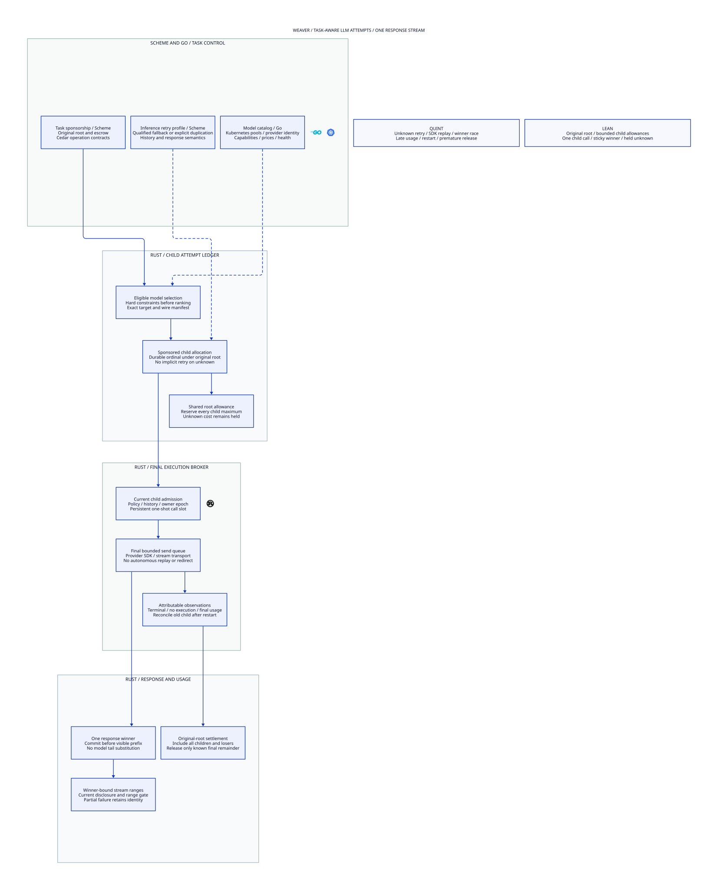

#+title: Weaver LLM Attempts and Failover Index
#+language: en
#+options: toc:2

#+begin_quote
Historical Python verification entrypoints are retired. Commands and receipts
referenced below describe earlier experiments. Current native verification uses
the Go-owned plan; see [[file:../../50-59-research-program/59-provider-rpc/59.21-verification-ownership.org][verification ownership and coverage]].
#+end_quote

* Task-aware inference reliability

Area =10-19 LLM Gateway=; category =11 Attempts and failover=.
Read this delta with [[file:../10-routing-and-inference/10.00-index.org][10 Routing and inference]]. It extends the initial
single-provider profile with sponsored child attempts under one original task.
It preserves the Gateway's logical execution authority and unknown-cost holds.
Earlier sealed documents remain historical receipts.

| ID | Artifact |
|----+----------|
| 11.00 | This index |
| 11.01 | [[file:11.01-attempts-budget-and-stream-winner.org][Task sponsorship, child attempts, budget and stream winner]] |
| 11.02 | [[file:11.02-attempt-ledger.d2][Core D2]] /  |
| 11.03 | [[file:11.03-validation-evidence.org][Proofs, counterexamples, source comparison and evidence]] |

Formal sources: [[file:../../../dev/proofs/lean/LlmAttemptLedger.lean][Lean]] and [[file:../../../dev/proofs/quint/LlmAttemptLedger.qnt][Quint]].
Reproduction: bounded local check runner (retired Python driver).
No Gateway runtime or dependency pin is changed.

* Embedded architecture views

** 11.02-attempt-ledger.svg

