#+title: Weaver LLM Semantic Contracts Index
#+language: en
#+options: toc:2

#+begin_quote
Historical Python verification entrypoints are retired. Commands and receipts
referenced below describe earlier experiments. Current native verification uses
the Go-owned plan; see [[file:../../50-59-research-program/59-provider-rpc/59.21-verification-ownership.org][verification ownership and coverage]].
#+end_quote

* Governed LLM interoperability

Area =10-19 LLM Gateway=; category =12 Semantic contracts=.
This delta connects [[file:../10-routing-and-inference/10.00-index.org][10 Routing and inference]] and [[file:../11-attempts-and-failover/11.00-index.org][11 Attempts and failover]] to
provider-specific request encoding, response streaming and tool proposals.
The Gateway preserves declared protocol constraints; it cannot prove equivalent
LLM behavior across providers or that a model obeys every instruction.

| ID | Artifact |
|----+----------|
| 12.00 | This index |
| 12.01 | [[file:12.01-request-response-and-tool-semantics.org][Semantic contract, wire binding, streaming and tool boundary]] |
| 12.02 | [[file:12.02-semantic-contract.d2][Core D2]] /  |
| 12.03 | [[file:12.03-validation-evidence.org][Quint, Lean, source comparison and remaining qualification]] |

Formal sources: [[file:../../../dev/proofs/lean/LlmSemanticContract.lean][Lean]] and [[file:../../../dev/proofs/quint/LlmSemanticContract.qnt][Quint]].
Run the local check runner (retired Python driver). Earlier sealed artifacts remain unchanged.
No Gateway runtime or dependency pin is changed.
