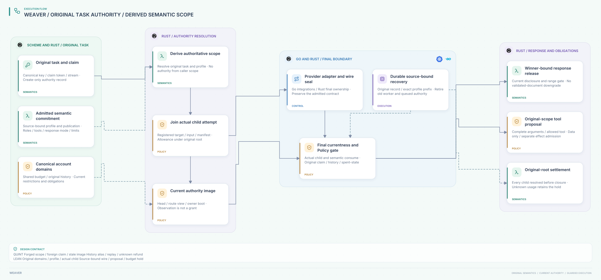

# SPDX-FileCopyrightText: 2026 hardenedlinux Linux Team and Contributors
#
# SPDX-License-Identifier: LGPL-2.1-or-later AND Apache-2.0

#+title: Weaver Authoritative Task-to-Scope Binding Index
#+language: en
#+options: toc:2

#+begin_quote
Historical Python verification entrypoints are retired. Commands and receipts
referenced below describe earlier experiments. Current native verification uses
the Go-owned plan; see [[file:../../50-59-research-program/59-provider-rpc/59.21-verification-ownership.org][verification ownership and coverage]].
#+end_quote

* Original task authority through LLM semantics

Area =10-19 LLM Gateway=; category =13 Authoritative scope=.
This category closes the supplied-scope gap identified in [[file:../12-semantic-contracts/12.03-validation-evidence.org][12.03]] at the abstract
protocol boundary. It joins the original claim and domain ledger to the canonical
semantic-contract registry, actual child invocation and semantic event gates.
The closure is conditional on authoritative registry publication and the existing
owner/storage contracts; it is not an implementation of those contracts.

| ID | Artifact |
|----+----------|
| 13.00 | This index |
| 13.01 | [[file:13.01-original-task-and-authoritative-scope.org][Task authority, immutable profile resolution and final gates]] |
| 13.02 | [[file:13.02-authoritative-scope.d2][Core D2]] /  |
| 13.03 | [[file:13.03-validation-evidence.org][Source comparison, proofs, counterexamples and runtime qualification]] |

Formal sources: [[file:../../../dev/proofs/lean/LlmAuthoritativeScope.lean][Lean]] and [[file:../../../dev/proofs/quint/LlmAuthoritativeScope.qnt][Quint]].
Run the isolated local check runner (retired Python driver). Earlier sealed categories remain historical.
No Gateway runtime, upstream source or dependency pin is changed.

* Embedded architecture views

** 13.02-authoritative-scope.svg

