# SPDX-FileCopyrightText: 2026 hardenedlinux Linux Team and Contributors
#
# SPDX-License-Identifier: LGPL-2.1-or-later AND Apache-2.0

#+title: Weaver Registry Publication and Durable Recovery Index
#+language: en
#+options: toc:2

#+begin_quote
Historical Python verification entrypoints are retired. Commands and receipts
referenced below describe earlier experiments. Current native verification uses
the Go-owned plan; see [[file:../../50-59-research-program/59-provider-rpc/59.21-verification-ownership.org][verification ownership and coverage]].
#+end_quote

* Persistent original-task semantics

Area =10-19 LLM Gateway=; category =14 Registry publication=.
This delta refines the immutable authority-registry premise of [[file:../13-authoritative-scope/13.00-index.org][13 Authoritative scope]]
into a sticky binding intent, exact root publication, independent confirmation
and current execution-ledger recovery gate. It retains the AI Agent Gateway's
logical execution-authority boundary.

| ID | Artifact |
|----+----------|
| 14.00 | This index |
| 14.01 | [[file:14.01-publication-claim-and-recovery.org][Publication ordering, original claim, recovery and fencing]] |
| 14.02 | [[file:14.02-registry-publication.d2][Core D2]] /  |
| 14.03 | [[file:14.03-validation-evidence.org][Source comparison, proof obligations and executable counterexamples]] |

Formal sources: [[file:../../../dev/proofs/lean/LlmRegistryPublication.lean][Lean]] and [[file:../../../dev/proofs/quint/LlmRegistryPublication.qnt][Quint]].
Run the isolated local check runner (retired Python driver). Earlier sealed sources and receipts remain
unchanged. No Gateway runtime, upstream source or dependency pin is changed.

* Embedded architecture views

** 14.02-registry-publication.svg

