#+title: Weaver Authority Read and Final Consumption CAS Index
#+language: en
#+options: toc:2

#+begin_quote
Historical Python verification entrypoints are retired. Commands and receipts
referenced below describe earlier experiments. Current native verification uses
the Go-owned plan; see [[file:../../50-59-research-program/59-provider-rpc/59.21-verification-ownership.org][verification ownership and coverage]].
#+end_quote

* Current authority at consumption

Area =10-19 LLM Gateway=; category =15 Recovery CAS=.
This delta refines [[file:../14-registry-publication/14.00-index.org][14 Registry publication]] by separating partial authority
reads, prepared requests, final conditional consumption and delayed confirmation.
External Policy/history changes participate in the final authority cut even when
no execution-ledger write occurs.

| ID | Artifact |
|----+----------|
| 15.00 | This index |
| 15.01 | [[file:15.01-authority-read-and-final-cas.org][Authority reads, coherent cuts and final consumption]] |
| 15.02 | [[file:15.02-recovery-cas.d2][Core D2]] /  |
| 15.03 | [[file:15.03-validation-evidence.org][Source comparison, proof correspondence and evidence]] |

Formal sources: [[file:../../../dev/proofs/lean/LlmRecoveryCAS.lean][Lean]] and [[file:../../../dev/proofs/quint/LlmRecoveryCAS.qnt][Quint]].
Reproduce with the isolated check runner (retired Python driver). This work changes design, formal models and
local evidence only. No Gateway implementation or dependency pin is changed.

* Embedded architecture views

** 15.02-recovery-cas.svg

