# SPDX-FileCopyrightText: 2026 hardenedlinux Linux Team and Contributors
#
# SPDX-License-Identifier: LGPL-2.1-or-later OR Apache-2.0

#+title: Weaver External Policy and History Publication Index
#+language: en
#+options: toc:2

#+begin_quote
Historical Python verification entrypoints are retired. Commands and receipts
referenced below describe earlier experiments. Current native verification uses
the Go-owned plan; see [[file:../../50-59-research-program/59-provider-rpc/59.21-verification-ownership.org][verification ownership and coverage]].
#+end_quote

* Pending, published and acknowledged

Area =10-19 LLM Gateway=; category =16 Policy publication=.
This delta makes category [[file:../15-recovery-cas/15.00-index.org][15 Recovery CAS]]'s effective-authority publication
point explicit: durable producer staging, a fenced owner publication and an
attributable historical acknowledgement. Producer/cache recovery never assigns
current consumption authority.

| ID | Artifact |
|----+----------|
| 16.00 | This index |
| 16.01 | [[file:16.01-pending-publication-and-effectiveness.org][Publication ordering, recovery and effective acknowledgement]] |
| 16.02 | [[file:16.02-policy-publication.d2][Core D2]] /  |
| 16.03 | [[file:16.03-validation-evidence.org][Source comparison, proof correspondence and evidence]] |

Formal sources: [[file:../../../dev/proofs/lean/LlmPolicyPublication.lean][Lean]] and [[file:../../../dev/proofs/quint/LlmPolicyPublication.qnt][Quint]].
Run the isolated check runner (retired Python driver). This work preserves prior sealed artifacts and
changes no Gateway runtime, upstream source or dependency pin.

* Embedded architecture views

** 16.02-policy-publication.svg

