# SPDX-FileCopyrightText: 2026 hardenedlinux Linux Team and Contributors
#
# SPDX-License-Identifier: LGPL-2.1-or-later AND Apache-2.0

#+title: Weaver Policy Conflict Resolution and Protocol Boundaries Index
#+language: en
#+options: toc:2

#+begin_quote
Historical Python verification entrypoints are retired. Commands and receipts
referenced below describe earlier experiments. Current native verification uses
the Go-owned plan; see [[file:../../50-59-research-program/59-provider-rpc/59.21-verification-ownership.org][verification ownership and coverage]].
#+end_quote

* Preserve the original intent through safe continuation

Area =10-19 LLM Gateway=; category =17 Policy continuation=.
This delta extends [[file:../16-policy-publication/16.00-index.org][16 Policy publication]] with authoritative family inspection,
source-bound reauthorization and one family winner. Protocol-specific identifiers
are aliases of canonical authority, not new authorization roots.

| ID | Artifact |
|----+----------|
| 17.00 | This index |
| 17.01 | [[file:17.01-conflict-resolution-and-safe-continuation.org][Conflict, uncertainty, reauthorization and final winner CAS]] |
| 17.02 | [[file:17.02-policy-continuation.d2][Core D2]] /  |
| 17.03 | [[file:17.03-validation-evidence.org][Source comparison, proofs and counterexamples]] |
| 17.04 | [[file:17.04-protocol-admission-and-identity.org][MCP, A2A, ACP, UI, ASP and other interface boundaries]] |

Formal sources: [[file:../../../dev/proofs/lean/LlmPolicyContinuation.lean][Lean]] and [[file:../../../dev/proofs/quint/LlmPolicyContinuation.qnt][Quint]].
Reproduce with the isolated runner (retired Python driver). No Gateway implementation, upstream source or
dependency pin is changed. Earlier sealed artifacts remain unchanged.

* Embedded architecture views

** 17.02-policy-continuation.svg

