#+title: Weaver Authoritative Canonical Identity Registry Index
#+language: en
#+options: toc:2

* One original source operation across protocol lifecycles

Area =10-19 LLM Gateway=; category =18 Canonical registry=.
This delta extends [[file:../17-policy-continuation/17.00-index.org][17 Policy continuation]] with authoritative origin registration,
qualified alias admission and source-bound recovery. MCP transport reconnect,
A2A task recreation and Client ACP session resume do not create intent families.

| ID | Artifact |
|----+----------|
| 18.00 | This index |
| 18.01 | [[file:18.01-authoritative-registration-and-recovery.org][Canonical registration, alias admission, recovery and final use]] |
| 18.02 | [[file:18.02-canonical-registry.d2][Core D2]] /  |
| 18.03 | [[file:18.03-validation-evidence.org][Source comparison, proof correspondence and counterexamples]] |

Formal sources: [[file:../../../dev/proofs/lean/LlmCanonicalRegistry.lean][Lean]] and [[file:../../../dev/proofs/quint/LlmCanonicalRegistry.qnt][Quint]].
Run [[file:../../../dev/proofs/check_llm_canonical_registry.py][the isolated runner]]. No Gateway implementation, upstream source or dependency
pin is changed. Earlier sealed artifacts remain unchanged.
