#+title: Weaver Multi-Key Canonical Registry Index
#+language: en
#+options: toc:2

#+begin_quote
Historical Python verification entrypoints are retired. Commands and receipts
referenced below describe earlier experiments. Current native verification uses
the Go-owned plan; see [[file:../../50-59-research-program/59-provider-rpc/59.21-verification-ownership.org][verification ownership and coverage]].
#+end_quote

* One authority order across identity and execution

Area =10-19 LLM Gateway=; category =19 Multi-key registry=.
This extension closes the serialization gap left explicit in
[[file:../18-canonical-registry/18.00-index.org][18 Canonical registry]]. Independent origin-local CAS operations cannot establish
unique family ownership, immutable aliases or a shared account bound.

| ID | Artifact |
|----+----------|
| 19.00 | This index |
| 19.01 | [[file:19.01-multi-key-serialization.org][Registration, alias binding, source CAS and recovery protocol]] |
| 19.02 | [[file:19.02-multi-key-registry.d2][Core D2]] /  |
| 19.03 | [[file:19.03-proof-and-source-evidence.org][Source comparison, proof premises, counterexamples and evidence]] |

Formal sources: [[file:../../../dev/proofs/lean/LlmMultiKeyRegistry.lean][Lean]] / [[file:../../../dev/proofs/quint/LlmMultiKeyRegistry.qnt][Quint]].
Reproduce with the isolated runner (retired Python driver). These are executable design models;
no Gateway implementation, upstream source or dependency pin is changed.
Earlier sealed artifacts are retained without rewriting their claims.

* Embedded architecture views

** 19.02-multi-key-registry.svg

