#+title: Weaver Projection Join and Final Queue Admission Index
#+language: en
#+options: toc:2

* One final admission decision after complete projection

Area =20-29 Execution authority=; category =21 Join enqueue=.
This extends [[file:../20-result-projection/20.00-index.org][20 Result projection]] from recovered source/account results to the
Rust broker's original durable operation. A successful earlier join is an
observation. Final admission compares current authority and immutable scope again.

| ID | Artifact |
|----+----------|
| 21.00 | This index |
| 21.01 | [[file:21.01-atomic-join-enqueue.org][Atomic join, Policy, fencing, canonical slot and no-send contract]] |
| 21.02 | [[file:21.02-join-enqueue.d2][Core D2]] /  |
| 21.03 | [[file:21.03-proof-and-source-evidence.org][Actual source composition, broker projection and counterexamples]] |

Models: [[file:../../../dev/proofs/lean/LlmJoinEnqueue.lean][Lean]] / [[file:../../../dev/proofs/quint/LlmJoinEnqueue.qnt][Quint]].
Run [[file:../../../dev/proofs/check_llm_join_enqueue.py][the isolated runner]]. This audit compares POO Flow and cedar-poo-spec.
No Gateway implementation, dependency pin or previous sealed artifact is changed.
