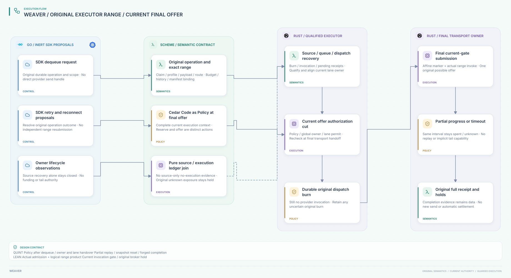

#+title: Weaver Durable Queue to Executor Offer Index
#+language: en
#+options: toc:2

* Dequeue is data; each original offer needs current authority

Area =20-29 Execution authority=; category =22 Executor offer=.
This extends [[file:../21-join-enqueue/21.00-index.org][21 Join enqueue]] with an actual admission/range product, execution-ledger
recovery qualification and separately checked burn/offer transitions.

| ID | Artifact |
|----+----------|
| 22.00 | This index |
| 22.01 | [[file:22.01-current-executor-offer.org][Current offer, logical owner handover, partial writes and recovery]] |
| 22.02 | [[file:22.02-executor-offer.d2][Core D2]] /  |
| 22.03 | [[file:22.03-proof-and-source-evidence.org][Actual range/broker composition, source audit and counterexamples]] |

Models: [[file:../../../dev/proofs/lean/LlmExecutorOffer.lean][Lean]] / [[file:../../../dev/proofs/quint/LlmExecutorOffer.qnt][Quint]].
Run [[file:../../../dev/proofs/check_llm_executor_offer.py][the isolated runner]]. Documents and diagrams are English only.
No Gateway implementation, dependency pin or earlier sealed artifact is changed.
