# SPDX-FileCopyrightText: 2026 hardenedlinux Linux Team and Contributors
#
# SPDX-License-Identifier: LGPL-2.1-or-later AND Apache-2.0

#+title: Weaver Execution Reconciliation Index
#+language: en
#+options: toc:2

#+begin_quote
Historical Python verification entrypoints are retired. Commands and receipts
referenced below describe earlier experiments. Current native verification uses
the Go-owned plan; see [[file:../../50-59-research-program/59-provider-rpc/59.21-verification-ownership.org][verification ownership and coverage]].
#+end_quote

* Execution evidence precedes source terminal and financial release

Area =20-29 Execution authority=; category =23 Execution reconciliation=.
This extends [[file:../22-executor-offer/22.00-index.org][22 Executor offer]] from original dispatch execution into source reconciliation
and application of the original reservation's unused remainder.

| ID | Artifact |
|----+----------|
| 23.00 | This index |
| 23.01 | [[file:23.01-execution-evidence-chain.org][Execution evidence, terminal decisions and original budget release]] |
| 23.02 | [[file:23.02-execution-reconciliation.d2][Core D2]] /  |
| 23.03 | [[file:23.03-proof-and-source-evidence.org][Composition proofs, source audit and executable counterexamples]] |

Formal artifacts: [[file:../../../dev/proofs/lean/LlmExecutionReconciliation.lean][Lean]] / [[file:../../../dev/proofs/quint/LlmExecutionReconciliation.qnt][Quint]].
Run the isolated checker (retired Python driver). Maintained documents and diagrams are English only.
No Gateway implementation, dependency pin or historical sealed artifact is changed.

* Embedded architecture views

** 23.02-execution-reconciliation.svg

