# SPDX-FileCopyrightText: 2026 hardenedlinux Linux Team and Contributors
#
# SPDX-License-Identifier: LGPL-2.1-or-later OR Apache-2.0

#+title: Weaver WAL to Balance Activation Index
#+language: en
#+options: toc:2

#+begin_quote
Historical Python verification entrypoints are retired. Commands and receipts
referenced below describe earlier experiments. Current native verification uses
the Go-owned plan; see [[file:../../50-59-research-program/59-provider-rpc/59.21-verification-ownership.org][verification ownership and coverage]].
#+end_quote

* Durable candidate, protected decision and current balance visibility

Area =20-29 Execution authority=; category =25 WAL activation=.
This refines [[file:../24-account-commit/24.00-index.org][24 Account commit]] with explicit local WAL, independent candidate retention,
protected commit confirmation and complete projection activation stages.

| ID | Artifact |
|----+----------|
| 25.00 | This index |
| 25.01 | [[file:25.01-wal-anchor-activation.org][WAL, anchor decision, replay and final visibility contract]] |
| 25.02 | [[file:25.02-wal-activation.d2][Core D2]] /  |
| 25.03 | [[file:25.03-proof-and-source-evidence.org][Composition proofs, source audit and executable counterexamples]] |

Models: [[file:../../../dev/proofs/lean/LlmWalActivation.lean][Lean]] / [[file:../../../dev/proofs/quint/LlmWalActivation.qnt][Quint]].
Run the isolated runner (retired Python driver). English only; no Gateway code, dependency pin,
upstream source or earlier sealed artifact is changed.

* Embedded architecture views

** 25.02-wal-activation.svg

