# SPDX-FileCopyrightText: 2026 hardenedlinux Linux Team and Contributors
#
# SPDX-License-Identifier: LGPL-2.1-or-later AND Apache-2.0

#+title: Weaver Account WAL, Independent Anchor and Balance Projection Activation
#+language: en
#+options: toc:3

* Reader view

A durable frame and accepted anchor are distinct from a committed balance.

* Decision and refinement boundary

A locally durable account WAL frame, a durably accepted anchor candidate and a
committed financial outcome are different states. Only the protected account commit
performs the category-24 atomic application/reservation/hold/balance transition.
A projection becomes usable only after current prefix confirmation, complete WAL
coverage and exact balance-image installation. Replaying that result never performs
a second financial delta.

Category 24 treated its durable financial commit as one logical action. This
refinement expands the persistence/confirmation premises around that action while
projecting every financial change to the actual earlier account transition. It
does not replace the independent anchor with a restorable local WAL, introduce a
second balance authority or implement a storage engine.

* Evidence and ordering

| Stage | Durable content or checked evidence | Financial meaning |
|-------+-------------------------------------+-------------------|
| Prepare | Original application/reservation, final usage binding, exact account predecessor, owner and source generation | Inert proposal |
| Flush WAL | Complete proposal and atomic resulting account image | Locally recoverable candidate; no credit |
| Submit candidate | Independent authority retains the complete candidate body before accepting it | Candidate retained; still no financial outcome |
| Protected account commit | Current predecessor/owner/source/policy checks plus atomic application, reservation, hold and balance result | One authoritative settlement |
| Observe confirmation | Authenticated current financial prefix, full result, owner and source generation | Historical commit is known; projection not yet activated |
| Repair and install | WAL contains every protected financial record; exact account after-image installed | Materialization only; no second delta |
| Activate | Confirmation still current, complete WAL, exact image, current qualified source/owner | Current projection may be used through the final authority gate |

A frame binds the entire immutable transaction body, complete account before-image,
complete after-image, original application ID and reservation, original source and
usage applications, unit/bound/usage, expected prefix and owner/source stamps.
Neither an application ID nor a commit position authenticates that body by itself.
Checksums detect damage; authentication, lineage and currentness are separate.

The local frame must be complete and durably written before submission. The anchor
service must retain the complete candidate, rather than only an address into a
worker's restorable WAL. Final commit rechecks current authority; earlier acceptance
is not a portable write permit. A source/owner change before commit blocks the old
candidate. An earlier committed result remains the original financial fact.

* Lost responses and late outcomes

Loss of the WAL or candidate acceptance response cannot release the hold. Loss of
the protected commit response cannot authorize another financial delta. Query the
original application/reservation against a current qualified prefix and compare
the complete immutable body. An unknown query result remains unknown until that
prefix and original outcome are resolved.

Local WAL loss after candidate acceptance does not prove the candidate was canceled.
The independent authority may still commit its retained complete body if its final
CAS remains current. Conversely, an owner rotation linearized before that CAS
rejects the old worker. A rotation after the CAS preserves the committed record.
These alternatives must be resolved by the authority, not by local file absence.

The service may receive duplicate identical candidates. They do not create a second
settlement: final application ID and original reservation uniqueness still apply.
A newly generated application ID cannot bypass original reservation consumption.
A current owner may prepare the same original financial body against a newly
qualified current head, retaining its application/reservation identity; the old
candidate remains fenced and cannot commit independently afterward.

* WAL truncation and snapshot recovery

The local WAL has an anchored prefix and may have an uncommitted suffix. Visibility
requires every anchored record in the local WAL to match the full protected record
at the same position. A truncated anchored prefix or altered body with an unchanged
position is insufficient. A complete uncommitted suffix may exist, but it has no
financial authority. The selected fixture permits one pending local suffix frame;
the proof states prefix coverage for arbitrary finite record lists.

Recovery closes new projection-based proposals, balance use and local activation.
Independently accepted candidates may still resolve under their final protected CAS.
Recovery obtains the current independently governed prefix and fence stamps,
restores every missing committed frame from that authority,
then installs the exact current financial image. Replay updates a projection; it
does not execute the transaction again. A local application row, available balance,
reservation tombstone or hold at a different position keeps the gate closed.

Repair may replace local candidate-only bytes with the current anchored prefix.
It does not discard the independently retained pending candidate, cancel an unknown
remote decision or change application/reservation consumption. A late decision can
advance the prefix after repair; the previous confirmation then becomes stale and
install/activation must retry against the newly authoritative result.

A torn local frame cannot be accepted as a complete candidate. If a previously
complete, anchored frame later disappears or corrupts, retain the protected result
and repair it. If no authenticated complete copy is available, stay closed. This
protocol does not infer trustworthy bytes from a checksum alone or turn a successful
read of an old checkpoint into proof that later commits never existed.

The native WAL contract must specify record framing, atomic commit boundary,
checksum/content binding, durable flush and recovery of torn records. A filesystem
write return value or an fsync completion on a draft is not an independent anchor
confirmation. No native WAL format, fsync implementation or power-loss behavior is
implemented or qualified by these models.

Planned compaction is not permission to forget an application or reservation.
This reference does not prune the protected journal. A future compacted recovery
path must first durably publish an independently anchored checkpoint containing
all application/reservation consumption, holds, balances, original source bindings
and owner/source stamps, then prove checkpoint-plus-suffix equivalence before
removing any required record copy. A checkpoint position without its complete
verified body cannot replace the prefix proof. Until that refinement is checked,
a missing protected record body makes repair unavailable rather than authorizing
an empty replacement log.

An old worker may still hold local WAL descriptors or buffered writes. Such writes
must remain inside the restorable local log domain. They cannot append to the
protected financial authority or bypass the final current CAS. Detected corruption
closes qualification and requires complete-prefix repair. Exclusive native account
ownership and complete mutation mediation are runtime premises, not consequences
of a process-local lease or a successful file write.

* Confirmation, activation and final use

Activation is not a permanent grant carried by a mutable balance handle. If another
commit advances the protected head between observation, replay, installation or
activation, the old confirmation must fail the current-head check. Every new
financial consumption or grant must compare its expected current head, owner and
original reservation at the authoritative CAS. Push notifications and cached active
flags cannot supply that serialization.

The formal =active= flag describes the authority-serialized product state. A remote
commit clears it in the next modeled state. This is a refinement obligation for the
native final gate, not a claim that every process learns about a remote commit
instantaneously. A replicated process may show stale informational data, but that
data cannot authorize another balance delta, grant, retry or provider execution.

The explicit late-commit controls cover a candidate that remains pending while the
old image is briefly qualified, and a commit that lands between repair and install.
The first commit closes visibility and makes the old confirmation stale; the second
prevents installing the repaired old image as current. The final consumer must
refine this same authority order rather than perform a local check followed by an
independent write.

* Unknown budgets and late execution data

No amount of WAL completeness or storage recovery substitutes for final source
usage. All protected account commits still require the actual category-24 sourceReady
predicate and final metering. The inherited category-23 bridge retains the original
claim, profile commitment, budget/history domain and reservation binding. A source
zero-call counter, completed range write, late SDK receipt or empty recovered WAL
cannot manufacture a metered financial effect.

Unknown original usage retains its original hold even when unrelated confirmed
reservations settle. Once an original settlement is committed, late observations
may enrich audit history but cannot change its final usage, recreate its hold or
mint another account application. Unknown account commit status is resolved by
original result readback; it is not equivalent to unknown source usage or a zero
financial outcome.

* Owner responsibilities and Code as Policy

| Owner | Responsibility | Enforced boundary |
|-------+----------------+-------------------|
| Scheme / POO | Define exact frame/result semantics, original financial effect and pending obligation; derive Cedar requests | Distinguish local durability, candidate acceptance, financial decision and activation |
| Go | Kubernetes lifecycle/identity integration, Gerbil toolchain observations and original-outcome query/retry proposals | No direct WAL-to-balance writer or authority from a restored Gerbil toolchain callback |
| Rust WAL owner | Atomically frame complete candidate and durable flush; detect truncated/corrupt prefixes | Local frame cannot release money |
| Rust independent account authority | Retain complete accepted candidates; serialize final commit with current head/owner/source/policy | One actual application/reservation/hold/delta transaction |
| Rust projection/final broker | Repair exact committed prefix, install exact image and gate final financial use | No stale active handle, second delta or external send during replay |
| Cedar / cedar-poo-spec | Code as Policy for submitOriginalAccountCandidate, commitOriginalSettlement and activateBalanceProjection | Match actual current effect/state; all required layers allow without errors |
| Quint / Lean | Failure interleavings and actual account/source composition | Native persistence, authentic complete evidence and independent current prefix remain premises |

Cedar authorizes the exact proposed effect under its actual context. It does not
prove that bytes were flushed, that a candidate committed, or that an anchor reply
is the current prefix. Runtime evidence must make those facts true before the
Scheme/Cedar check and the serialized final action.

* Reuse, assumptions and performance boundary

Reuse POO Flow's pure exact effect binding, conservative spent-state, unresolved
session obligations, generation/revision CAS intents and source-bound receipt
lineage. Reuse its explicit native ownership of append, fsync, checkpoint, replay
and repair. Add the account-specific complete-candidate retention, confirmation
stamp and projection activation gates; none is already established by a Scheme
store-contract receipt.

Reuse the actual category-24 account state and transitions, including current owner,
source qualification/generation, immutable applications and original reservation
holds. The new product does not reopen its atomic financial transaction into split
ID/delta writes. It expands the evidence sequence around that transaction and
retains all prior sealed artifacts unchanged.

The independent authority is a software service or qualified durable owner outside
the local WAL/snapshot rollback domain. No physical isolation is required. Its
native no-fork, current-prefix and fence persistence contracts remain essential.
If both account and authority can roll back together with no external witness,
exactly-once financial recovery cannot be inferred; remain unavailable.

The Lean proof allows arbitrary finite paths and record lists under these contracts.
The Quint fixture inherits a metered original source, two shared-account reservations
and an explicitly trusted second-reservation witness from category 24. It does not
claim an arbitrary-many-provider runtime or distributed storage implementation.

Local WAL staging and replay may run outside the provider send path. Immutable
result bodies can be cached, while mutable visibility still requires current
qualification. Group commit must preserve per-record completeness and final CAS
order; a batch acknowledgment cannot promote uncommitted candidates. No throughput,
latency or bounded recovery claim is made without native measurements.
