#+title: Weaver Checkpoint Publication and WAL Truncation Index
#+language: en
#+options: toc:2

#+begin_quote
Historical Python verification entrypoints are retired. Commands and receipts
referenced below describe earlier experiments. Current native verification uses
the Go-owned plan; see [[file:../../50-59-research-program/59-provider-rpc/59.21-verification-ownership.org][verification ownership and coverage]].
#+end_quote

* Published complete state precedes physical prefix deletion

Area =20-29 Execution authority=; category =26 Checkpoint truncation=.
This extends [[file:../25-wal-activation/25.00-index.org][25 WAL activation]] with authoritative checkpoint publication,
monotonic recovery floor, local prefix deletion and checkpoint-plus-suffix recovery.

| ID | Artifact |
|----+----------|
| 26.00 | This index |
| 26.01 | [[file:26.01-checkpoint-publication.org][Complete checkpoint publication, safe local WAL truncation and recovery]] |
| 26.02 | [[file:26.02-checkpoint-truncation.d2][Core D2]] /  |
| 26.03 | [[file:26.03-proof-and-source-evidence.org][Actual composition, source audit, counterexamples and evidence]] |

Models: [[file:../../../dev/proofs/lean/LlmCheckpointTruncation.lean][Lean]] / [[file:../../../dev/proofs/quint/LlmCheckpointTruncation.qnt][Quint]].
Run the isolated runner (retired Python driver). English only; no Gateway implementation, dependency
pin, upstream source or historical sealed artifact is changed.

* Embedded architecture views

** 26.02-checkpoint-truncation.svg

