#+title: Weaver Manifest Switch and Deletion Recovery Index
#+language: en
#+options: toc:2

#+begin_quote
Historical Python verification entrypoints are retired. Commands and receipts
referenced below describe earlier experiments. Current native verification uses
the Go-owned plan; see [[file:../../50-59-research-program/59-provider-rpc/59.21-verification-ownership.org][verification ownership and coverage]].
#+end_quote

* A durable replacement precedes deletion

Area =20-29 Execution authority=; category =27 Manifest switch=.
This refines [[file:../26-checkpoint-truncation/26.00-index.org][26 Checkpoint truncation]] by separating candidate objects, manifest
persistence, current-root switch, result readback and incremental deletion.

| ID | Artifact |
|----+----------|
| 27.00 | This index |
| 27.01 | [[file:27.01-manifest-switch.org][Manifest switching, deletion and recovery contract]] |
| 27.02 | [[file:27.02-manifest-switch.d2][Core D2]] /  |
| 27.03 | [[file:27.03-proof-and-source-evidence.org][Proof correspondence, source review and acceptance boundary]] |

Four artifacts: [[file:../../../dev/proofs/lean/LlmManifestSwitch.lean][Lean]] / [[file:../../../dev/proofs/quint/LlmManifestSwitch.qnt][Quint]] / this Org category / core D2.
Reproduce with the isolated runner (retired Python driver). This is design and executable formal evidence;
no Gateway implementation, dependency pin or historical sealed artifact changes.

* Embedded architecture views

** 27.02-manifest-switch.svg

