#+title: Weaver Concurrent WAL Append and Checkpoint Cut Index
#+language: en
#+options: toc:2

* Carry the current append generation across a checkpoint cut

Area =20-29 Execution authority=; category =28 Append handoff=.
This extends [[file:../27-manifest-switch/27.00-index.org][27 Manifest switch]] beyond its fixed-WAL cut assumption. The new
model separates the sealed cut from the live append generation and protects both.

| ID | Artifact |
|----+----------|
| 28.00 | This index |
| 28.01 | [[file:28.01-append-handoff.org][Concurrent append, cut, manifest switch and recovery contract]] |
| 28.02 | [[file:28.02-append-handoff.d2][Core D2]] /  |
| 28.03 | [[file:28.03-proof-and-source-evidence.org][Four-artifact mapping, source audit, counterexamples and evidence]] |

Four artifacts: [[file:../../../dev/proofs/lean/LlmAppendHandoff.lean][Lean]] / [[file:../../../dev/proofs/quint/LlmAppendHandoff.qnt][Quint]] / English Org / core D2.
Run [[file:../../../dev/proofs/check_llm_append_handoff.py][the isolated checker]]. No Gateway implementation, dependency pin, upstream
source or historical sealed evidence is changed.
