#+title: Protected Signer Durable Commit, Release and Recovery Qualification
#+language: en
#+date: 2026-10-19
#+property: STATUS conditional-model-checked-native-signer-qualification-pending
#+options: toc:3

* Decision and relation to the previous model

A protected signer must not release a signature merely because a coordinator
checked an old snapshot or a storage request returned success. Atomically publish
the exact immutable request row and non-equivocating prefix promise at one
qualified protected owner. Resolve uncertain commits against that owner. At the
actual key boundary, check the committed statement and current signing session
before producing any externally usable signature bytes.

[[file:../../architecture/28-quorum-durable-promises-prefix-recovery.org][The preceding review]] modeled promise preparation as one atomic abstract action.
It left commit response, signing-service recovery and actual key custody inside
the owner premise. This refinement splits staging, protected commit, exact
observation, key-boundary release and peer delivery. [[file:../../../dev/proofs/lean/ProtectedSignerRelease.lean][Lean]] composes these phases
with the earlier initialized quorum/configuration/consumption/account product.
[[file:../../../dev/proofs/quint/ProtectedSignerRelease.qnt][Quint]] exposes unsafe check-then-sign, early release, raw-key restoration and
checkpoint-based requalification. [[file:31.03-validation-evidence.org][The check receipt]] states finite bounds and native
premises. [[file:31.02-protected-signer.d2][The core D2]] /  omit versions and acceptance data.

The selected protocol retains the conservative sticky-prefix profile. Every
protected promise extends its predecessor; a different term or candidate cannot
replace an unresolved promised record. Repeated signing of the same prefix is
allowed. At-most-once cryptographic computation or byte-identical signatures is
not required and is not proved. The security property is absence of conflicting
prefix endorsements and preservation of the original execution obligation.
An abandoned promise may block forever; no consensus liveness claim is made.

* Protected transaction and identity

| Bound identity | Purpose |
|----------------+---------|
| Root, roster, old/joint/new stage, revision, term and predecessor | Distinguish the exact original consensus proposal; never relabel an old signature |
| Full candidate and complete deciding-state binding | Preserve data/control history, original claim, account, nonce/spent-state, budget/history and unresolved results |
| Signer identity, node incarnation and key qualification | Prevent a restored or retired member from signing as a fresh identity |
| Protected service session epoch | Fence obsolete service handles independently of membership and broker epochs |
| Request ID and exact immutable request body | Resolve one submitted transaction; an ID collision cannot change its statement |
| Expected protected predecessor and current owner revision | Serialize concurrent publication with compare-and-publish |

The durable transaction writes the next prefix promise and immutable request row
at one linearization point. The checked profile does not split these writes
across independent stores. Native storage must supply durable atomicity under
its stated fault model, including torn transactions and lost responses. If the
chosen backend cannot supply that contract, this profile is unqualified; adding
a second ordinary database does not repair it. Service caches and local request
queues are restorable and carry no independent authority.

A commit acknowledgement certifies the protected state, not a volatile WAL buffer
or leader-local append. The owner binds the result to the exact request and
nonrollback session/identity lineage. Durable publication precedes signature
release. The signer cannot recover from an uncertain commit by deleting a row,
clearing a promise, allocating a new claim/domain or treating NotFound from a
stale follower as authoritative.

* Phase protocol

| Phase | Required condition | Result and failure rule |
|-------+--------------------+-------------------------|
| Stage | Qualified service; current root/session/incarnation; immutable body and captured predecessor | Local pending request only; concurrent stages do not reserve signing permission |
| Protected commit | Recheck all current bindings; CAS the captured predecessor; extend the sticky promise; write request row atomically | Durable decision even when response is lost; no signature yet |
| Observe | Authentic owner response identifying the exact committed row | Resolves that request only; neither a missing response nor a positive cache entry qualifies release |
| Release at key boundary | Observed committed row; current qualified session and node; eligible nonretired signer; exact root header; candidate covered by protected history | Externally usable endorsement of that original statement only |
| Deliver | Signature actually emitted earlier | Delivery can be late; it cannot create or rebind a statement |
| Root publication | Required old/joint/new quorum has supplied the exact matching delivered signatures; full deciding image and inherited root guards hold | Commit the same original prefix; no direct application/send permission |

Two threads may stage conflicting candidates against the same expected
predecessor. Only one can successfully publish it. The loser must resolve or
fail; it cannot reuse its earlier check as a release permit. Even two identical
staged requests can fail the second CAS: the caller rereads protected state and
submits/resolves the exact same choice. Identical repeats are safe; a new ID,
connection or service process cannot change the promised candidate.

The formal protected commit refines an allowed prior promise transition, requires
the captured predecessor to match and records the exact resulting protected
history. The immutable request row is stored in the same abstract event. This is
an explicit atomic-store assumption, not a proof that an existing POO Flow store
already implements that transaction. Fresh identity/header checks happen again
at release, including after status resolution.

* Lost responses and asynchronous completion

A timeout means unknown. If the commit completed, a later exact owner query can
resolve that row while retaining the original promise. If the owner cannot
establish the decision, the signer remains unable to release that request.
Retry/status APIs never return a runnable account, burn or transport capability.
They return a typed protected-commit observation. Wrong-body, wrong-owner,
stale-session and unauthenticated observations are rejected.

Signature generation can also finish while its response is lost. Once usable
bytes leave the mediated key boundary, the protocol treats the statement as
released, whether a caller received the network response or not. A retry may
emit another signature for that exact covered statement, but cannot sign a
conflict. This avoids an unnecessary distributed exactly-once signing claim.
The released/delivered history in the models records observed semantic events;
it is not a magical durable oracle from which a crashed service reconstructs
missing bytes or permissions.

A signature emitted before session fencing may arrive at a peer afterwards.
Delivery itself does not require the old signing session to be current. The
peer checks the original proposal's term, revision, predecessor and scope before
forming a new certificate. Historical committed evidence remains historical;
late delivery is not a new endorsement under a replacement context. The models
separate this delivery from a fresh key invocation after fencing.

* Signing-service restart and qualification

An actual process boot does not increment authority by itself. Before new key
use, acquire a new protected service epoch and make previous mediated handles
ineffective at the actual key boundary. In the abstract model, =restart= is the
successful protected session-invalidation event, not proof that a crashed daemon
has physically stopped. During boot, uncertain epoch acquisition or unknown
revocation, the new service remains quarantined.

Recovery reads must authenticate the current protected session, complete promise
histories, immutable commit rows and authoritative deciding context. Equality
with a restored local cache is insufficient. The model's SignerOwner predicates
make authentic commit observation and signer recovery separate from the root
store's image/read predicates. It never manufactures missing signer evidence
from an otherwise valid root receipt. Qualify only after an exact current owner
read; every release still checks live session, incarnation and candidate coverage.

Restart clears local staging, status observations and service qualification;
protected promises and commit rows remain. A staged-only request is abandoned
without forgetting any actual protected decision. A committed old-session row
is not relabeled as current. A fresh qualified service can submit a new request
for the identical original prefix under its new session, preserving old rows and
promises. The sticky record's root term and payload remain unchanged. An ahead
pending promise or unavailable deciding prefix can still block recovery.

A cached read cannot qualify a new service epoch. Session allocation and owner
failover must themselves satisfy the protected owner's non-equivocation and
antirollback contract. If all copies of that owner, signing keys and counters
can be restored together, the framework cannot establish safe continuation.
Keep it unavailable; renaming the service, root or signer is not recovery.

* Old keys, sessions and the actual trusted boundary

Nonexportability is necessary for some deployment choices but insufficient.
A nonexportable HSM key exposed through an unrestricted Sign(digest) API can
still be used by an old authorized handle to endorse a conflict. The enforcement
owner must mediate the exact statement, authentic protected-commit proof and
current session in the key operation itself. Do not hand a general signing key,
blanket HSM session or reusable checked-once permit to Go or an old Rust worker.

The release linearization check and signature emission must be indivisible with
respect to session revocation and promise publication. If a hardware worker
checks a session, queues a digest, then signs after revocation without rechecking,
the queue is another unmediated capability. Either retain it within the same
exclusive owner until emission, revalidate at emission, or prove physical queue
isolation. Already emitted signatures may arrive late under their original
bindings; queued-but-unemitted requests cannot become new old-session output.

Key rotation preserves signer/root publication identity and old protected history.
A new key certificate cannot erase pending choices. Permanent retirement remains
irreversible for the old signer. A restored raw private key with an accepted
certificate can defeat this profile; the raw-key counterexample demonstrates
that this case is excluded by an essential native custody premise, not fixed by
a Rust type, process PID, Kubernetes restart or numerical epoch alone.

Signer isolation and final transport/account-writer isolation remain separate.
No signature authorizes a socket write. Original nonce consumption, Policy,
actual FD/buffer fencing and current-read/activation still gate the Rust broker.
An original pre-barrier burn may retain the previously documented single-send
window; IO submitted before isolation may finish afterwards. Unknown account
writes and usage results retain the original reservation until authentic
resolution. Signer restart does not retry an external effect or refund a budget.

* POO Flow and cedar-poo-spec correspondence

[[file:../../../dev/proofs/evidence/protected-signer/source-review.json][Eighteen committed blobs]] were rehashed at the existing pinned source identities.
The [[file:../../../dev/proofs/evidence/protected-signer/source-boundary-review.log][bounded source review]] records relevant consumption, durability, rollback and
publication definitions. The [[file:../../architecture/01-reference-comparison.org][source register]] defines P/C identifiers. These are
source/proof observations, not new native storage or signing acceptance results.

| Source | Reuse | Extension or premise that cannot be silently inferred |
|--------+-------+------------------------------------------------------|
| P12 authorized-effect-token | Exact effect/binding and consumed-nonce context | A signer commit observation is a distinct evidence type, never a replacement effect token |
| P13 strict-mediation | Indeterminate effects still consume nonce/sequence in the immutable successor | Publish the successor before effects; do not reset spent-state on signer timeout or query failure |
| P15 effect-host | Consume-before-callback ordering and local host identity guards | Cannot prove remote commit durability, write-before-sign or revocation of an old key handle |
| P17/P22 durable backend/store | Scheme contract versus runtime append/fsync/lease ownership | New atomic promise-plus-row CAS and antirollback receipt/session custody need a qualified native owner |
| P18/P19 recovery bridges | Original committed receipt and bound transaction/recovery identities | Acknowledgement loss is not absence of commit; valid prior commit/authentic observation remain inputs |
| P20 application exactly once | Conditional uniqueness of the original application | effectUniverseExecutesExactlyOnce is supplied, not a real signer/account/socket theorem |
| P31/P43 session attempts/reconciliation | Pending is nonrunnable; revision/generation and source-bound reconcile intent | Reconcile intent and process generation cannot qualify the key service or physically revoke a queued digest |
| P33 budgets | Distinguish deterministic/economic reservation from runtime timeout | Unknown signing/settlement outcomes do not release booked budget |
| P35 monotonicity | Equality rollback and branching-successor counterexamples; fork-free publication contract | CAS and protected signing must implement non-equivocation; increasing epochs alone do not prove it |
| P35 lineage-prefix | Full published-prefix and domain joins | Current signer rows/session must be independently authenticated; a root prefix proof is insufficient |
| C8 BoundOperation | Requested/executed operation and state equality | Native signature payload construction and caller inputs must be authentic and canonical |
| C10 CompoundAuthorization | All required nonempty layers allow without evaluation errors | A signer-status success does not bypass Cedar or convert a stale Allow into final-send authority |
| C11 Composition | Typed aligned semantic composition | No implied proof of key custody, service restart, storage CAS or transport enforcement |

Scheme owns original operation/domain semantics, canonical signature-statement
schema, evidence kinds, Policy composition and failure meaning. Cedar remains
Code as Policy over the actual protected effect; it is neither a persistence
protocol nor a replacement for live enforcement.

Go owns Kubernetes discovery, service/learner reconciliation, readiness reporting
and idempotent status orchestration. It passes immutable requests and authentic
observations; SDK retry, pod health or successful deployment cannot grant signing
qualification or bypass the final broker. No unrestricted signer/send client is
an adapter convenience API.

Rust and the qualified protected owner enforce typed native transaction CAS,
exact commit observation, live key-boundary checks and signature emission. A
remote key service/device is part of the declared trust boundary, not something
proved safe by Rust memory safety. Rust's final broker separately enforces
original consumption, live Policy and physical writer authority at submission.

* Properties, premises and excluded traces

| Property | Lean declaration / Quint controls | Preconditions and counterexample boundary |
|----------+-----------------------------------+------------------------------------------|
| Every released statement has an immutable committed row | initialized_releases_have_committed_rows; unknownCommitCannotReleaseTest | Atomic protected transaction and authentic owner observation; early-sign counterexample violates it |
| Every released prefix remains protected | initialized_release_invariant | Protected history extends across all permitted recovery; checkpoint reset is excluded |
| Concurrent staged choices cannot both publish | concurrentConflictFailsCASTest; every_released_statement_keeps_its_promise | CAS and exact prior transition; detached-check counterexample signs both choices |
| One signer cannot release conflicting equal-position prefixes | released_certificates_cannot_conflict | Same signer plus retained full histories; raw-key bypass defeats the premise |
| Lost responses preserve original decision | commit_response_loss_cannot_erase_commitment; lostCommitReplyRemainsDurableTest | Durable rows cannot be cleared by timeout/status retry |
| Restart cannot reuse old service handle | restart_does_not_restore_old_service_handle; oldServiceEpochReleaseRejectedTest | Actual mediated revocation, not process restart alone |
| Late delivery preserves original statement | late_delivery_cannot_create_a_new_statement; lateOriginalDeliveryAfterRestartTest | Previously emitted signature; current root header still checked when certifying |
| Root publication requires supplied quorum signatures | root_publication_requires_released_quorum; twoSignerRootCommitTest | Exact matching delivered statements plus inherited full-image/quorum/root predicates |
| Original consumption, settlement, capacity and reservations survive | original_consumption_and_settlement_remain_unique; original_budget_remains_conserved; unknown_original_reservation_stays_held | Initialized fourteen-layer product and inherited native effect/store assumptions |

Five unsafe rules stay outside Quint =step=: detached CAS, signing before durable
publication, old raw key after restart, restoring signing authority from a
checkpoint, and cached recovery qualification. The first produces two conflicting
released prefixes for the same signer; this is stronger than a mere timeout or a
failed guard. The cached-qualification trace violates recovery eligibility and
does not by itself demonstrate duplicate account application. The prior actual
forked-root duplicate-account trace is rerun separately.

Quint bounds three voters, six request IDs, three prefix positions and two data
choices. Cells include root term/revision, so election cannot silently make the
same integer payload a new acceptable sticky record. Lean uses arbitrary finite
structural record histories and Nat-indexed requests/voters over the prior
execution product. Neither model is an extracted native implementation; the
Quint signer abstraction does not reimplement the prior full joint configuration
or account pipeline. Native canonical full-image signature binding, cryptography
and model-to-runtime refinement remain separate qualification work.

* Native acceptance and performance boundary

Crash at each boundary: before/after protected commit, after response loss,
before/after key emission and before peer delivery. Race conflicting calls with
the same predecessor and reused IDs. Restart the signer and publication owner
while old mediated handles, raw keys, HSM sessions and queued digests remain.
Exercise authentic/forged/stale query responses, key rotation, permanent retirement
and election/joint transition during recovery. Verify current reads and CAS at
the owner, not coordinator caches. Keep a real failed release and retained unknown
obligation in the evidence rather than retrying until a success hides it.

Acceptance must establish that raw generic-sign access is absent, old sessions
are ineffective at emission and the protected transaction survives every allowed
snapshot restore. Prove actual key/device ownership and actual broker FD fencing
independently. If the protected trust root can itself roll back, stop; do not
claim universal recovery. These native acceptance routes are not completed here.

Persistence/signature work is per control record or logical authorization unit,
not a Scheme/Go callback per transport byte. Identical evidence may be cached only
under exact current bindings; a cache hit is not a durable commit or live signer
qualification. No batching, throughput or end-to-end performance claim is made.
No gateway implementation or dependency-pin change accompanies this design.

* Embedded architecture views

** 31.02-protected-signer.svg

