# SPDX-FileCopyrightText: 2026 hardenedlinux Linux Team and Contributors
#
# SPDX-License-Identifier: LGPL-2.1-or-later OR Apache-2.0

#+title: Key Boundary Assurance Index
#+language: en
#+options: toc:2

#+begin_quote
Historical Python verification entrypoints are retired. Commands and receipts
referenced below describe earlier experiments. Current native verification uses
the Go-owned plan; see [[file:../../50-59-research-program/59-provider-rpc/59.21-verification-ownership.org][verification ownership and coverage]].
#+end_quote

* Johnny Decimal category

Area =30-39 Assurance=; category =32 Key boundary=. English Org is the document
source. One ID identifies the D2 source and its SVG preview. Versions and
acceptance evidence remain in the receipt, outside the core diagram.

| ID | Artifact |
|----+----------|
| 32.00 | This category index |
| 32.01 | [[file:32.01-session-revocation-queued-signing.org][Session revocation, queued signing and final release]] |
| 32.02 | [[file:32.02-key-boundary.d2][Core D2]] /  |
| 32.03 | [[file:32.03-validation-evidence.org][Validation evidence]] |

* Proofs and checking

[[file:../../../dev/proofs/quint/KeyBoundaryQueue.qnt][Quint]] imports the existing protected-commit model. [[file:../../../dev/proofs/lean/KeyBoundaryQueue.lean][Lean]] composes an actual
queue/key-boundary refinement with the initialized original execution product.
Run from the workspace root:

#+begin_src sh :eval never
python3 dev/proofs/check_key_boundary.py
#+end_src

* Predecessors

[[file:../31-protected-signer/31.01-durable-commit-release-recovery.org][31.01 Protected commit and release]] / [[file:../31-protected-signer/31.03-validation-evidence.org][its unchanged receipt]] /
[[file:../../00-09-navigation/00-index/00.01-document-map.org][the earlier documentation map]]. Historical manifests retain their recorded
paths and byte identities; this category adds the next refinement without
rewriting those receipts or claiming a completed archive migration.

* Embedded architecture views

** 32.02-key-boundary.svg

