# SPDX-FileCopyrightText: 2026 hardenedlinux Linux Team and Contributors
#
# SPDX-License-Identifier: LGPL-2.1-or-later AND Apache-2.0

#+title: Actual Key Boundary Session Revocation, Queued Signing and Final Release
#+language: en
#+date: 2026-10-19
#+property: STATUS conditional-queue-composition-checked-native-device-isolation-pending
#+options: toc:3

* Decision and boundary

Queued work is not permission to release a signature. Close the actual signing
boundary, qualify isolation of every old handle and output path, then commit and
observe the protected successor key epoch before admitting a new session. Keep
old queued digests, running commands and completed results in the recovery model:
every final emission rechecks the exact protected commit and live handle.
Clearing software queues or restarting a pod is not an isolation proof.

This refines [[file:../31-protected-signer/31.01-durable-commit-release-recovery.org][the protected commit/release protocol]], whose release step abstracted
the key invocation as atomic. [[file:../../../dev/proofs/lean/KeyBoundaryQueue.lean][The Lean extension]] inserts handle registration,
queue, device execution, sealed completion, session isolation and final emission.
[[file:../../../dev/proofs/quint/KeyBoundaryQueue.qnt][Quint]] imports the actual previous protected-commit model rather than rebuilding
its durable-row semantics. [[file:32.03-validation-evidence.org][The receipt]] records conditional proof scope and
counterexamples. [[file:32.02-key-boundary.d2][Core D2]] /  describe architecture only.

The trusted boundary ends at the earliest point any untrusted or obsolete worker
can obtain usable signature bytes. A direct HSM response to an old client,
readable DMA/shared-memory buffer, callback carrying a signature or unrestricted
Sign(digest) endpoint is already a release. A downstream Rust check cannot make
those bytes secret again. The sealed-completion profile below is qualified only
if all such paths remain inaccessible until the mediated emission gate. If the
device/driver cannot provide that boundary, this design remains unqualified;
calling an ordinary driver buffer sealed does not satisfy the premise.

* Identity and ownership

| Coordinate | Required binding and lifetime |
|------------+-------------------------------|
| Original statement | Full root/predecessor/term/revision/roster, operation and complete deciding-state binding; retain original claim, account, budget/history and nonce/spent-state |
| Protected commit | Immutable request ID/body and original promise; an uncertain response never makes the choice empty |
| Key profile | Actual provider/device identity, boot/key identity, algorithm, canonical encoding and domain separation; rotation inherits original publication history |
| Registered handle | Wrapper identity bound to key epoch, service epoch, signer and incarnation; never retag or reuse a prior wrapper ID |
| Queue ticket | Immutable request body, protected-row identity and registered handle; ticket IDs never reused, even after buffer loss |
| Key epoch floor | Protected monotonic coordinate after qualified physical/mediated isolation; distinct from root term, signer incarnation, service session and final-broker epoch |
| Device result | Exact ticket, key profile and statement digest; a callback address or caller-supplied digest is insufficient |

The proof uses full structural statements and explicit handle registrations. It
does not derive a native digest/encoding or device identity from those records.
Native handle numbers may be reused by an HSM after restart; the wrapper identity
must additionally bind device boot/key identity and protected epoch. Counter or
identity exhaustion fails closed. A new key, digest, Authority or ticket cannot
create a new original claim or release an old economic reservation.

Scheme owns the canonical statement schema, original domain identities, typed
commit/result/isolation evidence and failure semantics. Cedar remains Code as
Policy over the actual protected effect, with all required layers allowing and
no evaluation error. Neither an HSM signature nor queue admission replaces Policy.

Go owns cloud-native discovery, reconciler intent, health reporting and bounded
status orchestration. It may request revocation and query its original result;
it cannot declare physical isolation, retag a handle, export a signature or
retry a send through an SDK side path. Pod readiness is not key readiness.

Rust and the selected protected owner mediate native handles, immutable tickets,
exact device results and final emission. The HSM/driver isolation contract is an
explicit trust boundary, not a consequence of Rust memory safety. Rust's final
transport/account broker remains a separate enforcement owner for actual FD,
buffer and submission authority.

* Queue and final-emission protocol

| Transition | Preconditions | Effect and failure meaning |
|------------+---------------+----------------------------|
| Register handle | Key boundary enabled; qualified current service; unused wrapper ID | Bind the actual handle to current key/service/signer/incarnation; never a generic signing capability |
| Enqueue | Exact durable row and authentic observation; current original context; live registered handle; unused ticket ID | Store the immutable complete statement and handle binding, not a borrowed mutable digest pointer |
| Start device command | Boundary still open; handle and original context still current | Move exact queued ticket to running; an earlier check grants no future release right |
| Complete inside boundary | Authentic exact ticket/result/key-profile match | Store a sealed result; old in-flight work may finish internally after closure if it cannot escape |
| Final emission | Exact completed ticket; open boundary; current registered handle/key floor/service/incarnation; live original protected row, observation, Policy/eligibility and covered promise | Emit only the original statement and refine the prior protected-release step |
| Peer delivery | Signature actually emitted earlier | May be late; cannot create a statement or rebind its original term/scope |

Signature production is a protocol-control effect, not another execution of the
original account/send effect. Repeated identical endorsements require separately
scoped operational admission where Policy limits physical attempts; they never
reset the original nonce/grant or create another application authority.

The device may be asynchronous, unable to cancel, or able to return an uncertain
result. None of those facts turns completion into permission to export. The
exact result remains inside the trusted owner, is discarded, or stays unknown.
If old clients can directly read that result, the isolation premise is false.
Ticket cancellation removes local work, not a protected commit or used-ID tombstone.

Native queueing must copy/own the canonical statement bytes or hold an immutable
source-bound lease through emission. A previously hashed pointer to a mutable
buffer is insufficient. Result verification checks the original ticket, key
profile, digest and algorithm before any signature becomes usable outside the
owner. Ticket IDs cannot be rebound after timeout, device reset or buffer loss;
a delayed callback must not complete a new job with the same integer handle.

Admission, revocation and emission serialize at the actual enforcement owner.
Checking an epoch in a worker and then placing a digest on an independent HSM
queue leaves a check/use gap. Either that queue and all outputs remain inside
the owner until a fresh final check, or the owner supplies an equivalent atomic
hardware operation with validated revocation semantics. No cached checked-once
permit may authorize later emission.

* Revocation protocol and durable recovery cut

1. Linearize closure at the actual owner. Stop new enqueue/start/emission calls.
   An RPC invocation from Go is only intent until this closure occurs. Before
   that linearization, the old session can still release its exact protected
   statement; no instantaneous cluster-wide revocation is claimed.
2. Isolate old native/HSM sessions, duplicated handles, driver command channels,
   callbacks and output aliases. Authenticate a receipt bound to root, old key
   epoch, current service epoch and exact successor epoch. Empty software queues
   and successful logout/close return codes do not by themselves cover aliases.
3. Resolve that original barrier receipt. If its response is lost, remain closed.
   Current owner status can resolve it; a timer or cached acknowledgement cannot.
4. Durably advance the protected key floor and invalidate the prior service
   session as one abstract control event. Preserve original promises, commit rows,
   handle registrations, used ticket IDs and original deciding history. An
   unknown commit result stays closed; do not repeat it as another successor.
5. Observe the exact committed floor. Read the current protected signer state,
   requalify the new service and validate device/key ownership at that floor.
   Activate only against matching isolation/floor/current qualification evidence.
   A cached service read or pod restart cannot open the new key epoch.

In the models, closure, isolation, barrier observation, floor advance, floor
observation and activation are distinct. The =advance= event refines the prior
protected signer's session-invalidation step; ordinary parent actions cannot
invoke restart or release behind this layer. KeyOwner isolation/floor/activation
predicates are authentic native-owner inputs. Their physical truth is not proved
by the transition system.

The active isolation field is a pointer to the current candidate receipt, not a
permission to delete historical native evidence. A later closure invalidates
current activation observations while the protected floor and original promises
remain. Native floor advancement must bind a unique predecessor and successor
and be idempotently resolved. The formal event is atomic; it does not prove a
cross-store implementation of key isolation plus floor publication.

Expose distinct typed outcomes: =CloseAccepted=, =IsolationObserved=,
=RevocationCommitted= and =NewSessionActivated=. Bind each to the original
revocation ID, root/key profile, predecessor/successor key floors and service
sessions. Only an authentic observation of the exact durable successor may
report =RevocationCommitted=. An isolation receipt alone cannot report that
result. Starting another cut invalidates previous floor observations; a cached
success from a different cut cannot acknowledge the new one. The model explicitly
clears that observation when a new isolation begins.

Session revocation stops future emissions through the old session after the
qualified cut. It does not retroactively erase previously emitted endorsements
or committed-prefix evidence. Key-compromise revocation, Policy denial and final
broker submission revocation are distinct operations; their live validation must
still run at the appropriate certificate/final-effect boundary.

A device command submitted before closure may complete later inside a sealed
owner. Isolation need not wait forever for its computation if the output and all
old access paths are demonstrably inaccessible. If that cannot be established,
keep the boundary closed until actual drain/isolation is proved. An old worker
with usable raw key access is outside this safe profile, even when the HSM calls
the key nonexportable.

* Race and failure cases

| Race / fault | Safe outcome | Forbidden interpretation |
|--------------+--------------+--------------------------|
| Close races final emission | One owner linearization order: old exact emission before close, or reject after close | Check in one process and emit later through an independent handle |
| Queued digest survives restart | Preserve/classify old ticket; old epoch cannot start or emit | Treat queue restore as fresh admission |
| Device completes while owner is closed | Seal or discard exact old result; no new external signature | Automatic callback response bypasses the final gate |
| Completed buffer survives key-floor advance | Preserve it as old; current-handle check rejects export | Retag old HSM handle or result to the new epoch |
| Barrier completes but reply is lost | Authentic original query or remain closed | Assume timeout means failure and reopen old session |
| Floor commits but reply is lost | Query exact committed successor before activation | Allocate another epoch or trust a stale floor read |
| Driver/HSM service restarts | Old aliases remain untrusted until covered isolation; current protected read required | Warm restart restores cached enabled/ready bits |
| Root election or membership change occurs while queued | Original header checked again at emission; inherited joint/root rules still apply | Recompute a digest under new term and reuse an old promise |
| Signer is retired while result waits | Reject emission; retain original commit | Restore old session or re-enroll the same identity with empty history |
| Old emitted signature arrives after revocation | Validate only as its original statement; current root certificate rules still apply | Treat delivery as a fresh current-session endorsement |
| Unknown original account application / usage remains | Retain original reservation, tombstone and receipt identity | Refund or retry execution because the signing service restarted |

The new Quint model imports the previous protected signer directly. Its root
publication still needs actual matching delivered signatures; it cannot consume
sealed completed results. Lean erases queue-only events to stutters and final
emission to the exact prior release constructor. Neither model supplies a new
physical ability to undo a signature already exported before closure.

Signatures alone do not authorize root publication or final transport. Native
certificate verification must validate the complete typed envelope, original
protected-commit evidence, immutable membership and context, not merely a valid
HSM signature. Raw-handle and digest-substitution counterexamples demonstrate
conflicting or unbacked model outputs, not a measured accepted consensus fork,
duplicate payment or native account execution.

* Source correspondence and reuse boundary

[[file:../../../dev/proofs/evidence/key-boundary/source-review.json][Eighteen pinned blobs]] were rehashed at the prior registered source revisions.
[[file:../../../dev/proofs/evidence/key-boundary/source-boundary-review.log][Targeted numbered excerpts]] and the [[file:../../architecture/01-reference-comparison.org][source register]] identify the reviewed
contracts. No dependency pin is changed and no native implementation is inferred
from proof names or interface negotiation metadata.

| Source | Direct reuse | Additional key-boundary obligation |
|--------+--------------+-----------------------------------|
| P12 authorized-effect-token | Arena/generation, offset/length, payload digest, lease, runtime/session/sequence and semantic binding | Own immutable queued bytes and validate the same full statement at device result and emission; the binding does not freeze a native pointer |
| P13 strict-mediation | Consumed nonce/sequence successor even when outcome is indeterminate | Persist consumed state; do not reset it on HSM timeout, callback loss or unknown emission |
| P15 effect-host | Consume-before-callback and local host guards | A callback/host identity is not isolation of an HSM session, DMA buffer or old generic-sign API |
| P17/P22 durable backend/store | Scheme contract versus native append/fsync/lease/recovery ownership | Extend the qualified owner contract with handle/ticket tombstones, exact isolation receipt and protected floor recovery |
| P18/P19 committed recovery bridges | Original committed receipt, exact recovery/transaction/fence joins | A matching fence ID or old close result does not prove every native alias is inaccessible |
| P20 committed application uniqueness | Conditional original effect uniqueness | effectUniverseExecutesExactlyOnce remains an input; no proof of HSM or account/socket atomicity follows |
| P31/P43 session attempt/reconcile | Pending recovery is nonrunnable; generation/revision progression | Reconcile intent is not an actual device barrier; warm process state cannot qualify key emission |
| P33 budget separation | Deterministic economic budget versus runtime timeout | Unknown HSM/application state keeps the original booked reservation |
| P35 monotonicity and lineage-prefix | Rollback/fork counterexamples; fork-free publication and exact domain-prefix contracts | Retain native key-floor/identity history and authenticate all cut observations; increasing a local epoch is insufficient |
| C8 BoundOperation | Exact requested/executed operation and state relation | Bind real device input/output bytes and key profile; equality of abstract inputs does not authenticate them |
| C10 CompoundAuthorization | Every required nonempty layer allows without evaluation errors | Queue completion or hardware success is not Policy Allow or final-send authority |
| C11 Composition | Typed semantic alignment and conditional composition | Requires native adapter refinement, actual session/output isolation and complete envelope verification |

The extension reuses original semantic consumption, pending recovery and
source-bound identity. It adds native key-boundary contracts and formal queue
states; it does not replace POO Flow with a second Policy or budget system.

* Checkable properties, assumptions and counterexamples

| Property | Lean declaration / Quint controls | Premise and limitation |
|----------+-----------------------------------+------------------------|
| Closed boundary cannot newly release | closed_boundary_cannot_release; queuedDigestCannotStartAfterCloseTest; completedOutputCannotEscapeAfterCloseTest | Closure has linearized at the actual exclusive owner |
| Every new export rechecks current handle and commit | every_new_export_checks_current_handle; staleHandleCannotServeFreshRequestTest | Handle registry corresponds to actual mediated hardware access |
| Handle IDs never retag; ticket IDs never reopen | handle_identity_never_retags; used_ticket_cannot_be_reissued | Protected identities survive permitted restores; native counter exhaustion rejected |
| Floor observation stays bound to its exact cut | initialized_floor_observation_is_current; floor_observation_stays_bound_to_exact_cut; newIsolationCannotReuseOldFloorObservationTest | Never reuse a cached successful floor observation for a successor isolation |
| Protected key floor never goes backwards | protected_key_epoch_never_rolls_back | No whole protected-owner/key rollback in the safe failure model |
| Export requires exact completed statement | initialized_queue_safety; completeResponseMustMatchTicketTest | Authenticated device result and inaccessible sealed storage |
| Actual exports cannot conflict at the same original position | actual_exported_prefixes_cannot_conflict | Initialized prior sticky-prefix model plus exact gate refinement |
| Original consumption, settlement and budget remain intact | original_consumption_and_settlement_remain_unique; original_budget_remains_conserved; unknown_original_reservation_stays_held | Inherited native source/store/account premises, not a new IO proof |

Five excluded Quint rules expose automatic old queued-result response, raw old
HSM handle use after restart, digest substitution at device output, software
queue emptiness treated as isolation and warm restart without a new qualified
key floor. The raw-handle and substitution traces release two conflicting
prefixes for the same signer. Queue-drain and warm-restart traces establish
false isolation/qualification; they do not by themselves demonstrate duplicate
settlement. The previous actual forked-root account replay is rerun separately.

Lean supports arbitrary finite record histories and Nat-indexed handles/jobs.
The Quint extension uses the previous three-voter/six-request/three-position
model plus six handle/ticket IDs. Both compare structural statements; native
hashing, canonical encoding, key profile and cryptographic authenticity remain
owner obligations. The finite physical-truth flag in Quint exposes a dishonest
barrier but is not a runtime oracle available to an implementation. There is no
extracted model-to-driver proof, Byzantine device theorem or liveness guarantee.
The sticky profile can keep unresolved work blocked indefinitely.

* Runtime qualification and performance

Qualify the actual HSM/provider/driver combination using retained old sessions,
duplicated FDs, mapped result buffers, callbacks, DMA/shared memory, device queues
and provider-side async jobs. Close concurrently with enqueue/start/completion/
export. Exercise daemon and device resets, reused native handle numbers, delayed
callbacks, digest mutation, lost barrier/floor responses and conflicting epoch
allocation. Prove all externally usable signature paths are mediated. A successful
logout or empty software queue alone is not a passing result.

Retain exact original request, handle/boot/key profile, epoch cut, signed bytes,
protected row and deciding-state identity in native evidence. Test that old
results remain inaccessible, not merely that the new coordinator refuses them.
Then separately qualify actual final-broker FD/buffer isolation and original
account-write recovery. Protected-commit proofs are not substituted for either
physical test. If the required barrier or antirollback root is unavailable,
remain closed; complete trust-domain rollback has no claimed safe continuation.

No HSM library, gateway, SDK or dependency pin is changed here. Queueing and
revocation are per signing/authorization unit; the transport byte path remains
in Rust. Batching, cancellation, result caching and performance must preserve
the same original statement and final owner linearization point. Identical
signature repeats still consume physical HSM quota or billable attempts. Bound
attempt rate, concurrency and cost separately at the owner; conservation of the
original account reservation does not bound those physical signing costs. No
throughput or native latency claim is made by these formal checks.

* Embedded architecture views

** 32.02-key-boundary.svg

