# SPDX-FileCopyrightText: 2026 hardenedlinux Linux Team and Contributors
#
# SPDX-License-Identifier: LGPL-2.1-or-later AND Apache-2.0

#+title: Key Boundary Queue and Revocation Validation Evidence
#+language: en
#+date: 2026-10-19
#+property: STATUS conditional-composition-checked-native-HSM-isolation-pending

#+begin_quote
Historical Python verification entrypoints are retired. Commands and receipts
referenced below describe earlier experiments. Current native verification uses
the Go-owned plan; see [[file:../../50-59-research-program/59-provider-rpc/59.21-verification-ownership.org][verification ownership and coverage]].
#+end_quote

* Identity, layout and source scope

Workspace /Users/guangtao/ghq/github.com/tao3k/weaver, branch main, tracked HEAD
=4df1f0233f9a78e5a3ea8a1a0d8aaca983698b8d=. Architecture/proof artifacts remain
untracked working-tree files. No gateway code, HSM library, dependency pin,
upstream source, native consensus implementation, commit or push is changed.

[[file:32.00-index.org][32.00 Index]], [[file:32.01-session-revocation-queued-signing.org][32.01 Design]], [[file:32.02-key-boundary.d2][32.02 D2]] /  and this receipt use Johnny
Decimal under =docs/30-39-assurance/32-key-boundary/=. Executable sources are
[[file:../../../dev/proofs/quint/KeyBoundaryQueue.qnt][dev/proofs/quint/KeyBoundaryQueue.qnt]] and [[file:../../../dev/proofs/lean/KeyBoundaryQueue.lean][dev/proofs/lean/KeyBoundaryQueue.lean]].
The requested =qunit= directory contains actual Quint language models.

[[file:../../../dev/proofs/evidence/key-boundary/source-review.json][Eighteen pinned source blobs]] were rehashed at POO Flow
=a74fc2fd63437252175b5a67649ee54b886d3bf4= and cedar-poo-spec
=c8d1a0641120cf65e299e8a98f9fe7666ca96ab5=. Exact hashes match the previous
registered identities. [[file:../../../dev/proofs/evidence/key-boundary/source-boundary-review.log][Targeted excerpts]] cover payload/arena/lease binding,
consumption under uncertainty, runtime durability ownership and conditional
fork-free publication. This is source review, not native HSM/driver acceptance.

* Reproduction and command receipts

Run from the workspace root:

#+begin_src sh :eval never
python3 dev/proofs/check_key_boundary.py
#+end_src

[[file:../../../dev/proofs/evidence/key-boundary/versions.log][Recorded tools]]: Lean =4.34.1=, arm64 Darwin, Std only; Quint =0.33.0=,
TypeScript backend. The runner builds all fifteen Lean modules in a fresh
isolated proof directory. [[file:../../../dev/proofs/evidence/key-boundary/commands.json][Twenty-four command records]] retain exact arguments,
output paths, timings, watchdogs and exits. Compilation/typecheck bounds remain
20 seconds, deterministic routes 55 seconds and each sampled route 30 seconds.
No watchdog was widened; checker timing is not gateway/HSM performance evidence.

| Command | Exit | Seconds | Raw output |
|---------+------+---------+------------|
| LogicalMessageAuthority | 0 | 0.677 | [[file:../../../dev/proofs/evidence/key-boundary/LogicalMessageAuthority.log][log]] |
| SharedMessageBudget | 0 | 0.732 | [[file:../../../dev/proofs/evidence/key-boundary/SharedMessageBudget.log][log]] |
| FiniteDomainMigration | 0 | 0.738 | [[file:../../../dev/proofs/evidence/key-boundary/FiniteDomainMigration.log][log]] |
| AnchoredRecoveryAndEgress | 0 | 0.769 | [[file:../../../dev/proofs/evidence/key-boundary/AnchoredRecoveryAndEgress.log][log]] |
| ComposedGatewayLifecycle | 0 | 0.671 | [[file:../../../dev/proofs/evidence/key-boundary/ComposedGatewayLifecycle.log][log]] |
| FiniteStreamManifest | 0 | 0.948 | [[file:../../../dev/proofs/evidence/key-boundary/FiniteStreamManifest.log][log]] |
| DriverCompletionRecovery | 0 | 0.564 | [[file:../../../dev/proofs/evidence/key-boundary/DriverCompletionRecovery.log][log]] |
| WriterSettlementClosure | 0 | 0.777 | [[file:../../../dev/proofs/evidence/key-boundary/WriterSettlementClosure.log][log]] |
| SettlementAnchorRecovery | 0 | 0.619 | [[file:../../../dev/proofs/evidence/key-boundary/SettlementAnchorRecovery.log][log]] |
| GateConsumptionPersistence | 0 | 0.766 | [[file:../../../dev/proofs/evidence/key-boundary/GateConsumptionPersistence.log][log]] |
| AnchorBrokerCommit | 0 | 0.782 | [[file:../../../dev/proofs/evidence/key-boundary/AnchorBrokerCommit.log][log]] |
| AnchorReconfiguration | 0 | 0.619 | [[file:../../../dev/proofs/evidence/key-boundary/AnchorReconfiguration.log][log]] |
| QuorumDurablePromises | 0 | 0.664 | [[file:../../../dev/proofs/evidence/key-boundary/QuorumDurablePromises.log][log]] |
| ProtectedSignerRelease | 0 | 0.671 | [[file:../../../dev/proofs/evidence/key-boundary/ProtectedSignerRelease.log][log]] |
| KeyBoundaryQueue | 0 | 0.72 | [[file:../../../dev/proofs/evidence/key-boundary/KeyBoundaryQueue.log][log]] |
| typecheck | 0 | 1.042 | [[file:../../../dev/proofs/evidence/key-boundary/typecheck.log][log]] |
| tests | 0 | 1.602 | [[file:../../../dev/proofs/evidence/key-boundary/tests.log][log]] |
| counterexamples | 0 | 1.333 | [[file:../../../dev/proofs/evidence/key-boundary/counterexamples.log][log]] |
| init | 0 | 1.062 | [[file:../../../dev/proofs/evidence/key-boundary/init.log][log]] |
| queued | 0 | 1.308 | [[file:../../../dev/proofs/evidence/key-boundary/queued.log][log]] |
| running | 0 | 1.388 | [[file:../../../dev/proofs/evidence/key-boundary/running.log][log]] |
| computed | 0 | 1.354 | [[file:../../../dev/proofs/evidence/key-boundary/computed.log][log]] |
| signed | 0 | 1.967 | [[file:../../../dev/proofs/evidence/key-boundary/signed.log][log]] |
| inherited-account-replay | 0 | 9.878 | [[file:../../../dev/proofs/evidence/key-boundary/inherited-account-replay.log][log]] |

The deterministic route selects named =Test$= controls, yielding 65 passing
controls: 30 imported unchanged protected-signer controls and 35 new controls
(30 positive/rejection controls and five intentional counterexamples). The new
Quint module imports the actual protected-commit model; it does not copy or
replace its durable-row semantics.

Five initializers (=init=, =queued=, =running=, =computed=, =signed=) each ran
10 traces of at most 25 steps at seed 97: 50 bounded samples, not exhaustive
exploration or liveness evidence. The earlier actual forked-root duplicate
account-application counterexample was separately rerun. No new device/account
native exactly-once result is inferred from that control.

* Decoded counterexamples

[[file:../../../dev/proofs/evidence/key-boundary/counterexample-observations.json][Observed final states]] were checked against all five focused ITFs. The old
raw-handle and digest-substitution traces each contain two actually emitted
model prefixes for signer 0, choices 1 and 2 at the original position. The old
handle's ticket epoch does not match the new emission floor. The substituted
statement does not match the immutable protected request row.

The automatic queued-result response occurs while the actual gate is closed.
The software-queue trace claims a barrier with one running command and no
physical-isolation fact. The warm-restart trace leaves an enabled boundary tied
to the old service epoch. These are distinct violations: a false barrier or
qualification does not by itself demonstrate an accepted root fork or duplicate
settlement. A signature still needs the full typed protected-commit/root envelope.

| Excluded rule / artifact | States | Trace |
|--------------------------+--------+-------|
| digestSubstitutionAtDeviceOutputCounterexampleTest-2.itf | 19 | [[file:../../../dev/proofs/evidence/key-boundary/itf/digestSubstitutionAtDeviceOutputCounterexampleTest-2.itf.json][ITF]] |
| oldRawHSMHandleAfterRestartCounterexampleTest-1.itf | 26 | [[file:../../../dev/proofs/evidence/key-boundary/itf/oldRawHSMHandleAfterRestartCounterexampleTest-1.itf.json][ITF]] |
| queuedAutomaticReplyAfterRevocationCounterexampleTest-0.itf | 18 | [[file:../../../dev/proofs/evidence/key-boundary/itf/queuedAutomaticReplyAfterRevocationCounterexampleTest-0.itf.json][ITF]] |
| serviceRestartWithoutKeyFloorCounterexampleTest-4.itf | 18 | [[file:../../../dev/proofs/evidence/key-boundary/itf/serviceRestartWithoutKeyFloorCounterexampleTest-4.itf.json][ITF]] |
| softwareQueueDrainIsNotIsolationCounterexampleTest-3.itf | 17 | [[file:../../../dev/proofs/evidence/key-boundary/itf/softwareQueueDrainIsNotIsolationCounterexampleTest-3.itf.json][ITF]] |

Unsafe rules stay outside =step=. =produced=, =exports= and the parent emitted
history are observation histories used by the checker, not durable databases
from which a crashed implementation can reconstruct permission. Old queued,
running and completed work deliberately survives the modeled recovery cut;
current final checks prevent its export. Lost buffers never reset used ticket
IDs or protected promises.

* Lean properties and remaining physical assumptions

[[file:../../../dev/proofs/evidence/key-boundary/KeyBoundaryQueue.log][Thirteen printed theorem reports]] contain no =sorryAx=, new axioms or final
compiler errors. Dependencies are none or standard =propext=, =Quot.sound= and
inherited =Classical.choice=. Checked results include:

- A closed key boundary cannot newly append a released statement.
- Every new export checks its live registered handle, current original context
  and exact protected row; handle identities never retag and used jobs never reopen.
- The protected key epoch never decreases under permitted transitions.
- Every export has an exact authentic completion and refines a prior protected
  release. Arbitrary finite initialized traces preserve these facts.
- Exported equal-position prefixes for one signer cannot conflict; the initialized
  product preserves original burn/dispatch/account uniqueness, shared capacity
  and unknown original reservation retention through the previous proof chain.

The new product erases queue-only transitions to stutters, final emission to the
exact prior release constructor, and qualified key-floor advancement to the prior
session-invalidation constructor. General parent events cannot release signatures
or change service epoch behind this layer. Physical isolation, authentic current
floor observations, correct device results and activation are separate KeyOwner
predicates, not consequences of a numerical comparison.

Lean models arbitrary finite structural histories with Nat-indexed handles/jobs.
Quint imports the earlier three-voter/six-request/three-position model and adds
six handle/job IDs. Native digest encoding, key/profile authentication, retained
raw-key access, readable DMA/output buffers and atomic gate/device interaction
are not proved by either representation. The finite device-isolation truth flag
exposes false receipts in a counterexample; it is not a runtime oracle available
to the adapter. No extracted model-to-driver proof, Byzantine HSM theorem or
consensus liveness result is claimed.

The safe physical profile requires that usable signature bytes cannot reach an
old or untrusted worker before the final gate. If an HSM/driver automatically
returns them through an old FD/callback, completion is already release and that
profile is unqualified. Closing a software queue or increasing an epoch does
not repair it. Likewise, the full protected owner/key/counter rollback domain
must be excluded; otherwise remain unavailable. Unknown original obligations
are retained, and sticky promises can block indefinitely.

* Draft diagnostics, documentation and byte identity

Preliminary logs retain the initial Lean nested-record syntax error and the
initial overbroad Quint selector. A negative-prefix test regex matched imported
qualified declarations and selected ordinary zero-argument actions/properties as
standalone tests; that route failed. The final =Test$= route selects declared
controls and passes. The failed selector run is retained as a failed diagnostic,
not relabeled as a passing semantic check.

The first complete control run had 62 passing tests. Its source snapshot and
command/test logs are retained as =preliminary-before-floor-response-controls-*=.
Two additional lost-floor-response controls were then added, and all fifteen
Lean modules plus all final checks were rerun on the final sources, producing
64 passing controls. A final review then made a new isolation invalidate the
previous floor observation and added its exact-cut property/control. All final
routes were rerun again, producing 65 passing controls; the preceding 64-control
source/command logs remain under =preliminary-before-floor-observation-binding-*=.
The exact-cut floor property is also checked over initialized runs; its final
Lean addition and all final routes were rechecked. Earlier histories/manifests
remain unchanged.

[[file:../../../dev/proofs/evidence/key-boundary/document-check.log][English Org/link/source-register checks]],
[[file:../../../dev/proofs/evidence/key-boundary/org-export.log][Org export without Babel]],
[[file:../../../dev/proofs/evidence/key-boundary/diagram-validation.json][all core D2 validations]],
[[file:../../../dev/proofs/evidence/key-boundary/visual-check.log][final SVG inspection]] and
[[file:../../../dev/proofs/evidence/key-boundary/historical-manifests.log][eight historical manifests]] are separate receipts. The core diagram uses
bundled Go/Kubernetes/Rust assets and has no versions or acceptance evidence.
Optional missing htmlize syntax-highlighting diagnostics remain in the Org
export log and do not affect structural export.

[[file:../../../dev/proofs/evidence/key-boundary/SHA256SUMS][The final byte manifest]] binds the new formal sources, runner, formal dependency
sources, Johnny Decimal artifacts and raw evidence. Native HSM/provider/driver
isolation, protected-floor durability, canonical signed bytes and final broker
FD acceptance remain pending. No gateway implementation or pin change is claimed.

* Embedded architecture views

** 32.02-key-boundary.svg

