#+title: Device Isolation and Floor Recovery Index
#+language: en
#+options: toc:2

#+begin_quote
Historical Python verification entrypoints are retired. Commands and receipts
referenced below describe earlier experiments. Current native verification uses
the Go-owned plan; see [[file:../../50-59-research-program/59-provider-rpc/59.21-verification-ownership.org][verification ownership and coverage]].
#+end_quote

* Johnny Decimal category

Area =30-39 Assurance=; category =33 Device isolation=. English Org contains
the design and evidence. D2 and SVG share one artifact ID; versions and check
results stay in the receipt.

| ID | Artifact |
|----+----------|
| 33.00 | This category index |
| 33.01 | [[file:33.01-isolation-evidence-floor-recovery.org][Isolation evidence and durable floor recovery]] |
| 33.02 | [[file:33.02-device-isolation.d2][Core D2]] /  |
| 33.03 | [[file:33.03-validation-evidence.org][Validation evidence]] |

* Executable verification

[[file:../../../dev/proofs/quint/DeviceIsolationRecovery.qnt][Quint]] imports the existing key-boundary model. [[file:../../../dev/proofs/lean/DeviceIsolationRecovery.lean][Lean]] composes current hardware
evidence, callback identity and durable floor-prefix recovery with the initialized
original execution product. Run from the workspace root:

#+begin_src sh :eval never
python3 dev/proofs/check_device_isolation.py
#+end_src

* Evidence lineage

[[file:../32-key-boundary/32.01-session-revocation-queued-signing.org][32.01 Key boundary]], [[file:../32-key-boundary/32.03-validation-evidence.org][its unchanged evidence receipt]] and
[[file:../31-protected-signer/31.01-durable-commit-release-recovery.org][31.01 Protected signer]] remain the preceding layers. Historical artifacts and
byte manifests retain their original paths and identities.
