#+title: Device Isolation Evidence and Protected Key Floor Recovery
#+language: en
#+date: 2026-10-19
#+property: STATUS conditional-device-recovery-composition-checked-native-evidence-pending
#+options: toc:3

* Decision

An authentic old isolation receipt is historical evidence, not current hardware
qualification. Recover the protected floor and its complete committed prefix
without discarding a valid old commit merely because the device has reset. Then
establish fresh device/driver/output-path isolation before enabling the new
hardware context. A scalar device counter, empty software queue or restored
checkpoint cannot establish either result.

This extends [[file:../32-key-boundary/32.01-session-revocation-queued-signing.org][the actual key-boundary protocol]]. [[file:../../../dev/proofs/lean/DeviceIsolationRecovery.lean][Lean]] adds scoped alias manifests,
full isolation cuts, immutable floor records, current hardware callbacks and
protected recovery views. [[file:../../../dev/proofs/quint/DeviceIsolationRecovery.qnt][Quint]] imports the prior key model and exercises
reset, retained FD/DMA state, stale callbacks and lost commit responses.
[[file:33.03-validation-evidence.org][The evidence receipt]] separates semantic results from native HSM/driver claims.
[[file:33.02-device-isolation.d2][Core D2]] /  contain no versions or acceptance detail.

The safe profile retains original claims, grants, spent-state, shared budgets,
history domains and unknown account obligations. Device recovery never allocates
a replacement financial domain or recreates a runnable application capability.
Neither an isolation receipt nor a signature is final broker authority.

* Two distinct evidence judgements

| Evidence | What remains valid after reset | What must be re-established |
|----------+--------------------------------+-----------------------------|
| Committed floor record | Original floor decision, exact predecessor/successor, signer-session invalidation and original isolation-cut identity | Authentic current owner read of the full prefix and high-water mark |
| Isolation certificate | Historical statement that one exact device/driver/alias cut was isolated | Applicability to current device, driver, mappings, output channels and key profile |
| Protected statement/nonce history | Original non-equivocating choice, consumption tombstones and unknown obligations | Authentic original deciding image and current Policy/eligibility |
| Callback/result receipt | Evidence for the exact original job and producing context | Current completion admission; it cannot be retagged to a new job or buffer |
| Cached readiness/floor value | Local data only | Qualified current hardware, current owner floor view and final gate checks |

Recovery must accept an authentic latest committed floor whose isolation cut
names an old device incarnation. Rejecting that floor as stale could rewind the
logical authority. The same record is insufficient to reactivate hardware after
a reset. Keep historical publication and current physical applicability as
separate evidence types and API results.

* Scope of an isolation cut

The full cut binds root/publication identity, immutable signing lineage and key
profile, original revocation/cut ID, nonreused device incarnation, driver/export
owner incarnation, old key floor and service session, exact successor coordinates
and a canonical manifest of every old-scope output/capability alias.

| Manifest element | Required identity and isolation claim |
|------------------+---------------------------------------|
| Native/HSM FD and duplicated handle | Actual originating session/key scope; every duplicate or remote capability made ineffective |
| DMA/shared-memory result mapping | Allocation and mapping generation, owner/IOMMU domain and readers; no usable signature can reach an old reader |
| Completion callback / channel | Producer boot/driver/channel identity, job/ticket and buffer binding; stale callbacks cannot update current slots |
| Provider/device async job | Original immutable request and result path; cancellation or sealing covers retained producer-side work |
| Registered wrapper | No identity reuse or relabeling across native handle-number reuse, driver restart or key rotation |

In the formal profile, the cut carries a finite exact list of every registered
alias whose originating key epoch is at most the retiring floor. Old alias
records remain tombstones. New aliases after activation must originate from the
successor epoch and current owner, and cannot be relabeled duplicates of an old
capability. They therefore do not retroactively invalidate the completed cut;
they are included when that successor epoch is retired. This supports ordinary
new jobs without a whole-device barrier for each allocation.

Exact registered scope does not prove physical inventory completeness. The
NativeOwner contract must establish that every real FD duplicate, mapping,
callback and provider job is mediated/registered or otherwise inaccessible.
An unregistered old alias defeats the premise. The model's alias map and blocked
facts are specification state, not a discovery oracle available to the driver.
The cut's canonical native envelope must additionally bind actual device/key
fingerprints, boot/export-owner identity and the complete inventory digest.

Device generations in the model are nonreusing qualified identities. They are
not resettable device-local counters or process PIDs. Actual evidence needs
freshness and origin authentication tied to the protected owner and actual
export boundary. A signed cached attestation naming an old boot is insufficient.

* Physical isolation, reset and usable signature bytes

The trusted boundary includes every location where an unreleased signature could
become usable: device response, duplicated FD, mapped result page, DMA target,
callback, provider response and retained plaintext buffer. A successful close,
logout, device reset or queue cancellation does not prove those paths inaccessible.
A callback is not just a notification if it already carries usable signed bytes.

The selected profile requires sealed-output confidentiality across permitted
resets. This can be supplied only by a qualified protected output path or an
equivalent authenticated opaque-result mechanism with the required key custody.
This document does not claim that an arbitrary HSM/driver supplies one. Calling
a normal driver buffer sealed does not make it protected. Already exported bytes
remain historical released signatures; their copies cannot be revoked retroactively.

If device reset or DMA remapping can reveal an unreleased plaintext signature to
an old worker before the owner notices, the safe profile is false. The retained
DMA counterexample makes that first release explicit. A later Rust gate cannot
repair it. Every real emission needs a fresh, atomic connection to the actual
hardware/export context, or a proven fail-closed interlock when that context
changes. Periodic health polling and cached boot IDs leave an unmodeled gap.

The safe reset transition closes the actual key boundary, invalidates active
physical certificates/views and advances the qualified device/driver context.
It retains old aliases, submissions, running jobs, completed buffers and original
protected authority. Driver restart similarly invalidates its current context,
even when the physical device identity is unchanged. The simultaneous quarantine
is a native interlock/refinement premise, not a theorem that operating-system
resets are automatically atomic with a coordinator write.

Any mapping/driver change capable of reopening an old-scope access path requires
the same invalidation discipline. A native callback cannot assert its own new
generation. A new wrapper ID cannot launder an old FD or map into the new epoch.

* Durable floor record and recovery protocol

Use one authoritative protected publication history, extending the preceding
key-floor owner. A committed row contains the exact isolation cut, original
request/revocation identity, predecessor and successor floors/service sessions,
original root/Policy-domain binding, commit position and authenticated prefix
identity. No second unrelated log or device counter may override that decision.

1. Close the actual emission boundary. Read the current authoritative protected
   floor, service and full committed prefix before selecting a successor cut.
   A restored local floor is a hint; unknown owner state blocks new planning.
2. Seal the exact retiring-scope manifest. Prevent new old-scope aliases or
   invalidate the cut. Isolate every listed path and authenticate complete
   coverage under the same device/driver/key context.
3. Publish/observe a matching isolation certificate. A fresh certificate clears
   previous barrier/floor observations; an earlier successful query cannot
   acknowledge a different cut. Keep the boundary closed on lost responses.
4. Durably accept one immutable floor-publication intent after observing the
   barrier. Authenticate and recover outstanding intent as well as committed
   prefix state. Reset, timeout and driver restart cannot clear or rebind it.
   Atomically publish the successor floor, original cut row and signer-session
   invalidation in the selected protected-owner profile. The preceding physical
   barrier is an ordered prerequisite, not part of a fictional atomic OS/database
   transaction. If the backend splits these durable writes, its recovery protocol
   must first be separately qualified; no native implementation is supplied here.
5. Resolve lost commit responses using the exact original transaction and full
   authoritative prefix. Do not infer absence from a timeout, reset device or
   stale replica. If committed, retain that original row even if its hardware
   context is now obsolete. Do not allocate the same successor again.
6. Recover current floor history into a typed historical view. If the hardware
   context changed, perform a fresh isolation cut from the recovered floor. A
   historical view alone never sets current physical isolation/readiness.
7. Activate only with current cut coverage, current device/key ownership,
   observed exact successor floor and fresh signer qualification. Recheck the
   same current conditions at final emission.

An accepted unresolved intent prevents selecting another cut even after reset.
A full owner read must return that intent as well as committed floor history;
an empty committed suffix is not evidence of no accepted request. This profile
has no timeout abort or promise-unlock operation. If reset makes the old cut
inapplicable while its intent is unresolved, remain closed until the original
decision is authoritatively resolved. The modeled path can remain blocked
indefinitely; a qualified abort/replacement protocol is not supplied.

Serialize floor admission/decision with the protected owner's reset/context fence.
If the floor decision linearizes first, its delayed response resolves to historical
commit evidence. If the fence linearizes first, the old cut cannot newly commit.
Unknown ordering is not activation authority. A native asynchronous writer must
prove this decide-or-fence refinement; physical reset detection alone is not a
cross-store transaction or permission to relabel an in-flight write.

The model's floor row and parent advancement occur in one abstract event. Its
journal is a structural prefix, with one row per floor advance from the modeled
genesis. Native implementations must bind full prefix content and publication
identity, not just length/equal counters. The read predicate authenticates the
entire structural journal; the cached view's arithmetic head is proof bookkeeping,
not a sufficient native receipt format or a compatibility API.

Partial/torn protected publication, equal-height different prefixes and complete
protected-owner/key rollback are not repaired by resetting the HSM. Current
owner evidence must establish one committed prefix. Otherwise remain unavailable,
retaining original unknown reservations. No controller snapshot can overwrite
protected floor or source spent-state. No consensus backend or migration pin is
selected by this formal extension.

* Callback and DMA completion admission

Capture an immutable submission envelope before actual device start: full
protected ticket/statement, actual device/driver/key profile, DMA allocation and
mapping generation, completion-channel identity, callback/job ID and key epoch.
Authenticate the exact producer and result. Queue entry, callback receipt and
output bytes must refer to the same envelope throughout.

A current callback may mark only its original current job completed. A valid
late callback from an old boot/driver/epoch may be archived as evidence for the
original job, but cannot populate a new completed slot, alter current readiness
or create a new signing permission. Driver/native integer ID reuse requires a
new nonreusing wrapper identity; it never authorizes callback relabeling.

Lean treats capture and enqueue as one abstract admission. Quint separates an
owned queued entry from exact submission binding; device start is blocked until
binding completes, and a reset/floor change prevents rebinding an old entry as
new work. These are explicit abstraction choices, not an extracted equivalence
proof. Neither representation justifies passing a borrowed mutable digest or
reused native pointer to an independent device worker.

Native result authentication must verify actual signed bytes, algorithm/key
profile and original complete statement, not simply copy the callback's claimed
job ID into a trusted completion. The late-callback counterexample deliberately
attributes an old result to a new job; it demonstrates a false completion join,
not successful signature forgery or an accepted root certificate.

* Race and failure decisions

| Interleaving | Safe decision |
|--------------+---------------|
| Reset after isolation, before floor commit | Invalidate the live certificate; retain actual protected predecessor; establish fresh scoped isolation |
| Floor commit completes, reply lost, then device resets | Recover the original committed successor and old cut as history; keep hardware inactive |
| Driver checkpoint contains an older floor | Authenticate the current full owner prefix; never overwrite protected state from the checkpoint |
| Old FD remains while DMA/callback paths are blocked | Isolation is incomplete; no certificate/activation |
| Device reset or remap exposes an old result buffer | Treat usable-byte exposure as release; the safe hardware profile is unqualified |
| Old callback reaches a reused native ID | Match immutable wrapper/job/device/mapping envelope; reject or archive only |
| New successor-epoch mappings are allocated after activation | Require authentic current origin and immutable identity; include them at the next retiring cut |
| Existing signature reaches a peer after reset | Original delivery rules apply; no relabeling to a new context or execution permit |
| Protected row missing but a scalar floor remains | Unknown/inconsistent durable state; no successful recovery acknowledgement |
| Latest floor cannot be established | Stay closed; preserve original claim, nonce, budget/history and unknown outcome |

The Rust final broker still requires original consumption, live Policy and actual
writer/FD isolation at final submission. HSM recovery does not isolate transport
FDs or turn an unknown account write into a retry/refund. Repeated identical
signature production consumes separately controlled operational quota; the
original account-budget theorem is not an HSM billing/resource bound.

* Source correspondence and language responsibilities

[[file:../../../dev/proofs/evidence/device-isolation/source-review.json][Eighteen registered source blobs]] were rehashed. [[file:../../../dev/proofs/evidence/device-isolation/source-boundary-review.log][Targeted excerpts]] and the
[[file:../../architecture/01-reference-comparison.org][source register]] retain exact pinned identities. No native HSM/driver
implementation is inferred from semantic recovery proofs or backend metadata.

| Source | Direct reuse | New obligation / explicit gap |
|--------+--------------+-------------------------------|
| P12 authorized-effect-token | Arena/generation, payload offset/length/digest, lease, runtime/session and sequence bindings | Carry immutable native submission/output identity through DMA and callbacks; these fields do not physically freeze memory or authenticate producer origin |
| P13 strict-mediation | Indeterminate effects consume nonce/sequence in the immutable successor | Persist authoritative spent-state; reset/callback uncertainty cannot restore an empty validation context |
| P15 effect-host | Consume-before-callback and local identity checks | Does not isolate old FD/DMA aliases or prove usable bytes remain sealed across device reset |
| P17/P22 durable backend/store | Scheme contracts with runtime append/fsync/lease/recovery ownership | Qualify atomic floor-row/session publication, authentic prefix recovery and current physical evidence joins |
| P18/P19 promotion/recovery bridges | Original valid prior committed receipt and exact source/transaction/fence joins | An old committed floor stays historical; matching identifiers alone do not prove current hardware isolation |
| P20 committed application uniqueness | Original logical exactly-once result under supplied execution premise | No derived HSM/driver, socket or actual account IO atomicity |
| P31/P43 attempt recovery/reconciliation | Pending is nonrunnable; generation/revision and source-bound intent | Driver PID, reconcile intent or cached readiness cannot qualify DMA/callback output |
| P33 budget separation | Economic reservation is distinct from a runtime watchdog | Keep unknown original obligations; no timeout-derived refund or new domain |
| P35 monotonicity and prefix closure | Equality rollback/fork counterexamples; authority-bound full prefix publication | Authenticate content/head and keep fork-free durable publication; a resettable device counter is insufficient |
| C8 BoundOperation | Exact requested/executed operation/state relation | Authenticate actual producer/key and signed bytes, not caller-supplied equal labels |
| C10 CompoundAuthorization | Every required nonempty layer allows without evaluation errors | Hardware success or floor recovery is not current Policy Allow |
| C11 Composition | Typed aligned semantic composition | Native inventory completeness, sealed-output/reset interlock and callback authentication remain conditional adapter obligations |

Scheme owns canonical original identities, evidence schemas, scope rules and
Policy semantics. Cedar remains Code as Policy over the actual operation.
Go owns cloud-native discovery, reconciliation and original-status queries; it
cannot attest physical coverage, adopt device counters or retag callbacks.
Rust and the qualified native owner enforce actual aliases, immutable buffers,
producer authentication, durable record joins and final output gates. Rust memory
safety does not establish IOMMU revocation or inventory completeness.

* Formal properties and counterexample meaning

| Property | Lean declaration / Quint controls | Qualification boundary |
|----------+-----------------------------------+------------------------|
| Accepted isolation joins current complete retiring scope | newly_accepted_isolation_has_complete_scope; oldFDPreventsIsolationTest | Exact registered manifest plus authentic native completeness/coverage |
| Alias identities never retag | registered_alias_never_relabels; aliasIdentityCannotRetagAfterResetTest | Native-origin binding and nonreusing wrappers |
| Accepted unresolved publication cannot be forgotten or rebound | unresolved_floor_intent_survives_until_original_commit; unresolvedIntentPreventsNewCutTest | Authenticated recovery includes accepted intent; no implicit abort/unlock |
| Floor and full committed prefix survive reset/restart | protected_floor_never_rolls_back; committed_floor_log_never_shrinks | Protected owner excludes full rollback; local checkpoint cannot write it |
| Every committed floor has its exact original cut | every_floor_append_keeps_exact_isolation_cut; initialized_floor_log_is_complete | Atomic abstract row/floor/session event, not a proof of native fsync |
| New completion authenticates original current producer envelope | validated_callback_has_original_current_envelope; oldCallbackCannotCompleteNewJobTest | Real device/result authentication and immutable DMA context |
| Every new export rechecks current hardware and original commit chain | every_new_export_requires_current_hardware | Fresh owner enforcement at actual usable-byte boundary |
| Original consumption, settlement, capacity and reservation survive | original_consumption_and_settlement_remain_unique; original_budget_remains_conserved; unknown_original_reservation_stays_held | Initialized product plus inherited native source/store/account assumptions |

Seven excluded traces expose reset receipt replay, an omitted old FD, retained DMA
bytes escaping at reset, callback relabeling to a new job, adopting a resettable
device floor, forgetting an accepted floor intent and reporting a floor scalar
without its committed prefix. The
traces distinguish premature physical confirmation, wrong callback admission,
unmediated byte release and inconsistent recovery. They do not by themselves
establish accepted consensus forks or duplicate payments. The older actual
forked-root duplicate-account control is rerun separately.

Lean supports arbitrary finite structural histories and finite cut manifests
over Nat-indexed aliases/jobs. Quint uses nine alias IDs, the prior six jobs and
small bounded original key/signing histories. Alias-kind/blocking facts are
specification inputs with native authenticity contracts, not hardware probes.
There is no extracted model-to-driver theorem or universal reset-tolerant HSM
claim. Unknown isolation and protected publication can block indefinitely.

* Required native acceptance

Exercise reset before/after isolation, floor commit and response delivery. Retain
duplicated FDs, readable mappings, in-flight device/provider jobs, callback threads
and old completed buffers. Change driver incarnation, native handle numbers,
DMA mappings, key profile and callback IDs independently. Verify no unreleased
usable bytes can reach old readers, including before reset detection. A positive
coordinator state or logout code is insufficient.

Crash the chosen protected writer between every durable boundary. Query the exact
original transaction and full current prefix after lost responses and mismatched
checkpoints; preserve an authentic old-context floor record as history while
rejecting it for current activation. Test missing rows, false current reads,
equal-head conflicting contents, stale attestations, unregistered aliases and
counter exhaustion. Retain failed and unknown runs as evidence.

Only a qualified actual inventory/attestation/export channel can discharge those
physical premises. Independently validate final broker FD/buffer fencing and
original account-write recovery. No gateway, driver/HSM library or dependency pin
is changed by this review; no native performance claim is made. The model's
whole-manifest coverage predicate is not a required per-byte scan. A qualified
owner can use an immutable coverage witness under exact nonreused context and
invalidation rules, while rechecking the actual emission boundary. A cache hit
alone is not that witness. Transport bytes remain on the separate Rust path.
