#+title: Floor Intent Decision and Context Fence Index
#+language: en
#+options: toc:2

#+begin_quote
Historical Python verification entrypoints are retired. Commands and receipts
referenced below describe earlier experiments. Current native verification uses
the Go-owned plan; see [[file:../../50-59-research-program/59-provider-rpc/59.21-verification-ownership.org][verification ownership and coverage]].
#+end_quote

* Johnny Decimal category

Area =30-39 Assurance=; category =34 Floor decision=. This category extends
[[file:../33-device-isolation/33.01-isolation-evidence-floor-recovery.org][33.01 Device isolation and floor recovery]] without rewriting its sealed evidence.

| ID | Artifact |
|----+----------|
| 34.00 | This category index |
| 34.01 | [[file:34.01-intent-decision-context-fence.org][Durable intent decision and reset/context fence]] |
| 34.02 | [[file:34.02-floor-decision.d2][Core D2]] /  |
| 34.03 | [[file:34.03-validation-evidence.org][Source, model and proof evidence]] |

* Executable verification

[[file:../../../dev/proofs/quint/FloorIntentDecision.qnt][Quint]] wraps the actual device/key/protected-release model.
[[file:../../../dev/proofs/lean/FloorIntentDecision.lean][Lean]] proves durable decision uniqueness, retained intent ownership and the
initialized composition back to original consumption, account and budget state.

#+begin_src sh :eval never
python3 dev/proofs/check_floor_intent_decision.py
#+end_src

The requested =dev/proofs/quint/= spelling is retained. These are Quint models,
not QUnit JavaScript tests. No gateway implementation or dependency migration
is part of this category. Historical categories retain their original receipts.

* Embedded architecture views

** 34.02-floor-decision.svg

