# SPDX-FileCopyrightText: 2026 hardenedlinux Linux Team and Contributors
#
# SPDX-License-Identifier: LGPL-2.1-or-later AND Apache-2.0

#+title: Durable Floor Intent Decision and Reset Context Fence
#+language: en
#+date: 2026-10-19
#+property: STATUS conditional-intent-decision-composition-native-refinement-pending
#+options: toc:3

* Decision

Accepting a floor intent creates a durable obligation. Only an authoritative
committed decision for that exact intent, observed in the current recovery
session, releases its coordination slot. A timeout, NotFound response, reset,
negative decision, new worker or new isolation cut cannot erase acceptance.
A durable context fence wins against any later attempt to commit the old
context. A commit that won before the fence remains committed even if its
response arrives after reset. Historical commitment does not qualify current
hardware or authorize final transmission.

This closes the unresolved intent ordering left in
[[file:../33-device-isolation/33.01-isolation-evidence-floor-recovery.org][33.01]]. The selected conservative profile deliberately retains a fenced,
uncommitted accepted intent. It can remain unavailable indefinitely. There is
no abort, replacement or transfer transition that frees that obligation. Safe
cancellation would require a new separately proved protocol covering every
accepted protected promise and physical output path; this design does not
infer cancellation from fencing. The safety result must not be reported as
unconditional recovery progress.

[[file:34.02-floor-decision.d2][Core D2]] /  show the design; [[file:34.03-validation-evidence.org][the receipt]] records versions and checks.
[[file:../../../dev/proofs/quint/FloorIntentDecision.qnt][Quint]] and [[file:../../../dev/proofs/lean/FloorIntentDecision.lean][Lean]] are executable formal artifacts, not gateway code.

The ordering view separates the two durable outcomes. The recovery view
separates acknowledgment of the original commit from current release.

* Three separate linearization points

| Point | Durable fact | What it does not imply |
|-------+--------------+------------------------|
| Accept | Immutable intent occupies the original lineage's slot | A committed floor, cancelled jobs or a released signature |
| Decide | Exactly one outcome for the same intent: committed or fenced-retained | Client acknowledgement, current hardware qualification or a refund |
| Observe and acknowledge | Authenticated current-session read of the complete deciding image, then idempotent local slot acknowledgement | A new semantic claim, budget domain, fresh device certificate or final send permission |

The owner serializes acceptance, decision and context-fence publication against
one protected history. A commit transition joins the exact cut row and successor
floor/service epoch in that authoritative image. A projection, checkpoint or
client response is not a second deciding authority. Separate storage adapters
must recover by joining the original transaction identity and full committed
prefix. Partial publication remains unknown and closed; never expose a floor
scalar before its intent decision and prefix are authoritative.

The Quint model represents accepted and decided records as sets to abstract
away irrelevant delivery order. Its original floor journal still orders by
retiring floor. Lean uses append-only lists and proves prefix extension. Neither
representation supplies quorum consensus or cross-store atomicity. The protected
owner/refinement contract below is required to relate these transitions to a
real multi-store deployment.

* Intent identity and durable state

An intent binds the original publication root, authority and signing lineage,
Policy/history/budget domains, unique request identity, exact retiring floor and
successor, service session, device/driver/profile, canonical alias cut, accepting
worker session, context fence and original accepted position. All retries carry
the same immutable envelope. No recovery path allocates another logical message,
nonce, Authority, budget or history domain to discharge this obligation.

The formal layer uses a nonreused accepted position, the full inherited Cut,
worker and fence. Root/claim/domain binding comes from the initialized inherited
product and native envelope premises; an integer alone is not a production ID.
The runtime owner must bind the complete canonical identity cryptographically.
Coordinates never wrap, reuse or restart at zero in a live publication domain.
Exhaustion closes admission instead of selecting a new root.

| State | Durable representation | Permitted continuation |
|-------+------------------------+------------------------|
| Free | Every earlier accepted intent has its original committed resolution | Fresh current owner read and new scoped isolation cut |
| Accepted unresolved | Original slot and immutable accepted row; no resolution | Commit under original current worker/context, or publish a retained fence |
| Committed unobserved | Original committed resolution and floor row; slot still held | Recover the exact full decision image in current recovery session |
| Committed observed | Same durable rows and exact receipt | Acknowledge that slot; fresh physical qualification remains mandatory |
| Fenced retained | Original accepted slot plus durable fenced resolution | Read/report original blocked outcome; no new cut or activation |
| Owner outcome unknown | No trustworthy current decision image available | Keep slot and original reservations; retry read of original identity |

=Fenced retained= is a positive durable decision that the context cannot newly
commit. It is not proof that no promise was accepted. It cannot be interpreted
as a terminal financial cancellation or a reusable capacity grant. The model
keeps the slot even after authentic observation of this outcome.

* Ordering reset, context fence and floor commit

The physical change must fail closed at the actual release boundary immediately.
A reset request first quarantines output; it is not a success acknowledgement
that all aliases or DMA channels were isolated. The protected owner then
serializes its context-fence outcome against any in-flight floor transaction.
The logical reset/fence step models the resulting qualified closed state, not
an atomicity property of ordinary device reset, an OS close or an RPC timeout.

| Authoritative order | Handling delayed work and replies | Recovery result |
|---------------------+-----------------------------------+-----------------|
| Commit before fence | Preserve exact historical commit; reject any attempt to retag it as a new cut | Current-session read may acknowledge the old committed slot; require new hardware isolation before activation |
| Fence before commit | Retain accepted slot, append fenced outcome, reject old and replacement workers' commits | No slot release, seal, floor advance, activation or send through that intent |
| Ordering unknown | Do not guess from a timeout or local queue | Quarantine remains closed until authoritative recovery; unresolved remains held |
| Both reported committed and fenced for one intent | Conflicting evidence violates the owner contract | Quarantine publication domain; no majority guess or local preference |
| No accepted record in a stale snapshot | Absence cannot establish non-acceptance | Recover current protected full prefix; do not create a new cut |

No independent commit may finish after an acknowledged fence by using a stale
CAS token, writer lease, HSM handle or queued digest. The final transaction
rechecks the exact accepting worker and fence inside the protected commit
boundary. A cached admission check before an asynchronous queue is insufficient.
A commit whose protected transition already completed is historical success,
even when its network completion callback is late. Transport timing does not
reverse the protected order.

For multi-store adapters, the fence acknowledgement requires a durable decision
for every accepted original transaction that could still reach the owner. If
an accepted floor write can remain invisible and later appear, a negative query
or fence response cannot safely unlock anything. The conservative profile stays
blocked instead of fabricating a non-commit certificate. The storage owner must
not acknowledge a reset/context fence until later old-context commits are
actually impossible. A software coordinator flag does not satisfy that condition.

* Recovery and old worker rejection

Recovery reads accepted slot, full decision prefix, floor journal and current
owner/fence identity as one authoritative deciding image. It verifies full intent
binding, predecessor/successor relation and original cut. Observation binds the
current recovery session and actual deciding prefix. A stale receipt, wrong cut,
missing prefix or mismatched worker session cannot acknowledge the slot.

Reset, driver restart or worker replacement clears volatile observations and
physical readiness, advances worker/fence identity and retains all accepted
records, decisions, submissions, spent nonces and reservations. If commit was
already durable, the new worker can read it as original history; the old worker
cannot submit a new commit or manufacture a current-session observation.
A committed receipt alone is insufficient to reopen output. Restored old buffers,
FDs and callbacks remain subject to the inherited full alias isolation and
original immutable completion envelope.

A client acknowledgement lost after local slot release is idempotent: the
committed row remains in the complete prefix. Query returns the same original
outcome; no re-execution, second account write or new budget allocation follows.
The small executable layer models lost responses as stutters and acknowledgement
as one slot transition; a production duplicate-ack API must additionally return
that same historical outcome after the slot has moved to another intent.

The owner itself may restart only with nonrollbackable durable state and current
protected identity. Resetting its log, worker/fence coordinate or root is outside
the safe transition relation. Quorum/signer antirollback qualification remains
an inherited premise, not a capability bestowed by a process restart.

* Scheme, Go and Rust responsibilities

| Boundary | Responsibility | Forbidden inference |
|----------+----------------+---------------------|
| Scheme semantics and Cedar Code as Policy | Bind original operation, claim, history and shared budget; specify all required authorization layers and resolution meaning | Fenced means cancelled; a new nonce or root restores the original capacity |
| Scheme immutable publication/session mechanism | Use current revision/generation and publish the accepted/decided image only through its owning durable protocol | Pure value construction or an accepted receipt proves durable publication |
| Go cloud-native adapter | Reconcile Kubernetes lifecycle, original request identity and protected status; retry reads and idempotent requests; report unknown/retained states | Pod replacement, leader election, provider-client retry or cloud readiness creates a new cut or proves native isolation |
| Rust protected owner/native adapter | Serialize decision with context fence, bind every completion to original intent, persist the full deciding prefix and fail closed on mismatch | A stale storage absence, lease timeout, cached fence or response ordering proves non-commit |
| Rust final broker | Recheck original consumption, live Cedar authority, sealed protected result, current key/context and actual FD/buffer fence at final release | Historical committed floor, isolation receipt or usable signature bypasses current final-send checks |
| Quint and Lean | Explore fault traces; prove retained obligations, unique decision and initialized composition | Finite exploration or abstract proof certifies an arbitrary HSM or storage service |

Go's role follows its network, Kubernetes and reconciliation ecosystem strengths.
It owns orchestration and adapter lifecycle, while Rust owns the narrow actual
release/commit boundary. Scheme retains semantic authority; it does not become
a blocking parser/interpreter on every transport byte. Cedar authorizes the
concrete bound effect/state and every required layer. It does not provide a
transaction log, quorum durability or DMA isolation. A cached allow remains
insufficient when the final route, context or actual effect changes.

* Reuse and required extension from pinned sources

The exact source register and byte-verified excerpts are in [[file:34.03-validation-evidence.org][34.03]]. Reuse is
semantic/module reuse where stated; no runtime extraction or native ABI execution
was performed in this documentation work.

| Source | Directly reusable meaning | Required extension at this boundary |
|--------+--------------------------+-------------------------------------|
| P12 authorized-effect-token | Exact arena/generation/payload/runtime/session/sequence binding; immutable consumption transition | Bind canonical floor-intent/cut and authoritative deciding image; persist ownership |
| P13 strict-mediation | Indeterminate result does not restore consumed nonce/sequence | Late floor decision cannot allocate a replacement grant; publish spent and obligation state |
| P15 effect-host | Consume before callback; local identity checks | Actual asynchronous storage/driver completion and durable session fence |
| P17/P22 durable store backend/store | Append, fsync, checkpoint and recovery ownership mechanisms | One protected nonrollbackable decision image and reset/commit serialization; no inference from an ordinary fsync alone |
| P18 PromotionTransactionRecovery | Valid original commit and authentic receipt; duplicate outcome is not a prior commit | Typed committed versus fenced-retained floor resolution and exact owner prefix |
| P19/P20 authorized recovery and committed application | Source-bound identity join and conditional exactly-once effect relation | Connect final native owner transition; existing exactly-once premise is not a native effect theorem |
| P31/P43 session attempt | Revision/generation fencing; pending is not runnable; trusted resolution is explicit | Durable protected worker/fence binding and late completion rejection at the deciding owner |
| P33 runtime budget | Separate deterministic accounting from watchdogs | A floor timeout never releases unknown original shared budget |
| P35 context monotonicity and prefix closure | Equality alone permits rollback replay; explicit fork-free publication and bound full prefix | Protected physical persistence and final fencing; two advancing lineages remain unsafe |
| C8 BoundOperation | Concrete effect/state projection and matching | Authenticate the actual hardware/storage state before admission and final execution |
| C10 CompoundAuthorization | Every required nonempty layer allows with no evaluation errors | Enforce the same bound operation at final send; unknown recovery never becomes allow |
| C11 Composition | Typed alignment of semantic components | Storage, cryptographic and native driver refinement premises remain explicit |

* Proof correspondence and counterexamples

| Property | Executable evidence | Premise and practical limit |
|----------+---------------------+----------------------------|
| Every accepted intent remains committed or occupies its original slot | Lean initialized_conservation; Quint conserved | No owner rollback, fresh immutable IDs, all transitions mediated |
| One original intent cannot resolve both ways | Lean initialized_unique_decision; Quint uniqueDecision | Serialized protected owner; not a newly proved quorum algorithm |
| Fenced accepted intent cannot free its slot | Lean fenced_accepted_intent_stays_locked; Quint fencedResolutionDoesNotUnlockTest | Conservative sticky profile may remain blocked indefinitely |
| Only observed original commit unlocks | Lean only_original_commit_unlocks; Quint missingObservationCannotUnlockTest | Authentic exact current-session deciding image |
| Old worker cannot newly commit | Lean old_worker_cannot_newly_commit; Quint both stale/current worker rejection after fence | Owner checks inside commit, not a prior SDK check |
| Context fence invalidates observation and keeps slot | Lean context_fence_invalidates_observation; Quint resetInvalidatesObservedSessionTest | Physical quarantine plus qualified durable ordering |
| New acceptance cannot replace pending slot | Lean new_acceptance_requires_free_slot; Quint fencedNewCutRejectedTest | No unrestricted delegate or alternate native path |
| Historical commit survives lost response/reset | Lean decisions_never_roll_back and commitment_survives; Quint commitBeforeFenceLostResponseTest | Protected prefix survives real owner restart and machine snapshot rollback |
| Old committed result cannot activate reset hardware | Inherited current hardware proof; Quint historicalReceiptCannotActivateTest | Complete native alias inventory and sealed output survive reset |
| Original consumption/account uniqueness, conserved shared budget and held unknown reservation | Three initialized Lean composition theorems; signed Quint fixture reaches actual inherited release | Inherited source, antirollback, Policy and actual output-owner premises |

Unsafe test-only mutations demonstrate timeout unlock, commit after fence,
rollback of the deciding prefix, negative-outcome unlock and old-worker receipt
relabeling. Lean additionally constructs timeout-unlock and conflicting-decision
counterexamples for arbitrary Cut values. Unsafe mutations do not occur in the
safe step relation. They identify a failed invariant, not a failed desired test.

Lean's control relation is parameterized by an underlying device step and then
instantiated with the actual inherited DeviceIsolationRecovery.Step. Every
non-stuttering transition carries that source step. Delegate framing prohibits
hidden floor/cut/reset changes; new cuts require an empty outer slot. Parent
projection establishes a complete initialized run, rather than assuming the
original account/budget conclusions as axioms. Quint enumerates wrapped parent
actions instead of importing an unrestricted parent step that could bypass
acknowledgement or the retained fence.

* Required native qualification and performance path

Fault injection must place crashes before/after accepted-row persistence,
protected decision, floor-prefix publication, response delivery, fence persistence
and acknowledgement. Exercise both orders of concurrent commit/fence, lost replies,
restored old workers, delayed storage completion, old HSM/FD/DMA callbacks and
inconsistent cross-store snapshots. An observed committed result must occur once
in the original floor lineage; a fenced unresolved result must hold the same
slot and original unknown obligations. Reject a restored owner that cannot prove
its complete protected prefix and high-water identity.

Required evidence includes raw owner transaction identities/order, exact deciding
image/prefix, protected reset/fence acknowledgement, old-context rejection,
full alias isolation and final Rust release trace. Native counters must measure
actual sends/account writes, not RPC acknowledgements. Native testing is still
pending; the receipt separates it from model results.

Floor rotation and context recovery are control-path operations. The steady-state
Rust final release gate uses a current qualified context, immutable exact ticket,
original spent-state and live Policy. It must not delegate final release to Go
SDK automatic retries. Cache invalidation is mandatory on reset/fence/Policy or
route changes. No throughput/latency improvement is claimed without matched native
measurements; durable safety is not weakened to keep the fast path available.

* Embedded architecture views

** 34.02-floor-decision.svg

