#+title: Floor Intent Decision and Context Fence Validation Evidence
#+language: en
#+date: 2026-10-19
#+property: STATUS conditional-composition-checked-native-owner-refinement-pending
#+options: toc:2

#+begin_quote
Historical Python verification entrypoints are retired. Commands and receipts
referenced below describe earlier experiments. Current native verification uses
the Go-owned plan; see [[file:../../50-59-research-program/59-provider-rpc/59.21-verification-ownership.org][verification ownership and coverage]].
#+end_quote

* Scope and identity

[[file:34.00-index.org][34.00 Index]], [[file:34.01-intent-decision-context-fence.org][34.01 Design]] and [[file:34.02-floor-decision.d2][34.02 Core D2]] /  use Johnny Decimal.
The diagram contains only core design. The executable additions are
[[file:../../../dev/proofs/quint/FloorIntentDecision.qnt][Quint]], [[file:../../../dev/proofs/lean/FloorIntentDecision.lean][Lean]] and the check runner (retired Python driver). No gateway implementation,
dependency pin, upstream source, commit or push was changed.

Workspace: /Users/guangtao/ghq/github.com/tao3k/weaver; branch =main=;
tracked HEAD =4df1f0233f9a78e5a3ea8a1a0d8aaca983698b8d=. Architecture/formal
artifacts remain untracked working-tree content. [[file:../../../dev/proofs/evidence/floor-intent-decision/dependency-identity.log][Dependency file identities]]
are recorded for this receipt; they are not architecture design requirements.

* Exact pinned source comparison

[[file:../../../dev/proofs/evidence/floor-intent-decision/source-review.json][Eighteen source blob identities and numbered excerpts]] were independently
rehydrated with git show and rehashed from POO Flow
=a74fc2fd63437252175b5a67649ee54b886d3bf4= and cedar-poo-spec
=c8d1a0641120cf65e299e8a98f9fe7666ca96ab5=. Every SHA256 matches the
preceding source register. [[file:../../../dev/proofs/evidence/floor-intent-decision/source-boundary-review.log][Additional targeted numbered source readings]] cover
commit, pending, recovery, checkpoint, context lineage and bound operations.
The design gives a source-by-source reuse/extension matrix. In particular,
strict-mediation's indeterminate consumption is not cancellation; session
pending state is not runnable; full-prefix publication is conditional on its
fork-free owner. Cedar bound effect/state alignment does not authenticate native
state. These semantic proofs are reused through the existing initialized product;
no extraction of upstream proofs or native ABI qualification was performed.

* Reproduction and final checks

#+begin_src sh :eval never
python3 dev/proofs/check_floor_intent_decision.py
#+end_src

[[file:../../../dev/proofs/evidence/floor-intent-decision/versions.log][Tools]]: Lean 4.34.1, Std only; Quint 0.33.0, TypeScript backend; D2 renderer
recorded separately. Seventeen Lean modules were compiled in a fresh isolated
olean directory; the changed final module was rebuilt there after adding the
explicit DecisionOwner evidence and final properties. Exact paths and arguments
are in [[file:../../../dev/proofs/evidence/floor-intent-decision/commands.json][29 final command records]]. All final commands exited zero. Compile/typecheck
watchdogs are 20 seconds, deterministic/focused tests 55 seconds, each sampling
route 30 seconds; none was widened. Timings are check timings, not gateway
performance measurements.

| Command | Exit | Seconds | Evidence |
|---------+------+---------+----------|
| LogicalMessageAuthority | 0 | 0.786 | [[file:../../../dev/proofs/evidence/floor-intent-decision/LogicalMessageAuthority.log][raw log]] |
| SharedMessageBudget | 0 | 0.77 | [[file:../../../dev/proofs/evidence/floor-intent-decision/SharedMessageBudget.log][raw log]] |
| FiniteDomainMigration | 0 | 0.796 | [[file:../../../dev/proofs/evidence/floor-intent-decision/FiniteDomainMigration.log][raw log]] |
| AnchoredRecoveryAndEgress | 0 | 0.719 | [[file:../../../dev/proofs/evidence/floor-intent-decision/AnchoredRecoveryAndEgress.log][raw log]] |
| ComposedGatewayLifecycle | 0 | 0.673 | [[file:../../../dev/proofs/evidence/floor-intent-decision/ComposedGatewayLifecycle.log][raw log]] |
| FiniteStreamManifest | 0 | 0.827 | [[file:../../../dev/proofs/evidence/floor-intent-decision/FiniteStreamManifest.log][raw log]] |
| DriverCompletionRecovery | 0 | 0.667 | [[file:../../../dev/proofs/evidence/floor-intent-decision/DriverCompletionRecovery.log][raw log]] |
| WriterSettlementClosure | 0 | 0.886 | [[file:../../../dev/proofs/evidence/floor-intent-decision/WriterSettlementClosure.log][raw log]] |
| SettlementAnchorRecovery | 0 | 0.669 | [[file:../../../dev/proofs/evidence/floor-intent-decision/SettlementAnchorRecovery.log][raw log]] |
| GateConsumptionPersistence | 0 | 0.676 | [[file:../../../dev/proofs/evidence/floor-intent-decision/GateConsumptionPersistence.log][raw log]] |
| AnchorBrokerCommit | 0 | 0.717 | [[file:../../../dev/proofs/evidence/floor-intent-decision/AnchorBrokerCommit.log][raw log]] |
| AnchorReconfiguration | 0 | 0.616 | [[file:../../../dev/proofs/evidence/floor-intent-decision/AnchorReconfiguration.log][raw log]] |
| QuorumDurablePromises | 0 | 0.614 | [[file:../../../dev/proofs/evidence/floor-intent-decision/QuorumDurablePromises.log][raw log]] |
| ProtectedSignerRelease | 0 | 0.621 | [[file:../../../dev/proofs/evidence/floor-intent-decision/ProtectedSignerRelease.log][raw log]] |
| KeyBoundaryQueue | 0 | 0.982 | [[file:../../../dev/proofs/evidence/floor-intent-decision/KeyBoundaryQueue.log][raw log]] |
| DeviceIsolationRecovery | 0 | 0.782 | [[file:../../../dev/proofs/evidence/floor-intent-decision/DeviceIsolationRecovery.log][raw log]] |
| FloorIntentDecision | 0 | 3.231 | [[file:../../../dev/proofs/evidence/floor-intent-decision/FloorIntentDecision.log][raw log]] |
| typecheck | 0 | 1.736 | [[file:../../../dev/proofs/evidence/floor-intent-decision/typecheck.log][raw log]] |
| tests | 0 | 3.467 | [[file:../../../dev/proofs/evidence/floor-intent-decision/tests.log][raw log]] |
| counterexamples | 0 | 2.068 | [[file:../../../dev/proofs/evidence/floor-intent-decision/counterexamples.log][raw log]] |
| init | 0 | 2.072 | [[file:../../../dev/proofs/evidence/floor-intent-decision/init.log][raw log]] |
| boot | 0 | 1.993 | [[file:../../../dev/proofs/evidence/floor-intent-decision/boot.log][raw log]] |
| pending | 0 | 2.219 | [[file:../../../dev/proofs/evidence/floor-intent-decision/pending.log][raw log]] |
| committedPending | 0 | 2.107 | [[file:../../../dev/proofs/evidence/floor-intent-decision/committedPending.log][raw log]] |
| fencedPending | 0 | 2.186 | [[file:../../../dev/proofs/evidence/floor-intent-decision/fencedPending.log][raw log]] |
| signed | 0 | 2.365 | [[file:../../../dev/proofs/evidence/floor-intent-decision/signed.log][raw log]] |
| device-isolation-regression | 0 | 3.272 | [[file:../../../dev/proofs/evidence/floor-intent-decision/device-isolation-regression.log][raw log]] |
| protected-signer-regression | 0 | 0.937 | [[file:../../../dev/proofs/evidence/floor-intent-decision/protected-signer-regression.log][raw log]] |
| inherited-account-replay | 0 | 5.245 | [[file:../../../dev/proofs/evidence/floor-intent-decision/inherited-account-replay.log][raw log]] |

The final named =Test$= route passes 63 controls: 38 directly imported device
controls and 25 new controls (20 positive/rejection controls and five intentional
counterexamples). Transitive key controls are not silently counted as direct
imports. A separate DeviceIsolationRecovery regression passes 73 controls and
a separate ProtectedSignerRelease regression passes 30 controls. The inherited
actual duplicate-account-application counterexample was separately rerun and
still demonstrates the unsafe forked-root behavior in its older model.

Six initializers (=init=, =boot=, =pending=, =committedPending=,
=fencedPending=, =signed=) each ran 10 samples with at most 25 post-initializer
steps, seed 113: 60 bounded samples with no invariant violation. This is not
exhaustive exploration or liveness evidence. The signed fixture reaches the
inherited actual protected release, rather than concluding from a local status bit.

[[file:../../../dev/proofs/evidence/floor-intent-decision/axiom-audit.log][Nineteen printed Lean declarations]] have no sorryAx or compiler errors.
Standard propext/Quot.sound and inherited Classical.choice remain. The proofs
include conservation, unique resolution, retained fenced intent, original-commit
unlock, current owner evidence, context-fence invalidation, stale-worker rejection,
two constructive counterexamples and initialized projection to original execution.
The initialized product yields original consumption/account uniqueness, conserved
shared budgets and retained unknown reservations. Authentic native owner evidence
is an explicit DecisionOwner predicate, not a theorem about an HSM service.

* Decoded intentional counterexamples

[[file:../../../dev/proofs/evidence/floor-intent-decision/counterexample-observations.json][Final-state assertions]] independently inspect the five focused ITFs.
Every unsafe mutation is excluded from the safe step relation.

| Unsafe control | States including setup | Focused trace |
|----------------+------------------------+---------------|
| lateCommitAfterFence | 30 | [[file:../../../dev/proofs/evidence/floor-intent-decision/itf/lateCommitAfterFenceCounterexampleTest-1.itf.json][ITF]] |
| negativeResolutionUnlock | 31 | [[file:../../../dev/proofs/evidence/floor-intent-decision/itf/negativeResolutionUnlockCounterexampleTest-3.itf.json][ITF]] |
| oldWorkerReceiptRelabel | 31 | [[file:../../../dev/proofs/evidence/floor-intent-decision/itf/oldWorkerReceiptRelabelCounterexampleTest-4.itf.json][ITF]] |
| rollbackDecisionPrefix | 32 | [[file:../../../dev/proofs/evidence/floor-intent-decision/itf/rollbackDecisionPrefixCounterexampleTest-2.itf.json][ITF]] |
| timeoutUnlock | 30 | [[file:../../../dev/proofs/evidence/floor-intent-decision/itf/timeoutUnlockCounterexampleTest-0.itf.json][ITF]] |

- Timeout unlock leaves an accepted intent neither committed nor occupying its slot.
- Late commit after a retained fence creates two conflicting outcomes and lacks
  the original committed floor row.
- Deciding-prefix rollback erases committed resolutions after slot acknowledgement.
- Treating a negative fenced outcome as cancellation frees an accepted obligation.
- Old-worker receipt relabeling admits a receipt for a different original intent.

Lean's counterexamples hold for arbitrary inherited Cut values; the parameterized
conservation and uniqueness proofs are not limited to the bounded Quint ID universe.
Quint uses a finite alias/job universe and set abstraction for decision records;
Lean models append-only decision lists. Neither artifact proves a new consensus
or quorum-reconfiguration implementation.

* Retained development diagnostics

Initial Lean syntax/type diagnostics and initial Quint test failures remain in
this evidence directory. The initial test route had 52 passes and seven failures:
continuing after Quint fail() left variables unset. Rejection tests were changed
to terminate at fail(), with separate positive recovery controls. The repaired
route passed 63 controls. Compiler diagnostics were repaired without adding
sorry or widening watchdogs. Preliminary command records and pre-additional-property
logs remain identifiable; they are not relabeled as final passes.

* Documentation, visuals and sealed evidence

[[file:../../../dev/proofs/evidence/floor-intent-decision/document-check.log][Document inventory and link validation]],
[[file:../../../dev/proofs/evidence/floor-intent-decision/diagram-validation.json][D2 validation]],
[[file:../../../dev/proofs/evidence/floor-intent-decision/visual-check.log][Visual inspection]],
[[file:../../../dev/proofs/evidence/floor-intent-decision/org-export.log][Org export]] and
[[file:../../../dev/proofs/evidence/floor-intent-decision/historical-manifests.log][Historical byte verification]] record the final documentation checks.
Org export disables Babel evaluation. Missing optional htmlize highlighting,
if reported, is retained in the raw log. The final diagram was rendered and
visually inspected, with bundled official Go/Kubernetes/Rust icons and a separate
retained-intent branch; no version or acceptance data appears in the diagram.

[[file:../../../dev/proofs/evidence/floor-intent-decision/SHA256SUMS][The final byte manifest]] seals the new category, raw results, focused ITFs,
source snapshots, checker and canonical formal chain. All ten preceding manifests
remain byte-valid. No earlier receipt or historical source identity was rewritten.

* Native acceptance remains pending

The conditional model assumes nonrollbackable protected owner state, serialized
commit/fence decisions, current authenticated full-prefix reads and complete
native output isolation. Real multi-store crashes, delayed writes after reset,
HSM/FD/DMA retained paths, service snapshot rollback and recovery of an obsolete
owner must still be qualified against those contracts. Fenced accepted intents
remain blocked indefinitely in this conservative profile; safe cancellation and
unconditional recovery liveness are not proved. No native performance or gateway
implementation claim follows from these results.

* Embedded architecture views

** 34.02-floor-decision.svg

