#+title: Fenced Intent Continuation Index
#+language: en
#+options: toc:2

* Johnny Decimal category

Area =30-39 Assurance=; category =35 Intent continuation=. This category extends
[[file:../34-floor-decision/34.01-intent-decision-context-fence.org][34.01 Durable floor decision]] with an explicit continuation protocol. The earlier
conservative no-continuation profile and its sealed evidence remain unchanged.

| ID | Artifact |
|----+----------|
| 35.00 | This category index |
| 35.01 | [[file:35.01-safe-continuation-recovery-progress.org][Safe continuation and conditional recovery progress]] |
| 35.02 | [[file:35.02-intent-continuation.d2][Core D2]] /  |
| 35.03 | [[file:35.03-validation-evidence.org][Validation evidence]] |

* Four coordinated artifacts

[[file:../../../dev/proofs/lean/FencedIntentContinuation.lean][Lean]] proves preservation and conditional progress. [[file:../../../dev/proofs/quint/FencedIntentContinuation.qnt][Quint]] exercises the
same boundary and fault cases. [[file:35.01-safe-continuation-recovery-progress.org][Org]] defines the contracts and source mapping;
[[file:35.02-intent-continuation.d2][D2]] displays core ownership and flow. The design's correspondence table names
concrete predicates, tests and diagram nodes so that disagreement is reviewable.

#+begin_src sh :eval never
python3 dev/proofs/check_fenced_intent_continuation.py
#+end_src

The requested =dev/proofs/quint/= directory contains Quint models. No gateway code
or dependency pin is changed. Conditional control recovery is distinct from
replaying an uncertain external operation or releasing unknown budget.
