#+title: Safe Fenced Intent Continuation and Conditional Recovery Progress
#+language: en
#+date: 2026-10-19
#+property: STATUS conditional-continuation-composition-native-qualification-pending
#+options: toc:3

* Decision and explicit extension boundary

Continue the original accepted obligation through a fresh, fenced physical
attempt. Keep its original claim, immutable accepted intent, unknown obligations,
spent nonces, shared budget and history domains. Keep the old attempt's fenced
decision unchanged. A continuation links new physical evidence to that same
root; it neither cancels the root nor creates a replacement logical operation.
Only one original or continuation commit can settle the root. Final Rust
release still requires original consumption, live Policy and current hardware.

This intentionally extends the no-continuation profile in [[file:../34-floor-decision/34.01-intent-decision-context-fence.org][34.01]]. In that profile,
a fenced accepted intent remains locked forever. It would be incorrect to claim
that the new protocol refines every transition of that unchanged graph. The new
root completion relation counts either its original commit or a committed
continuation. The old per-attempt outcome remains uniquely fenced; it never
becomes committed. The proof reuses the actual initialized KeyBoundaryQueue
product for original consumption, account and budget properties, while proving
the new root and continuation invariants separately.

[[file:35.02-intent-continuation.d2][Core D2]] / , [[file:../../../dev/proofs/quint/FencedIntentContinuation.qnt][Quint]], [[file:../../../dev/proofs/lean/FencedIntentContinuation.lean][Lean]] and this Org are one review unit.
[[file:35.03-validation-evidence.org][35.03]] records source identities, tests and remaining native gates. Versions,
check counts and evidence IDs stay out of the core diagram.

* Immutable root, retiring attempt and continuation head

| Object | Identity and durable meaning | Allowed evolution |
|--------+------------------------------+-------------------|
| Original accepted intent | Original semantic obligation, root/publication/key lineage, claim, budgets/history, exact predecessor/successor and initial cut | Never replaced, refunded or erased |
| Original attempt decision | Original worker/fence/cut resolved committed or fenced-retained | Immutable, including after successful continuation |
| Continuation link | Nonreused position, original root, exact new physical cut, current worker/fence and retired predecessor link | Append only; a new fence retires eligibility without deleting history |
| Root completion | Original commit or exactly one continuation commit, bound to the original floor row and deciding prefix | Write once under original root CAS |
| Worker observation | Exact current-session head or committed result and complete protected image | Invalidated by reset/replacement; cannot become a new claim |

The production envelope additionally binds actual key fingerprints, publication
root, canonical manifest digests, source/policy generation and full original
claim/domain identities. Integer IDs and record equality in the models represent
these authenticated, nonreusing identities; they are not a cryptographic scheme.
All coordinates are protected against machine snapshot rollback and wraparound.

A new cut is physical evidence, not a new logical key. It must retain the original
retiring floor, service session and key profile. Its exact alias manifest includes
every original retiring alias and every newly registered alias in scope. Device
and driver incarnations may change. The old alias descriptors, queued jobs and
buffers remain tombstones; a fresh wrapper never relabels an old capability.

If a reset changes the key identity/profile, original semantic effect, booked
budget or predecessor/successor, this continuation profile is inapplicable. Such
migration requires another explicit protocol. Do not rename the root to bypass
the preserved constraints.

* Protected persistence and CAS protocol

The deciding owner stores original accepted intent, old attempt outcome, complete
continuation chain, retired attempt IDs, current worker/fence, original floor
journal and root completion in one protected authoritative history. Local
checkpoints and worker caches are projections. A split-store adapter must recover
the exact transaction and deciding prefix without manufacturing missing rows.

1. Recover the authentic original accepted obligation and durable fenced decision.
   If the original attempt actually committed first, recover that commit and do
   not create a continuation. If ordering remains unknown, retain the slot.
2. Under current worker/fence and original root CAS, append one continuation link.
   Bind the complete current alias cut, original semantic coordinates and exact
   retired predecessor. Keep the original slot and pending intent occupied.
3. Read back the authoritative current head, full continuation prefix and current
   recovery session. Admission persistence is not observation. A lost admission
   response does not permit another link, fabricated head or replayed old cut.
4. Isolate every retiring alias in the new cut, obtain authentic scoped evidence
   and observe its protected barrier. Missing or permanently accessible FD/DMA
   paths keep the original obligation blocked.
5. Atomically commit the original root under its current link, worker and fence.
   Recheck root unresolved, exact original pending intent, current head, retired
   predecessor, current isolation, original predecessor/successor and live owner
   eligibility. Publish root completion and original floor row in the same
   authoritative image. Never change the old fenced outcome.
6. Recover that exact completion in the current recovery session and acknowledge
   only the original slot. Lost completion or acknowledgement replies return the
   same original result; they do not repeat the transition or release budget.
7. Read the current floor prefix, observe the floor, recover protected signer
   history and qualify the signer. Activate only with current physical evidence.

The original floor journal appends the original intent's cut identity. The
continuation completion carries the separate fresh physical cut that justified
this commit. It would be false to claim that the old hardware certificate itself
qualified the reset hardware. The new two-part record must be preserved during
serialization and recovery. Scalar floor equality cannot reconstruct this join.

All root completions, including the old attempt path, use the same root CAS.
Reject the original attempt after its fence, even when its storage RPC or HSM
callback arrives late. A continuation cannot race an independent old writer in
a second deciding store. A conditional write checked only before enqueueing is
insufficient: the authoritative final write and final release boundary check the
current protected fence/head. Lost responses do not change that order.

* Reset, stale workers and late results

| Interleaving | Durable result | Safe continuation |
|--------------+----------------+-------------------|
| Continuation admission persists, reply lost | Same immutable head; original slot held | Read that exact head, then continue; do not allocate another link |
| New reset before continuation commit | Current link retired; worker/fence advance; no root completion | Re-read protected state and append a successor under the same root, with a fresh exact physical cut |
| Commit wins before new fence, reply lost | Original root completed once; old attempt stays fenced | Recover historical completion and acknowledge; reset hardware still needs fresh qualification |
| Fence wins before delayed commit | Retired link cannot newly commit | Old and replacement workers cannot retag it; new link must name the retired predecessor |
| Late result after another head exists | Original producer and exact attempt remain identifiable | Archive/report original result; never overwrite current head or callback identity |
| Head/result observation then process restart | Observation invalid; accepted/completed history retained | Current-session authentic read is required again |
| Conflicting root completions or missing prefix | Owner contract violated or result unknown | Quarantine; do not select a convenient branch or release reservations |

Retiring an attempt removes future commit/release eligibility. It never revokes
bytes already released or invalidates a commit that linearized earlier. The
model records retirement even for an already committed link after reset, while
retaining its historical completion. Native alias/output isolation remains the
same mandatory boundary as in [[file:../33-device-isolation/33.01-isolation-evidence-floor-recovery.org][33.01]]. An old FD, DMA page, queued digest or callback
cannot be made safe by a new control-plane identifier.

After a post-commit reset, historical completion may acknowledge the root, but
cannot reactivate the stale cut. The model returns to the unqualified normal
recovery path. A later floor/control cut can run only after the original root is
completed; it does not recreate the original external action or its budget.

The model's durable state is authoritative owner state. It is not a worker-side
oracle that may be reconstructed from memory. A runtime head read binds the full
root/attempt/fence/commit image and a current owner identity. Replayed prefixes
or stale worker sessions are rejected. An owner with unprovable antirollback
state is ineligible to serve the protocol.

* Recovery rank and precise liveness claim

The stable continuation suffix has the following milestones. Phase numbers are
formal control coordinates; they do not belong in the core diagram.

| Phase | Required next milestone | Persistent protection |
|-------+-------------------------+-----------------------|
| 14 | Unqualified normal recovery or enter continuation | Original slot/decisions remain authoritative |
| 13 | Append current continuation cut | Same root and original pending intent |
| 12 | Observe exact current continuation head | Full prefix and current worker/fence |
| 11 | Block all retiring aliases | Original plus current alias scope |
| 10 | Certify new isolation cut | Authentic current physical evidence |
| 9 | Observe protected barrier | No usable bytes through obsolete aliases |
| 8 | Commit continuation under original root CAS | One root completion and original floor row |
| 7 | Observe original continuation completion | Current recovery session and full result image |
| 6 | Acknowledge original slot | Completion remains durable; no budget release |
| 5 | Read current floor prefix | Historical commit joined to its physical witness |
| 4 | Observe current floor | Current native qualification still required |
| 3 | Read protected signer state | Fresh original deciding state |
| 2 | Qualify signer | Current signer history and protected eligibility |
| 1 | Activate current hardware | Original consumption and live Policy still gate sends |
| 0 | Qualified key boundary enabled | Not permission to replay an uncertain external action |

Lean proves that worker-stable transitions starting within phases 0-13 cannot
increase this rank. Each scheduled next recovery milestone reduces it. It then
proves eventual phase zero and actual key-boundary enabled state under the
following explicit conditional progress contract:

- Eventually there is a suffix without another worker/context fence or reset.
- Protected owner state and the complete current deciding image become available.
- Every original/current alias can eventually be isolated or proven inaccessible;
  valid evidence and required responses become available.
- Current Policy, signer eligibility and required protected history permit this
  control recovery. Permanent denial or unavailable keys cannot imply progress.
- Each continuously available next milestone is eventually scheduled and its
  required authentic observation is delivered. Infinite stuttering is excluded.

The rank lemma's =fair= premise states that every positive stable rank
has a future scheduled rank-decreasing milestone. It does not prove those native
availability and scheduling premises, and does not give a wall-clock bound.
The stronger =weakly_fair_available_recovery_becomes_enabled= theorem instead
assumes an actual enabled next protocol step at every positive phase and weak
fairness of scheduling that next-milestone action. Its =NextMilestoneEnabled=
predicate requires a legal Event with a lower phase; availability does not assume
that the event already occurred. The theorem derives the rank-progress premise
and actual enabled state. Native availability and scheduler fairness remain
separate conditional premises; Ready is not assumed as an outcome. Quint checks concrete successful paths,
repeated resets, retained buffers and bounded fault interleavings; finite sampling
is not a temporal liveness proof.

Unknown budget may remain fully reserved after phase zero. Recovery of the
control boundary does not prove the original external effect never happened,
does not refund it, and does not guarantee enough budget for another agent call.
A timeout may trigger reconciliation but cannot satisfy a recovery milestone.
Continuous resets, permanent partitions, inaccessible aliases and unfair scheduling
preserve safety while defeating unconditional recovery progress.

* Scheme, Go and Rust responsibilities

| Owner | Responsibility | Boundary |
|-------+----------------+----------|
| Scheme semantics | Define original root, claim/history/shared budget, exact continuation equivalence and unknown-result meaning | No root renaming, budget refund or semantic effect widening during recovery |
| Cedar Code as Policy | Authorize the actual bound effect/state and every required policy layer | Recovery readiness is not an allow for arbitrary final send |
| Go cloud-native reconciliation | Reconcile Kubernetes/agent lifecycle and idempotent status under original root; retry authentic reads and detect stalled recovery | Pod replacement, provider-client retry and controller leadership cannot create a root or attest a native barrier |
| Rust protected owner | Persist and serialize accepted root, retired attempts, head and root CAS; authenticate full-prefix/session reads | No stale worker or storage write can bypass current fence |
| Rust native driver and final broker | Qualify complete alias isolation and actual key/output state; recheck protected commit, original consumption and live Policy at release | Old FD/DMA/buffer/callback cannot emit through a new head |
| Quint and Lean | Check fault interleavings, invariant preservation, source-step projection and conditional recovery rank | No implicit proof of HSM, quorum or storage implementation |

Go is selected for network, Kubernetes and reconciliation ecosystem strengths.
Rust owns the narrow actual commit/release boundary; Scheme owns semantic
constraints. No language can turn its local cache or health check into authority.
Floor recovery remains a control-path transaction; the steady-state Rust gate
uses current qualified state and exact original ticket/Policy. No throughput
or latency improvement is claimed without matched native measurements.

* Source comparison: reuse and extension

[[file:35.03-validation-evidence.org][The receipt]] contains the freshly rehashed pinned source register and numbered
readings. This review does not change upstream source or dependency pins.

| Source | Reusable mechanism or proof | Extension required for continuation |
|--------+----------------------------+-------------------------------------|
| P12 authorized-effect-token | Exact effect/runtime/session/sequence/arena generation binding and immutable consume | Add canonical original-root/head/fence envelope; continuation is not a fresh semantic token |
| P13 strict-mediation | Indeterminate outcome keeps consumed nonce/sequence | Root continuation preserves unknown original obligations; no timeout regrant |
| P15 effect-host | Consume-before-callback and local identity guards | Persist current head and reject late native callbacks at final boundary |
| P17/P22 durable store backend/store | Existing append/fsync/checkpoint/rebuild and recovery ownership | Protected joint root/head CAS, exact full prefix and nonrollbackable reset/fence order |
| P18 PromotionTransactionRecovery | Prior authentic commit can be recovered; duplicate outcome is not a prior commit | Separate immutable fenced attempt from original-root completion by a new physical witness |
| P19 authorized recovery bridge | Source-bound recovery identity joins | Add original-root/continuation-cut join and current observing session |
| P20 committed effect exactly once | Conditional committed application semantics | Actual KeyBoundaryQueue projection; no claim of a native external effect theorem |
| P31/P43 session attempt | Pending is not runnable; revision/generation fence; trusted reconciliation is explicit | Durable attempt head, atomic root CAS and separate head/result observation |
| P33 runtime budget | Accounting and watchdogs have distinct meaning | Control recovery never releases unknown original shared budget |
| P35 monotonicity/prefix closure | Equality alone allows rollback; full published prefix and fork-free owner are explicit | Bind continuation chain and current head; retirement is durable, not a process flag |
| C8 BoundOperation | Concrete effect/state projection and matching | Authenticate actual root/head/native state; do not substitute cached readiness |
| C10 CompoundAuthorization | All required nonempty layers allow with no evaluation errors | Recheck bound Policy at final release after recovery |
| C11 Composition | Typed semantic alignment | New continuation transition requires its own owner/native refinement; it is not inferred from composition alone |

The unchanged DeviceIsolationRecovery graph cannot seal around an existing
pending cut or commit it under a different physical context. This category adds
those two transitions explicitly: recut keeps the original pending intent;
continuation commit appends its original floor row with the fresh physical link.
All non-stuttering key transitions carry an actual inherited key step. The
initialized proof therefore reuses original claims/budget/account invariants
without pretending the earlier no-continuation graph already implemented this.

* Four-artifact correspondence and review gates

| Contract | Org rule | Quint control/predicate | Lean evidence | Core D2 node |
|----------+----------+-------------------------+---------------+--------------|
| FC1 Original obligation retained | Root cannot be renamed or freed by recut | conserved; recutDoesNotFreeSlotTest | initialized_conservation; recut_preserves_original_obligation | semantic.obligation |
| FC2 Old decision immutable | Original fenced outcome remains history | uniqueDecision; lateOldAttemptCommitRejectedTest | old_attempt_decisions_never_change; initialized_original_attempt_outcomes_unique | ledger.history |
| FC3 Physical evidence extends scope | Same floor/service/profile and all original aliases | immutablePromise; originalAliasRosterRetainedTest | Extends; recut_preserves_original_obligation | native.cut |
| FC4 Admission is not observation | Authentic current full head read precedes isolation | noHeadObservationCannotBlockTest; staleHeadObservationRejectedTest | Step.linkRead | ledger.head |
| FC5 New fence retires eligibility | Successor names retired predecessor; no old-context commit | lineageBound; oldContinuationCannotCommitAfterResetTest | retired_attempts_never_reactivate; late_active_link_cannot_cross_new_fence | native.fence |
| FC6 One original-root completion | Original and resumed paths share root CAS | continuationUnique; duplicateResumeCommitRejectedTest | initialized_unique_root; initialized_original_and_continuation_cannot_both_commit | ledger.commit |
| FC7 Unknown budget remains held | Completion is not cancellation or refund | safety; originalPromiseContinuesTest | original_budget_remains_conserved; unknown_original_reservation_stays_held | semantic.unknown |
| FC8 Recovery progresses conditionally | Stable available fair milestones decrease rank | stableRecoveryDecreasesMilestonesTest; unfairStutterDoesNotFinishTest | weakly_fair_available_recovery_becomes_enabled; unfair_stutter_has_no_recovery | recovery.progress |
| FC9 Historical result is not readiness | Post-commit reset requires fresh qualification | historicalContinuationCannotActivateTest | initialized_zero_phase_means_enabled; initialized_product_refines_key | recovery.activate |
| FC10 Retained bytes remain mediated | New head cannot relabel old ticket/buffer | retainedOldBufferCannotReleaseTest; newHandleCannotRecreateConsumedJobTest | initialized_product_refines_key | native.release |

[[file:../../../dev/proofs/evidence/fenced-intent-continuation/four-artifact-check.json][The machine-checked correspondence receipt]] verifies that each named test,
Lean declaration/constructor and D2 node exists. This is a consistency gate,
not an equivalence or native extraction proof. Any future state, guard or failure
branch change must update and rerun all four artifacts before acceptance.

* Counterexamples and native qualification

Unsafe controls demonstrate recut unlocking the original slot, laundering a new
root, committing the same root twice, losing the predecessor fence and rolling
back the original committed floor row. Lean adds generic recut-unlock,
duplicate-root and infinite unfair-stutter counterexamples. Safe transitions
exclude these mutations. Liveness premises cannot be dropped merely because
the positive recovery path executes in a finite fixture.

Native qualification must inject crashes/lost responses around link persistence,
head observation, full alias isolation, root commit, result observation and slot
acknowledgement. Race old writes with fence/head CAS, restore old workers and FD/DMA
mappings, deliver original and successor callbacks in both orders, and restore
inconsistent cross-store snapshots. Verify one original root completion, its
exact fresh witness, unchanged original claims/reservations and no stale release.
A stored head pointer without its immutable prefix fails admission.

Measure real owner transactions and actual output/account application counts,
not SDK successes. Native antirollback state, complete alias inventory, authentic
observations, fair availability and fail-closed output interlocks remain explicit
qualification requirements. No gateway or dependency implementation is delivered.

* Embedded architecture views

** 35.02-intent-continuation.svg

