#+title: Fenced Intent Continuation Validation Evidence
#+language: en
#+date: 2026-10-19
#+property: STATUS conditional-safety-and-recovery-progress-checked-native-qualification-pending
#+options: toc:2

* Identity and four-artifact scope

[[file:35.00-index.org][35.00 Index]], [[file:35.01-safe-continuation-recovery-progress.org][35.01 Org design]], [[file:35.02-intent-continuation.d2][35.02 Core D2]] / ,
[[file:../../../dev/proofs/quint/FencedIntentContinuation.qnt][Quint]] and [[file:../../../dev/proofs/lean/FencedIntentContinuation.lean][Lean]] are reviewed together. [[file:../../../dev/proofs/evidence/fenced-intent-continuation/four-artifact-check.json][Ten correspondence rows]] name actual
predicates, declarations/tests and diagram nodes; [[file:../../../dev/proofs/evidence/fenced-intent-continuation/check-four-artifacts.py][the correspondence checker]] verifies
these references. Reference consistency is not semantic equivalence or native
extraction. The core diagram contains no versions, acceptance counts or evidence IDs.

Workspace: /Users/guangtao/ghq/github.com/tao3k/weaver; branch =main=;
tracked HEAD =4df1f0233f9a78e5a3ea8a1a0d8aaca983698b8d=. Architecture/formal
artifacts remain untracked working-tree content. No gateway implementation,
upstream source, dependency pin, commit or push was changed.
[[file:../../../dev/proofs/evidence/fenced-intent-continuation/dependency-identity.log][Dependency file identities]] are recorded separately from the core design.

* Rechecked source boundary

[[file:../../../dev/proofs/evidence/fenced-intent-continuation/source-review.json][Eighteen pinned source blobs]] were freshly read with git show and rehashed at
POO Flow =a74fc2fd63437252175b5a67649ee54b886d3bf4= and cedar-poo-spec
=c8d1a0641120cf65e299e8a98f9fe7666ca96ab5=. All source hashes match the
registered identities. [[file:../../../dev/proofs/evidence/fenced-intent-continuation/source-boundary-review.log][Fresh numbered recovery/pending/generation excerpts]] support
the per-source reuse/extension matrix in the design. No dependency build, native
ABI or HSM service was qualified by those source reads.

Reuse preserves immutable effect/session binding, indeterminate consumption,
source-bound committed recovery, pending-not-runnable session transitions and
full-prefix publication. Existing durable-store mechanisms need a protected
joint root/head/fence CAS extension. BoundOperation and compound Cedar layers
still require authentic actual effect/state; composition does not supply native
durability or isolation. The new continuation graph is an explicit semantic
extension of the old no-continuation profile, not a claim that the old graph
already allowed these transitions.

* Reproduction and final commands

#+begin_src sh :eval never
python3 dev/proofs/check_fenced_intent_continuation.py
python3 dev/proofs/evidence/fenced-intent-continuation/check-four-artifacts.py
#+end_src

[[file:../../../dev/proofs/evidence/fenced-intent-continuation/versions.log][Recorded tools]]: Lean 4.34.1, Std only; Quint 0.33.0, TypeScript backend;
D2 version recorded. Eighteen Lean modules were compiled in a fresh isolated
olean directory. The final changed module was rebuilt there after adding
explicit weak fairness, original/continuation disjointness and fresh protected
signer read requirements. [[file:../../../dev/proofs/evidence/fenced-intent-continuation/commands.json][31 final command records]] retain exact arguments,
exit codes, watchdogs and timings. All final commands exited zero. Compile and
typecheck use 20 seconds; deterministic/focused controls 55 seconds; each sampling
route 30 seconds. No watchdog was widened. Check timings are not gateway
performance results.

| Command | Exit | Seconds | Evidence |
|---------+------+---------+----------|
| LogicalMessageAuthority | 0 | 1.819 | [[file:../../../dev/proofs/evidence/fenced-intent-continuation/LogicalMessageAuthority.log][raw log]] |
| SharedMessageBudget | 0 | 1.037 | [[file:../../../dev/proofs/evidence/fenced-intent-continuation/SharedMessageBudget.log][raw log]] |
| FiniteDomainMigration | 0 | 1.157 | [[file:../../../dev/proofs/evidence/fenced-intent-continuation/FiniteDomainMigration.log][raw log]] |
| AnchoredRecoveryAndEgress | 0 | 0.837 | [[file:../../../dev/proofs/evidence/fenced-intent-continuation/AnchoredRecoveryAndEgress.log][raw log]] |
| ComposedGatewayLifecycle | 0 | 0.78 | [[file:../../../dev/proofs/evidence/fenced-intent-continuation/ComposedGatewayLifecycle.log][raw log]] |
| FiniteStreamManifest | 0 | 0.937 | [[file:../../../dev/proofs/evidence/fenced-intent-continuation/FiniteStreamManifest.log][raw log]] |
| DriverCompletionRecovery | 0 | 0.617 | [[file:../../../dev/proofs/evidence/fenced-intent-continuation/DriverCompletionRecovery.log][raw log]] |
| WriterSettlementClosure | 0 | 0.723 | [[file:../../../dev/proofs/evidence/fenced-intent-continuation/WriterSettlementClosure.log][raw log]] |
| SettlementAnchorRecovery | 0 | 0.77 | [[file:../../../dev/proofs/evidence/fenced-intent-continuation/SettlementAnchorRecovery.log][raw log]] |
| GateConsumptionPersistence | 0 | 0.67 | [[file:../../../dev/proofs/evidence/fenced-intent-continuation/GateConsumptionPersistence.log][raw log]] |
| AnchorBrokerCommit | 0 | 0.671 | [[file:../../../dev/proofs/evidence/fenced-intent-continuation/AnchorBrokerCommit.log][raw log]] |
| AnchorReconfiguration | 0 | 0.724 | [[file:../../../dev/proofs/evidence/fenced-intent-continuation/AnchorReconfiguration.log][raw log]] |
| QuorumDurablePromises | 0 | 0.562 | [[file:../../../dev/proofs/evidence/fenced-intent-continuation/QuorumDurablePromises.log][raw log]] |
| ProtectedSignerRelease | 0 | 0.67 | [[file:../../../dev/proofs/evidence/fenced-intent-continuation/ProtectedSignerRelease.log][raw log]] |
| KeyBoundaryQueue | 0 | 0.672 | [[file:../../../dev/proofs/evidence/fenced-intent-continuation/KeyBoundaryQueue.log][raw log]] |
| DeviceIsolationRecovery | 0 | 0.839 | [[file:../../../dev/proofs/evidence/fenced-intent-continuation/DeviceIsolationRecovery.log][raw log]] |
| FloorIntentDecision | 0 | 0.8 | [[file:../../../dev/proofs/evidence/fenced-intent-continuation/FloorIntentDecision.log][raw log]] |
| FencedIntentContinuation | 0 | 1.954 | [[file:../../../dev/proofs/evidence/fenced-intent-continuation/FencedIntentContinuation.log][raw log]] |
| typecheck | 0 | 2.066 | [[file:../../../dev/proofs/evidence/fenced-intent-continuation/typecheck.log][raw log]] |
| tests | 0 | 5.229 | [[file:../../../dev/proofs/evidence/fenced-intent-continuation/tests.log][raw log]] |
| counterexamples | 0 | 2.451 | [[file:../../../dev/proofs/evidence/fenced-intent-continuation/counterexamples.log][raw log]] |
| recovering | 0 | 2.227 | [[file:../../../dev/proofs/evidence/fenced-intent-continuation/recovering.log][raw log]] |
| admittedLink | 0 | 2.71 | [[file:../../../dev/proofs/evidence/fenced-intent-continuation/admittedLink.log][raw log]] |
| linked | 0 | 2.446 | [[file:../../../dev/proofs/evidence/fenced-intent-continuation/linked.log][raw log]] |
| prepared | 0 | 2.272 | [[file:../../../dev/proofs/evidence/fenced-intent-continuation/prepared.log][raw log]] |
| resumedPending | 0 | 2.306 | [[file:../../../dev/proofs/evidence/fenced-intent-continuation/resumedPending.log][raw log]] |
| resumeReady | 0 | 2.342 | [[file:../../../dev/proofs/evidence/fenced-intent-continuation/resumeReady.log][raw log]] |
| floor-decision-regression | 0 | 3.736 | [[file:../../../dev/proofs/evidence/fenced-intent-continuation/floor-decision-regression.log][raw log]] |
| device-isolation-regression | 0 | 3.138 | [[file:../../../dev/proofs/evidence/fenced-intent-continuation/device-isolation-regression.log][raw log]] |
| protected-signer-regression | 0 | 1.379 | [[file:../../../dev/proofs/evidence/fenced-intent-continuation/protected-signer-regression.log][raw log]] |
| inherited-account-replay | 0 | 5.111 | [[file:../../../dev/proofs/evidence/fenced-intent-continuation/inherited-account-replay.log][raw log]] |

The final =Test$= route passes 110 controls: 73 imported device/key controls and
37 new controls (32 positive/rejection controls and five intentional
counterexamples). Importing D and K references the same actual key state;
[[file:../../../dev/proofs/evidence/fenced-intent-continuation/import-probe.log][a focused import probe]] verified that shared state. Independent regressions pass
63 floor-decision, 73 device-isolation and 30 protected-signer controls. The
older actual duplicate-account-application counterexample was separately rerun;
it remains an unsafe-root demonstration, not a passing native effect guarantee.

Six initializers (=recovering=, =admittedLink=, =linked=, =prepared=,
=resumedPending=, =resumeReady=) each ran 10 samples with at most 25
post-initializer steps, seed 127: 60 bounded samples without invariant failures.
Positive paths exercise original-root completion after one or two continuation
attempts; rejection paths cover stale workers/heads, missing prefixes, repeated
commit and old completed buffers. Finite sampling is not exhaustive exploration
or temporal fairness evidence.

[[file:../../../dev/proofs/evidence/fenced-intent-continuation/axiom-audit.log][24 printed Lean declarations]] have no sorryAx or compiler errors. Standard
propext/Quot.sound and inherited Classical.choice remain. The declarations cover
retained original obligations, immutable attempt outcomes, unique/disjoint root
completion, current link/fence rejection, initialized key-product projection,
original consumption/account uniqueness, conserved shared budget and unknown
reservation retention. The recovery proof derives actual enabled key state
from stable context, available legal next milestones and weakly fair scheduling;
it does not assume Ready as an outcome. Native availability and authentication
remain explicit premises, and no wall-clock progress bound is proved.

* Final counterexample observations

[[file:../../../dev/proofs/evidence/fenced-intent-continuation/counterexample-observations.json][Decoded final states]] were independently checked for all five focused ITFs.
Unsafe actions are absent from the safe step relation.

| Unsafe control | States including setup | Trace |
|----------------+------------------------+-------|
| duplicateRootCommit | 38 | [[file:../../../dev/proofs/evidence/fenced-intent-continuation/itf/duplicateRootCommitCounterexampleTest-2.itf.json][ITF]] |
| lostFenceLineage | 41 | [[file:../../../dev/proofs/evidence/fenced-intent-continuation/itf/lostFenceLineageCounterexampleTest-3.itf.json][ITF]] |
| newRootLaundering | 34 | [[file:../../../dev/proofs/evidence/fenced-intent-continuation/itf/newRootLaunderingCounterexampleTest-1.itf.json][ITF]] |
| recutUnlock | 34 | [[file:../../../dev/proofs/evidence/fenced-intent-continuation/itf/recutUnlockCounterexampleTest-0.itf.json][ITF]] |
| rollbackCommittedContinuation | 38 | [[file:../../../dev/proofs/evidence/fenced-intent-continuation/itf/rollbackCommittedContinuationCounterexampleTest-4.itf.json][ITF]] |

- Recut unlock leaves the original fenced accepted obligation uncommitted and unheld.
- Root laundering inserts a continuation for a root absent from accepted history.
- Duplicate root completion inserts two distinct records for one original root.
- Lost predecessor fencing leaves a successor pointing to an unretired attempt.
- Floor rollback leaves a committed continuation without its original floor row.

Lean additionally constructs recut-unlock and duplicate-root counterexamples
for arbitrary intent/link values, and an infinite nonzero stuttering rank that
shows why fairness cannot be omitted. Its parameterized safety proofs are not
limited to the Quint alias/job universe. The liveness theorem is conditional
and does not prove another action can spend unknown reserved budget.

* Retained diagnostics and discovered omissions

Initial compilation diagnostics and initial failing controls remain in this
new evidence directory. The first model draft failed to invalidate phase zero
on close, so all recovery fixtures stopped before sealing. Explicit context
invalidation corrected that defect. Subsequent cross-review found admission and
head observation were conflated; a distinct authentic current full-head read
now separates them. The diagram was corrected to place physical isolation after
head observation, matching the actual protocol. Initial Lean parser/type and
weak-fairness parameter diagnostics are retained; no sorry was added.
Pre-head-observation command/test logs remain marked preliminary. They are not
relabeled as final evidence.

* Document, diagram and byte checks

[[file:../../../dev/proofs/evidence/fenced-intent-continuation/document-check.log][Document inventory and links]],
[[file:../../../dev/proofs/evidence/fenced-intent-continuation/diagram-validation.json][D2 validation]],
[[file:../../../dev/proofs/evidence/fenced-intent-continuation/visual-check.log][Rendered visual inspection]],
[[file:../../../dev/proofs/evidence/fenced-intent-continuation/org-export.log][Org export]] and
[[file:../../../dev/proofs/evidence/fenced-intent-continuation/historical-manifests.log][Historical byte verification]] record final checks. Org export disables Babel;
optional htmlize highlighting diagnostics remain in its raw log. Bundled official
Go/Kubernetes/Rust icons and the shared four-column theme are retained.

[[file:../../../dev/proofs/evidence/fenced-intent-continuation/SHA256SUMS][The new byte manifest]] seals this category, canonical formal chain, runner,
source snapshots and raw evidence. All eleven preceding manifests remain
byte-valid; no earlier profile or receipt was silently rewritten.

* Remaining native and progress qualification

The runtime must demonstrate protected original-root/head CAS, nonrollbackable
fence persistence, authentic complete-prefix reads, current key/profile identity,
full alias isolation and final release mediation. Inject lost responses and
crashes at admission, observation, isolation, commit and acknowledgement; restore
obsolete workers and inconsistent stores; check actual sends/account writes.
The antirollback storage/HSM and scheduler/availability premises remain unqualified.
Permanent partitions, unavailable evidence/keys, Policy denial and continual
reset do not imply recovery progress. Unknown budgets stay held even after
control recovery. No gateway implementation or performance claim is delivered.
