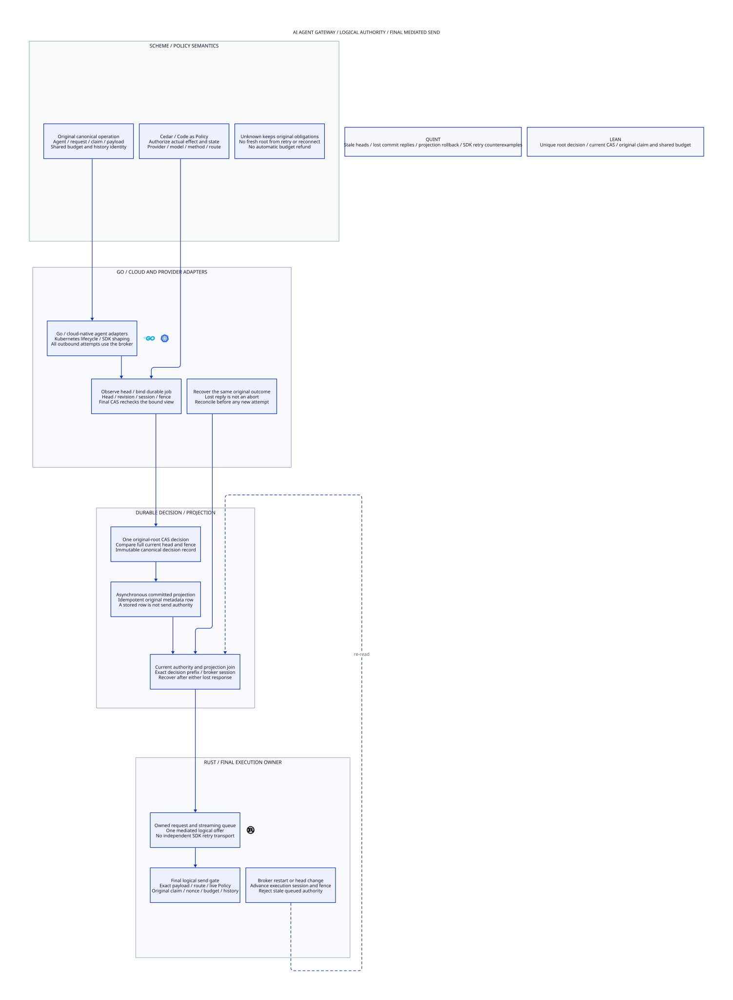

#+title: AI Agent Gateway Head Observation and Root CAS Index
#+language: en
#+options: toc:2

#+begin_quote
Historical Python verification entrypoints are retired. Commands and receipts
referenced below describe earlier experiments. Current native verification uses
the Go-owned plan; see [[file:../../50-59-research-program/59-provider-rpc/59.21-verification-ownership.org][verification ownership and coverage]].
#+end_quote

* Johnny Decimal category

Area =30-39 Assurance=; category =36 Gateway head CAS=. This is the current
Gateway interpretation of head/fence recovery: logical execution authority,
provider requests and final broker admission. Hardware isolation is outside
this core profile. Earlier sealed hardware-oriented models remain historical
conditional explorations; they are not prerequisites for this Gateway design.

| ID | Artifact |
|----+----------|
| 36.00 | This category index |
| 36.01 | [[file:36.01-authoritative-head-root-cas.org][Authoritative head observation and original-root CAS]] |
| 36.02 | [[file:36.02-gateway-head-cas.d2][Core D2]] /  |
| 36.03 | [[file:36.03-validation-evidence.org][Validation evidence]] |

* Four coordinated artifacts

[[file:../../../dev/proofs/lean/GatewayHeadCAS.lean][Lean]] composes with the pure finite-domain message/budget model.
[[file:../../../dev/proofs/quint/GatewayHeadCAS.qnt][Quint]] checks request/head/fence and cross-store fault interleavings.
[[file:36.01-authoritative-head-root-cas.org][Org]] and [[file:36.02-gateway-head-cas.d2][D2]] expose the same logical Gateway boundary. The design includes a
machine-checked named correspondence table. No gateway implementation or
dependency pin is changed.

#+begin_src sh :eval never
python3 dev/proofs/check_gateway_head_cas.py
#+end_src

* Embedded architecture views

** 36.02-gateway-head-cas.svg

