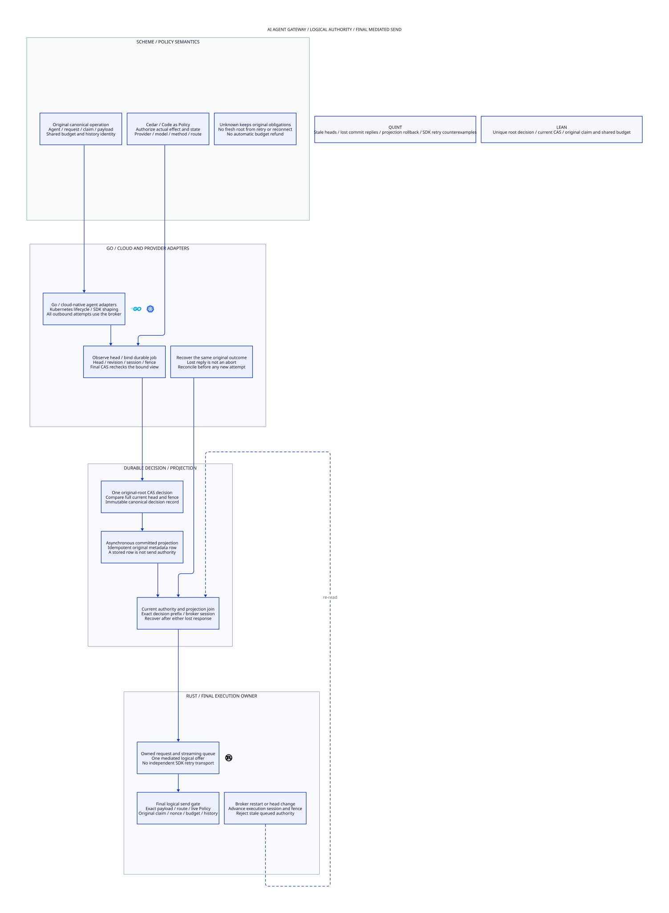

#+title: AI Agent Gateway Authoritative Head Observation and Original Root CAS
#+language: en
#+date: 2026-10-19
#+property: STATUS logical-gateway-profile-conditional-runtime-refinement-pending
#+options: toc:3

* Scope correction: AI Agent Gateway execution authority

Weaver is an AI Agent Gateway. Its enforcement boundary covers canonical agent
requests, provider/model routes, provider-client retries and redirects, message/stream queues,
original claims and budgets, and Rust broker admission of the actual send.
Isolation here means separation and revocation of logical execution authority.
A broker session, queue owner or routing head can be fenced through software
identity checks and durable conditional writes. HSM custody, device reset and
hardware physical isolation are not requirements of this core profile.

This corrects the focus of the preceding hardware-oriented exploration in
[[file:../35-intent-continuation/35.01-safe-continuation-recovery-progress.org][35.01]]. Its sealed evidence remains historical; this category supersedes its
hardware assumptions for the Gateway core. The new formal modules import only
LogicalMessageAuthority, SharedMessageBudget and FiniteDomainMigration. They do
not import the protected-signer, key-boundary or device-isolation models.

[[file:36.02-gateway-head-cas.d2][Core D2]] / , [[file:../../../dev/proofs/quint/GatewayHeadCAS.qnt][Quint]], [[file:../../../dev/proofs/lean/GatewayHeadCAS.lean][Lean]] and this Org form one design unit.
[[file:36.03-validation-evidence.org][36.03]] records checks and implementation limits. No gateway code or dependency
pin is changed. Logical head revisions are protocol state; software versions
and validation counts stay out of the core diagram.

* Core decision

An authenticated head observation is evidence about one exact authority image.
It is not a reusable execution grant. The original-root CAS compares that image
again at its authoritative linearization point. A new head, publication revision,
worker/fence, semantic ledger revision or completed original root invalidates
an old queued CAS request. Returning a head pointer to an earlier value does
not restore its old revision or fence.

The authority transaction decides the original logical root once. An independent
projection store may subsequently materialize that immutable decision. An
uncommitted prepared job cannot populate an authoritative completion projection.
A projection row, successful SDK callback or missing response cannot substitute
for the original root decision. Final send admission requires a fresh current
join of authority and materialized decision, the selected exact effect/route,
original consumed claim and live Policy.

Root completion here means one durable authorization/continuation disposition
for the original logical operation. It does not mean that a remote provider
executed or completed the operation. External outcome uncertainty retains the
original obligations and unknown budget.

* Identities and language boundaries

| Identity | Canonical binding | Meaning |
|----------+-------------------+---------|
| Logical message key | Immutable original request/payload identity and claim | Stable across SDK request IDs, new nonce, Authority, stream reconnect and process restart |
| Semantic domain | Canonical root, shared budget account and history account | Cannot be replaced to reclaim capacity or evade restrictive history |
| Head | Unique head ID, logical key/domain, payload identity, original claim token/stream, selected route and Policy generation | Current proposed execution scope |
| Authority view | Complete head plus publication revision, broker worker/session, fence and semantic ledger revision | Exact expected CAS image |
| Prepared job | Nonreused local job identity and original authenticated view | Proposed transaction, not completed authorization |
| Committed decision | Original job and actual full image at its successful root CAS | Immutable original-root outcome |
| Joined observation | Current authority view, complete decision prefix, exact projection rows and observing client boot | Current publication evidence, not independent authority |

Production encoding also binds principal/workload identity, method/protocol,
provider/model, request-body/header commitments, original grant/nonce reference,
Policy schema/context and canonical account/history references. The bounded
models represent these bindings with immutable IDs. Actual canonical encoding,
authentication, request shaping and policy evaluation remain runtime obligations.
The model's payload ID is not a byte-level proof of the emitted HTTP body.
Admission owns the authenticated alias-to-logical-key registry. The model assumes
that canonicalization is correct; equal client payloads alone do not prove that
two operations are identical. A new client-supplied ID cannot redefine that
registry or declare a replacement original root.

| Owner | Concrete responsibility | Authority boundary |
|-------+-------------------------+--------------------|
| Scheme | Define canonical operation identity, continuation meaning, claim/history/budget invariants and Policy request projection | Reconciliation never creates a fresh semantic root or refunds unknown work |
| Cedar Code as Policy | Evaluate the actual bound principal/action/resource/context and every required policy layer | An earlier allow is invalid when actual effect, route or relevant state changes |
| Go | Kubernetes lifecycle/reconciliation, provider/agent protocol shaping and network/Gerbil toolchain adapters | Every outbound attempt, retry or redirect returns to the Rust broker; adapter health and process identity are not execution authority |
| Rust authority/ledger owner | Persist prepared records and root decisions, authenticate full views and serialize root CAS against head/fence changes | Check expected image at the actual deciding write, not before an asynchronous queue |
| Rust final broker | Own outbound queue/transport admission, original consumption and exact request/route binding; recheck current authority and Policy | A stored projection, Gerbil toolchain callback or old queue handle cannot emit independently |
| Quint and Lean | Check fault traces and prove invariant preservation over real semantic source steps | No claim of native HTTP, database or provider refinement from finite models alone |

Go's network and Kubernetes ecosystems justify its adapter/control-plane role.
Rust owns the narrow execution path and concurrency-sensitive broker state.
Scheme retains semantic authority. These roles use language strengths without
requiring a copy of another Gateway's implementation language split.

* Authoritative head read and original-root CAS

The authority owner persists original root identity, canonical heads, current
publication revision, broker session/fence and original-root decisions. Prepared
jobs retain their exact original view. A client cache never reconstructs or
rewinds this durable state.

1. Read the complete current view from the authoritative owner. Verify origin,
   current session and exact semantic binding; a projection/local snapshot is
   not an authoritative head read.
2. Prepare an immutable job bound to that view and the original logical key.
   Concurrent queued jobs may exist, but neither creates a new root, nonce
   consumption, claim, reservation or send right.
3. At the root CAS, check the exact prepared view against current head, revision,
   worker/fence and semantic ledger revision. Verify original root unresolved,
   original claim/payload/account binding and current Policy. Commit the one
   canonical decision record atomically in that authority store.
4. Clear cached head/join observations after commit. A lost response leaves the
   decision committed. Resolve its original identity; do not issue a replacement
   root or infer abort from NotFound in a stale store.

The authority's persisted prepared-job record retains the authentic observation
that justified preparation. Clearing a client observation cache, losing an RPC
reply or restarting a client does not cancel a job already queued at the owner.
That job may still commit if its bound view remains exactly current. The CAS
checks the persisted job's provenance and current expected view, not whether a
client still remembers an observation. A broker restart/head fence invalidates
that view; a client timeout by itself does not. Cancellation would require a
separate authoritative protocol and is not inferred here.

Head change advances publication revision and fence. Broker restart also advances
worker/session identity. Republishing the same head advances revision even if
worker and fence are unchanged. Restoring an old known head creates a fresh
revision/fence; it is not restoration of its old permit. Gateway publication revision also advances on every semantic-state publication,
even when the underlying pure ledger operation does not increment its own
revision. The inherited semantic ledger revision is an additional check, not the
only invalidation coordinate. This explicitly closes the pure Quint fixture's
same-revision restriction/publication case without changing that historical model.

The owner must compare the entire expected version tuple and unresolved original
key within one conditional transaction. A read followed by an unconditional
write is unsafe. Rechecking only the head ID misses same-head republishing and
ABA; rechecking only worker/fence misses head or semantic-state changes.

* Cross-store commit, materialization and recovery

The authority decision is the sole root completion. The projection store contains
rebuildable metadata for that committed decision. It does not apply a financial
settlement, execute a provider request or release budget. This distinction permits
ordinary asynchronous persistence without assuming an atomic database/socket or
cross-database send transaction.

| Event or fault | Durable interpretation | Required response |
|----------------+------------------------+-------------------|
| Prepare persists; CAS has not committed | Original root unresolved; job is only intent | Never materialize it as a committed outcome or send from it |
| Request reply lost before CAS decides | Persisted queued job may still commit under its exact current view | Resolve the original job/root; timeout does not cancel it |
| CAS commits; reply lost | Original root completed once at authority | Recover original decision; subsequent jobs cannot commit that root again |
| Projection commits; reply lost | Same canonical metadata row exists | Idempotent write/read of that exact decision; no second authority transaction |
| Projection is restored to an older snapshot | Authority decision still exists; metadata may be missing | Invalidate join, rebuild canonical rows, reread exact current images |
| Projection row exists without a matching current authority decision | Orphan/conflicting evidence | Quarantine that result; never promote projection data to authority |
| Head/fence changes during a queued old CAS | Expected image is stale | Reject old transaction; a fresh view may prepare a new job for the same unresolved root |
| Old worker recovers after another worker committed | Original durable decision wins | No second root completion; current broker reads its historical result |
| Authority or required projection read is unavailable | Result/current join unknown | Keep original holds; block new final admission in this conservative profile |

Late writes of the exact already-committed projection row may be harmless
metadata operations. They do not acquire current broker authority and cannot
acknowledge a current fence on behalf of a new worker. A fresh current join is
still required before send. The projection's canonical-key conditional write
must reject a different row for the same original root. The formal profile
models duplicate identical rows idempotently and allows projection loss/rebuild;
it does not claim only one physical storage write across rebuilds.

A joined observation binds current head/revision/session/fence, semantic ledger
revision, the full authoritative decision prefix, exact committed projection
rows and observing client boot. Missing rows, stale snapshots, old client boots
or untrusted receipts do not establish JoinReady. A restart, head/fence change,
semantic update, partition or projection rollback invalidates cached authority.
The final broker checks that the join is still current at admission.

A concrete read-join protocol reads authority image A, reads and authenticates
canonical projection rows for A's committed prefix, and then confirms the exact
same authority image before publication. Final broker admission still compares
A's head/revision/session/fence and actual effect under its admission sequencer;
a previously successful two-read check is not a reusable permit. If either image
changes during this process, retry reconciliation without completing the root
again. This uses conditional publication and immutable decision identity, not
an assumed atomic read spanning two databases.

The model's JoinReady additionally requires current projection publication.
Coordinated projection restore/rebuild must invalidate its publication generation
and cached joins before new admission. A plain database read followed by a
cached ready flag does not implement that predicate. Integration must serialize
projection-generation invalidation with broker publication or keep new admission
closed until a new current join. Historical canonical row validity alone never
supplies current send authority. This publication/currentness refinement is an
explicit software obligation, not a proved database implementation.

The authority store's committed history is a durability and consistency premise,
which can be supplied by an ordinary qualified transactional/consensus storage
owner. Process checkpoint rollback must not overwrite that owner. This is not
a requirement for hardware antirollback. Complete unobservable rollback or a
fork of the deciding authority violates the premise; the model does not claim
it can detect such a history from an entirely rolled-back local state.

* Actual send, provider-client retries, redirects and streaming queues

Go adapters construct normalized attempt intents for the broker. They must not
retain an independent provider transport or credential path that bypasses it.
Automatic provider-client retries/redirects must be mediated as proposed attempts against
the same original logical key. Kubernetes election, a new request ID, reconnect
or new nonce cannot create a second original claim or restore its unknown budget.
Runtime network/credential permissions enforce this software mediation contract.

At final broker admission, join the original committed decision to the exact
currently selected head, payload and route. Re-evaluate live Cedar Policy and
original semantic eligibility. Use the original consumed claim/executor binding
and budget/history domain. An old authorization for route A cannot silently
become route B because an SDK follows a redirect. A response/body transformation
must preserve its canonical bound effect or be re-authorized explicitly.

The formal send event is an irreversible logical offer to the transport owner,
not provider delivery or a TCP packet. CAS, metadata materialization and final
offer are separate transitions. The actual runtime must serialize that final
admission with head/fence changes and Policy invalidation at the broker's queue
owner. Merely checking in Go before handing work to another transport queue
leaves a TOCTOU gap. Policy generation/invalidation must participate in the
same admission sequencer or an equivalently checked current Policy generation.
An eventually refreshed adapter policy cache does not prove immediate revocation.
The Lean actual_logical_offer_requires_broker_authority theorem is triggered by
the underlying semantic offer counter changing, not merely by an audit entry.

Logical fencing rejects not-yet-admitted stale work. Bytes or an offer already
accepted before a fence may complete afterward; software cannot retract bytes
already transmitted. Partial writes and missing provider outcomes retain the
original unknown obligation. They do not justify a new root or an automatic
second offer. Provider idempotency/status lookup would require its own explicit
contract; no exactly-once remote effect is claimed here.

The current formal module checks one original message/bounded logical offer per
canonical key and arbitrary finite shared-account support in Lean. The runtime
may host streaming queues, but this module does not prove arbitrary TCP chunk
replay/resume or all range-completion protocols. Future stream/range refinements
must carry the same root/head/fence and shared budget/history identities through
each admitted unit. Earlier historical range models do not import a hardware
requirement into this Gateway profile.

A broker process session and the POO semantic executor stamp are different
coordinates. Restarting a broker does not rewrite the original claim owner.
The pure source step still requires its current original executor ticket.
A new executor cannot inherit a consumed claim by copying a broker session ID.

* Fast path and publication ordering

The complete images in the model specify equality and provenance, not a required
full-history scan or interpreter invocation for every byte. Durable root CAS and
head publication are control-path operations. Rust can keep immutable validated
root/decision references and owner-local version words, while Go handles protocol
and cloud concurrency and Scheme defines stable semantics. Projection rows can
be indexed by canonical root and rebuilt asynchronously.

A cached reference is usable only if the publication protocol serializes every
head/fence/Policy invalidation with the final broker admission owner. An
independently updated database plus a periodically refreshed broker cache is
insufficient for immediate fencing. If the owner cannot establish currentness,
it closes new admission. A bounded durable spent/admission record precedes an
outbound attempt; a crash between that record and transmission can lose progress,
but must not restore the original right and resend an uncertain operation.

These are software transaction/queue-owner contracts, not hardware isolation or
an atomic database/socket write. Data already admitted can drain under its
original record; no second offer is reconstructed on restart. Runtime tests must
verify this refinement, including actual SDK transport hooks and credential /
network mediation. Policy denial and unknown admission never become permission
through a timer or optimistic cache reuse.

The proof uses a conservative semantic revision shared across relevant state.
Sharding may follow independently enforced authority domains, but cannot split
a shared budget/history account into unrelated per-request capacity or revision
checks. No throughput gain follows merely from choosing Go or Rust; matched
runtime measurements must qualify any such optimization.

* Source-grounded reuse and necessary extension

[[file:36.03-validation-evidence.org][The receipt]] contains freshly rehashed pinned source blobs and numbered excerpts.
The following reuse does not assert extraction or existing runtime implementation.

| Source | Directly reusable semantic mechanism | Required Gateway extension |
|--------+-------------------------------------+----------------------------|
| P12 authorized-effect-token | Exact payload/runtime/session/sequence/arena binding and immutable consume | Canonical provider/model/route/head/fence envelope at actual broker admission |
| P13 strict-mediation | Indeterminate result retains consumed nonce and sequencing | Persist original root decision and authoritative spent-state; no replacement claim on lost response |
| P15 effect-host | Consume before callback and check local identity | Mediate asynchronous provider/provider-client retries and final queue admission |
| P17/P22 durable store backend/store | Append/fsync/checkpoint/rebuild and recovery ownership mechanisms | Atomic expected-view/root CAS and authenticated current joins across independent projections |
| P18 promotion transaction recovery | Original authentic commit can be recovered; duplicate response is not a prior commit | Typed prepared versus committed versus projected Gateway decision |
| P19/P20 authorized recovery/application | Source-bound recovery joins; conditional effect uniqueness | Map to actual logical broker offer; metadata is not provider completion or budget settlement |
| P31/P43 session attempt | Pending is not runnable; revision/generation and trusted reconciliation are explicit | Current head/session/fence binding at the authoritative write and final broker |
| P33 runtime budget | Accounting and watchdogs have different authority | Unknown provider outcome remains held through retries, restart and projection loss |
| P35 monotonicity/prefix closure | Equality alone permits rollback; published full prefix and fork-free owner are explicit | Current head version tuple and original decision/projection join; ordinary durable owner qualification |
| C8 BoundOperation | Concrete effect/state projection and exact matching | Authenticate actual agent request, canonical payload, selected route and current owner state |
| C10 CompoundAuthorization | Every required nonempty layer allows without evaluation errors | Recheck the same concrete effect at final send, not merely in an adapter |
| C11 Composition | Typed alignment of policy/semantic components | Logical storage, adapter and transport-owner refinement remains explicit |

The executable foundation is the existing pure finite-domain migration model:
canonical aliases/domains, nonces, original claim/executor, restrictive history
and shared capacity. Every new control/storage transition stutters that ledger;
every semantic change or final offer carries an actual source Transition.
The initialized composition preserves original claim identity, at-most-once
claim/offer, nonce consumption and free/held/charged conservation. No hardware
model participates in this proof dependency graph.

* Four-artifact correspondence

| Contract | Org rule | Quint control/predicate | Lean evidence | Core D2 node |
|----------+----------+-------------------------+---------------+--------------|
| HC1 Current CAS image | Compare complete authoritative view at commit | casAudit; republishedHeadRejectsOldVersionTest; lostRequestReplyBeforeCommitCanStillCommitTest; otherMessagePolicyPublicationInvalidatesJobTest; semanticTicketPublicationInvalidatesJobTest | initialized_cas_audit; newly_committed_job_has_current_scope; initialized_read_provenance | cloud.observe |
| HC2 Unique original root | Competing jobs cannot complete root twice | rootUnique; twoQueuedJobsHaveSingleWinnerTest | initialized_unique_roots | ledger.cas |
| HC3 Prepared is not committed | No projection authority from an uncommitted job | rowsCommitted; preparedIsNotProjectionAuthorityTest | initialized_rows_are_committed; prepared_row_is_not_committed_counterexample | ledger.rows |
| HC4 New fence invalidates caches | Restored old worker/ABA cannot reuse permit | oldWorkerCannotCommitAfterRestartTest; abaHeadPointerDoesNotRestorePermitTest | changed_fence_clears_cached_authority; every_new_decision_rechecks_current_head | broker.fence |
| HC5 Cross-store join is current | Projection response is not send authority | joinSound; projectionWriteAloneCannotSendTest | new_join_requires_authentic_current_images; new_send_requires_exact_current_join | ledger.join |
| HC6 Historical metadata is safe to rebuild | Lost row reply or rollback does not recommit root | lostProjectionReplyIsIdempotentTest; projectionRollbackDoesNotRecommitRootTest | decisions_never_roll_back; initialized_rows_are_committed | cloud.recover |
| HC7 Actual effect remains bound | SDK route/body changes cannot reuse allow | sendBound; payloadChangeCannotReuseDecisionTest; redirectCannotWidenSelectedRouteTest | new_send_requires_exact_current_join | broker.gate |
| HC8 Original semantic identity persists | New broker session does not replace claim/executor | unknownBudgetRemainsHeldAcrossRestartTest | original_claim_and_history_survive; original_executor_survives | semantic.intent |
| HC9 Original shared obligations remain | No automatic refund or replay after unknown result | streamReconnectCannotReclaimOriginalTest | unknown_original_reservation_survives; shared_budget_is_bounded; nonce_consumption_once | semantic.unknown |
| HC10 Code as Policy reaches final admission | Current effect/state and live Policy gate actual offer | policyRevocationBlocksFinalOfferTest | actual_logical_offer_requires_broker_authority; original_claim_and_offer_once | semantic.policy |

[[file:../../../dev/proofs/evidence/gateway-head-cas/four-artifact-check.json][The named correspondence check]] verifies these references across actual Org,
Quint, Lean and D2. It is a consistency check, not a semantic equivalence or
runtime extraction proof. Update all four when changing a state, guard or failure
branch. The core diagram contains no hardware-isolation chain or check metadata.

* Counterexamples, software qualification and progress limits

Unsafe model controls show stale head CAS, semantic-publication CAS using an old view, old-worker CAS after a new fence,
duplicate root completion, treating prepared projection data as committed,
retaining an old join after fence advance and redirecting actual send outside
the authorized route. Lean constructs generic prepared-row, duplicate-root and
stale-fence counterexamples and composes the safe relation with initialized
semantic state.

Runtime qualification must race head changes/republication with queued CAS,
crash after authority commit or projection write but before response, restore
old adapter/broker clients and projection snapshots, and race final admission
with Policy revocation and route updates. Verify the actual canonical request
and root IDs at the broker, authority transaction order, original decision count,
logical offer count and retained budget/history. Exercise SDK automatic retry,
redirect and stream-reconnect paths through the same broker boundary.

Progress requires available authoritative storage, a recoverable canonical
projection, current Policy permitting the exact selected effect, and a scheduled
broker. A changed committed route, restricted history, stale semantic executor
or uncertain already-offered message can remain blocked. This profile proves
safety and concrete recovery cases; it does not inherit a liveness theorem from
the different earlier hardware/continuation graph. No native software/store or
provider refinement, performance claim or unconditional recovery guarantee is
asserted. No gateway implementation or dependency pin is changed.

* Embedded architecture views

** 36.02-gateway-head-cas.svg

