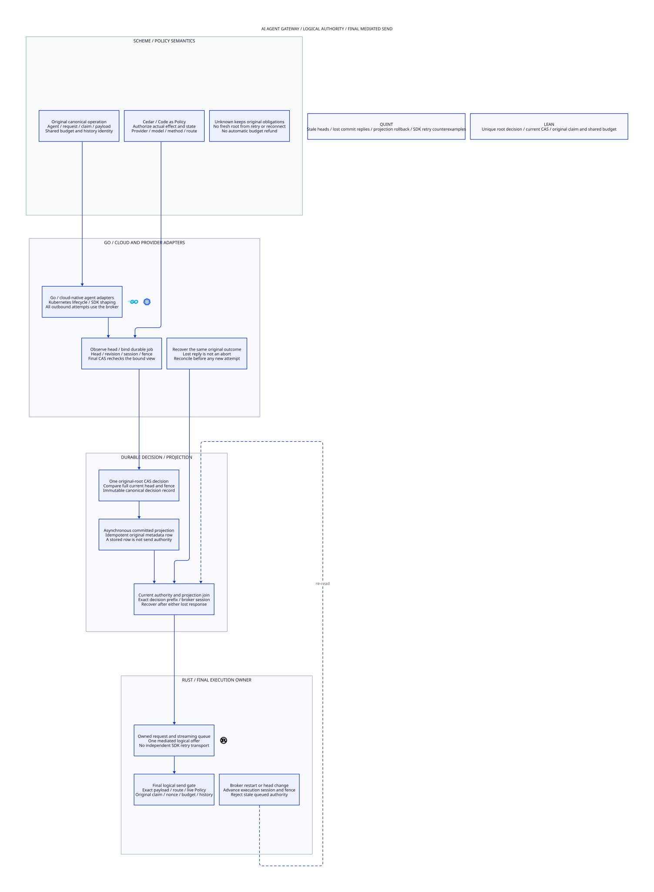

#+title: AI Agent Gateway Head CAS Validation Evidence
#+language: en
#+date: 2026-10-19
#+property: STATUS logical-gateway-model-checked-software-refinement-pending
#+options: toc:2

#+begin_quote
Historical Python verification entrypoints are retired. Commands and receipts
referenced below describe earlier experiments. Current native verification uses
the Go-owned plan; see [[file:../../50-59-research-program/59-provider-rpc/59.21-verification-ownership.org][verification ownership and coverage]].
#+end_quote

* Current scope and source identity

[[file:36.00-index.org][36.00 Index]], [[file:36.01-authoritative-head-root-cas.org][36.01 Org design]], [[file:36.02-gateway-head-cas.d2][36.02 Core D2]] / ,
[[file:../../../dev/proofs/quint/GatewayHeadCAS.qnt][Quint]] and [[file:../../../dev/proofs/lean/GatewayHeadCAS.lean][Lean]] define the AI Agent Gateway logical authority profile.
This explicitly corrects the prior focus on hardware physical isolation.
The [[file:../../../dev/proofs/evidence/gateway-head-cas/dependency-graph.json][proof dependency graph]] contains only the three pure message/shared-budget/
finite-domain modules. Earlier hardware-oriented profiles retain their sealed
historical receipts; they are not current Gateway prerequisites.

Workspace: /Users/guangtao/ghq/github.com/tao3k/weaver; branch =main=;
tracked HEAD =4df1f0233f9a78e5a3ea8a1a0d8aaca983698b8d=. Architecture/formal
artifacts remain untracked working-tree content. No gateway code, upstream source,
dependency pin, commit or push was changed. [[file:../../../dev/proofs/evidence/gateway-head-cas/dependency-identity.log][Dependency file identities]] equal the
preceding sealed receipt.

[[file:../../../dev/proofs/evidence/gateway-head-cas/source-review.json][Eighteen pinned source blobs]] were freshly read and SHA256 checked at POO Flow
=a74fc2fd63437252175b5a67649ee54b886d3bf4= and cedar-poo-spec
=c8d1a0641120cf65e299e8a98f9fe7666ca96ab5=. [[file:../../../dev/proofs/evidence/gateway-head-cas/source-boundary-review.log][Numbered pending/revision/commit/
prefix/BoundOperation readings]] support the design's per-source reuse/extension
matrix. Source comparison is not native ABI, policy-engine extraction or runtime
provider qualification. No dependency compatibility migration is performed.

* Reproduction and final commands

#+begin_src sh :eval never
python3 dev/proofs/check_gateway_head_cas.py
python3 dev/proofs/evidence/gateway-head-cas/check-four-artifacts.py
#+end_src

[[file:../../../dev/proofs/evidence/gateway-head-cas/versions.log][Recorded tools]]: Lean 4.34.1, Std only; Quint 0.33.0, TypeScript backend;
D2 version recorded separately. Four Lean modules were built in a fresh isolated
olean directory; the final changed module was rebuilt there after adding the
actual logical-offer gate theorem. [[file:../../../dev/proofs/evidence/gateway-head-cas/commands.json][14 final command records]] retain exact arguments,
exit codes, timings and watchdogs. All final commands exited zero. Compile and
typecheck use 20 seconds, deterministic/focused controls 55 seconds, each sampling
route 30 seconds. No watchdog was widened. These are proof/model timings, not
Gateway performance measurements.

| Command | Exit | Seconds | Evidence |
|---------+------+---------+----------|
| LogicalMessageAuthority | 0 | 3.502 | [[file:../../../dev/proofs/evidence/gateway-head-cas/LogicalMessageAuthority.log][raw log]] |
| SharedMessageBudget | 0 | 0.932 | [[file:../../../dev/proofs/evidence/gateway-head-cas/SharedMessageBudget.log][raw log]] |
| FiniteDomainMigration | 0 | 0.988 | [[file:../../../dev/proofs/evidence/gateway-head-cas/FiniteDomainMigration.log][raw log]] |
| GatewayHeadCAS | 0 | 0.996 | [[file:../../../dev/proofs/evidence/gateway-head-cas/GatewayHeadCAS.log][raw log]] |
| typecheck | 0 | 2.153 | [[file:../../../dev/proofs/evidence/gateway-head-cas/typecheck.log][raw log]] |
| tests | 0 | 2.824 | [[file:../../../dev/proofs/evidence/gateway-head-cas/tests.log][raw log]] |
| counterexamples | 0 | 1.933 | [[file:../../../dev/proofs/evidence/gateway-head-cas/counterexamples.log][raw log]] |
| originals | 0 | 1.846 | [[file:../../../dev/proofs/evidence/gateway-head-cas/originals.log][raw log]] |
| admitted | 0 | 2.027 | [[file:../../../dev/proofs/evidence/gateway-head-cas/admitted.log][raw log]] |
| prepared | 0 | 1.901 | [[file:../../../dev/proofs/evidence/gateway-head-cas/prepared.log][raw log]] |
| committed | 0 | 1.909 | [[file:../../../dev/proofs/evidence/gateway-head-cas/committed.log][raw log]] |
| materialized | 0 | 1.807 | [[file:../../../dev/proofs/evidence/gateway-head-cas/materialized.log][raw log]] |
| ready | 0 | 1.917 | [[file:../../../dev/proofs/evidence/gateway-head-cas/ready.log][raw log]] |
| finite-domain-regression | 0 | 1.358 | [[file:../../../dev/proofs/evidence/gateway-head-cas/finite-domain-regression.log][raw log]] |

The final =Test$= route passes 59 controls: 17 directly imported finite-domain
controls and 42 new controls (35 positive/rejection controls and seven intentional
counterexamples). The independent finite-domain regression passes 17 controls.
No hardware-oriented regression is silently counted as a Gateway core result.

Six initializers (=originals=, =admitted=, =prepared=, =committed=,
=materialized=, =ready=) each ran 10 samples of at most 25 post-initializer steps,
seed 131: 60 bounded samples without invariant violations. The fixture contains
four canonical message slots and admits two original claims sharing one budget;
Lean uses an arbitrary finite canonical key list. Finite sampling is not
exhaustive model checking, temporal liveness or runtime transport qualification.

[[file:../../../dev/proofs/evidence/gateway-head-cas/axiom-audit.log][23 printed Lean declarations]] contain no sorryAx or compiler errors. Standard
propext/Quot.sound and inherited Classical.choice remain. The initialized
composition proves root decision uniqueness, committed-only projection rows,
exact CAS snapshots, current join evidence, preserved claim/executor/history,
nonce consumption, shared capacity and free/held/charged conservation. The
actual_logical_offer_requires_broker_authority theorem is triggered by an
underlying semantic offer changing, not by an audit entry alone. It requires
the current join, original decision, exact selected head and live Policy.

Authentication, current concrete Policy evaluation, ordinary durable authority
and serialized actual broker admission are explicit software refinement premises.
The proof does not import protected-signer/device-isolation requirements and
does not certify an actual database, HTTP client or Cedar binary.

* Intentional counterexamples and final-state assertions

[[file:../../../dev/proofs/evidence/gateway-head-cas/counterexample-observations.json][Decoded final states]] were independently checked for seven focused ITFs.
Unsafe actions are excluded from the safe step relation.

| Unsafe control | States including setup | Trace |
|----------------+------------------------+-------|
| duplicateRootCompletion | 28 | [[file:../../../dev/proofs/evidence/gateway-head-cas/itf/duplicateRootCompletionCounterexampleTest-3.itf.json][ITF]] |
| oldWorkerCAS | 28 | [[file:../../../dev/proofs/evidence/gateway-head-cas/itf/oldWorkerCASCounterexampleTest-2.itf.json][ITF]] |
| preparedProjectionAsCommit | 27 | [[file:../../../dev/proofs/evidence/gateway-head-cas/itf/preparedProjectionAsCommitCounterexampleTest-4.itf.json][ITF]] |
| redirectedFinalSend | 30 | [[file:../../../dev/proofs/evidence/gateway-head-cas/itf/redirectedFinalSendCounterexampleTest-6.itf.json][ITF]] |
| semanticPublicationCAS | 28 | [[file:../../../dev/proofs/evidence/gateway-head-cas/itf/semanticPublicationCASCounterexampleTest-0.itf.json][ITF]] |
| staleHeadCAS | 28 | [[file:../../../dev/proofs/evidence/gateway-head-cas/itf/staleHeadCASCounterexampleTest-1.itf.json][ITF]] |
| staleJoinAfterNewFence | 30 | [[file:../../../dev/proofs/evidence/gateway-head-cas/itf/staleJoinAfterNewFenceCounterexampleTest-5.itf.json][ITF]] |

- A semantic publication with unchanged parent-ledger revision admits an old CAS view.
- Same-head republishing admits a queued job with a stale expected revision.
- A restored old worker commits using a view from before the new broker fence.
- Two distinct decisions complete the same original logical root.
- An uncommitted prepared job is projected as though it were committed.
- An old joined observation survives fence advance and appears reusable.
- The actual logical offer is redirected outside its committed selected route.

Lean constructs generic prepared-row, duplicate-root and stale-fence
counterexamples for arbitrary job/decision values. Positive and rejection
controls additionally cover lost authority/projection replies, projection
rollback/rebuild, two queued CAS jobs, head pointer ABA, policy restriction,
request-payload mismatch, client/broker restart and stream reconnect.
A late projection write of the same original committed row may be metadata;
it cannot provide current send authority without a new joined observation.

* Four artifacts and documentation checks

[[file:../../../dev/proofs/evidence/gateway-head-cas/four-artifact-check.json][Ten correspondence rows]] and their checker (retired Python driver) resolve concrete predicates/tests,
Lean declarations and core D2 nodes named by Org. This verifies references,
not semantic equivalence or native extraction. The diagram uses bundled official
Go/Kubernetes/Rust icons, the shared four-column theme and logical Gateway
ownership. It contains no hardware isolation chain, software versions or check IDs.

[[file:../../../dev/proofs/evidence/gateway-head-cas/document-check.log][Document inventory and links]],
[[file:../../../dev/proofs/evidence/gateway-head-cas/diagram-validation.json][D2 validation]],
[[file:../../../dev/proofs/evidence/gateway-head-cas/visual-check.log][Rendered visual inspection]],
[[file:../../../dev/proofs/evidence/gateway-head-cas/org-export.log][Org export]] and
[[file:../../../dev/proofs/evidence/gateway-head-cas/historical-manifests.log][Historical byte verification]] record the final documentation checks.
Org export disables Babel. Optional htmlize highlighting diagnostics are
retained in its raw output.

[[file:../../../dev/proofs/evidence/gateway-head-cas/SHA256SUMS][The new byte manifest]] seals this category, canonical formal sources, runner,
source snapshots and raw evidence. All twelve earlier manifests remain byte-valid.
No historical result was silently rewritten to endorse the corrected core scope.

* Retained development diagnostics

Initial Quint diagnostics used nondeterministic oneOf in deterministic test
expressions. Named deterministic job selectors corrected that harness issue.
Initial Lean record-field and join-proof diagnostics are retained alongside
intermediate check logs and the failed four-command compile route. Final
successful commands are separately recorded; no sorry or watchdog widening
was used. Cross-review also found that the pure Quint parent restrict operation does not
advance its ledger revision in the same way as the Lean parent. Gateway now
advances its own publication revision on every semantic publication; old jobs
cannot survive unrelated message/policy state changes. The [[file:../../../dev/proofs/evidence/gateway-head-cas/semantic-publication-review.json][numbered parent-model comparison]] records this difference. The historical parents
remain untouched. A further review removed the invalid assumption that losing a client read cache
cancels a persisted queued CAS. The new initialized_read_provenance proof keeps
authentic preparation evidence in the job history; final CAS compares the exact
current owner image and may finish after a client timeout. Two focused positive
controls cover that delayed completion and client restart. Source-level request
payload was added explicitly to the head/send
binding rather than relying on route identity alone.

* Remaining runtime acceptance and progress limits

Qualify actual broker queue admission, authoritative conditional writes and
currentness publication ordering with a provider/SDK adapter. Crash between
authority/projection commits and their replies, restore obsolete clients and
projection snapshots, race head/Policy updates with queued sends, and exercise
SDK retry/redirect and partial-stream outcomes. Check actual canonical requests,
logical offers and retained original budgets, not merely successful callbacks.

The model's send is an irreversible logical offer, not remote provider delivery
or all TCP/range replay semantics. No exactly-once provider effect, full stream
resume theorem, immediate global revocation from an asynchronous policy cache,
complete authority-rollback detection, unconditional recovery liveness or
performance improvement is claimed. There is no hardware-isolation requirement
in this core profile. No Gateway implementation or dependency pin is changed.
