# SPDX-FileCopyrightText: 2026 hardenedlinux Linux Team and Contributors
#
# SPDX-License-Identifier: LGPL-2.1-or-later AND Apache-2.0

#+title: Durable Consumption to Final Broker Queue
#+language: en
#+options: toc:3
#+property: STATUS design-and-conditional-model-proof-runtime-refinement-open

* Core decision

[[file:37.00-index.org][37.00 Index]]; [[file:37.02-broker-consumption-queue.d2][core D2]] / ; [[file:37.03-validation-evidence.org][validation evidence]].

Durable nonce consumption, queue acceptance, local write invocation and provider
execution are distinct events. A spent record is neither proof of enqueue nor
permission to recreate an outbound request. A queue acknowledgement is neither
a provider completion nor evidence of final usage. Unknown outcomes retain the
original claim, budget reservation and history restriction.

The Gateway owns logical execution rights through a Rust final broker. Go owns
cloud-native integration and Gerbil toolchain adaptation. Scheme owns canonical operation
identity, Cedar policy semantics and accounting/history rules. These are software
contracts. No physical isolation mechanism is required by this profile.

The category-36 abstract =send= event is refined here as the one irreversible
logical admission of an original operation. It occurs at authoritative broker
consumption, before downstream queue work. It does not denote a TCP write or a
provider success. This explicitly narrows the older diagram's ambiguous term
"offer"; it does not assume that durable storage and network I/O are atomic.

* Immutable identity and persistence contract

One authenticated operation binds principal, agent/session, original logical key,
claim token and stream, original nonce consumption, budget/history domains,
provider/model/method/route, canonical payload and immutable wire manifest,
Policy publication and broker generation/fence. A manifest covers application
payload ranges and their exact encoding; offsets must not silently refer to a
new compression, framing, credential or SDK-generated body.

The queue key is derived from this original operation and manifest identity.
Nonce, SDK attempt number, reconnect ID, worker generation and queue epoch are
not alternative business identities. Reusing the key with different bytes or a
different route is rejected. Recovery reattaches to the original operation; it
does not issue a new claim or debit a different account.

The parent readiness state has already consumed the semantic nonce and reserved/
claimed the original message. The new =q.spent= flag records Rust broker-level
consumption of that already-bound logical admission; it is not another semantic
nonce consumption. Runtime publication must authenticate both layers before enqueue.

The consumption CAS and a canonical handoff intent are authoritative durable
records. They may share a transaction when one owner/store provides it. If they
are separate, a worker first proves original consumption, then idempotently
persists the same intent. An orphan intent cannot authorize enqueue. Losing the
CAS response triggers authoritative lookup of the original key; absence from a
replica, cache or projection is not proof of non-commit.

Queue acceptance uses a durable insert-or-compare keyed by that same identity.
Re-submission returns the same acceptance without creating a second runnable
item. The accepted tombstone, consumed write slots and their immutable ranges
survive queue/broker restart. This is a required software storage contract,
not a property established merely by declaring an outbox table. A local fsync
alone does not establish cross-store atomicity or anti-rollback freshness.

Recovery must join the authoritative spent record, original intent, queue
acceptance and consumed-range prefix at the selected durable publication.
Unverifiable or inconsistent recovery blocks new execution and budget release.
Whole-store snapshot rollback is excluded by this model's persistent-state
premise; the prior logical publication/anchor contract must detect it before
activation. Replaying a snapshot must not reset these identities or tombstones.

* Protocol and failure branches

| State or event | Durable meaning | Allowed next action | Failure handling |
|----------------+-----------------+---------------------+------------------|
| Prepared only | No authoritative consumption | Retry original CAS with current authority | A lost request is not an abort |
| Consumed, no intent | Original nonce/claim admission is spent | Persist same canonical intent | Crash resumes from original spent record |
| Intent persisted | Original operation is eligible for queue reconciliation | Submit same queue key | Intent alone cannot bypass live Policy |
| Accepted, reply lost | Durable dedup slot exists | Query or re-submit same key | Never allocate a second runnable item |
| Range reserved | Durable interval and epoch allocated before invocation | Final gate may invoke that exact interval | Crash does not prove no invocation |
| Invocation consumed | At most one application call for that interval | Await bound evidence | Timeout/partial result retains pending interval |
| Full interval receipt | Exact original interval attributable as locally completed | Advance to the next non-overlapping suffix | Receipt does not prove provider execution |
| Terminal plus final usage | No pending/unknown interval; authenticated operation outcome and usage | Idempotent original settlement decision/application | Account write loss is reconciled by original settlement key |

A consumption reply lost before intent persistence is safe to reconcile because
it does not itself submit bytes. A queue reply lost after acceptance is safe to
re-submit only because the final queue owner retains the original durable dedup
slot. Without that contract, automatic re-submission is forbidden.

Restart clears execution activation. A trusted recovery join must re-establish
the current durable prefix before a worker can reserve or invoke another range.
Recovery does not relabel a previously pending interval.

The queue must not equate "not visible in a local queue" with "never accepted".
An enqueue that is rejected before any acceptance has an attributable negative
result. An enqueue whose outcome is unknown remains attached to the original
slot. An explicit rejection does not undo nonce consumption; reauthorization,
if permitted, continues the same original claim and held reservation.

* Final write gate, concurrency and partial streaming

Before each invocation, Rust serializes the final authority check and invocation
consumption at the execution owner. It authenticates current broker generation,
fence, exact operation/manifest, current Policy and history restriction, queue
acceptance and original reservation. No detached Go permit authorizes transport.
A cached earlier allow or a reserved interval does not survive a new fence.

The =reserveWrite(n)= transition records =[frontier, frontier+n)= before the
call. The frontier never decreases. The invocation consumes that interval's call
slot once and marks its outcome unknown before handing control to the transport.
A second SDK call for the same interval is rejected even after a lost reply.
The broker may reserve a later suffix only after the original pending interval
has a matching full receipt. Ranges are disjoint and bounded by a finite manifest.

The interval consumption and actual application call have a crash gap. This
model chooses safety: recovery never replays the pending interval, even when a
crash may have occurred before the call. A current worker cannot relabel an old
pending interval with its new epoch. This may stall the operation indefinitely.
A future resumable protocol must add authoritative, bound non-delivery evidence
or a provider-supported idempotency/offset protocol; a timeout is insufficient.

A partial write, cancellation, connection close or timeout does not clear the
pending interval. Bytes already handed off may still drain after revocation.
A known partial byte count alone does not prove that the remainder is absent
from SDK/internal queues. It cannot create a fresh tail capability. The present
model deliberately blocks automatic partial-range replay or suffix recovery
inside that uncertain interval. It allows a next disjoint range only after a
full original receipt. A stream reconnect cannot resend headers, prompt or
previous chunks under a new logical key.

Concurrent reserve/invoke requests are serialized or CAS-protected by the same
logical execution owner. Checking a fence and then allowing an independent
worker to call the SDK is insufficient: the check-to-call race remains open.
Fencing linearizes at application invocation admission; it cannot retract an
invocation already admitted. Kernel packet retransmission is not a second
application request. provider-client retries, HTTP redirects, provider fallback, reconnect
and SDK background sends are application effects and must return through the
broker's original identity and policy gate.

A matching late receipt may resolve the original pending interval after restart.
Its authority derives from the original operation/range/call provenance, not
from a stale worker's permission. A receipt for an earlier interval cannot clear
a later interval. Full local write completion still needs a separately trusted
terminal operation outcome and final usage; it is not financial settlement.

* Budget, completion and history

An invoked interval with unknown outcome retains the original reservation. A
stream is not released while any pending/unknown interval remains. Neither a
queue acknowledgement nor an SDK completion callback supplies trusted final
usage by itself. The terminal record must bind the original manifest and all
range outcomes; final usage must bind that terminal outcome, account/domain,
units, maximum reservation and attributable provider operation identity.

The =settle= transition models authorization of a single original settlement,
not a new implementation of account storage. It requires terminal evidence,
final usage, no pending/unknown interval and an unapplied settlement slot. Late
account receipts only reconcile the original immutable settlement decision.
They cannot select a new amount, refund unknown usage or allocate another key.
Existing settlement/account-application contracts remain necessary for actual
cross-store balance mutation. The Lean product stutters on the inherited shared
ledger: no queue failure restores its original claim or reservation capacity.
It does not prove a new numerical billing algorithm or concurrent account API.

* Language responsibilities and the non-bypass boundary

| Owner | Required responsibility | Forbidden inference |
|-------+-------------------------+---------------------|
| Scheme / POO Flow | Canonical root/domain/manifest semantics, strict mediation state, Cedar requests, history monotonicity, reservation and settlement rules | A pure updated state or receipt is already durably published |
| Go | Kubernetes discovery/lifecycle, provider and agent protocol shaping, backpressure, cancellation, Gerbil toolchain instrumentation and original-key reconciliation | provider-client retry, redirect or reconnect creates transport authority |
| Rust broker | Durable consumption bridge, authoritative queue insert-or-compare, immutable range intents, final live-policy gate, per-range invocation CAS, receipt provenance and recovery blocking | Accepted queue entry or persisted row proves provider completion |
| Cedar | Evaluate all required layers against authenticated actual operation/state, deny errors and mismatches | Cedar allow performs storage, authenticates inputs or prevents a transport bypass |
| Quint | Exercise commit/enqueue/write crash schedules and unsafe counterexamples | Bounded tests prove arbitrary deployment behavior |
| Lean | Prove transition invariants, arbitrary finite disjoint ranges and conditional admission composition | A theorem establishes the native Gerbil toolchain/storage refinement |

Go is selected for its cloud-native networking and Kubernetes/provider ecosystem,
not as a second egress authority. Rust is selected for explicit ownership and
controlled low-level transport integration. The runtime must ensure every
provider-bound application request uses the broker, including Gerbil toolchain background
paths. Language choice alone cannot enforce that deployment property. Scheme's
semantic descriptors must reach Rust as authenticated immutable data; Go may
shape bytes only within the authorized manifest/route or request a fresh semantic
decision attached to the same original obligations.

* Pinned source comparison: direct reuse and missing bridge

[[file:../../../dev/proofs/evidence/broker-consumption-queue/source-review.json][Freshly hashed source images]] and [[file:../../../dev/proofs/evidence/broker-consumption-queue/source-boundary-review.log][numbered excerpts]] support this matrix.
Source identities and tool versions belong in the evidence receipt, not D2.

| Source | Direct reuse | Required extension or unproved premise |
|--------+--------------+---------------------------------------|
| P12 authorized-effect-token | Runtime/session/sequence, payload and generation binding; immutable token consumption | Persist authoritative spent state before queue authority; bind immutable wire manifest |
| P13 strict-mediation | Observation unavailable still consumes nonce and advances sequence; fail closed | Publish returned state by authoritative CAS; a caller cannot keep an old validation context |
| P15 effect-host | Exact serialized owner and consume-before-deliver handoff; delivered differs from indeterminate | Durable queue dedup, restart recovery and final SDK invocation instrumentation are not supplied |
| P17/P22 durable store backend/store | Runtime ownership of append, fsync, leases, checkpoints and repair | Implement the selected spent/intent/queue publication contract; no atomic socket transaction follows |
| P18/P19 recovery proofs | Authentic prior-commit identity and source-bound recovery joins | Prove recovered queue prefix and original binding; response loss is not a negative commit receipt |
| P20 exactly-once application | Conditional declared effect-universe reasoning | Its effectUniverseExecutesExactlyOnce premise is not a provider exactly-once implementation |
| P31/P43 session attempt | Pending is not runnable; pure recovery/reconcile intents; unpublished receipt flags | Host must resolve attributable receipts and publish by CAS before execution |
| P33 runtime budget | Separate watchdog and deterministic/runtime obligations | Timeout never restores unknown reservation |
| P35 context/lineage closure | Exact domain and published prefix; explicit fork-free lineage assumptions | Equality of a rolled-back snapshot is not freshness or exclusive queue ownership |
| C8 BoundOperation | Exact operation/state match | The Host must authenticate actual effect/state and encoded request |
| C10 compound authorization | Nonempty required layers allow without evaluation errors | Re-evaluate current restrictions at final invocation; do not trust an old allow cache |
| C11 composition | Typed authorization/composition alignment | No native queue, storage, transport or SDK refinement proof is inherited |

* Four-artifact correspondence

[[file:../../../dev/proofs/quint/BrokerConsumptionQueue.qnt][Executable Quint]] imports GatewayHeadCAS. Its consumption action invokes the
actual parent send transition; downstream actions cannot invoke it again. Lean
[[file:../../../dev/proofs/lean/BrokerConsumptionQueue.lean][BrokerConsumptionQueue]] imports the same parent proof layer. Its =Admission=
requires an initialized parent run and actual send-count-changing transition.
The =Product= combines that admission with a downstream queue run. Source claim,
nonce and shared-budget proofs are reused through the parent; downstream queue
steps stutter on that semantic snapshot.

Lean proves range properties for every natural finite manifest length and every
finite run of this single-original-operation queue. It does not compose a new
concurrent multi-message billing service. The inherited finite-domain model
supplies shared-account safety; coupling a real account mutation to these queue
receipts remains a runtime refinement obligation.

| Contract | Org rule | Quint declarations | Lean declarations | D2 node |
|----------+----------+--------------------+-------------------+---------|
| BQ1 | Original consumption survives reply loss | lostConsumeReplyTest; duplicateConsumptionRejectedTest | durable_consumption_survives; admission_has_current_policy | ledger.cas |
| BQ2 | Intent precedes deduplicated acceptance | missingIntentCannotEnqueueTest; lostQueueReplyTest; enqueueBeforeIntentCounterexampleTest | accepted_tombstone_survives; initialized_safe | ledger.rows |
| BQ3 | Restart retains accepted identity | crashBeforeEnqueueTest; crashAfterEnqueueTest; restartRequiresPrefixRecoveryTest; verifiedRecoveryContinuesSuffixTest; forgedRecoveryRejectedTest; restartedSpentLossCounterexampleTest | accepted_tombstone_survives; queue_refinement_preserves_original_affinity | ledger.join |
| BQ4 | Final current worker and Policy gate | oldWorkerCannotInvokeTest; newWorkerCannotRelabelRangeTest; revocationBeforeInvokeTest; routeChangeBeforeInvokeTest; localReallowCannotUndoHistoryRestrictionTest | invocation_rechecks_final_gate; stale_worker_cannot_invoke | broker.gate |
| BQ5 | SDK invocation slot is consumed once | sdkRetryCannotInvokeAgainTest; sdkReplayCounterexampleTest | initialized_at_most_one_invocation; repeated_sdk_invocation_counterexample | broker.queue |
| BQ6 | Range frontier never recreates a tail | secondRangeUsesUnwrittenSuffixTest; overlappingTailCounterexampleTest; crashBeforeCallCannotAllocateTailTest | initialized_nonoverlapping_ranges; frontier_monotone; overlapping_tail_counterexample | broker.queue |
| BQ7 | Partial or unknown writes retain hold | partialWriteKeepsHoldTest; partialWriteCannotReplayTest; timeoutCannotSettleTest; timeoutRefundCounterexampleTest | unknown_retains_original_hold; end_to_end_unknown_preserves_obligations; unknown_refund_counterexample | semantic.unknown |
| BQ8 | Late receipts resolve only original intervals | forgedReceiptRejectedTest; lateOriginalFullReceiptTest; oldReceiptCannotClearNewTailTest; unboundLateReceiptCounterexampleTest | full_receipt_rechecks_original_pending; settlement_has_every_original_range_receipt | cloud.recover |
| BQ9 | Terminal usage precedes single settlement | normalCompletionTest; missingFinalUsageTest; duplicateSettlementRejectedTest | settlement_requires_terminal_evidence; initialized_receipt_coverage | broker.fence |
| BQ10 | Queue failures preserve shared obligations | nonceRetryCannotMintNewAdmissionTest; authorityBound | queue_refinement_preserves_shared_budget; queue_refinement_preserves_original_affinity | semantic.intent |

* Explicit premises, counterexamples and remaining acceptance

The safe transition system assumes durable authoritative records do not roll
back, a single final execution owner serializes admission, authenticated bindings
cannot be substituted, current Policy observation is trustworthy, and receipt
validation authenticates original provenance. Lean =ReceiptOwner.recoveryValid=, =policyValid=,
=fullValid=, =terminalValid= and =usageValid= are explicit predicates whose runtime
implementations remain to be refined. They are not cryptographic or I/O proofs.
The model has no hidden claim of remote exactly-once delivery.

Six unsafe Quint schedules deliberately remove one contract: repeated SDK call,
unknown refund, overlapping tail, forgotten spent state, acceptance without intent,
and unbound late receipt. The last passes weak terminal/usage booleans but fails
=evidenceBound=: all original reserved ranges must have matching full receipts.
Lean has explicit unsafe-state witnesses for repeated invocation, unknown refund
and overlap, plus initialized receipt-coverage and clearing-provenance theorems.
These are conditional machine proofs and counterexamples, not extracted Cedar
execution, a native queue implementation or external provider qualification.

Future runtime acceptance must inject crashes before and after consumption CAS,
intent persistence, queue acceptance, write-intent persistence, call consumption
and real invocation; drop each response independently; race restart/revocation
with the final invocation; trigger provider-client retry/redirect/background sends; deliver
partial writes and reordered old receipts; and recover inconsistent queue/store
snapshots. Observe actual application request IDs, exact manifest intervals,
authoritative spent/accepted prefixes, current fence and held/charged account
state. Reject any duplicate interval invocation, mismatched receipt, forgotten
spent key or release while outcome is unknown. Provider-supported idempotency
would need its own documented semantics and acceptance evidence.

No throughput claim follows from these checks. The high-performance path keeps
bytes/queues in Rust, amortizes immutable policy/manifest decoding, uses bounded
backpressure, and performs authoritative CAS/live-policy checks at the semantic
admission/write boundaries. Batching must preserve every original interval and
its failure status; an unverified cache hit cannot skip a final gate. No latency
optimization may turn an unknown result into permission to replay.

* Embedded architecture views

** 37.02-broker-consumption-queue.svg

