#+title: Broker Consumption Queue Validation Evidence
#+language: en
#+date: 2026-10-19
#+property: STATUS conditional-model-checked-native-refinement-open
#+options: toc:2

#+begin_quote
Historical Python verification entrypoints are retired. Commands and receipts
referenced below describe earlier experiments. Current native verification uses
the Go-owned plan; see [[file:../../50-59-research-program/59-provider-rpc/59.21-verification-ownership.org][verification ownership and coverage]].
#+end_quote

* Scope and identity

[[file:37.00-index.org][Index]], [[file:37.01-consumption-to-final-queue.org][design]], [[file:37.02-broker-consumption-queue.d2][D2]] / ,
[[file:../../../dev/proofs/lean/BrokerConsumptionQueue.lean][Lean]] and [[file:../../../dev/proofs/quint/BrokerConsumptionQueue.qnt][Quint]] form category 37. The proof scope is software
execution authority for an AI Agent Gateway, without physical isolation.

Workspace: /Users/guangtao/ghq/github.com/tao3k/weaver; branch =main=;
tracked HEAD =4df1f0233f9a78e5a3ea8a1a0d8aaca983698b8d=. Architecture and
formal artifacts remain untracked. No Gateway implementation, dependency pin,
upstream source, commit or push was changed. [[file:../../../dev/proofs/evidence/broker-consumption-queue/dependency-identity.log][Dependency identities]] match the
preceding category-36 receipt. Its historical sealed files remain unchanged.

[[file:../../../dev/proofs/evidence/broker-consumption-queue/source-review.json][Eighteen source images]] were freshly read and SHA256 checked at POO Flow
=a74fc2fd63437252175b5a67649ee54b886d3bf4= and cedar-poo-spec
=c8d1a0641120cf65e299e8a98f9fe7666ca96ab5=. [[file:../../../dev/proofs/evidence/broker-consumption-queue/source-boundary-review.log][Numbered source readings]] distinguish
pure consumption, serialized local delivery, runtime store ownership, unpublished
session intents and conditional authorization/application proofs. These readings
do not establish native queue or provider behavior.

* Reproduction and final formal evidence

#+begin_src sh :eval never
python3 dev/proofs/check_broker_consumption_queue.py
python3 dev/proofs/evidence/broker-consumption-queue/check-counterexample-observations.py
python3 dev/proofs/evidence/broker-consumption-queue/check-four-artifacts.py
#+end_src

[[file:../../../dev/proofs/evidence/broker-consumption-queue/commands.json][Final command records]] retain arguments, timings, watchdogs and exit codes.
The final runner compiles five Lean modules into a fresh isolated directory:
LogicalMessageAuthority, SharedMessageBudget, FiniteDomainMigration,
GatewayHeadCAS and BrokerConsumptionQueue. Lean uses the installed 4.34.1 toolchain
and Std; Quint uses 0.33.0 with the TypeScript backend. These are evidence details,
not dependency migrations or core diagram labels.

The new Lean log prints 21 declarations without =sorryAx= or errors. Standard
propext, Quot.sound and inherited Classical.choice are recorded rather than
hidden. The [[file:../../../dev/proofs/evidence/broker-consumption-queue/dependency-graph.json][source dependency graph]] contains only this five-module software
closure; historical hardware-oriented modules are not imported.

The =Test$= command passes 75 controls: 42 directly imported GatewayHeadCAS
controls plus 33 new controls, including six intentional unsafe counterexamples.
The separate GatewayHeadCAS regression passes its original 59 controls, including
17 finite-domain controls. Imported controls are counted separately and are not
new queue proof coverage.

Seven initializers (=init=, =consumed=, =queued=, =reserved=, =uncertain=,
=firstDone=, =complete=) each run ten bounded samples of at most 30 post-initializer
steps, seed 137. The queue fixture uses a four-unit manifest; the parent fixture
contains two original claims sharing one budget. These 70 samples are bounded
simulation, not exhaustive state-space verification or a liveness proof.

Lean range proofs quantify over any natural finite manifest length and every
finite queue run. The admission composition requires an actual parent transition
from an initialized history. It proves original claim/send affinity, original
reservation and shared-capacity bounds survive downstream unknown outcomes.
The downstream model stutters on that semantic ledger: it does not implement
new concurrent billing updates or prove native I/O.

The six final [[file:../../../dev/proofs/evidence/broker-consumption-queue/itf][ITF traces]] are independently decoded by the stored Python checker.
[[file:../../../dev/proofs/evidence/broker-consumption-queue/counterexample-observations.json][Decoded observations]] confirm the actual failing fields, not just test names:

| Unsafe schedule | Observed violation | Safe contract |
|-----------------+--------------------+---------------|
| SDK replay | Original offset call count becomes two | Single invocation slot CAS |
| Timeout refund | Outcome unknown while settled | Unknown retains original hold |
| Tail reconstruction | Two reserved intervals overlap | Monotone disjoint manifest frontier |
| Restarted spent loss | Accepted item survives while spent identity disappears | Persistent original consumption and accepted tombstone |
| Enqueue before intent | Accepted item has no original durable intent | Intent-before-acceptance contract |
| Unbound late receipt | Terminal/usage booleans pass but original range receipt is missing | Receipt provenance and complete original range coverage |

The last counterexample deliberately shows why weak status booleans are not
sufficient evidence. Lean additionally proves that a pending interval is cleared
only by its exact original, invoked, owner-valid full receipt, and that settlement
has every original range receipt. Current-policy, recovery-join, full receipt,
terminal and usage authentication remain explicit runtime predicates.

* Documentation, diagram and integrity evidence

[[file:../../../dev/proofs/evidence/broker-consumption-queue/four-artifact-check.json][Ten correspondence rows]] resolve real Org contracts, Quint tests/properties,
Lean declarations and D2 nodes. This check proves named-reference consistency,
not semantic equivalence between tools or correctness of generated runtime code.

[[file:../../../dev/proofs/evidence/broker-consumption-queue/document-check.log][Document inventory]] checks English ASCII Org, balanced source blocks, local
links, pinned source targets and existing acceptance registers. [[file:../../../dev/proofs/evidence/broker-consumption-queue/org-export.log][Org export]] runs
with Babel evaluation disabled. Optional missing-htmlize diagnostics are retained.
[[file:../../../dev/proofs/evidence/broker-consumption-queue/diagram-validation.json][D2 validation]] covers all core diagram sources; the new bundled SVG is rendered
and visually inspected. Official Go, Kubernetes and Rust logos use the existing
shared style. The core diagram contains no versions, check counts or device chain.

[[file:../../../dev/proofs/evidence/broker-consumption-queue/historical-manifests.log][Thirteen historical manifests]] are byte-verified unchanged. The new
[[file:../../../dev/proofs/evidence/broker-consumption-queue/SHA256SUMS][manifest]] seals the category-37 artifacts, formal dependency sources, shared
visual assets and evidence. Preliminary parser/type/effect and Lean elaboration
diagnostics are retained as preliminary logs; final success applies only to the
final command routes and final source identities.

* Remaining runtime acceptance boundary

No native broker, persistent queue, SDK adapter or account integration is
implemented or executed. In particular, an application-call slot consumed before
I/O may remain unresolved after a crash even if no bytes were sent. The model
chooses fail-closed safety and makes no unconditional recovery progress claim.
Automatic partial-range replay is not admitted. Provider completion and exactly-
once external side effects are not inferred from local range receipts.

Runtime qualification must validate durable-prefix recovery, immutable operation
binding, all SDK egress paths, final gate serialization, no duplicate local
interval invocation, original receipt authentication and account-application
idempotency under the injected failures listed in 37.01. Conditional formal
closure must not be reported as production exactly-once delivery or a performance
result.

* Embedded architecture views

** 37.02-broker-consumption-queue.svg

