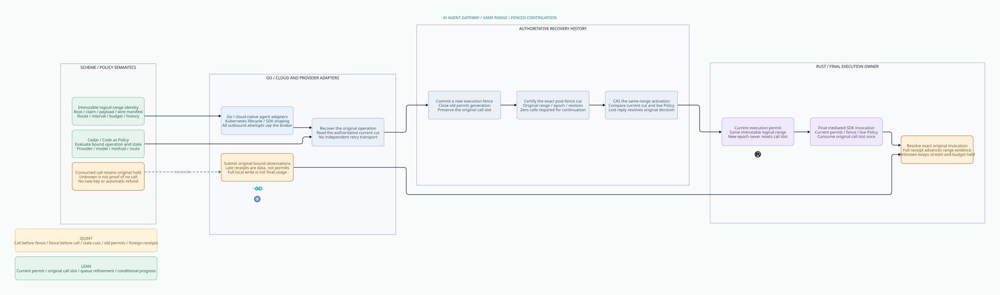

#+title: Logical Range Recovery Index
#+language: en
#+options: toc:2

#+begin_quote
Historical Python verification entrypoints are retired. Commands and receipts
referenced below describe earlier experiments. Current native verification uses
the Go-owned plan; see [[file:../../50-59-research-program/59-provider-rpc/59.21-verification-ownership.org][verification ownership and coverage]].
#+end_quote

* Johnny Decimal category

Area =30-39 Assurance=; category =38 Logical range recovery=. This extends
[[file:../37-broker-consumption-queue/37.00-index.org][37 Broker consumption queue]] by separating immutable logical range identity
from mutable execution permits. The scope is an AI Agent Gateway software
execution owner. Hardware isolation is not required.

| ID | Artifact |
|----+----------|
| 38.00 | This index |
| 38.01 | [[file:38.01-same-range-continuation.org][Same-range continuation and evidence contract]] |
| 38.02 | [[file:38.02-logical-range-recovery.d2][Core D2]] /  |
| 38.03 | [[file:38.03-validation-evidence.org][Validation evidence and limits]] |

[[file:../../../dev/proofs/lean/LogicalRangeRecovery.lean][Lean]] provides recovery invariants, an initialized data-path projection to
the preceding queue model, original-obligation composition and a constructive
conditional progress path. [[file:../../../dev/proofs/quint/LogicalRangeRecovery.qnt][Quint]] drives actual parent queue invocation and
receipt transitions under the added logical recovery controls. The design table
links these declarations to the Org rules and core D2 nodes.

#+begin_src sh :eval never
python3 dev/proofs/check_logical_range_recovery.py
python3 dev/proofs/evidence/logical-range-recovery/check-four-artifacts.py
python3 dev/proofs/evidence/logical-range-recovery/check-counterexample-observations.py
#+end_src

No Gateway implementation or dependency pin is changed. Earlier sealed categories
remain historical evidence; the design delta is maintained here.

* Embedded architecture views

** 38.02-logical-range-recovery.svg

